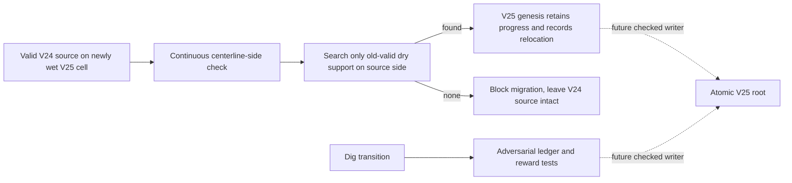
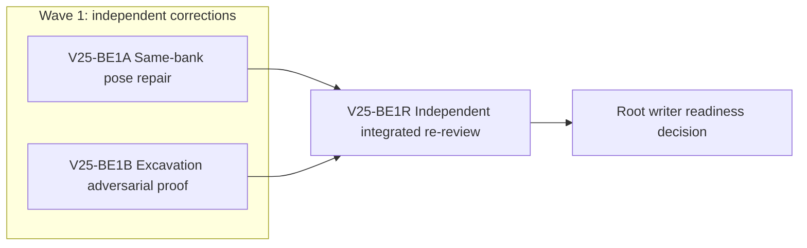

# Ticket Pack: V25 Same-Bank Migration and Excavation Proof Repair

## Summary

The independent review of `STARTER_VALLEY_V25_SAVE_AND_EXCAVATION_PACK.md` returned NO-GO. A valid old streamed pose north of the new river centerline can relocate to the south bank because the nearest dry candidate may be across the channel. The compact excavation tests also omit several required adversarial assertions. This correction keeps the production interfaces and V24 behavior unchanged, fixes the actual bank gate, and fills the proof gaps before any V25 writer depends on these contracts.

Goal: aligned with the active full-game goal. System translation: not_qualified. Product agent runtime: not_required. No commit, PR, push, browser renderer, or server restart.

Locked design:

- For newly wet old poses without an actual built bridge deck, derive the source bank from continuous `from.z` compared with `publicV25RiverCenterZ(seed,gx) * WORLD_CELL_METERS`. Exactly on the centerline belongs to the north/lower-z bank. A relocation candidate must be a dry old-valid support on that same side. If none exists, return `null`; do not send the player across the new barrier.
- The existing nearest-distance ordering and north tie-break remain within the chosen bank. A built bridge remains untouched. V14 through V24 sources, save roots, and UI stay unchanged.
- Excavation production code stays fixed unless tests expose an actual bug; this lane initially owns tests only. Do not shrink tests to an arbitrary count.

Important repo truth: review probe at `seed='wizard-realms', x=36, gx=9, from.z=11` found centerline z=12, valid dry old supports at north z=4 and south z=16, and current migration chose z=16. Both bank tiles were discovered and valid, so this is not a missing-discovery artifact. The first pack's four files total 300 lines; that cap was met but is now superseded by this reasoned safety correction.

## Proposed Flow

## Public Interfaces

No exported signature changes. `relocatePublicV25RiverSource` keeps its return type but narrows candidate selection to the source bank as defined above. `createPublicV25Migration` continues to throw `RangeError` when relocation has no candidate. Excavation test fixtures use the existing `publicV25StratumAt` to identify deeper ore locations; tests may not hard-code fabricated loot.

## Lane Graph

## Topology Audit

- Productive lanes: BE1A owns migration pose behavior and its tests; BE1B owns excavation test coverage. Both are narrow, distinct, and usable by the future V25 writer.
- Maximum parallel width: two. `BE1A || BE1B` because neither consumes or edits the other's files or decisions.
- Fan-in: BE1R consumes both final artifacts and the previous review's exact findings. Root decision consumes BE1R receipt.
- Evidence classification: BE1A's actual behavior and proof and BE1B's decision-bearing adversarial test artifact are productive. BE1R and root decision are not counted for parallel width.
- Certainty/novelty: BE1A closes the concrete opposite-bank probe and the no-same-side failure case. BE1B closes whether exact ledger shape, deeper deterministic rewards, hostile requests, and failed-action nonmutation are asserted. Stop at exact passing focused tests. Any existing pose validator rejecting the fixture or any new production failure outside the owned files is a surprise trigger and returns to planner.
- Conditional activation: none. No PR finisher since the user did not ask for a PR. A new finding maps to a new scoped pack, not an invented repair.

| Serial edge | Exact consumed artifact | Why concurrent execution is impossible |
|---|---|---|
| BE1A -> BE1R | Final same-bank module/test | Reviewing before the fix would be stale. |
| BE1B -> BE1R | Final excavation test | Reviewing before proof completion would be stale. |
| BE1R -> root | Findings and command receipt | Writer may depend only on accepted contracts. |

Dispatch verdict: PASS. Two incomparable productive lanes converge at review, with disjoint ownership and no artificial serial step.

## Smallest Viable Diff

Behavior delta: same-bank relocation under the canonical V25 river, plus missing tests for the V25-only dig ledger. Expected additional budget: three files, roughly 80 to 120 net lines, no new file or dependency. This knowingly makes the cumulative V25 substrate exceed the earlier 300-line heuristic; the review exposed a concrete save-integrity defect and missing proof, so this is a scoped replan, not silent scope creep. Expected changed files: `publicWorldV25MigrationPose.ts`, `.test.ts`, and `publicWorldV25Excavation.test.ts`. Forbidden: older save/world profiles, UI, V25 production excavation, package files, GitHub. Reuse `publicV25RiverCenterZ`, `WORLD_CELL_METERS`, `publicV25StratumAt`, existing migration fixtures, and existing test harness. Config/docs alone cannot enforce bank selection or behavioral proof. Simplification target: one filter in the existing candidate loop, no second migration function. Acceptance: both focused migration suites, excavation suite, TypeScript, untracked-file whitespace scan. Tripwire: any production file beyond migration pose, any old-profile edit, dependency, new shared abstraction, or >120 added lines triggers planner re-evaluation.

## Tickets

### Paste now to: Implementer A

Ticket: V25-BE1A. Lane type: Parallel. Delivery phase: pr_hardening. Delivery milestone: pre_surface. Shortest complete user flow: valid old-world north/south source positions do not gain a free crossing at V25 migration; a source with no same-side dry support remains in V24. First-feedback evidence: exact x=36,z=11 counterexample plus opposite side, no-candidate, tie, and built-deck tests. Test-writing policy: pr_hardening_required. Review blocking: any opposite-bank mapping, source mutation, or older-profile change. Surface entrypoint/revision: V24 preview remains available, V25 pending. Optional-feedback wait: never.

Branch/worktree: `ben/wizard-playable-v2`, `/private/tmp/pa-wizard-playable-v2`; no commit. Role: implementer ONLY. Dispatch: native_spawned_subagent, inherited model, Cursor runtime not_applicable; existing-task routing not_authorized, all task qualification fields not_applicable, no interruption, no task/thread receipt; final fallback none. Runtime rationale: same native child that implemented the prior migration pose has current capability/context and a bounded two-file fix; no browser needed. Agent spec: Wizard Realms migration repair implementer. Session: continue the same native child, no nested workers. Worker agent: Codex implementer. Required skills: auto-planner-ticket-pack and smallest-viable-diff.

Change only `engine/src/domain/publicWorldV25MigrationPose.ts` and `.test.ts`. Insert a same-side filter before old-support validation in the existing candidate loop. Use `from.z <= centerlineZ` for north, and compare candidate `point.z < centerlineZ` for north or `> centerlineZ` for south. Existing dry predicate excludes centerline candidates. Preserve prior distance ordering and built-deck early return. Test old x=36,z=11 -> north dry z=4 when both banks valid, south source -> south dry, center tie -> north, no same-side discovered support -> null, and real built deck -> unchanged. Reuse existing fixture helpers; keep tests concise but specific.

Acceptance: from engine, `npx vitest run src/domain/publicWorldV25MigrationPose.test.ts src/domain/publicWorldV25Migration.test.ts --maxWorkers=1`, `npx tsc -b --pretty false`, plus `rg -n '[[:blank:]]+$'` on owned files with no matches. Visual proof not applicable. Budget: <=60 added lines, 0 new files/dependencies. Return exact receipt fields from parent pack, observed error/change/restart/retry result, and same native child ID.

### Paste now to: Implementer B

Ticket: V25-BE1B. Lane type: Parallel. Delivery phase: pr_hardening. Delivery milestone: pre_surface. Shortest complete user flow: no hostile or malformed dig request, failed gate, or invented loot changes the ledger. First-feedback evidence: focused adversarial assertions. Test-writing policy: pr_hardening_required. Review blocking: missing test assertions or any exposed production bug left unreported. Surface entrypoint/revision: V24 preview remains available, V25 pending. Optional-feedback wait: never.

Same branch/worktree/no-commit. Role: implementer ONLY. Dispatch: native_spawned_subagent, inherited model, Cursor runtime not_applicable; existing-task routing not_authorized, task evidence and receipt not_applicable, no interruption; final fallback none. Runtime rationale: the same native child has the exact ledger context and only one test file owner. Agent spec: Wizard Realms excavation proof implementer. Session: continue same child, no nested workers. Worker agent: Codex implementer. Required skills: auto-planner-ticket-pack and smallest-viable-diff.

Change only `engine/src/domain/publicWorldV25Excavation.test.ts`. Add explicit assertions for failure-path nonmutation; missing and extra bag fields; combined bag overflow; hostile request proxy; deterministic deeper gold/diamond material using bounded search over actual `publicV25StratumAt` output and a depth fixture; and exact rejection reasons for wet, reach, reveal. If a production bug is exposed, stop and report, do not edit production code under this lane. Do not remove existing assertions to meet line count.

Acceptance: from engine, `npx vitest run src/domain/publicWorldV25Excavation.test.ts --maxWorkers=1`, `npx tsc -b --pretty false`, plus `rg -n '[[:blank:]]+$'` on owned test file with no matches. Visual proof not applicable. Budget: <=60 added lines, no production edit/new file/dependency. Return full receipt including exact test output and same child ID.

### Wait for BE1A and BE1B, then paste to: Reviewer

Ticket: V25-BE1R. Lane type: Dependent. Delivery phase: pr_hardening. Delivery milestone: pre_surface. Role: reviewer ONLY, read-only. Dispatch: native_spawned_subagent, inherited model, Cursor runtime not_applicable; existing-task routing not_authorized, all task qualification fields not_applicable, no interruption, no fallback. Runtime rationale: independent read-only adversarial proof on the repaired revision. Agent spec: Wizard Realms save and excavation reviewer. Session: continue reviewer child where available, no nested workers. Required skills: auto-planner-ticket-pack and smallest-viable-diff.

Findings first. Re-run the x=36,z=11 counterexample and a no-same-side-support source, inspect migration's positional bank rule and built-deck preservation. Inspect exact deeper material test, hostile request test, failure nonmutation, bag shape and overflow, unchanged production excavation, scope, diff budget, and pack topology. Run three focused test files and TypeScript. Return GO/NO-GO, severity-ordered line findings, explicit required-point passes/fails, topology PASS/NO-GO, smallest diff/reuse/deletion PASS/NO-GO, tripwires, exact outputs, and V24 surface/no renderer disposition.

## Assumptions

- The continuous centerline is the least arbitrary bank boundary for a pose that predates the V25 river; a pose exactly on it uses the north/lower-z side as the already-established tie convention.
- A blocked migration does not delete or modify a V24 save. The future UI must explain that blocked state and offer the old world, not silently reset.
