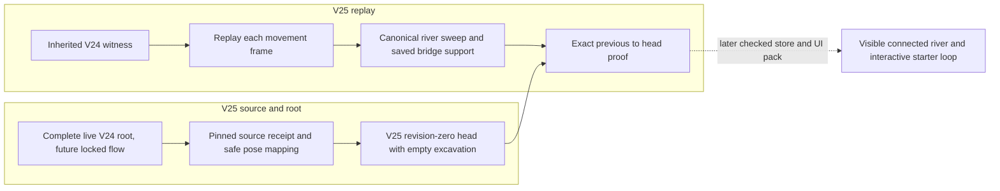
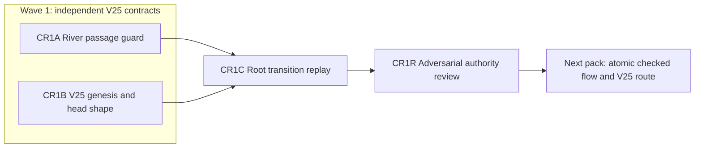

# Ticket Pack: V25 Checked River Authority

## Summary

The starter valley needs a continuous river that cannot be crossed by walking through cells that were dry in V24. This pack joins the accepted V25 river and source-migration primitives to a strict V25 root replay contract. It does not expose a V25 UI or claim that click-to-dig, fill, rescue, or boat travel is complete. It advances the active full-game goal and the aligned problem in `STARTER_VALLEY_WORLD_LOOP_UNDERSTANDING.md`.

Locked design:

- Never reinterpret or write V17, V23, or V24 roots. V25 remains a distinct schema and source-pinned database.
- Crossing a canonical wet cell requires an existing saved elevated bridge support. Dry visible ground is not blocked by the new river gate.
- The river predicate and segment supercover are the accepted `publicWorldV25River*` functions. No second wetness formula.
- The V25 root has exactly lineage, head, and previous. The root decoder must replay the last transition, not merely check shapes. Do not expose a write path until complete live V24 ancestry is checked under the shared lock in a later pack.
- Preserve the sole existing V24 preview and one-renderer RAM limit. No commit, PR, push, server restart, or GitHub identity action.

Important repo truth:

- `publicWorldV25Migration.ts` already pins the V24 source receipt and maps newly wet poses to the same bank. `publicWorldV25RiverSweep.ts` identifies any wet-cell contact, including a diagonal corner.
- V24 frame witnesses are replayed by `replayPublicV24Witness`. The V24 writer does not know the new river, so V25 must gate every accepted frame segment, not only the batch endpoints.
- `publicWorldV24Snapshot.ts` is the three-slot prior version. `publicV17StarterSupportAt` recognizes saved Greenway bridge decks; `resolvePublicV23Surface` recognizes elevated streamed works and authored bridge routes.
- The current public UI remains `http://127.0.0.1:5193/?publicWorld=v24`. Browser control was environment-blocked by `unsupported Codex auth method: apikey` on two attempts. No V25 UI proof is claimed here.

Goal status: aligned. System translation: not_qualified, this is new game behavior rather than a whole-system port. System translation receipt: not_applicable. Product agent runtime: not_required, the product adds no agent runtime.

## Proposed Flow

Example: a migrated player walks on a dry bank and is stopped by water until an eight-log bridge exists. A saved bridge allows only movement on its physical deck. The dashed UI path is out of scope.

## Public Interfaces

- `publicWorldV25Passage.ts` exports `publicV25RiverPassage(progress: PublicV24Progress, from: Vec3, to: Vec3): {ok:true}|{ok:false;reason:'river-needs-bridge'|'invalid-segment'}`. It is pure and never accepts browser-supplied bridge IDs. It checks the canonical supercover, then samples a contacted segment at intervals no larger than 0.125 m. Every wet sample must resolve to saved elevated bridge support; a supercover contact with no sampled wet interior fails closed. Ordinary dry segments pass. Invalid/nonfinite/out-of-world or overlong segments fail, not throw.
- `publicWorldV25Snapshot.ts` exports `PublicV25Head` with exact fields `schemaVersion`, `saveRevision`, `state`, `greenwayWorks`, `regionalWorks`, `excavation`, `witness`; `PublicV25Root` with exact fields `lineage`, `head`, `previous`; `createPublicV25Root(rawV24Receipt)`, `decodePublicV25Head(value,lineage)`, and `decodePublicV25Root(value)`. Revision zero is `createPublicV25Migration` plus `emptyPublicV25ExcavationLedger`, no witness or previous. Later revisions initially accept inherited V24 witnesses only and keep excavation unchanged. Dig witnesses are reserved for a later checked pack before public V25 release.
- `decodePublicV25Root` proves exactly one most recent V24-witness transition: `after.saveRevision === before.saveRevision + 1`, strict witness decode, legacy replay equality, every frame movement segment passes `publicV25RiverPassage`, and immutable excavation ledger. It preserves inherited V13 history, V17 works, and regional ladders from genesis. A later checked store must additionally compare the complete live V24 source chain under `PUBLIC_V7_LOCK_NAME`.

## Lane Graph

## Topology Audit

- Productive lanes: CR1A owns one pure passage helper and focused safety tests. CR1B owns V25 genesis/head schema and focused migration safety tests. They have disjoint files and consume only accepted contracts.
- Maximum parallel width: two. `CR1A || CR1B` is incomparable; neither consumes the other's output. CR1C is a narrow same-file continuation after B, consuming both public interfaces to produce complete root replay.
- Fan-in: CR1C combines A and B; CR1R tests the adversarial interaction. Reviewer is not counted as productive width.
- Broad-lane split: A is movement, B is shape/genesis, C is last-transition replay. The later atomic flow, UI, dig, fill, and rescue are separate behavior contracts.
- Certainty: A closes wet-corner and bridge-bypass risk by discriminating tests. B closes strict genesis and malformed-root shape risk. C closes frame-by-frame crossing and one-transition replay risk. Stop when the specified checks pass; a replay divergence or a supported bridge blocked by the gate is a surprise requiring local replan.
- Serial edges: A to C supplies the passage API; B to C supplies the exact head/root types; C to R supplies final integrated replay. Concurrent C would read partial contracts. R to N supplies a GO/NO-GO, not implementation authority.
- No conditional repair or finisher: a finding returns to planner, and no PR is requested. No-repair path is all three implementation receipts plus reviewer GO.
- Dispatch verdict: PASS, two independent productive lanes converge through a concrete replay integration.

## Smallest Viable Diff

Behavior delta: strict new-river crossing proof and V25 root replay without touching old saves. Budget: at most four new files, 300 net lines for the initial two lanes; CR1C may extend only the B module and its test after fan-in, with a total pack tripwire of 400 net lines requiring replan before crossing. Zero dependencies. Expected files: `engine/src/domain/publicWorldV25Passage.ts`, `.test.ts`, `publicWorldV25Snapshot.ts`, `.test.ts`. Forbidden: old save modules, UI/view, package/lockfiles, runtime framework, GitHub. Reuse the V24 witness decoder/replay, V25 river/sweep/migration/excavation validators, old support resolvers, and `samePublicV14Value`. A config or document cannot enforce movement/save authority. No old code is obsolete because old roots must remain readable; avoid duplicating decoders. Validation is focused Vitest plus TypeScript and whitespace scan. Any extra file, shared abstraction, old-profile edit, dependency, or budget overrun stops for replanning.

## Tickets

### Paste now to: Implementer A

Ticket: CR1A. Lane type: Parallel. Delivery phase: implementation. Delivery milestone: pre_surface. Shortest complete user flow: later, walk toward the continuous river and stop unless on saved bridge deck. First-feedback evidence: pure crossing check on dry, wet, and bridge segments. Test-writing policy: migration/movement-authority safety exception before surface. Review blocking: dry-land false block, wet bypass, forged support, throwing on bad segment. Surface readiness: not applicable until checked V25 UI pack. Surface revision/entrypoint: V25 pending; V24 preview retained. Availability: do not open or restart a renderer. Post-surface validation: future UI journey. Optional-feedback wait: never.

Depends on: none. Branch: `ben/wizard-playable-v2`; worktree: `/private/tmp/pa-wizard-playable-v2`; base: current local HEAD `6bb8d39`. Role: implementer ONLY. Dispatch: native_spawned_subagent, model inherited, Cursor runtime not_applicable. Existing-task routing: not_authorized for durable tasks; capability/mission/scope/custody/status/delivery proof not_applicable. No-interruption: not_applicable. Task/thread receipt: not_applicable. Final fallback: none; all fallback fields not_applicable. Runtime rationale: isolated, deterministic code on the existing checkout with no extra renderer. Agent spec: Wizard Realms river authority implementer. First contact: native spawn with role bootstrap and this ticket; follow-up: same native child. No nested workers. Worker agent: Codex implementer.

Required skills: auto-planner-ticket-pack and smallest-viable-diff, both read completely. Applicable AGENTS instructions and this pack are mandatory. Only add `publicWorldV25Passage.ts` and `.test.ts`. Reuse `publicV25RiverTouchesSegment`, canonical cell predicate, existing Greenway/streamed elevated support. Evaluate movement segment no longer than `PUBLIC_RUN_STEP_METERS` plus epsilon, fail closed on malformed/out-of-world. Permit dry and saved-deck movement; refuse newly wet dry-looking V24 ground and corner-graze bypass. Do not change movement in legacy profiles. Exact command: `cd games/wizard-realms/engine && npx vitest run src/domain/publicWorldV25Passage.test.ts --maxWorkers=1 && npx tsc -b --pretty false`; then whitespace scan. Visual proof not applicable, pure domain code. Smallest diff: two new files, <=150 net lines; no dependency/helper duplication; tripwire if extra owner needed. Return full skill receipt, native child ID, current files, line counts, test output, no-commit/no-browser evidence, and candidate merge unit.

### Paste now to: Implementer B

Ticket: CR1B. Lane type: Parallel. Delivery phase: implementation. Delivery milestone: pre_surface. Shortest complete user flow: later, open V25 from an intact V24 save without rewriting it. First-feedback evidence: strict revision-zero and head-shape tests. Test-writing policy: save/migration safety exception. Review blocking: shape-only forged root accepted, corrupted genesis, source mutation. Surface readiness: pending checked UI. Surface revision/entrypoint: V25 pending, V24 preview retained. Availability: no browser or server restart. Post-surface validation: future migration UI. Optional-feedback wait: never.

Depends on: none. Same branch/worktree/base as A; do not commit. Role: implementer ONLY. Dispatch: native_spawned_subagent, model inherited, Cursor runtime not_applicable. Existing-task routing: not_authorized; all candidate evidence fields not_applicable. No-interruption: not_applicable. Task/thread receipt: not_applicable. Final fallback: none, all fallback fields not_applicable. Runtime rationale: separate new save module can be built concurrently without touching A's files. Agent spec: Wizard Realms V25 root-shape implementer. First contact: native spawn with role bootstrap and this ticket; follow-up: same child. No nested workers. Worker agent: Codex implementer.

Required skills as A. Only add `publicWorldV25Snapshot.ts` and `.test.ts`. Implement the stated V25 head/root types, `createPublicV25Root` and `decodePublicV25Head` with exact keys, V24 source pin, migrated pose, empty excavation, revision-zero equality, and strict later-head inherited witness shape. Do not export a root decoder yet; C owns replay. Do not accept dig witness or write any store/UI. Tests must reject malformed, extra-key, wrong-version, negative-revision, wrong-seed, altered genesis, and hostile input, and prove source immutability. Exact command: `cd games/wizard-realms/engine && npx vitest run src/domain/publicWorldV25Snapshot.test.ts --maxWorkers=1 && npx tsc -b --pretty false`; then whitespace scan. Visual proof not applicable. Smallest diff: two new files, <=150 net lines, no new parser if existing exact-key and decoders suffice. Return full skill receipt as A.

### Wait for CR1A and CR1B, then paste to: Implementer C

Ticket: CR1C. Lane type: Dependent. Delivery phase: implementation. Delivery milestone: pre_surface. Shortest complete user flow: later, a saved walk cannot bypass the V25 river, while saved bridge crossing and prior actions replay. First-feedback evidence: strict V25 last-transition tests. Test-writing policy: save/migration safety exception. Review blocking: movement bypass in multi-frame batch, witness forgery, state/history rollback. Surface readiness/entrypoint: V25 pending, V24 preview retained; no renderer. Optional-feedback wait: never.

Depends on: CR1A passage API and CR1B head/root type receipt. Same branch/worktree/base, no commit. Role: implementer ONLY. Dispatch: native_spawned_subagent, model inherited, Cursor runtime not_applicable. Existing-task routing: not_authorized; candidate evidence fields not_applicable. No-interruption: not_applicable. Task/thread receipt: not_applicable. Final fallback: none, fallback fields not_applicable. Runtime rationale: one isolated replay owner after its two inputs are stable. Agent spec: Wizard Realms save replay implementer. First contact native spawn with full bootstrap; follow-up same child. No nested workers. Worker agent: Codex implementer.

Required skills as A. Update only `publicWorldV25Snapshot.ts` and `.test.ts`. Add `decodePublicV25Root` with exact three slots and one-transition replay. For inherited frame batches, replay each frame in order using the old V24 witness path and call CR1A on each before/after pose; check the combined result equals the submitted head. For non-frame inherited actions, replay as V24. In all cases, excavation must remain equal to the prior ledger, and genesis-to-head inherited history/works must be preserved. No dig witness or writer/UI in this lane. Test single and multi-frame wet bypass, a built bridge, dry walk, forged previous, action replay, revision skipping, and source mutation. Exact command: `cd games/wizard-realms/engine && npx vitest run src/domain/publicWorldV25Passage.test.ts src/domain/publicWorldV25Snapshot.test.ts --maxWorkers=1 && npx tsc -b --pretty false`; then whitespace scan. Visual proof not applicable. Smallest diff: only two existing pack files, <=100 new net lines; stop on parser duplication or larger scope. Return full skill receipt.

### Wait for CR1C, then paste to: Reviewer

Ticket: CR1R. Lane type: Dependent. Delivery phase: pr_hardening. Delivery milestone: pre_surface. Role: reviewer ONLY, read-only. Dispatch: native_spawned_subagent, model inherited, Cursor runtime not_applicable. Existing-task routing: not_authorized, all candidate fields not_applicable. No-interruption/task receipt: not_applicable. Final fallback: none. Runtime rationale: independent adversarial save and river-authority check. Agent spec: Wizard Realms authority reviewer. First contact native spawn with full bootstrap; follow-up same child. No nested workers. Skills: auto-planner-ticket-pack and smallest-viable-diff.

Review only this pack's four files and accepted upstream contracts. Findings first, GO/NO-GO. Test bypass attempts at newly wet cells, multi-frame turns, exact-corner contact, old built deck, invalid prior root, changed source receipt, no legacy edits, and minimal diff. Run the combined focused tests and TypeScript. Return severity-ordered findings with file/line, explicit pass/fail on each point, topology audit, smallest-diff/reuse/deletion/tripwire verdicts, residual risk, revision proof, and no-renderer disposition. No PR finisher because no PR was requested.

## Assumptions

- The accepted V25 river shape is west-to-east through map-edge water. Boats, dynamic bridge placement across every point, fill, dig witness, rescue cooldown, and UI are subsequent milestones, not covertly added here.
- This root decoder is a pure candidate validator. It is not a full checked source inspection or permission to write a V25 database until a later atomic flow validates complete live V24 and its ancestry under the shared lock.
- The first route may remain the existing eight-log Greenway bridge. Subsequent route variety can use later versioned actions without making V24 saves unreadable.
