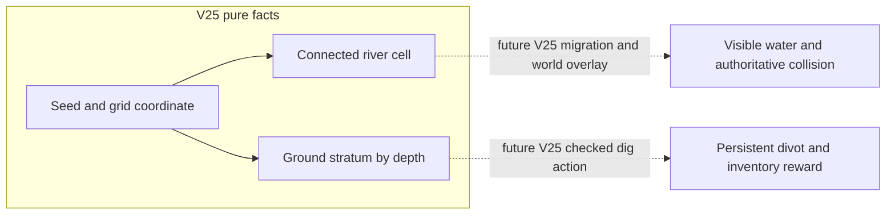
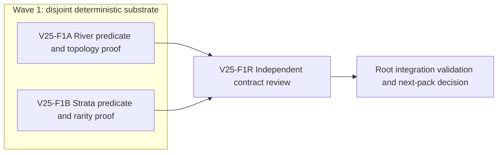

# Ticket Pack: V25 Connected River and Ground Strata Foundation

## Summary

The active full-game goal requires geography and excavation that remain stable
under saved replay. This pack implements two independent, deterministic domain
facts for a future V25 world: one connected river across the complete 2.048 km
grid, and one bounded layer/material profile for clicked-ground digging. It
does not wire either into V24 or claim the new valley is playable. The aligned
problem and staged outcome are recorded in
`STARTER_VALLEY_WORLD_LOOP_UNDERSTANDING.md`.

Goal status: aligned. System translation: `not_qualified`, because this is a
feature within the current engine. Product agent runtime: `not_required`.

Locked design:

- V14, V17, V23, and V24 terrain and replay behavior remain byte-for-byte
  unchanged. V25 integration and migration come in a dependent pack.
- Grid cells are 4 m, `gx` and `gz` are integers in [-256, 255]. The starter
  river must include exactly the existing five center cells (`gx` -2..2,
  `gz` 2), and extend in one cardinally connected component from the west
  world edge to the east world edge.
- No resource randomness may consume the legacy simulation RNG. Material at a
  location and depth is stable across reload and independent of dig order.
- New minerals are not inserted into the legacy ItemId or inventory validator
  in this pack. V25 must later own capacity-counted rewards.
- No commit, PR, push, browser renderer, or server restart is authorized here.

Important repo truth: `worldChunks.ts` owns grid limits and `hashSeed` in
`generation.ts` is deterministic. The existing creek is five cells only.
V24 is a checked three-slot source-pinned replay root. Adding river or digging
to old profiles would invalidate historical poses and witness proofs.

## Proposed Flow

For example, a player will eventually see water continue to both map edges,
build a bridge, and use an equipped spade on a revealed bank cell. This pack
proves the pure river and material facts only. Dashed paths are explicitly out
of scope until a source-pinned V25 root exists.

## Public Interfaces

`engine/src/domain/publicWorldV25River.ts` exports:

- `PUBLIC_V25_RIVER_PROFILE = 'connected-river/v1'`.
- `publicV25RiverCenterZ(seed: string, gx: number): number`, one canonical
  center row for each world column.
- `publicV25RiverCellAtGrid(seed: string, gx: number, gz: number): boolean`,
  with connector cells in a column whenever its center row differs from the
  previous column. This is the only future wet-cell predicate.

Both functions require nonempty seed length <=128 and safe integer in-range
grid coordinates; bad input throws `RangeError`. Center rows stay in the world
grid. The centerline is seed-dependent and gently meanders; adjacent center
rows differ by at most one. `gx` -2..2 has center row 2 and exactly the five
legacy central cells are wet there. No separate visual-only river geometry.

`engine/src/domain/publicWorldV25Strata.ts` exports:

- `PUBLIC_V25_BEDROCK_LAYER = 12`.
- `publicV25StratumAt(seed: string, gx: number, gz: number, layer: number)`
  returning `{ material, toolTier, minimumExcavationLevel }`.
- `material` is `soil | stone | iron_ore | gold_ore | diamond | bedrock`.
  `toolTier` is `spade | pick | enchanted_pick | none`.

Layer is a safe integer 0..12. Layer 12 is bedrock, tool `none`. Layers 0..1
reflect the base world terrain: loam/wetland yield soil with spade/level 1;
rocky/snow yield stone with pick/level 2. Layers 2..4 are stone except iron
can occur at layers 3..4. Layers 5..7 add rare gold, and layers 8..11 add
rarer diamond. Use a stable 32-bit hash of seed, coordinate, and layer, with
ordered thresholds on a 4096-point roll: diamond below 8 only at layer >=8,
gold below 64 only at layer >=5, iron below 512 only at layer >=3, else stone.
Stone uses pick/level 2, iron pick/level 5, gold pick/level 12, diamond
enchanted_pick/level 25. The present spade therefore opens soil, while later
tools and skill expose deeper ore. These are geology facts, not reward grants.

## Lane Graph

## Topology Audit

- Productive lanes: F1A changes only river module/tests; F1B changes only
  strata module/tests. Both produce distinct, reusable V25 facts.
- Maximum parallel width: two. F1A and F1B are incomparable because neither
  consumes the other's code or decisions. They converge at F1R.
- Serial edge A/B to R consumes both completed surfaces; reviewing before
  their final state would produce stale findings. R to root consumes the
  findings receipt and test status.
- Reviewer concern: independently challenge cardinal connectivity, exact
  central compatibility, deterministic geology, and rare-resource gates.
  It is not generic rereading.
- No PR finisher: the user did not request a PR or packaging in this turn.
- No conditional repair tickets are preauthorized. A concrete review finding
  requiring edits returns to planner mode for a bounded correction.
- Dispatch verdict: PASS. The graph has two productive incomparable lanes,
  disjoint file custody, and one evidence-bearing convergence gate.

## Tickets

### Paste now to: Implementer A

Ticket: V25-F1A. Lane type: Parallel. Delivery phase: implementation.
Delivery milestone: pre_surface. Shortest complete user flow: not yet exposed;
future V25 walking sees one continuous river. First-feedback evidence: pure
topology tests, not UI proof. Test-writing policy: safety exception for
save-stable geography before surface. Review blocking: broken connectivity or
old-profile edits. Surface revision/entrypoint: current V24 preview remains
available; V25 surface pending. Optional feedback wait: never.

Role: `implementer` ONLY. Transport: `native_spawned_subagent`, model:
`inherited`, Cursor runtime: `not_applicable`. Existing-task routing:
`not_authorized`; user did not authorize messaging a durable peer task for this
pack. No-interruption disposition: `not_applicable`. Final fallback: `none`.
Runtime rationale: host-native child can edit two domain files in the current
checkout without another browser or ownership collision. Agent spec: Wizard
Realms domain implementer. Session policy: initialize once, follow up in the
same native child. Branch/worktree: `ben/wizard-playable-v2`,
`/private/tmp/pa-wizard-playable-v2`.

Required skills: `auto-planner-ticket-pack`, `smallest-viable-diff`.
Read this pack and applicable AGENTS instructions completely. Add only
`publicWorldV25River.ts` and `publicWorldV25River.test.ts`. Reuse `hashSeed`,
`WORLD_GRID_MIN/MAX`, and `WORLD_CELL_METERS`. Use a bounded smooth seed-phase
formula anchored at `gx=0`, with adjacent center difference <=1 and center 2
for `gx=-2..2`; bridge any one-row bend with an extra cell in the arriving
column. Do not alter old river, movement, save, render, or UI files. Tests must
prove every wet cell is one cardinal component for several seeds, both edge
terminals exist, the central five cells are exact, adjacent centers are <=1,
determinism, seed variety, and invalid-input rejection.

Smallest Viable Diff: behavior delta is one pure canonical river predicate.
Budget: two new files, <=180 net lines, zero dependencies, zero old-file edits.
No prompt/config option can create a save-stable canonical topology. Keep
one generator, no duplicate visual approximation. Tripwire: more files or
>180 net lines requires return to planner before further edits.

Acceptance: from `games/wizard-realms/engine`, run
`npx vitest run src/domain/publicWorldV25River.test.ts --maxWorkers=1`,
`npx tsc -b --pretty false`, and whitespace check. Return exact paths, counts,
proof result, reuse/deletion rationale, tripwires, and native child ID. Visual
proof: not applicable, pure domain facts are not rendered in this pack.

### Paste now to: Implementer B

Ticket: V25-F1B. Lane type: Parallel. Delivery phase: implementation.
Delivery milestone: pre_surface. Shortest complete user flow: not yet exposed;
future clicked dig samples one stable layer. First-feedback evidence: pure
strata tests, not UI proof. Test-writing policy: safety exception for
save-stable reward facts. Review blocking: non-determinism, resource leakage
into shallow soil, old inventory edits. Surface revision/entrypoint: current
V24 preview remains available; V25 surface pending. Optional feedback wait:
never.

Role: `implementer` ONLY. Transport: `native_spawned_subagent`, model:
`inherited`, Cursor runtime: `not_applicable`. Existing-task routing:
`not_authorized`, no durable peer contact. No-interruption disposition:
`not_applicable`. Final fallback: `none`. Runtime rationale: disjoint pure
domain work, no renderer and no shared file owner. Agent spec: Wizard Realms
geology implementer. Session policy: initialize once, same native child for
follow-ups. Branch/worktree: `ben/wizard-playable-v2`,
`/private/tmp/pa-wizard-playable-v2`.

Required skills: `auto-planner-ticket-pack`, `smallest-viable-diff`.
Read this pack and applicable AGENTS instructions completely. Add only
`publicWorldV25Strata.ts` and `publicWorldV25Strata.test.ts`. Reuse
`hashSeed`, `worldTileAtGrid`, `WORLD_GRID_MIN/MAX`, and `TerrainId`. Implement
the exact layer/material/tool/skill contract above. Do not add items to old
ItemId, inventory, store, or writer. Tests prove determinism across call order,
different seeds, shallow-material rules by terrain, exact gate mapping,
bedrock, invalid input, and that gold/diamond exist in a bounded grid sample
but never shallow. The expected geology may be revised only in a future
versioned profile, not silently after saves depend on it.

Smallest Viable Diff: behavior delta is one pure stratigraphy predicate.
Budget: two new files, <=180 net lines, zero dependencies, zero old-file edits.
No config-only alternative provides coordinate/depth determinism. Avoid
duplicating world tile classification. Tripwire: more files or >180 net lines
requires return to planner.

Acceptance: from `games/wizard-realms/engine`, run
`npx vitest run src/domain/publicWorldV25Strata.test.ts --maxWorkers=1`,
`npx tsc -b --pretty false`, and whitespace check. Return exact paths, counts,
proof result, reuse/deletion rationale, tripwires, and native child ID. Visual
proof: not applicable, pure domain facts are not rendered in this pack.

### Wait for F1A and F1B, then paste to: Reviewer

Ticket: V25-F1R. Lane type: Dependent. Delivery phase: pr_hardening.
Delivery milestone: pre_surface. Role: `reviewer` ONLY, read-only. Transport:
`native_spawned_subagent`, model: `inherited`, Cursor runtime:
`not_applicable`. Existing-task routing: `not_authorized`. Final fallback:
`none`. Branch/worktree as above. Required skills: `auto-planner-ticket-pack`,
`smallest-viable-diff`. No browser or GitHub. Findings first. Challenge the
actual river graph for all 512 columns and several seeds, including connector
cells; prove exact five-cell central compatibility and no hidden disjoint wet
islands. Challenge strata thresholds, tool gates, no shallow precious ore,
seed/order stability, and invalid inputs. Review scope/no old-file edits and
diff budget. Return GO/NO-GO, source references, exact test coverage limits,
and residual risks. Visual proof: not applicable at this pure stage.

## Assumptions

- The river runs west to east, a user-authorized example of a continuous
  region-spanning barrier. Widening into lakes or tributaries is a later V25
  world-design decision; this pack must not add disconnected water islands.
- `layer` is a 4 m column's half-meter excavation increment for future V25
  actions. Depth, tool, and reward integration are not implemented here.
- The known browser-control bridge failure is an environment blocker, not
  permission to spawn another WebGL renderer. The existing V24 preview stays
  up for the user while this pure foundation is built.
