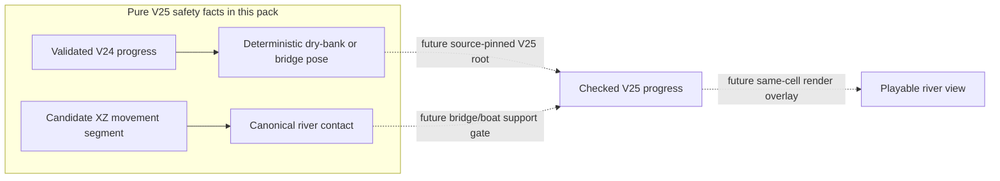
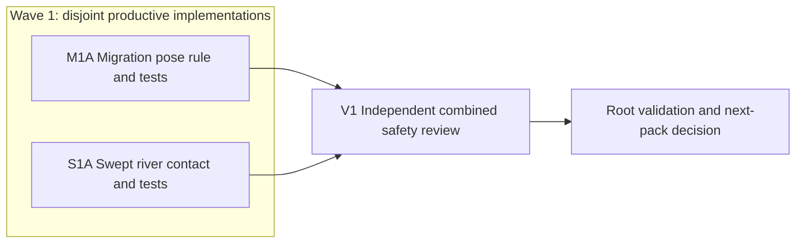

# Ticket Pack: V25 River Migration and Swept Contact

## Summary

The connected V25 river needs two independent safety facts before it can be
connected to saved gameplay. M1A maps an old V24 pose to a safe V25 starting
pose without rewriting the source. S1A identifies every river cell touched by
a proposed movement segment. Neither changes the current playable V24 world.

This umbrella pack corrects a planner defect found at read-only review: the
two independently authored lane specifications were initially presented as
linear standalone packs, even though the actual disjoint implementers ran
concurrently. This document records their real non-linear topology and is the
controlling pack for review and any subsequent corrections. The earlier
pre-dispatch audit omission is not represented as if it had occurred.

Locked design:

- V24 source and historical replay remain unchanged. V25 writes require a new
  source-pinned root in a subsequent pack.
- Migration may retain only a real bridge deck over newly wet ground. On an
  equal-distance bank tie it chooses the north, lower-z starter side rather
  than granting a free crossing.
- River contact uses `publicV25RiverCellAtGrid` and the same half-open 4 m
  cell convention as movement authority. No separately approximated water.

Important repo truth:

- The present V24 creek is five cells; V25's accepted canonical river spans
  all 512 world columns.
- V24 saves validate a grounded pose and replayed state. Changing old
  collision or rendering in place would invalidate source facts.

## Proposed Flow

For example, a saved character whose old dry tile is now river gets placed on
the north bank unless already on a built bridge. Later, a crossing attempt
reports water contact to a checked bridge gate. Dashed paths are future work,
not behavior this pack claims to deliver.

## Public Interfaces

- `relocatePublicV25RiverSource(raw: PublicV24Progress)` returns detached
  validated progress and an optional exact from/to relocation, or null when a
  safe mapping cannot be proven. Full contract and fixtures are in
  `STARTER_VALLEY_V25_MIGRATION_POSE_PACK.md`.
- `publicV25RiverTouchesSegment(seed, from, to)` returns a boolean for
  canonical river contact, including diagonal corner contact, or throws
  `RangeError` on invalid input. Full contract and fixtures are in
  `STARTER_VALLEY_V25_RIVER_SWEEP_PACK.md`.

## Lane Graph

Runnable wave 1: M1A and S1A had fixed independent interfaces and disjoint
new-file custody, so both were dispatched and executed concurrently. V1 is
dependent on their final code. I consumes V1's verdict and integrated checks.

## Topology Audit

- Productive-lane inventory: M1A owns one migration-pose module plus tests;
  S1A owns one river-sweep module plus tests. Both produce distinct reusable
  source artifacts and lane-local tests.
- Maximum parallel width: two productive lanes.
- Incomparable pair: M1A || S1A. M1A consumes the accepted river predicate
  but not S1A; S1A consumes the same predicate but not M1A. File and behavior
  ownership do not overlap.
- Fan-in: V1 reviews both final modules, their interaction assumptions,
  exact geometry, and save-safety limits. I consumes the V1 GO/NO-GO receipt.
- Broad-lane split: none. M1A owns pose migration only, S1A contact only;
  neither writes persistence, renderer, or bridge acceptance.
- Evidence/decision classification: M1A and S1A tests are lane-local proof;
  V1 is a non-productive independent review and I is an orchestrator decision.
  There is no generic test lane used to inflate productive width.
- Certainty/novelty: M1A closes the unknown of an old pose newly covered by
  water; its stop is valid dry or built-deck relocation or explicit null.
  S1A closes exact wet segment/corner contact; its stop is deterministic
  symmetric contact with bounded world traversal. V1 checks different failure
  modes jointly and does not repeat implementation.
- Surprise/escalation: an unprovable bridge kind, a migration that crosses the
  river for free, a lost valid save, missed corner water, broad file edits, or
  a failed old-profile test returns to the planner for a bounded correction.
- Conditional activation/finisher readiness: no PR finisher is authorized.
  No speculative repair lane is activated. A concrete finding is mapped to
  the owning implementer and retested before a new review. The no-repair path
  ends at V1 GO and root integration validation.

| Serial edge | Exact consumed artifact or decision | Why concurrent execution is impossible |
|---|---|---|
| M1A to V1 | Final migration module and tests | Reviewing an earlier edit would be stale. |
| S1A to V1 | Final sweep module and tests | Reviewing an earlier edit would be stale. |
| V1 to I | Findings-first GO/NO-GO receipt | Integration cannot accept a known unsafe contract. |

Dispatch verdict for the corrected umbrella topology: PASS. Historical
process note: this audit was written after the original two disjoint lane
dispatches because the standalone-pack structure was a planner defect. It is
not evidence that a pre-dispatch umbrella audit occurred.

## Tickets

### M1A: Migration-pose implementer

Role `implementer` only, native child `/root/v25_migration_pose`, inherited
model. Scope, acceptance, tests, failure tripwires, and no-GitHub/no-renderer
limits are fixed in `STARTER_VALLEY_V25_MIGRATION_POSE_PACK.md`. Delivery is a
pre-surface domain fact, not playable migration. A north-bank tie correction
was routed to this same child and rerun before V1.

### S1A: Swept-contact implementer

Role `implementer` only, native child `/root/v25_river_sweep`, inherited
model. Scope, acceptance, tests, failure tripwires, and no-GitHub/no-renderer
limits are fixed in `STARTER_VALLEY_V25_RIVER_SWEEP_PACK.md`. Delivery is a
pre-surface domain fact, not live movement collision.

### V1: Dependent independent review

Role `reviewer` only, native child `/root/v25_migration_sweep_review`, read-only.
Consume final M1A and S1A code and the two full ticket specifications. Return
findings first, separate GO/NO-GO per contract and overall, exact source
references, coverage limits, residual risks, and native receipt. A process
finding is actionable and is not erased by passing tests. No browser, commit,
PR, push, or GitHub action.

### I: Direct orchestrator integration gate

Run four V25 focused suites together and TypeScript, verify V24 HTTP preview
remains available, and record that V25 is not yet rendered or playable. If V1
reports a code finding, route a bounded repair to its owner and repeat the
same checks. If V1 is GO, author the dependent source-pinned V25 root pack.

## Assumptions

- The old save's progress is validated by the V24 source flow before M1A is
  used in a writer. M1A itself validates inherited progress defensively.
- A local, offline save cannot provide anti-cheat protection against direct
  database tampering. Future root checks still must fail closed on malformed
  replay and never mutate the V24 source.
- Browser-control authentication currently prevents rendered UI proof. The
  current V24 preview remains open; no extra renderer is started for this
  pure-domain pack.
