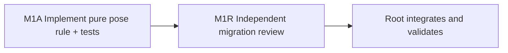

# Ticket Specification: V25 River Migration Pose

This is the M1A/M1R lane specification governed by
`STARTER_VALLEY_V25_MIGRATION_AND_SWEEP_PACK.md`. It is not a standalone
substantive ticket pack. Its local chain is one branch of the umbrella pack's
parallel M1A and S1A wave.

## Summary

The accepted V25 river turns some old dry V24 player positions into water.
Before a new source-pinned root can be created, migration needs one pure,
deterministic rule for those poses. This pack adds that rule and its tests. It
does not alter V24, write a V25 save, render water, or claim playable V25.

Goal: preserve a validated V24 source while producing a V25-safe starting
pose, or fail without changing it. The full-game goal and starter-valley
milestone remain active. System translation: `not_qualified`. Shipped agent
runtime: `not_required`.

## Locked Interface and Behavior

Add only `engine/src/domain/publicWorldV25MigrationPose.ts` and its `.test.ts`.
Export `relocatePublicV25RiverSource(raw: PublicV24Progress):
{ progress: PublicV24Progress; relocation: { from: Vec3; to: Vec3 } | null }
| null`. The returned value is a detached copy. Invalid inherited progress
returns null. `null` also means no safe migration candidate, not a license to
silently reset the character.

Use the accepted `publicV25RiverCellAtGrid` as the only new wet predicate.
Convert world coordinates to the existing 4 m grid with the authority's
`Math.ceil(coordinate / WORLD_CELL_METERS - 0.5)` convention. A dry current
cell keeps its exact validated pose. A wet current cell on an existing built
bridge deck keeps its exact pose: Greenway support must be an actual built
bridge; streamed support must resolve to an actual built or authored bridge,
not a ladder, generic work tag, ordinary terrain, or a dug floor. These checks
must use existing support resolvers and validated built ledgers, not a visual
approximation.

For a wet unsupported pose, retain its `x`, yaw, pitch, gear, inventory,
works, clock, and history. Search the same `gx` column for dry ground at the
centers of rows within eight 4 m cells of the original row. Order by actual
distance from the original `z`, breaking ties toward the north bank (lower
`z`, the starting-valley side of the river). This avoids granting a free
crossing at an exactly centered old pose. Reject a
candidate if it is outside the world, in either old or new unsupported water,
in a different movement-owner region, lacks the existing authoritative
ground floor, or fails `decodePublicV23Progress` after the position changes.
Use that floor as the new `y`, set vertical velocity to zero, and report the
exact old and new positions in `relocation`. If no candidate passes, return
null. No RNG, event/tick increment, reward, or mutation of the V24 source.
The future V25 root will snapshot this migration result and pin the complete
V24 source receipt.

## Why One Lane

This is one coupled behavior and one file owner. Splitting its support check,
candidate ordering, and decoder validation into separate implementers would
create artificial parallelism. A dependent read-only review challenges the
complete rule after implementation. The existing V24 preview remains the
earliest real surface. No browser renderer is needed for this pure module.

## Ticket M1A: Implementer

Role lock: `implementer` only. Transport: native spawned subagent, inherited
model, same checkout `ben/wizard-playable-v2` at
`/private/tmp/pa-wizard-playable-v2`. Existing task routing: not authorized.
No interruption or fallback. Skills: `auto-planner-ticket-pack` and
`smallest-viable-diff`, read completely with this pack and applicable AGENTS.
Delivery: pre-surface domain migration rule. No optional user feedback wait.

Add the two named files only. Reuse `decodePublicV23Progress`, current support
resolvers, grid constants, and river predicate. Tests must cover: valid dry
identity, a validated V24 pose that becomes wet and relocates to dry support,
an existing built deck over water that remains in place, determinism,
candidate ordering, no mutation, and invalid or unresolvable input returning
null. Build fixtures from existing valid V24/V23 helpers, never weaken old
validators to make a test pass. New geography/save safety tests are allowed
before surface readiness. A test may document a valid fixture search; it must
be bounded and reproducible.

Smallest Viable Diff budget: two new files, <=240 net lines, no dependencies,
no old-file edits. No configuration or prompt-only change can safely resolve
a versioned migration pose. Tripwire: scope or budget breach, missing valid
wet fixture, or an old built-deck pose whose support cannot be classified
without changing old code. Return to planner before crossing a tripwire.

Acceptance: focused Vitest, `npx tsc -b --pretty false`, whitespace check.
Report paths, line counts, exact fixture states, pass counts, reuse/deletion
rationale, tripwires, and native child ID. No commit, PR, push, GitHub action,
browser, renderer, or server restart.

## Ticket M1R: Reviewer, dependent on M1A

Role lock: `reviewer` only, read-only. Same skills, checkout, and constraints.
Challenge actual support classification, all same-column candidate ordering,
old-owner preservation, old decoder revalidation, no source mutation, bounded
failure, tests, and scope. Findings first, GO/NO-GO, source references,
coverage limits, and residual risks. Rendering and V25 save integration are
explicitly out of scope for this review.

## Integration Gate and Risks

M1A is not playable and must not be wired into V24. After M1R GO, the next
pack builds a checked V25 root and IndexedDB writer with exact V24 source
pinning, then overlays the connected river in movement and rendering together.
Existing V24 saves remain untouched. If a particular saved pose has no valid
nearby bank, migration must block visibly rather than discard it.

The current browser-control bridge is environment-blocked, so pure-domain
evidence here is not visual proof. The existing preview stays available and
no additional WebGL renderer is opened.
