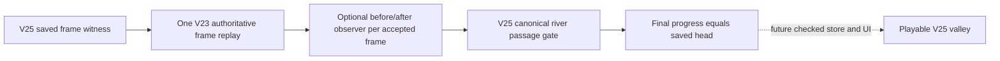
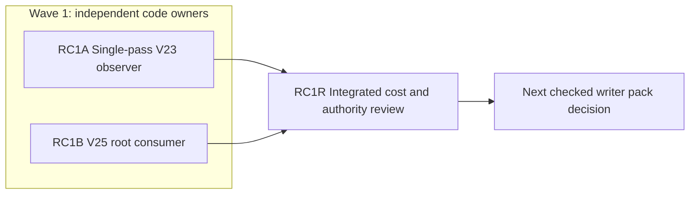

# Ticket Pack: V25 River Replay Cost Repair

## Summary

Independent CR1R review found the new V25 root decoder functionally correct but too slow: a valid 128-frame save replays 8,256 prefixes and took 4,789 ms on the local probe. This repair replaces prefix reconstruction with one observed legacy replay, then checks each V25 river segment exactly once. It closes the NO-GO in `STARTER_VALLEY_V25_CHECKED_RIVER_PACK.md`; it does not add a V25 writer or UI. The aligned user problem is in `STARTER_VALLEY_WORLD_LOOP_UNDERSTANDING.md`.

Locked design:

- V23 and V24 return values, witness grammar, and checked replay semantics must remain unchanged. No V17/V23/V24 save rewrite.
- An optional observer receives the exact before and after progress for each frame in the existing V23 replay loop. No second movement implementation and no prefix replay.
- V25 still rejects every canonical river contact without saved elevated bridge support. It still requires final legacy replay equality, strict three-slot root, and immutable excavation ledger.
- No browser renderer, server restart, commit, PR, push, or GitHub account action. Keep the existing V24 preview available.

Important repo truth: `framesResult` in `publicWorldV23Transitions.ts` already performs the authoritative frame loop. `decodePublicV25Root` in `publicWorldV25Snapshot.ts` currently calls `advancePublicV23Frames` once for every prefix. CR1R measured one full 128-frame replay at 62 ms versus 4,789 ms for the root decoder. Those are local diagnostic observations, not a CI timing guarantee.

Goal aligned. System translation: not_qualified; receipt not_applicable. Product agent runtime: not_required.

## Proposed Flow

## Public Interfaces

- `publicWorldV23Transitions.ts` adds `visitPublicV23Frames(before:PublicV23Progress, frames:PublicV14FrameWitness['frames'], visit:(beforeFrame:PublicV23Progress, afterFrame:PublicV23Progress)=>boolean):PublicV23Progress|null`. It invokes `visit` exactly once after each accepted frame, in order. `false` or a thrown callback fails closed with `null`. It uses the existing `framesResult` loop and final grounded validation. Existing callers with no observer behave byte-for-byte the same.
- `publicWorldV25Snapshot.ts` uses that interface only for V25 frame witnesses. The callback calls `publicV25RiverPassage(beforeFrame, beforeFrame.state.player.position, afterFrame.state.player.position)`. Non-frame witnesses still use `replayPublicV24Witness`. For both paths, compare final progress to the candidate head once. No trusted browser pose or loot input.

## Lane Graph

## Topology Audit

- Productive lanes: RC1A owns the existing V23 replay loop and its focused test. RC1B owns only the V25 root consumer and its focused test. They are independent under the fixed `visitPublicV23Frames` signature and edit disjoint files.
- Maximum parallel width: two. `RC1A || RC1B`; neither needs the other's implementation to edit its owned surface. Their changes converge at integrated TypeScript and RC1R.
- Broad-lane split: one observer owner, one consumer owner. Neither adds a generic performance framework or UI.
- Novel certainty: RC1A closes whether the old replay can expose exact per-frame progress without changing old behavior. RC1B closes whether V25 uses one replay and keeps all crossing checks. RC1R measures the combined 128-frame case and probes old-profile parity. Stop at a current functional and cost receipt; a valid batch over one second or old-profile regression is a surprise and triggers bounded repair.
- Serial edges: A/B to R require final integrated code to benchmark and review. R to next pack supplies GO/NO-GO. No other serial edges or synthetic dependency.
- Conditional repair/finisher: none; a new finding returns to planner. No PR requested. Dispatch verdict: PASS.

## Smallest Viable Diff

Behavior delta: replace repeated prefix replay with one observer pass. Budget: four existing files, <=120 net lines, zero new files/dependencies, no broad refactor. Expected: `engine/src/domain/publicWorldV23Transitions.ts`, `publicWorldV23.test.ts`, `publicWorldV25Snapshot.ts`, `publicWorldV25Snapshot.test.ts`. Forbidden: other legacy authority/save modules, V25 passage/river/strata, UI/view, package files. Reuse `framesResult`, `publicV25RiverPassage`, and V24 witness replay. A config or doc cannot fix runtime cost. Delete the prefix loop, do not leave it as a fallback. Validation: focused suites, TypeScript, and a read-only 128-frame benchmark. Tripwire: extra file, >120 net lines, dependency, changed old public behavior, or new movement implementation requires replan.

## Tickets

### Paste now to: Implementer A

Ticket: RC1A. Lane type: Parallel. Delivery phase: implementation. Delivery milestone: pre_surface. Shortest complete user flow: a future V25 save inspects each actual movement once and still rejects wet bypass. First-feedback evidence: observer call sequence for a valid batch. Test-writing policy: authority/performance safety exception before UI. Review blocking: V23/V24 behavior drift, missed frame, callback bypass. Surface readiness/entrypoint: V25 pending; existing V24 preview kept. No renderer. Post-surface validation: future UI. Optional-feedback wait: never.

Depends on: none. Branch `ben/wizard-playable-v2`; worktree `/private/tmp/pa-wizard-playable-v2`; base local HEAD `6bb8d39`, do not commit. Role: implementer ONLY. Dispatch: native_spawned_subagent, model inherited, Cursor runtime not_applicable. Durable existing-task routing not_authorized; capability/mission/custody/status/delivery evidence and task/thread receipt not_applicable. No-interruption not_applicable. Final fallback none, all fallback fields not_applicable. Runtime rationale: isolated old-loop edit needs local deterministic tests, not another provider or renderer. Agent spec: Wizard Realms replay observer implementer. First contact: native child role bootstrap plus this pack; follow-up: same child. No nested workers. Worker agent: Codex implementer.

Required skills: auto-planner-ticket-pack and smallest-viable-diff, read fully. Read this pack and applicable AGENTS instructions. Update only `publicWorldV23Transitions.ts` and `publicWorldV23.test.ts`. Add exactly the declared observer export by optional callback plumbing through `framesResult`. Invoke callback after both Greenway and streamed branch progress changes, once per accepted frame. False/throw is a failed trace; no observer keeps all old return paths. Test a mixed or multi-frame batch, one call per frame with correct positions, callback failure, and unchanged old `advancePublicV23Frames`/`replayPublicV23Witness` results. Run `cd games/wizard-realms/engine && npx vitest run src/domain/publicWorldV23.test.ts --maxWorkers=1 && npx tsc -b --pretty false`, then whitespace scan. TSC may temporarily fail until RC1B import settles, report that dependency honestly. Visual proof not applicable. Budget <=80 net lines, no new module. Return full skill receipt including changed files, net lines, reuse/deletion/tripwires, exact tests, native child ID, no-browser/no-GitHub, and candidate unit.

### Paste now to: Implementer B

Ticket: RC1B. Lane type: Parallel. Delivery phase: implementation. Delivery milestone: pre_surface. Shortest complete user flow as A. First-feedback evidence: accepted 128-frame V25 root and unchanged wet bypass rejection. Test-writing policy: save/performance safety exception. Review blocking: repeated prefix loop remains, final equality dropped, wet bypass. Surface readiness/entrypoint as A. Optional-feedback wait: never.

Depends on: none; the observer interface is fixed above. Same branch/worktree/base, no commit. Role: implementer ONLY. Dispatch native_spawned_subagent, model inherited, Cursor runtime not_applicable. Durable existing-task routing not_authorized; all corresponding evidence/task receipt not_applicable. No-interruption not_applicable. Final fallback none, all fallback fields not_applicable. Runtime rationale: isolated V25 consumer edit in a disjoint file; no renderer. Agent spec: Wizard Realms V25 replay cost implementer. First contact native child bootstrap plus this pack; follow-up same child. No nested workers. Worker agent: Codex implementer.

Required skills as A. Update only `publicWorldV25Snapshot.ts` and `.test.ts`. Replace the entire prefix loop with one call to the declared `visitPublicV23Frames`; use its final progress as the authoritative frame witness result and call the passage gate in the observer. Keep V24 replay for non-frame witnesses, exact candidate equality, and all other root checks. Add a valid maximal batch fixture or adapt an existing one, plus a blocked wet multi-frame fixture. Run `cd games/wizard-realms/engine && npx vitest run src/domain/publicWorldV25Snapshot.test.ts src/domain/publicWorldV25Passage.test.ts --maxWorkers=1 && npx tsc -b --pretty false` after A lands; before that, only inspect or write owned files. Visual proof not applicable. Budget <=40 net lines, delete the old prefix loop, no new abstraction. Return full skill receipt as A.

### Wait for RC1A and RC1B, then paste to: Reviewer

Ticket: RC1R. Lane type: Dependent. Delivery phase: pr_hardening. Delivery milestone: pre_surface. Role: reviewer ONLY, read-only. Dispatch native_spawned_subagent, model inherited, Cursor runtime not_applicable. Durable existing-task routing not_authorized, all candidate fields not_applicable. No-interruption/task receipt not_applicable. Final fallback none. Runtime rationale: independent authority and cost check on integrated change. Agent spec: Wizard Realms replay reviewer. First contact native child with full role bootstrap; follow-up same child; no nested workers. Skills: auto-planner-ticket-pack and smallest-viable-diff.

Findings first. Run the focused V23/V25 suites and TypeScript. Reproduce the same valid 128-frame root benchmark method used by CR1R and report before/after with conditions; do not use a brittle timing threshold as a test assertion. Verify observer count/order, old V23/V24 return parity, callback false/throw fail-closed, wet corner and saved bridge, one final progress equality, no repeat-prefix loop, no extra files. Return GO/NO-GO, severity-ordered findings, explicit pass/fail, topology and smallest-diff/reuse/deletion/tripwire verdicts, benchmark and revision, residual risk, no-renderer disposition. No PR finisher because no PR was requested.

## Assumptions

- The performance repair does not change the accepted V25 river topology or legacy movement physics.
- A local benchmark guides responsiveness but does not prove browser frame rate. UI proof remains required once V25 is exposed.
