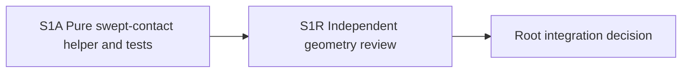

# Ticket Specification: V25 River Swept Contact

This is the S1A/S1R lane specification governed by
`STARTER_VALLEY_V25_MIGRATION_AND_SWEEP_PACK.md`. It is not a standalone
substantive ticket pack. Its local chain is one branch of the umbrella pack's
parallel M1A and S1A wave.

## Summary and contract

The accepted V25 river is a canonical set of 4 m wet cells. A future movement
gate must test the whole path, not only the destination, or a fast/diagonal
step can pass through water between dry endpoints. This pack adds one pure
segment-contact helper. It does not accept or reject movement, infer a bridge,
change V24, render water, or write a save.

Goal alignment: the user should eventually cross the continuous river only
on a built bridge or boat. This helper answers just whether a proposed XZ
segment touches the river. System translation: `not_qualified`; shipped agent
runtime: `not_required`.

Add only `engine/src/domain/publicWorldV25RiverSweep.ts` and `.test.ts`.
Export `publicV25RiverTouchesSegment(seed: string, from: {x:number;z:number},
to: {x:number;z:number}): boolean`. The helper validates the same seed
contract as `publicV25RiverCellAtGrid` and finite endpoints whose canonical
cells lie in [-256, 255]; invalid inputs throw `RangeError`. It uses
`Math.ceil(coordinate / WORLD_CELL_METERS - 0.5)` for cell ownership. It calls
the canonical V25 river predicate, never a copied water formula. Wet
endpoints, wet segment interiors, and a segment threading an exact grid corner
with either adjacent side cell wet all return true. A segment touching a cell
edge but staying in the dry owning cell does not become wet until it enters a
wet cell. There is no hidden maximum step length; at most the finite world
grid is traversed. No RNG or world mutation.

Use grid-edge parameter cuts along X and Z, inspect each open interval's
midpoint, and handle simultaneous X/Z cuts explicitly for corner-cutting.
Avoid fixed-distance sampling, which can miss narrow cells. Test exact
half-open boundaries and both travel directions. The future checked movement
owner will use this with a saved bridge-support test, and rendering will use
the same river predicate. This pack is pre-surface safety proof.

## Lane graph and topology audit

One implementation lane is correct because the segment algorithm and its
tests have one owner. Splitting directions/corners into separate workers would
be artificial. S1R is dependent and read-only. This pack is independent of
the migration-pose pack in different new files, so they may execute safely in
parallel. The existing V24 HTTP preview stays available throughout.

## S1A: implementer

Role lock: `implementer` only. Transport: native spawned child, inherited
model, same session, branch `ben/wizard-playable-v2`, checkout
`/private/tmp/pa-wizard-playable-v2`. Existing durable-task routing: not
authorized. No interruption or fallback. Required skills: full
`auto-planner-ticket-pack` and `smallest-viable-diff`, plus this pack and
applicable AGENTS instructions. Delivery: pre-surface pure domain fact;
optional user feedback is not a gate.

Scope: the two named new files only. Reuse river predicate, grid constants,
and cell convention. Tests must cover wet start/end, dry step, forward and
backward crossing, exact edge ownership, diagonal exact-corner rejection,
near-corner dry path, multiple-cell segment, invalid inputs, and a scan of
river edge columns so there is no around-the-end gap inside the world.
Determinism and result symmetry are required. Save-stable collision tests are
allowed before UI surface readiness.

Smallest Viable Diff: <=200 net lines across two files, zero dependencies,
zero old-file edits. The helper is needed because existing V17 wetSweep is
hard-coded to a five-cell rectangle and cannot represent a meander. No
copy-pasted water formula or per-frame allocations proportional to the full
world on ordinary short steps. Tripwire: altered legacy files, more than
200 net lines, or unresolvable half-open corner semantics. Stop and return to
planner on tripwire.

Acceptance: focused Vitest, TypeScript, whitespace check; report exact paths,
line counts, pass counts, reuse/deletion rationale, tripwires, native child
receipt. No commit, PR, push, GitHub action, browser, renderer, or server
restart.

## S1R: reviewer after S1A

Role lock: `reviewer` only, read-only. Same skills and no-renderer/GitHub
constraints. Independently challenge interval/corner coverage, half-open
boundary behavior, long-segment bound, symmetry, edge columns, test quality,
and scope. Findings first, GO/NO-GO, coverage limits, residual risks, and
native child receipt. This is not visual or live movement proof.
