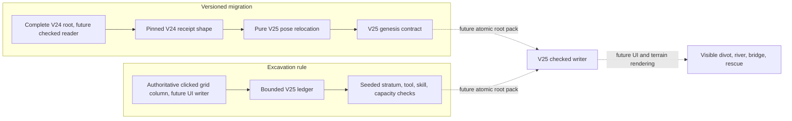
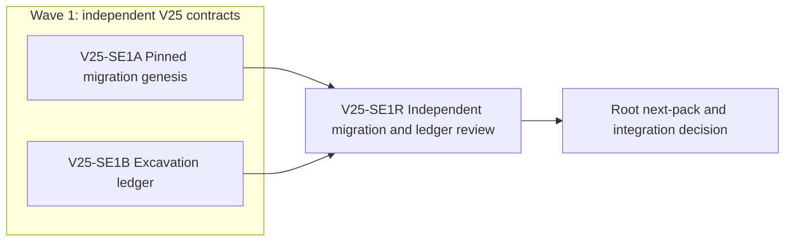

# Ticket Pack: V25 Checked Migration and Excavation Substrate

## Summary

The full-game goal needs a reachable starter valley and click-to-dig terrain, but a V24 save must not be silently reinterpreted under a new river. This pack creates two independent V25 contracts: a source-pinned migration genesis and a bounded, deterministic excavation ledger. A later dependent pack will join them in an atomic V25 root and expose the playable V25 route. This pack does not claim the river, digging, or rescue is in the live UI.

Goal: aligned with the active complete Wizard Realms goal. System translation: not_qualified. Product agent runtime: not_required. No commit, PR, push, browser renderer, or server restart is authorized.

Locked design:

- Leave V14, V17, V23, and V24 save schemas, replay, world geometry, and UI unchanged.
- V25 migration pins the exact V24 `{head,lineage}` receipt shape. The future flow must validate the complete live V24 root and its V23/V17 ancestry under the shared world lock before use.
- An old pose newly wet under the V25 river is relocated only by `relocatePublicV25RiverSource`; a valid old built bridge deck remains valid. Relocation cannot hand the player a free river crossing.
- Digging is a V25-only canonical grid-column operation. Material at `(seed,gx,gz,layer)` comes only from `publicV25StratumAt`, never client-supplied loot or mutable simulation RNG.
- Ledger size and carried resources are bounded, replayable, and capacity-counted. Existing `ItemId`, V24 player inventory, and old terrain works do not change.

Important repo truth:

- `publicWorldV24Snapshot.ts` already distinguishes receipt shape proof from complete live source proof. `publicWorldV24Flow.ts` owns the latter under `PUBLIC_V7_LOCK_NAME`.
- `publicWorldV25River.ts`, `publicWorldV25Strata.ts`, and `publicWorldV25MigrationPose.ts` are tested but not live. The V24 preview at `http://127.0.0.1:5193/?publicWorld=v24` remains the current user surface.
- The browser-control bridge returned `unsupported Codex auth method: apikey` twice. That is an environment blocker for UI proof, not permission to launch a second WebGL renderer.

## Proposed Flow

Example future journey: the player equips the owned spade, clicks a revealed dry bank tile within reach, receives its stable shallow material if the backpack has space, and sees a persistent divot. This pack proves migration and excavation facts only. Dashed edges are out of scope.

## Public Interfaces

`engine/src/domain/publicWorldV25Migration.ts` exports:

- `PUBLIC_V25_SCHEMA = 'wizard-world/v25'` and `PUBLIC_V25_DATABASE_NAME = 'wizard-realms:world:v25'`.
- `PublicV25SourceReceipt = Readonly<{head: PublicV24Head; lineage: PublicV24Lineage}>`.
- `PublicV25Lineage = Readonly<{origin:'v24-migration'; seed:string; rulesProfile:'connected-river/v1'; sourceReceipt:PublicV25SourceReceipt}>`.
- `decodePublicV25SourceReceipt(value:unknown): PublicV25SourceReceipt|null`, exact two keys and V24 lineage/head validators. This proves shape only.
- `decodePublicV25Lineage(value:unknown): PublicV25Lineage|null`, exact four keys and seed consistency.
- `createPublicV25Migration(rawSource:unknown): {lineage:PublicV25Lineage; progress:PublicV24Progress; relocation:PublicV25Relocation|null}`, throwing `RangeError` for invalid receipt or unplaceable migration. It must not mutate the input.

`engine/src/domain/publicWorldV25Excavation.ts` exports:

- `PublicV25ExcavationLedger = Readonly<{columns:readonly {gx:number;gz:number;depth:number}[]; bag:Readonly<{soil:number;stone:number;iron_ore:number;gold_ore:number;diamond:number}>}>`.
- `emptyPublicV25ExcavationLedger()` returns zero bag and no columns.
- `decodePublicV25ExcavationLedger(value:unknown): PublicV25ExcavationLedger|null`, exact keys, sorted unique columns by `(gx,gz)`, valid in-range safe-integer coordinates, depth 1..12, at most 256 columns, nonnegative safe-integer bag counts. It rejects hostile/proxy input and bag totals above 256. The future root will additionally replay action history.
- `digPublicV25Column(ledger:unknown, request:Readonly<{seed:string;gx:number;gz:number;tool:'spade'|'pick'|'enchanted_pick'|null;excavationLevel:number;backpackCapacity:number;legacyCarriedCount:number;reservedCount:number;reachable:boolean;revealed:boolean}>): {ok:true;ledger:PublicV25ExcavationLedger;material:Exclude<PublicV25Material,'bedrock'>;layer:number}|{ok:false;reason:string}`.
- The next layer is the current column depth, default 0. Reject new-river wet cells, unrevealed/unreachable targets, missing/insufficient tool, low skill, bedrock, and full backpack before changing anything. Tool hierarchy is `spade < pick < enchanted_pick`. Count all legacy carried items, trade reserves, and all V25 bag items against backpack capacity. Successful digs add exactly one stable material and one layer to exactly one column, without mutating input or RNG. A target `depth=12` cannot advance. Existing columns remain sorted.

The request's `reachable` and `revealed` booleans are future authoritative-writer outputs, not trusted browser data. This pack does not implement filling, selling, clicked raycasts, depth meshes, or item UI. A future pack may extend the V25-only ledger before first release, but may not silently modify the profile after it ships.

## Lane Graph

## Topology Audit

- Productive-lane inventory: SE1A is a bounded source receipt/genesis implementation in `publicWorldV25Migration.*`. SE1B is a bounded excavation state transition in `publicWorldV25Excavation.*`. They create distinct artifacts consumed by the future V25 root.
- Maximum parallel width: two. `SE1A || SE1B`: neither consumes the other's files, output, or decisions.
- Fan-in: SE1R reviews source pinning and ledger invariants against both final artifacts, then root decides the exact follow-on writer pack. The reviewer is not counted toward productive width.
- Broad-lane split: each implementer owns one module and one test file, no shared edits or speculative UI glue.
- Evidence/decision classification: lane-local tests prove each contract; SE1R gives distinct adversarial findings and combined-scope GO/NO-GO; root next-pack is a decision node, not a productive lane.
- Certainty/novelty: SE1A closes whether a V24 source head can be shape-checked and deterministically relocated without writing old roots. SE1B closes whether each dig is deterministic, gated, bounded, capacity-counted, and non-mutating. Stop at those receipts. A conflicting old validator or unbounded excavation representation is a surprise trigger requiring replan.
- Conditional activation: no preauthorized repair or finisher. Any finding returns to planner for a bounded follow-up; no PR is requested. The no-repair path is both accepted lanes plus reviewer GO.

| Serial edge | Exact consumed artifact | Why concurrent execution is impossible |
|---|---|---|
| SE1A -> SE1R | Final migration module and tests | Earlier review would be stale. |
| SE1B -> SE1R | Final excavation module and tests | Earlier review would be stale. |
| SE1R -> root | Findings and validation receipt | Writer scope must account for accepted contracts and findings. |

Dispatch verdict: PASS. Two independent productive lanes are runnable at once and converge at one decision-bearing review.

## Smallest Viable Diff

Behavior delta: two pure V25 contracts with no old-world changes. Budget: four new files, at most 300 net lines total, no dependencies. Expected files are the two named modules and two named tests only. Forbidden: V24 and earlier save, UI, world rendering, common `ItemId`, package files, server, GitHub. Reuse V24 decoders, V25 relocation, V25 strata, V25 river predicate, world grid constants, and existing strict exact-key helper. Config or docs alone cannot enforce versioned save and dig transition invariants. Delete/simplify pass: reuse these helpers rather than adding a second parser or resource generator; no old code is obsolete yet. Validation: both focused Vitest files and `npx tsc -b --pretty false`. Tripwire: any extra file, dependency, old-profile edit, >300 combined net lines, or requirement for a new shared abstraction returns to planner.

## Tickets

### Paste now to: Implementer A

Ticket: V25-SE1A. Lane type: Parallel. Delivery phase: implementation. Delivery milestone: pre_surface. Shortest complete user flow: a V24 player may later enter V25 without losing valid progress or crossing the new river for free. First-feedback evidence: pure migration tests. Test-writing policy: safety exception for save-stable migration before surface. Review blocking: forged V24 receipt, unsafe relocation, input mutation. Surface entrypoint/revision: V24 preview stays live, V25 pending. Optional-feedback wait: never.

Branch: `ben/wizard-playable-v2`. Worktree: `/private/tmp/pa-wizard-playable-v2`. Base branch: current HEAD `6bb8d39`; do not commit. Role: implementer ONLY. Dispatch: native_spawned_subagent, model inherited, Cursor runtime not_applicable. Existing-task routing not_authorized; user has not authorized messaging durable peer tasks for this pack. Mission/custody/status/delivery evidence and task/thread receipt not_applicable. No-interruption disposition not_applicable. Final fallback transport none, all fallback fields not_applicable. Runtime rationale: the local child can implement this isolated high-risk contract with existing V24 validators and focused tests; no browser or external model needed. Agent spec: Wizard Realms save migration implementer. Session: initialize once, continue same child, no nested workers. Worker agent: Codex implementer.

Required skills: auto-planner-ticket-pack and smallest-viable-diff. Read both completely. Read this pack and applicable AGENTS instructions. Change only `engine/src/domain/publicWorldV25Migration.ts` and `.test.ts`. Implement exactly the Public Interfaces migration contract, copying neither V24 flow nor old roots. `decodePublicV25SourceReceipt` uses `exactPublicV23`, `decodePublicV24Lineage`, `decodePublicV24Head`; `createPublicV25Migration` calls the existing relocation helper on `{state,greenwayWorks,regionalWorks}`. Include valid revision-zero and later V24 receipt shapes, wrong seed/profile/extra-key rejection, wet relocation without free crossing, valid dry no-op, unplaceable rejection, hostile input, and input immutability. Do not validate complete live V24 ancestry in this pure module; future flow owns it.

Acceptance: `cd games/wizard-realms/engine && npx vitest run src/domain/publicWorldV25Migration.test.ts --maxWorkers=1 && npx tsc -b --pretty false`; `git diff --check`. Visual proof: not applicable, no rendered state. Smallest viable diff: two new files, <=150 net lines; reuse V24 decoders and V25 relocation; no new dependency or shared parser; stop on tripwire. Return exact changed files, line counts, reuse and simplification proof, command output, tripwires, candidate merge unit, native child ID, launch/continued-session receipt, fallback false, and no out-of-scope edits.

### Paste now to: Implementer B

Ticket: V25-SE1B. Lane type: Parallel. Delivery phase: implementation. Delivery milestone: pre_surface. Shortest complete user flow: a future equipped spade click on visible reachable dry ground digs a stable layer if backpack capacity permits. First-feedback evidence: pure dig-transition tests. Test-writing policy: safety exception for save/reward invariants. Review blocking: client-chosen loot, duplicate grant, capacity bypass, unbounded or mutable ledger. Surface entrypoint/revision: V24 preview stays live, V25 pending. Optional-feedback wait: never.

Branch/worktree/base and no-commit/no-GitHub constraints as SE1A. Role: implementer ONLY. Dispatch: native_spawned_subagent, model inherited, Cursor runtime not_applicable. Existing-task routing not_authorized; all existing-task evidence and task/thread receipt not_applicable. No-interruption disposition not_applicable. Final fallback none, all fallback fields not_applicable. Runtime rationale: independent deterministic domain work with only two new files and no renderer. Agent spec: Wizard Realms excavation implementer. Session: initialize once, same child for follow-ups, no nested workers. Worker agent: Codex implementer.

Required skills: auto-planner-ticket-pack and smallest-viable-diff. Read both completely. Read this pack and applicable AGENTS instructions. Change only `engine/src/domain/publicWorldV25Excavation.ts` and `.test.ts`. Implement exactly the ledger and dig contracts above. Reuse `publicV25StratumAt`, `publicV25RiverCellAtGrid`, and grid constants. Test same-spot layer progression, stable material after reload/order change, one reward and one depth per accepted action, tool hierarchy and skill gates, wet/reach/reveal rejects, bedrock, capacity including reserve and bag, malformed/proxy ledgers, sorted uniqueness, in-range bounds, and nonmutation on success/failure. No UI raycast, legacy inventory or old terrain change.

Acceptance: `cd games/wizard-realms/engine && npx vitest run src/domain/publicWorldV25Excavation.test.ts --maxWorkers=1 && npx tsc -b --pretty false`; `git diff --check`. Visual proof: not applicable, no rendered state. Smallest viable diff: two new files, <=150 net lines; no duplicate material generator or old parser; stop on tripwire. Return same full receipt fields as SE1A.

### Wait for SE1A and SE1B, then paste to: Reviewer

Ticket: V25-SE1R. Lane type: Dependent. Delivery phase: pr_hardening. Delivery milestone: pre_surface. Role: reviewer ONLY, read-only. Dispatch: native_spawned_subagent, model inherited, Cursor runtime not_applicable. Existing-task routing not_authorized, all corresponding evidence not_applicable, no interruption, no fallback. Runtime rationale: independent adversarial review of save migration and reward integrity. Agent spec: Wizard Realms domain reviewer. Session: initialize once; no nested workers. Branch/worktree as above. Required skills: auto-planner-ticket-pack and smallest-viable-diff.

Findings first. Verify the complete pack topology audit, V24 source shape proof versus live root distinction, exact-key/hostile input handling, no free-crossing relocation, deterministic material, ledger bounds, capacity math, no client-chosen loot, no old-profile edits, and minimum diff. Run both focused suites and TypeScript once on the integrated files. Return GO/NO-GO, severity-ordered line findings, explicit pass/fail for each point, topology PASS/NO-GO, smallest-diff/reuse/deletion PASS/NO-GO, tripwires, residual risk, tested revision, and no-renderer proof disposition. No PR finisher because no PR was requested.

## Assumptions

- The first V25 excavation substrate stores material in a V25-only bag so existing inventory validator remains stable. A future checked writer must derive reach, reveal, actual equipment, skill, and capacity from authoritative state, not the browser request.
- This pack deliberately does not make V25 playable. The dependent writer, movement, visual, fill, rescue, and route-building packs remain required for the user's full starter-valley experience and the broader full-game goal.
