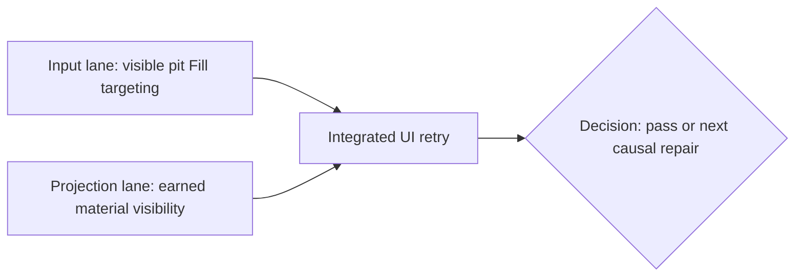

# V26 visible-pit and material feedback repair pack

## User and observed-failure contract

The starter valley must make an equipped spade feel like a direct tool. In the
one-renderer V26 UI probe, buying/equipping it and digging a revealed ground
column succeeded. A visible pit appeared. Selecting Fill and tapping the pit
three times produced no action or rejection. The backpack still showed 2/20
and no earned material. This is a bounded repair of V26 presentation and
input, not a new save grammar or an assertion that the full valley is done.

## Done gate

A fresh V26 UI journey can buy/equip the spade, tap dry ground to dig, see the
earned material and truthful capacity, select Fill, tap the visible open pit,
and either fill one layer or get a specific checked rejection such as lacking
soil. Dig and Fill clicks must not pass through a rock, water, cliff,
unrevealed cell, or unrelated object. Unit tests, typecheck, build, and a
same-entrypoint one-renderer UI retry must pass. A tester must close the
browser renderer afterward and leave the preview available.

## Interface contracts fixed before dispatch

- V26-only projection adds optional `v26TerrainBag`, a read-only copy of the
  checked ledger's five material quantities. The HUD displays it separately
  from ordinary inventory so it does not imply a sale/listing ability that
  the writer lacks. Its quantities count in displayed used capacity exactly
  as they do in the checked dig gate. All older projections omit it.
- The same read-only V26 projection adds `v26OpenPitColumns`, containing only
  saved, revealed, visible columns whose checked depth is positive. This is
  presentation metadata, never permission for Fill; the writer still
  validates every action. Older projections omit it.
- Terrain picking takes the current `dig` or `fill` intent and the projected
  open-pit columns as optional arguments. `dig` preserves the present
  frontmost top-surface rule. `fill`
  may map the actual face of a **saved visible open pit** to that pit's exact
  revealed 4 m column. It may not use a general raycast-through-blockers
  fallback. Keep the canonical cell and action validation in the writer.
- No V26 save, witness, geology, migration, economy, or movement rule changes
  in these two lanes. No PR, commit, push, account change, or new browser tab.

## Lane graph and ownership

### Lane A, input implementer

Own only `view/V26TerrainPicker.ts`, its focused test,
`view/WizardScene.tsx`, `view/WizardSurface.tsx`, and a focused surface test
if needed. Consume `v26OpenPitColumns` from the projection contract owned by
Lane B. First reproduce a fascia-frontmost pit click at unit level, then
make Fill resolve a saved revealed pit without selecting ordinary cliff faces
or clicking through rocks or water. Preserve ordinary Dig semantics. If a
legitimate terrain-mode tap cannot name ground, provide brief visible feedback
instead of silence, without spamming camera drag or non-terrain taps. Run
focused tests, typecheck, and diff check. Do not run a renderer in this lane.

### Lane B, material projection implementer

Own only `PublicV26WorldView.ts`, its focused test, `view/contracts.ts`,
`view/WizardHud.tsx`, and a focused HUD test if needed. Project the validated
V26 terrain bag and revealed visible open-pit coordinates. Show nonzero bag
counts under a clear `Excavated materials`
label, and make used capacity include it. Do not expose Sell or List controls
for these values until a checked economy action exists. Run focused tests,
typecheck, and diff check. Do not run a renderer in this lane.

### Lane C, independent integrated UI proof

Use one isolated Playwright renderer against the already-running Vite preview.
Start fresh at `?publicWorld=v26`, follow the actual controls to buy/equip the
field spade, dig, fill the visible pit, inspect displayed material and
capacity, reload and confirm saved terrain. Collect one screenshot plus
console/network evidence for any failure. Stop at the first decision-bearing
blocker and close the renderer. Do not edit source or use state shortcuts.

## Topology and safety audit

Two productive lanes are parallel and own disjoint files. The final UI lane
depends on both; it is not a duplicate implementation lane. Older saves and
authority are untouched, and no claim of sale/trade follows merely from HUD
display. The browser preview is already available, so exhaustive testing does
not delay user access. Candidate merge unit is one local V26 UX repair;
GitHub topology is not requested. Audit: PASS.

## Follow-on, not hidden in this repair

The user's broader valley contract also needs a checked material-to-trade or
craft path, soil placement beyond filling a pit, clear first river and cliff
teaching, and a visual pass for why a reachable-looking boundary stops. The
existing V26 terrain bag is not the ordinary store inventory, so return trade
cannot be claimed here. If a new authoritative economy or placement action is
required, introduce a versioned V27 root with explicit migration and replay
tests. A later first-time UI journey must prove both exits and the return
loop before this valley milestone is called complete.
