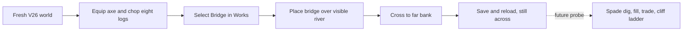
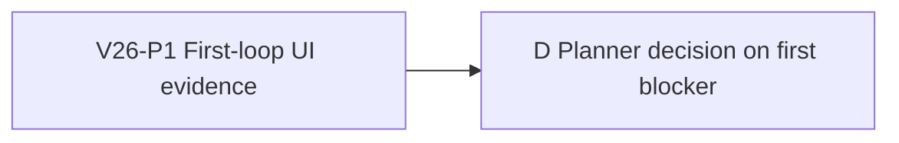

# Ticket Pack: V26 first-loop UI probe

## Summary

The V26 preview has checked route and excavation machinery, but browser proof
currently stops at four logs and opening Works. This pack finds the first real
blocker in the shortest new-player route to crossing, without editing code or
mistaking model tests for a playable journey. It consumes the aligned problem
statement in `STARTER_VALLEY_WORLD_LOOP_UNDERSTANDING.md` and remains a
milestone within the full Wizard Realms RPG goal.

Locked design:

- Use only one isolated Playwright renderer, then close it. The live Vite server
  at `http://127.0.0.1:5193` remains available to the user.
- Preserve V17/V23/V24/V25 saves and the current V26 root. Do not clear browser
  storage, reset a save, commit, push, or use GitHub.
- Record what a first-time player actually sees. Do not use script evaluation,
  local storage mutation, direct state writes, or internal API calls to advance.

Important repo truth:

- `?publicWorld=v26` can start a new checked V25 foundation and copy it to V26.
- The prior browser pass verified fresh entry, axe equip, four-log chopping,
  and Bridge/Ladder Works copy, but not placement and crossing.
- The source and tests claim eight-log bridge, four-log ladder, owned spade,
  checked dig/fill, and save/resume. Those claims need UI evidence.

## Proposed Flow

## Public Interfaces

- Browser URL: `http://127.0.0.1:5193/?publicWorld=v26`.
- Browser interaction: visible buttons, keyboard, canvas pointer actions only.
- Output: timestamped Playwright snapshots, screenshot of the first result or
  blocker, relevant console/network evidence, and exact reproduction sequence.

## Lane Graph

Runnable wave: V26-P1 starts now. D consumes P1's first decision-bearing UI
receipt and chooses either a bounded observed-failure repair or a wider
implementation pack for the next unproved loop segment.

## Topology Audit

- Productive-lane inventory: V26-P1 is a one-renderer discriminating evidence
  gate for the first unproved physical crossing.
- Maximum parallel width: one. This is the skill's bounded `user_flow_probe`
  exception. A second renderer would violate the user's RAM constraint and
  duplicate the same journey.
- Incomparable lane pairs: none in this probe. No artificial parallelism.
- Fan-in: D consumes the concrete UI receipt and is a decision node, not code.
- Certainty: whether the visible crossing can be completed is empirically
  open. Stop at the first reproducible blocker or at saved crossing proof.
- Surprise trigger: migration/source corruption, missing server, or a mismatch
  between visual bridge geometry and collision requires reclassification.
- Conditional repairs: none preauthorized before the observed owner is known.
- Dispatch verdict: PASS for bounded user-flow-probe exception only.

## Tickets

Paste now to: Native Reviewer 1
Ticket: V26-P1
Lane type: Serial discriminating probe
Delivery phase: user_flow_probe
Delivery milestone: SURFACE_READY
Shortest complete user flow: fresh V26 start, equip axe, chop eight logs, build
and cross one visible river bridge, save and reload across the river.
First-feedback evidence: exact first blocker or saved-crossing screenshot.
Test-writing policy: prohibited_until_pr_hardening
Review blocking classes: misleading UI, unexplained stop, migration/data-loss
risk, reproducible game-breaking browser error.
Surface readiness gate: URL loads, fresh V26 entry starts, game is visible.
Surface revision: current dirty worktree, record `git rev-parse HEAD` and the
local file-status baseline rather than pretending the diff is committed.
Surface entrypoint: `http://127.0.0.1:5193/?publicWorld=v26`
Surface availability / validation isolation: one isolated Playwright profile;
do not disturb the user's existing browser or dev server; close the profile.
Post-surface validation: planner routes first blocker to repair, then final UI
journey and focused regression proof continue.
Optional-feedback wait policy: never
Depends on: none

Lane role: Reviewer
Dispatch transport: native_spawned_subagent
Model: inherited
Cursor runtime: not_applicable
Existing-task routing: not_authorized
Existing-task capability and mission evidence: not_applicable
User-authorized task-coordination scope: ephemeral subagent within this goal
Ownership/workspace collision evidence: read-only files, one Playwright browser;
no other browser worker is active.
Current-status evidence: no active child owns this UI journey.
Existing-task delivery policy: not_applicable
No-interruption disposition: not_applicable
Task/thread receipt: not_applicable
Final fallback transport: none
Fallback CLI: not_applicable
Fallback model: not_applicable
Fallback activation conditions: not_applicable
Fallback availability evidence: not_applicable
Fallback first contact: not_applicable
Fallback follow-ups: not_applicable
Fallback session continuity: not_applicable
Runtime selection rationale: a native child can inspect the real UI and report
the first blocker without creating a durable task or another source owner.
Agent spec: independent first-time player, evidence-first and findings-first.
Required skills: auto-planner-ticket-pack, smallest-viable-diff, test-from-ui,
playwright.
Session policy: initialize once, then continue the same child if needed. Do
not spawn workers or change transport/model.
Worker agent: Codex Reviewer

Required behavior:

1. Read the listed skill files completely. Use `test-from-ui` `early_smoke` and
   the Playwright CLI wrapper. `command -v npx` first.
2. On a fresh isolated profile, use visible controls only. Capture the exact
   URL, sequence, screenshot, snapshot, console/network failures, and the first
   reproducible inability to advance. Do not continue broad testing after the
   first decision-bearing blocker.
3. Close the Playwright browser at completion and leave Vite running.

Certainty contract:

- Unknown / live branches: saved bridge crossing works; UI affordance blocks
  placement; geometry/collision blocks crossing; save/reload changes it.
- Closure mode: discriminating_probe.
- New information: the first concrete visible step that fails or succeeds.
- Stop condition: screenshot plus reproduction and correlated browser evidence.
- Surprise trigger: source corruption, storage reset prompt, or unrelated
  environment failure.

Required files to add/update: none.
Required tests to add/update: none, prohibited in this phase.

Smallest viable diff:

- Behavior delta: none in this probe; it selects the next actual fix.
- Expected diff budget: zero files, zero lines, zero dependencies.
- Reuse scan: existing V26 UI and Playwright CLI only.
- Prompt/config/contract alternative: no code until real UI evidence names an
  owner.
- Deletion/simplification target: not applicable.
- Tripwire policy: any file write or second renderer stops the lane.

Keep this lane narrow: no editing, no direct state modification, no new server,
no broader campaign assessment, no PR or GitHub action.

Acceptance commands:

- `command -v npx`
- `/Users/Benjamin.Fowlersmith/.codex/skills/playwright/scripts/playwright_cli.sh open 'http://127.0.0.1:5193/?publicWorld=v26'`
- Playwright `snapshot`, UI interaction, `screenshot`, and `close` commands.

Visual proof: required. The screenshot and exact journey must be from the
visible game, not unit tests or direct state. Report console/network status.

Return receipt: GO/NO-GO for the scoped crossing, first blocker with exact
steps and source hypothesis if any, screenshot/snapshot/log paths, branch and
HEAD, files changed (must be none), browser closure, transport/model/native
child ID, surface revision/URL, remaining unproved steps, and no-fallback
status. Smallest viable diff, reuse, deletion, and tripwires must be explicit.

## Assumptions

- One isolated Playwright profile is safe under the RAM constraint. It is
  closed at the end rather than kept open.
- The saved game in the user's own browser is not touched by this probe.
- No PR, commit, merge, or GitHub account action is authorized here.
