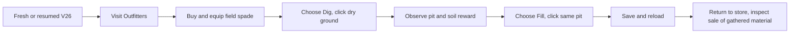
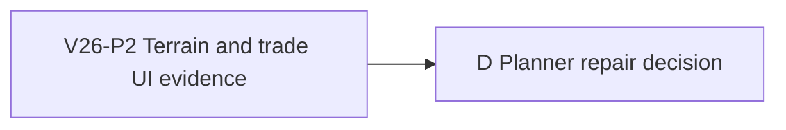

# Ticket Pack: V26 spade and terrain UI probe

## Summary

The creek bridge is browser-proven. This pack checks the next first-region
boundary: can a player acquire and equip the spade, click ground to dig, fill
the resulting pit, and find an honest route back to trade? It is a read-only
UI probe, not an implementation or a claim that the full RPG is finished.
The aligned source is `STARTER_VALLEY_WORLD_LOOP_UNDERSTANDING.md`.

Locked design: one isolated Playwright renderer, visible UI interactions only,
no state shortcuts, no browser save reset, no source edit, no commit or GitHub.
Leave the existing Vite server on port 5193 available and close the test
browser on completion. Do not touch the user's browser profile.

Important repo truth: V26's checked terrain writer accepts equipped-spade
soil digs on nearby discovered dry ground. The current UI advertises Dig/Fill
tools and Greenway Outfitters; the browser has not shown those steps working.

## Proposed Flow

## Public Interfaces

- URL: `http://127.0.0.1:5193/?publicWorld=v26`.
- Evidence: visible UI snapshot, screenshot, exact input sequence, console and
  network failures, saved/resumed status. If a fresh Playwright profile does
  not retain P1's save, start a new world through the UI; do not copy storage.

## Lane Graph

P2 starts now. D consumes the first visible blocker or the whole proved flow.

## Topology Audit

- Productive lane: P2 is one discriminating browser evidence gate.
- Maximum width: one; `user_flow_probe` exception, because a second renderer
  would duplicate the journey and add RAM pressure.
- Incomparable pair: none, no artificial parallelism.
- Fan-in: D uses P2's evidence, does not edit.
- Unknown: acquisition, targeting, rendering, persistence, or store economy
  could be the first failure. The UI result distinguishes these branches.
- Stop: first reproducible blocker or the complete flow with screenshot.
- Surprise: source corruption or external browser/server failure requires
  classification before product repair.
- Dispatch verdict: PASS for bounded user-flow-probe exception.

## Tickets

Paste now to: Native Reviewer 1, continued session
Ticket: V26-P2
Lane type: Serial discriminating probe
Delivery phase: user_flow_probe
Delivery milestone: SURFACE_READY
Shortest complete user flow: visit Outfitters, acquire/equip spade, Dig one
nearby dry cell, Fill it, save/reload, then inspect selling the gathered item.
First-feedback evidence: screenshot and first blocker, or final saved result.
Test-writing policy: prohibited_until_pr_hardening
Review blocking classes: unavailable promised action, misleading target,
unexplained rejection, lost save, game-breaking browser error.
Surface readiness gate: existing V26 URL and visible game load.
Surface revision: record HEAD plus dirty file baseline, not a false commit.
Surface entrypoint: `http://127.0.0.1:5193/?publicWorld=v26`
Surface availability / validation isolation: isolated Playwright browser,
closed at end, server remains.
Post-surface validation: planner routes first blocker to scoped implementer,
then repeats the same UI path and focused regression checks.
Optional-feedback wait policy: never
Depends on: V26-P1 crossing receipt, GO.

Lane role: Reviewer
Dispatch transport: native_spawned_subagent
Model: inherited
Cursor runtime: not_applicable
Existing-task routing: not_authorized
Existing-task capability and mission evidence: not_applicable
User-authorized task-coordination scope: ephemeral continuation in this goal
Ownership/workspace collision evidence: read-only, prior browser closed.
Current-status evidence: P1 child completed and is idle.
Existing-task delivery policy: not_applicable
No-interruption disposition: not_applicable
Task/thread receipt: not_applicable
Final fallback transport: none
Fallback CLI: not_applicable
Fallback model: not_applicable
Fallback activation conditions: not_applicable
Fallback availability evidence: not_applicable
Fallback first contact: not_applicable
Fallback follow-ups: not_applicable
Fallback session continuity: not_applicable
Runtime selection rationale: the already-qualified native P1 reviewer can
continue in a read-only UI lane with recent context and no new durable task.
Agent spec: independent first-time player, evidence-first and findings-first.
Required skills: auto-planner-ticket-pack, smallest-viable-diff, test-from-ui,
playwright (already read in P1; reread changed instructions if any).
Session policy: continue same child, no nested workers or model change.
Worker agent: Codex Reviewer

Required behavior:

1. Use `test-from-ui` early_smoke through Playwright CLI visible controls.
   Confirm whether the old isolated profile retained P1's save; if not,
   create V26 through the UI. Do not mutate storage or write source.
2. Attempt the shortest spade, dig, fill, resume, and sale path. Stop at the
   first decision-bearing reproducible blocker. Record exact text and location.
3. Close the Playwright browser and leave Vite running.

Certainty contract:

- Unknown / live branches: spade cannot be bought; digging target is
  undiscoverable or invalid; pit/material fails to render or save; gathered
  material cannot be traded; whole journey works.
- Closure mode: discriminating_probe.
- New information: first UI boundary with exact screenshot and steps.
- Stop condition: first blocker or saved terrain and sale outcome.
- Surprise trigger: unexpected save/source lock or external environment error.

Required files to add/update: none.
Required tests to add/update: none, prohibited in probe phase.
Smallest viable diff: zero production files and lines, no dependencies; reuse
existing controls; any source edit or second renderer is a tripwire. A prompt
or doc cannot substitute for actual UI evidence.
Keep narrow: no code, no GitHub, no broad campaign playthrough.
Acceptance commands: `command -v npx`; Playwright CLI `open`, `snapshot`,
visible interactions, `screenshot`, `close` using the installed wrapper.
Visual proof: required, with input sequence and console/network status.
Return receipt: GO/NO-GO, exact blocker or saved outcome, artifacts, branch and
HEAD, files changed none, browser closed, remaining unproved steps, transport
native_spawned_subagent/model inherited/child ID, fallback false, smallest
diff/reuse/deletion/tripwire result.

## Assumptions

- The same local Vite server is still running.
- A fresh profile may require a fresh game; repeated visible setup is allowed.
- This probe does not authorize resetting or altering any user's save.
