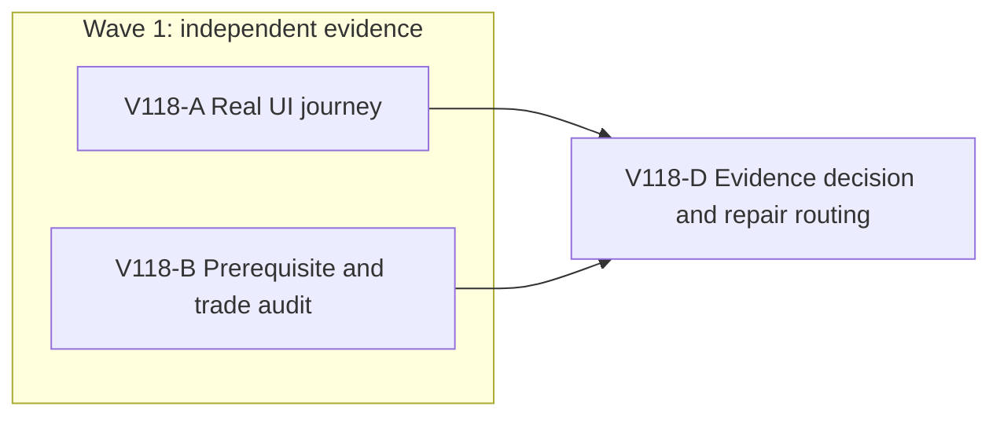

# Ticket Pack: V118 Highland source-to-buyer UI proof

## Summary

Original ask: continue the full third-person Wizard Realms RPG goal. The current V32 preview already supports a genuine connected trip and a checked, saved Quarry Crown study. The immediate aligned problem is to prove the next honest player loop in the real UI: discover a stone shelf, earn the stated spade and Excavation prerequisites, extract stone, return, sell it, and reload the saved result. This is one milestone toward the full 2 km campaign, not its terminal condition.

Goals: one lineage, visible controls and route cues, checked actions, persistent extraction and sale, no invented resources or altered checkpoint. Non-goals for this pack: new regions, mounts, fairy rings, combat, endgame, PR packaging, and online anti-cheat.

Locked design:

- Preserve V11 to V31 history, V32 checked authority, the rock-return and river collisions, and the four canonical Highland nodes.
- Use the authentic private V32 revision-118 checkpoint without printing or editing its IndexedDB contents. Its player has an axe and 120 coins, but no spade or Excavation Lv2.
- Use one isolated browser renderer at a time. Checkpoint and close/reopen before roughly 1.0 GB RSS; stop immediately if it exceeds 1.2 GB. Keep the user-facing dev preview at port 5193 available.
- No GitHub action or production deployment is authorized. Any later GitHub action must use the Bioscopics identity, never a work identity, with `ben/` branches.

Important repo truth:

- `PublicV32WorldView.ts` reveals a canonical stone shelf only after its tile is walked and in active view. Within 5 m it offers a nearby prompt; checked extraction requires grounded pose within 3 m, Crown studied, an owned and equipped field spade, Excavation Lv2, two free pack slots, and a recovered node.
- `publicWorldV32Highland.ts` grants two stone and 20 Excavation XP on success. The V32 root replays inherited V31 actions, including ordinary purchase, equip, digging, and Outfitters sale.
- Prior UI evidence proved Crown Study and reload at revision 118, but not shelf discoverability, extraction, return, or sale. A heavy combined snapshot retest was stopped for RAM; focused domain-lane tests passed earlier.

System translation routing: `not_qualified`, this is a product journey on the existing engine, not a cross-system port. System translation receipt: `not_applicable`. Product agent runtime: `not_required`, the shipped game does not execute an agent or model. Goal status: `aligned`, the active durable goal gives the terminal condition. Open questions are execution-local, not outcome-determinative.

## Proposed Flow

## Public Interfaces

No public interface change is planned. The surface is `http://127.0.0.1:5193/?publicWorld=v32`; UI validation uses isolated preview port 5194 and the private revision-118 checkpoint. An observed product failure may activate a new bounded repair ticket, not a speculative interface change.

## Lane Graph

Runnable wave 1: A and B start from the already fixed V32 contract and touch separate surfaces. A owns the isolated test browser and private checkpoint. B owns read-only source analysis. D consumes both receipts, decides whether the full loop passed or a concrete defect needs a scoped repair. There is no PR finisher because this pack authorizes no PR.

## Topology Audit

- Productive lanes: A creates a genuine UI journey/evidence artifact; B independently establishes the legitimate acquisition and sale route and identifies any source contradiction. Their work is incomparable and can run in parallel.
- Maximum safe width: 2. Only A may open the game renderer.
- Fan-in: D consumes A's observed behavior and B's source contract. A source assertion never upgrades an unplayed UI step to a pass.
- Broad-lane split: none. A is one continuous gameplay proof; B is one bounded source/economy concern.
- Certainty: A closes whether the actual UI exposes and accepts the complete player path, using a discriminating browser probe. B closes whether the existing checked prerequisites and sale can support it, using source reasoning plus only targeted existing tests if source is ambiguous. A blocker, an unmarked node, contradictory prompt, or failed reload is a surprise requiring local diagnosis.
- Serial edges: A and B only feed D; D cannot decide before both report. No implementer is activated without an observed owner and a new bounded ticket.
- Conditional repair readiness: not applicable yet; unmapped findings return to planning. Dispatch verdict: PASS.

## Tickets

### Paste now to: V118-A UI implementer

Ticket: V118-A. Lane type: Parallel. Delivery phase: user_flow_probe, then implementation evidence. Delivery milestone: SURFACE_READY (already available), then final_complete only for the full played loop. Shortest complete user flow: resume V32 #118, reveal shelf, satisfy tools/skill through UI, extract, return, sell, reload. First-feedback evidence: actual shelf prompt or first product blocker. Test-writing policy: prohibited until hardening. Review blocking classes: invisible shelf, false route, incorrect prerequisite, checked-action failure, lost save, performance cap breach.

Role lock: `implementer` ONLY. Transport: `native_spawned_subagent` continued from the prior ephemeral UI child. Model: inherited. Cursor runtime: not_applicable. Existing user-owned task routing: not_authorized. Ownership: isolated browser and checkpoint only, no source files. No interruption: prior child is completed and available. Fallback transport: none. CWD: `/private/tmp/pa-wizard-playable-v2/games/wizard-realms/engine`. Agent spec: realistic novice tester, one renderer, no hidden-state shortcuts. Session: continue the same child; no nested worker.

Required skills: `auto-planner-ticket-pack`, `smallest-viable-diff`, `test-from-ui`, `playwright` if using terminal browser automation. Read each before acting. Run one isolated preview of the current build on port 5194, not the user's 5193. Do not print or edit private checkpoint contents. Use visible map and controls, not direct DB writes. Capture exact prompt, action, save/reload, console/network, memory RSS and screenshot evidence. Report each observed blocker as `observed error | change | restart | retry result | next action`; do not repair source in this lane. Close preview and sole renderer on stop. If a full-loop run needs multiple bounded sessions, persist a private mode-600 checkpoint and continue the same lane.

Smallest viable diff: behavior delta is proof only, expected files 0, net lines 0, dependencies 0. Reuse existing V32 UI, tools, save, and store. Prompt/config alternative is not relevant because no code change is authorized. Delete/simplify target: none. If a code edit seems necessary, stop and report the exact owner. Acceptance: UI screenshot plus checked save/reload for each changed state, no gameplay console/network error, RSS under cap except a reported transient.

Return: transport/session receipt, exact visible route and controls, prices/resources/XP actually observed, saved revision, screenshot paths, health evidence, pass/fail per step, blocker and next safe action, plus smallest-diff receipt with no changed files.

### Paste now to: V118-B source reviewer

Ticket: V118-B. Lane type: Parallel. Delivery phase: implementation evidence. Delivery milestone: pre_surface for this lane. Shortest complete user flow under review: acquire and equip spade, reach Excavation Lv2, extract two stone, sell at Outfitters through inherited checked actions. First-feedback evidence: exact owner/constraints or contradiction. Test-writing policy: no changes. Review blocking classes: source-level impossible progression, missing sale, save incompatibility.

Role lock: `reviewer` ONLY. Transport: `native_spawned_subagent` continued from the prior ephemeral source reviewer. Model: inherited. Cursor runtime: not_applicable. Existing user-owned task routing: not_authorized. Ownership: read-only game source and existing tests; never the private checkpoint or browser. No interruption: prior child is completed and available. Fallback transport: none. CWD: `/private/tmp/pa-wizard-playable-v2`. Agent spec: findings-first domain/economy auditor. Session: continue same child; no nested worker.

Required skills: `auto-planner-ticket-pack`, `smallest-viable-diff`. Read before acting. Inspect existing Outfitters catalog, spade purchase/equip, Excavation XP acquisition, V32 node discovery/extraction, and stone sale/replay with exact code references. Decide whether the authentic axe-only, 120-coin player can complete the loop without reset, mutation, or hidden shortcut. Identify the shortest legitimate path and any source contradiction. Do not edit files, start a renderer, or run the memory-heavy combined snapshot suite.

Smallest viable diff: read-only, files 0, net lines 0. Reuse present authority and tests. Acceptance: evidence-backed GO/NO-GO, exact prerequisite chain and pricing, source/test references, one named residual unknown for UI. Return the required reviewer receipt, including minimal-diff PASS/NO-GO, risks, gaps, and no code changes.

### Wait for A and B, then: V118-D decision

The top-level planner compares source and played evidence. If UI passes, record the milestone without claiming the full RPG complete. If UI finds a reproducible product blocker, preserve the exact checkpoint, action, and error, then author a bounded owner-specific repair. If only prerequisites remain, continue A without faking state. No automatic PR, merge, or goal completion.

## Assumptions

- The current checked V32 build and dev preview remain available; an isolated preview can use built assets without changing the user's server.
- The private revision-118 checkpoint is intact and is treated as test data, never as a source file or Git artifact.
- A locally editable browser save gives structural integrity, not anti-cheat authenticity. Online market remains outside this pack.

## Fan-in receipt, 2026-10-11

V118-A and V118-B both passed their stated contracts. The source audit found a legitimate 18g spade purchase, a first soil Dig that awards 30 Excavation XP and reaches Lv2, checked Highland stone extraction, and a carried-stone Outfitters sale. The real UI then exercised those steps from the authentic Crown-studied save without editing the save or bypassing the controls.

The played sequence was: discover a ready shelf and its spade lock; return by the revealed quarry trail and centered saved ladder; buy and equip the field spade for 18g; Dig a clear dry Greenway soil patch and reach Excavation Lv2; follow the charted dry-bank and quarry trail back; extract two stone at an enabled shelf; return through the upper east-rock detour and saved ladder; sell both stone at Outfitters for 2g. Validated save #512 retained 104 coins, no carried Stone, the equipped spade, and Excavation Lv2. The sale completed the V118 source-to-buyer milestone, not the full-game goal.

The initial off-center ladder attempts were refused as cliff drops, but a centered retry from the visible Works coordinates succeeded in both directions. Two early Dig targets were protected building ground and rock beneath pale terrain; a clear grass patch accepted Dig. These were checked/visible constraints, not source changes or demonstrated product defects. One IndexedDB-inclusive export from a live ~1.05 GB WebGL renderer briefly rose to ~1.41 GB and was closed immediately. Subsequent authentic checkpoints first unloaded the same tab's WebGL scene to `about:blank`, then exported IndexedDB, keeping the sole renderer below the 1.2 GB cap. No game source, tests, or Git state changed during this evidence pass.

Final evidence: [pre-sale store snapshot](../.playwright-cli/page-2026-10-11T09-02-21-752Z.yml), [sale screenshot](../.playwright-cli/page-2026-10-11T09-02-52-882Z.png), [post-reload screenshot](../.playwright-cli/page-2026-10-11T09-03-55-388Z.png), and private mode-600 [validated #512 checkpoint](../.playwright-cli/wizard-v118-stone-sale-rev512-indexeddb.json). The private checkpoint is test data and must not be committed. Console after final reload had zero errors and one `THREE.Clock` deprecation warning; app and bundle requests returned 200. Isolated test preview 5194 and its renderer were closed. User preview 5193 remained HTTP 200.
