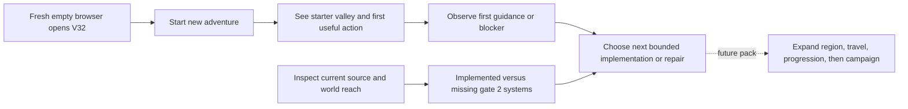
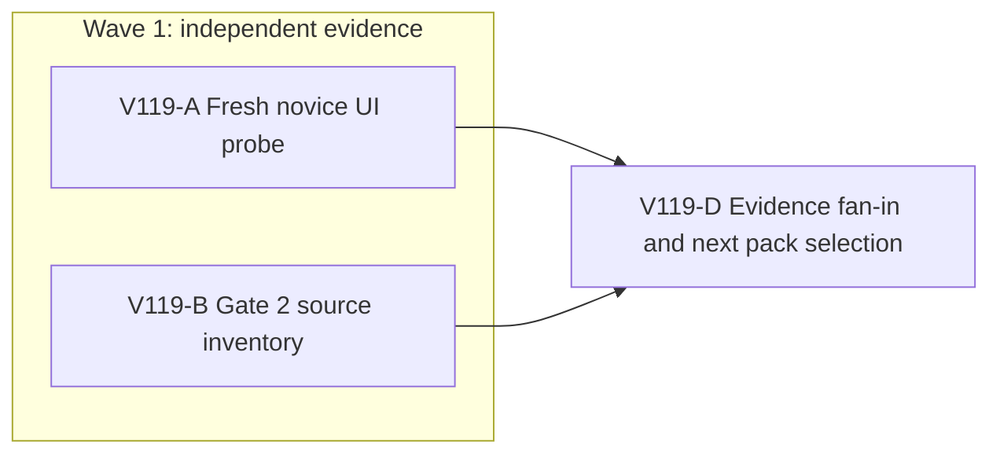

# Ticket Pack: V119 fresh-player entry and connected-world breadth decision

## Summary

This pack consumes the aligned problem statement in `V119_FRESH_ENTRY_AND_BREADTH_UNDERSTANDING.md`. The V115 first-region and V118 Highland journeys prove real saved gameplay, but they do not prove a fresh current-build novice start or the full connected-world campaign. Two independent evidence lanes close those questions before the next feature pack is selected.

Locked design:

- Preserve the current approved hair direction, V11 through V32 behavior, save lineage, collision, and prior private checkpoints.
- No source edit or GitHub action in this pack. The user-facing preview at port 5193 remains live.
- A fresh novice browser gets a separate origin/profile with no imported save and no hidden-state manipulation. One test renderer at a time; unload/close before 1.2 GB RSS.
- Full-game completion remains the active goal, not a result of this diagnostic pack.

Important repo truth:

- `PublicV32Entry.tsx` offers `Start new adventure` only after checked V31/V32 inspection. A fresh start creates a checked predecessor lineage, not a quick in-memory demo.
- V115 proves a continuous saved Mireglass expedition and trade. V118 proves genuine Highland extraction, westbound return, sale, and reload at save #512. Neither is a clean-origin novice journey on one unchanged current build.
- `GAME_DESIGN.md` has the current full-game delivery gates but its status paragraph describes an older v11 world. Source and runtime, not that paragraph, determine implemented breadth.

System translation routing: `not_qualified`; receipt `not_applicable`. Product agent runtime: `not_required`. Goal status: `aligned`. Surface revision: current `ben/wizard-playable-v2` working tree, recorded by lane receipts, not a tagged release. No PR units are proposed by read-only evidence lanes.

## Proposed Flow

## Public Interfaces

No public interface changes. The real entrypoint is `http://127.0.0.1:5193/?publicWorld=v32`. UI validation runs against an isolated Vite preview on port 5194 with its own fresh browser profile. The output of this pack is an evidence and next-action decision, not an API or schema.

## Lane Graph

Runnable wave 1: A owns only the isolated game browser and fresh profile; B owns read-only source inspection without a renderer. Neither consumes the other's result. D consumes both receipts. No implementer repair can start until an observed defect identifies a bounded owner. Reviewer is omitted because there is no code diff; D reconciles independent evidence. PR finisher is omitted because no PR or packaging was requested or authorized.

## Topology Audit

- Productive lanes: A creates a fresh UI behavioral receipt for onboarding; B creates a source-grounded gate-2 capability inventory and extension seam. They are decision-bearing, non-overlapping evidence artifacts.
- Maximum safe width: 2. Only A may run a browser renderer.
- Incomparable pair: A and B use fixed existing V32 and design contracts and touch disjoint surfaces. Neither needs the other's result to start.
- Fan-in: D selects a subsequent bounded feature or observed-failure repair from both receipts. D does not repeat the UI journey or source review.
- Broad-lane split audit: A tests only initial fresh-player comprehension through the first useful interaction or first blocker. B audits only connected-world breadth and travel-tier owners, not graphics, economy balance, or endgame design.
- Certainty: A discriminates whether fresh V32 entry and first action are usable; stop at the first decision-bearing pass/blocker. B reasons from current source to distinguish implemented travel/world systems from design-only claims; stop once the next extension seam is identified. A surprising entry failure or a source/runtime contradiction triggers local deepening.
- Conditional activation: any product defect requires a new bounded repair ticket with exact observed error and owner. If A is usable, D can select the next region/travel pack; no automatic PR. Dispatch verdict: PASS.

| Serial edge | Consumed artifact | Why concurrent execution is impossible |
|---|---|---|
| A to D | Fresh novice UI receipt | D must know whether entry or first action blocks before choosing build work. |
| B to D | Current-source gate-2 inventory | D must know which world/travel seam actually exists before scoping the next build. |

## Tickets

### Paste now to: V119-A UI implementer

Ticket: V119-A. Lane type: Parallel. Delivery phase: `user_flow_probe`. Delivery milestone: `SURFACE_READY` is already met by the existing user preview; this lane returns `final_complete` only for the bounded probe. Shortest complete user flow: open a genuinely fresh V32 browser, click `Start new adventure`, understand movement and the first suggested useful action, perform one real action such as chopping an accessible tree, and see the resulting inventory/XP or the first precise blocker. First-feedback evidence: screenshot of entry and first post-action state or exact failure, plus console/network. Test-writing policy: prohibited until a later hardening pack. Review blocking classes: entry cannot create a save; first control/action is invisible, occluded, misleading, or refused without actionable cue; save is lost; fatal browser failure.

Role lock: `implementer` ONLY, evidence-only. Dispatch transport: `native_spawned_subagent`, continued from the completed ephemeral Wizard UI tester with recent V118 capability evidence. Model: inherited. Cursor runtime: not_applicable. Existing-task routing: not_authorized, no user-owned Codex task contact. Capability and mission evidence: prior child completed the authentic V118 Highland UI loop, with snapshots, checkpointing, and a single-renderer memory discipline. Ownership/workspace collision evidence: isolated browser/profile and port 5194; no code files. Current-status evidence: verify child completed before follow-up. Delivery policy: bounded first-result message, final receipt with evidence. No-interruption disposition: idle_safe_to_contact only if still completed; otherwise halt. Task/thread receipt: not_applicable. Final fallback transport: none; fallback CLI/model/activation/commands/session: not_applicable. Runtime selection rationale: the same native UI child knows the current browser controls and save discipline, while a fresh profile tests actual novice entry. Agent spec: unfamiliar player who reads only visible UI, not source directions. Session policy: initialize once then continue the same ephemeral child, no nested workers. Worker agent: Wizard UI tester.

Required skills: `auto-planner-ticket-pack`, `smallest-viable-diff`, `test-from-ui`, and `playwright` if using terminal browser automation. Read each completely before acting. Use `early_smoke`. CWD: `/private/tmp/pa-wizard-playable-v2/games/wizard-realms/engine`. The already provisioned user preview is on 5193; start an isolated `npm run dev -- --host 127.0.0.1 --port 5194` only if needed, with a fresh test profile. Environment repair authority: none. Stop after one confirmed external setup failure plus at most one documented retry. If 5194 is already occupied by the same owned preview, attach instead of spawning another.

Required behavior: click visible fresh-entry controls; do not import any saved checkpoint; do not read or edit IndexedDB; follow only the game's own cues; attempt one first meaningful action and inspect visible output. Capture entry, first action/result, console and failed network requests, exact inputs, browser RSS, and any save/reload that is safe within the bounded probe. If the first result is a blocker, report it immediately and stop broader play. No source edits, Git action, or broad suites. Close sole renderer and isolated preview on exit; preserve 5193.

Smallest viable diff: proof only, expected changed files 0, net lines 0, new files 0, dependencies 0. Reuse current V32 entry, controls, and HUD. Prompt/config alternative: no code change in this lane. Deletion target: none. Tripwire: any need for product or infrastructure edits stops the lane for D. Visual proof: required because this is a rendered game journey. Acceptance: visible fresh start and first committed action or captured first blocker, with screenshot and console/network evidence. Return: exact first result, URL/profile isolation, screenshot paths, action inputs, save revision if any, memory, health evidence, all V119-A delivery/runtime fields, and no-diff receipt.

### Paste now to: V119-B source reviewer

Ticket: V119-B. Lane type: Parallel. Delivery phase: `implementation` evidence. Delivery milestone: `final_complete` for source inventory only. Shortest user outcome under review: a player can traverse the approximately 2 km world and eventually use distinct regions, fairy rings, boats, ground and flying mounts. First-feedback evidence: precise current implementation classification and one highest-leverage extension seam. Test-writing policy: no changes. Review blocking classes: a design-only feature misclassified as playable; reachability claimed without code or UI proof.

Role lock: `reviewer` ONLY. Dispatch transport: `native_spawned_subagent`, continued from the completed ephemeral V118 source reviewer. Model: inherited. Cursor runtime: not_applicable. Existing-task routing: not_authorized. Capability and mission evidence: prior child produced an accurate source-level V118 tool, XP, and sale audit. Ownership/workspace collision evidence: read-only source/docs, no browser, no checkpoint access. Current-status evidence: verify child completed before follow-up. Delivery policy: one findings-first report and final receipt. No-interruption disposition: idle_safe_to_contact only if still completed. Task/thread receipt: not_applicable. Final fallback transport: none; fallback CLI/model/activation/commands/session: not_applicable. Runtime selection rationale: current reviewer has recent V32 source context and can distinguish authority from design declarations without consuming renderer RAM. Agent spec: evidence-led world/travel capability auditor. Session policy: initialize once then continue same ephemeral child, no nested workers. Worker agent: Wizard source reviewer.

Required skills: `auto-planner-ticket-pack`, `smallest-viable-diff`. Read each completely before acting. CWD: `/private/tmp/pa-wizard-playable-v2`. Inspect `games/wizard-realms/docs/GAME_DESIGN.md`, `FIRST_REGION_SYSTEMS_CONTRACT.md`, `SECOND_REGION_HIGHLAND_PACK.md`, current V32 entry/domain/view owners, and focused tests for world dimensions, region discovery, fairy rings, boats, ground/flying mounts, and transport. Use `rg` first. Do not trust stale status prose. Do not edit files, launch a renderer, inspect private save contents, or run heavy combined suites.

Certainty contract: unknown is which gate-2 world/travel capability should be implemented next. Live branches are missing authored region breadth, missing usable travel tier, or a fresh-entry blocker that makes both premature. Closure mode: reasoning from current source and existing focused test coverage, explicitly distinguishing code presence from UI proof. New information: table of implemented, design-only, and unverified capabilities, exact owner files and likely narrow extension seam. Stop when one next implementation candidate and dependencies are clear. Surprise trigger: source contradicts V118/V115 UI evidence or world extent is not actually connected.

Smallest viable diff: read-only, files 0, net lines 0. Reuse scan names current region/travel owners and tests. Prompt/config alternative: no behavior change. Deletion target: none. Tripwire: no edits. Acceptance: exact source paths/line references and proof boundaries, with a GO/NO-GO for whether new region/travel work can begin without altering historical saves. Return: findings-first inventory, one recommended smallest next build seam, unknowns requiring UI proof, no-diff and runtime receipt.

### Wait for V119-A and V119-B, then: V119-D planner fan-in

D consumes both receipts and chooses exactly one bounded next product pack. If A exposes a reproducible product blocker, use its exact URL/input/error and mapped source owner for the observed failure causal loop. If A passes and B finds a ready extension seam, author the next region/travel pack with explicit migration and real UI proof. If B reports an architecture or save boundary, remain in Planner mode until that decision is resolved. D never upgrades source presence or a first-action smoke test into full-game completion.

## Assumptions

- The current 5193 V32 preview is reachable and remains user-facing. The UI lane uses an isolated browser origin/profile.
- The first novice action can be probed without resetting any existing browser save.
- The V118 accepted hair direction is stable for this pack. Later environment and character fidelity work remains part of the full-game goal.

## Smallest Viable Diff

Behavior delta: no code change yet; produce decision-bearing fresh-entry and world-breadth evidence. Expected diff budget: files 0, net lines 0, new files 0, dependencies 0, apart from this planning documentation and non-committed browser evidence. Expected changed production files: none. Forbidden surfaces: existing V11 to V32 save authority, user preview/profile, asset hair, dependencies, GitHub. Reuse scan: V32 entry, existing HUD and world projection, V115/V118 receipts, current region and travel owners. Prompt/config/contract alternative: evidence is needed before deciding whether a code or content change is required. Deletion/simplification target: none in evidence phase. Validation: real fresh-origin browser probe and read-only source inventory. Tripwire: any proposed source edit or more than one renderer returns to planning for a bounded implementation ticket.

## Fan-in receipt, 2026-10-11

V119-A passed its bounded fresh-entry smoke test. In a genuinely empty isolated V32 browser, `Start new adventure` appeared without `Continue`; the visible objective led to equipping the axe and chopping a nearby Greenway oak twice. The committed result was four logs, skill XP, and a changed objective explaining the ladder/bridge use of those logs. Same-tab reload validated save #3 with axe, four logs, and 120 coins retained. This proves only first entry and first action, not the complete first-region novice journey. [Entry screenshot](../.playwright-cli/page-2026-10-11T09-13-54-683Z.png), [chop result](../.playwright-cli/page-2026-10-11T09-15-00-306Z.png), [resumed state](../.playwright-cli/page-2026-10-11T09-15-45-737Z.png). The isolated renderer and preview were closed; the user preview remained HTTP 200. Peak renderer RSS was about 863 MiB, with no gameplay console errors after reload.

V119-B found that the current 2,048 m grid is mostly generated wilderness, with authored gameplay concentrated in Greenway, Mireglass, and Highland Quarry. Walking, discovery, boots, Wayfinder, and checked built routes exist. Fairy-ring teleport is not available in V32: Greenway's current projection has no ring, Mireglass's ring has no destinations, and inherited continuous authority rejects cross-region teleport. Boats and mounts have no current action/authority path. Focused world/Highland/view tests passed 34/34. This is a source classification, not a new UI travel proof.

V119-D decision: the first-action novice blocker branch did not activate. The next product pack should create a checked, save-safe, two-ring Greenway-to-Mireglass travel link as a useful return tier while preserving walking and built routes. A new versioned successor is required rather than modifying V32 witnesses. The full fresh first-region acceptance and broader campaign remain open. No source files, Git state, or GitHub state changed in V119; only this planning record and isolated browser evidence were added.
