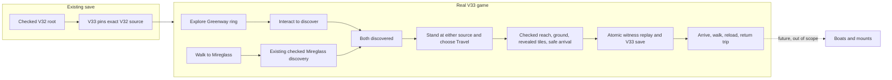
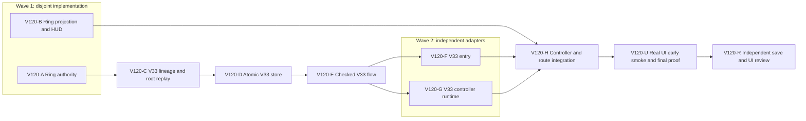

# Ticket Pack: V120 checked Greenway–Mireglass fairy-ring link

## Summary

This pack implements the aligned problem in `V120_FAIRY_RING_LINK_UNDERSTANDING.md`. V33 adds a bidirectional, discovery-gated shortcut between the two existing rings, with a separate checked save lineage and an opt-in `?publicWorld=v33` UI. V32 remains available and unchanged in meaning. This pack does not complete the full game.

Locked design:

- The only ring pair is `ring-greenway` and `ring-mireglass`. Greenway discovery is a new checked witness; Mireglass discovery remains the existing checked V24 action. For the Greenway ring center on a grid seam, both authority and projection derive its revealed tile using `worldTileAtGrid(seed, ceil(x / WORLD_CELL_METERS - 0.5), ceil(z / WORLD_CELL_METERS - 0.5)).id`; Mireglass uses its canonical `mireglassFairyRing(seed).tile.id`.
- V33 is a separate database and exact, complete V32-root migration. V32's disabled cross-region frame stays disabled. New travel is a single V33 checked action with atomic save, strict replay, and no hidden reveal of unknown tiles.
- Source reach is grounded and within 3 m in 3D; both ring IDs and both ring tiles must already be discovered; arrival must be dry supported ground at the effective floor. Rejection is state-neutral. Travel is free and repeatable, with `tick` and `eventSequence` each advancing by one and `verticalVelocity` reset to zero.
- Keep 5193 V32 alive. Use one isolated renderer for V33 UI work, close it after proof, and stop before 1.2 GB RSS. No GitHub mutation or PR.

Important repo truth:

- `domain/publicWorldV13ContinuousSession.ts` rejects cross-region teleport, and `PublicV14WorldView.ts` omits Greenway rings. `PublicV24MireglassView.ts` exposes a discovery-only ring.
- `view/WizardHud.tsx` already renders discovered fairy destinations but excludes `starterCliff` projections. `PublicV23Controller.tsx` owns V32 action routing and projection composition.
- V32 save boundaries are `publicWorldV32Migration.ts`, `publicWorldV32Snapshot.ts`, `atomicV32Database.ts`, `publicWorldV32Flow.ts`, `PublicV32Entry.tsx`, and `PublicV32ControllerRuntime.ts`. Reuse each contract, do not loosen its decoder.

System translation: `not_qualified`. Product agent runtime: `not_required`. Goal: `aligned`. Branch/worktree: `ben/wizard-playable-v2`, `/private/tmp/pa-wizard-playable-v2`. Baseline is dirty and ahead 2; all unrelated state is user-owned. No PR unit yet. Delivery phase starts at `implementation`, pre-surface, and moves to `pr_hardening` only after real V33 surface readiness.

## Proposed Flow

## Public Interfaces

- `PUBLIC_V33_SCHEMA = 'wizard-world/v33'`; `PUBLIC_V33_DATABASE_NAME = 'wizard-realms:world:v33'`; `PublicV33Lineage` pins the exact `PublicV32Root` with rules profile `fairy-ring-link/v1`; `PublicV33Progress = PublicV32Progress`.
- New strict witnesses: `{kind:'fairy-ring-discover/v1', ringId:'ring-greenway'}` and `{kind:'fairy-ring-travel/v1', sourceRingId:'ring-greenway'|'ring-mireglass', targetRingId:'ring-greenway'|'ring-mireglass'}`. Travel requires distinct IDs and the canonical pair. Witnesses contain no destination coordinates or arbitrary state patch.
- `confirmPublicV33FairyRingAction(progress,witness)` is a pure reducer returning `{progress}` or `{rejection}`. It never changes a failed input. Its travel successor changes only `state.tick`, `state.eventSequence`, `state.movementOwner`, `state.player.position`, `state.player.verticalVelocity`; discovery changes only sequence and `discoveredRingIds`.
- `PublicV33Root` is `{lineage,head,previous}`; head has V32 progress fields plus V33 schema, saveRevision, and `PublicV32Witness | PublicV33FairyRingWitness | null`. Export V32's existing private `preserves` and `monotonic` checks as `publicV32Preserves` and `publicV32Monotonic`, with parameter types widened only to `PublicV32Progress`; their bodies and V32 call sites remain behavior-identical. V33 calls these exact helpers, not a copied rule set. Three-slot replay and checked successor must reconstruct the exact progress from the witness.
- `PublicV33EntryApp` at `?publicWorld=v33`, opt-in only, can create/migrate/resume through checked V32 ancestry. The existing `?publicWorld=v32` route remains.
- `WizardViewProjection.v33FairyTravel?: boolean` opt-in flag permits the existing HUD ring panel despite `starterCliff`. Projection exposes only actually revealed, active ring tiles and only discovered destination choices. No global HUD change for V32.

## Lane Graph

Wave 1 is immediately runnable after this pack is accepted. A and B are incomparable: pure action authority versus read-only projection/HUD, with disjoint files and fixed IDs/contract. C consumes A's witness decoder. D consumes C's root decoder. E consumes D's store. F and G consume E's flow types but touch disjoint entry and runtime files. H consumes B, F, G and is the only shared-controller integration owner. U uses one isolated real browser; R reviews the integrated result. No PR finisher: the user did not request packaging or a PR, and no GitHub action is authorized.

## Topology Audit

- Productive lanes: A owns pure V33 ring reducer; B owns projected ring affordance; C owns versioned lineage/root; D owns atomic store; E owns locked flow; F owns entry; G owns runtime adapter; H owns controller/route integration; U owns cross-boundary UI evidence. Each changes or proves one bounded concern.
- Maximum immediately safe width: 2 (A and B). Later width: 2 (F and G). No two lanes edit the same file concurrently.
- Incomparable pairs: A || B, F || G. Both pairs converge at H through exact action and UI contracts.
- Fan-in: H integrates A through G into the opt-in route; U tests the real user outcome; R checks stale-source, replay, and UI exposure risks independently.
- Broad-lane split: store, flow, entry, and runtime are separate to keep each implementation family near 1 to 3 files and under 300 net new lines. Any need to alter historical V32 behavior, shared renderer/framework, dependencies, or more than five files in a lane stops for replan.
- Certainty: A closes whether canonical rings can form a checked, safe pure transition; B closes whether the existing HUD can show only discoverable rings; C/D/E close exact save lineage, replay, and CAS; U closes integrated real UI behavior; R seeks an omission in cross-version integrity or hidden map/UI leakage, not a generic reread. Surprise triggers are legacy state rejection, unsupported target pose, source mismatch, WebGL error, and non-atomic travel.
- Conditional activation: a reproducible product blocker stays with its current bounded implementer for the observed-error loop. If it survives two grounded repairs or crosses scope, return to planner. No automatic PR. Dispatch verdict: `PASS` for A and B only; downstream lanes require their exact upstream receipts.

| Serial edge | Consumed artifact | Why concurrent execution is impossible |
|---|---|---|
| A→C | Final witness decoder/reducer exports | Root replay cannot validate an undefined witness. |
| C→D | Exact root and checked-successor decoders | Atomic store commits only decoded roots. |
| D→E | Store proof/CAS interface | Flow's locked writes require the actual store contract. |
| E→F,G | Inspection, start, commit, return-home types | Both adapters bind the settled flow API. |
| B,F,G→H | Projection, entry bindings, runtime signatures | Shared controller and route must import working adapters. |
| H→U→R | Integrated route and browser evidence | The real journey and independent final review need the assembled revision. |

## Smallest Viable Diff

Behavior delta: one checked discover action plus a two-way ring shortcut in opt-in V33. Expected diff budget: A 1 new file under 180 net lines; B 1 new view file and 2 small edits under 180; C 2 new files and one behavior-preserving export edit under 300; D one store file under 130; E one flow file under 260; F one entry file under 220; G one runtime file under 170; H controller/main under 140; no dependencies. Tests are added only after `SURFACE_READY` and kept focused. Reuse scan: canonical Greenway/Mireglass ring facts, V24 discovery, V31 pose, V32 replay/lineage/store/flow, existing HUD panel, existing v32 controller. Prompt/config alone cannot enforce atomic, replayable travel. Deletion/simplification: remove the V33-only empty destination/hidden-panel behavior via opt-in projection; do not delete V32's deliberate guard. Validation: focused TypeScript, current tests, strict save/action tests, real UI trip. Tripwire: any lane >5 files, >300 net new lines, new dependency, historical V32 behavior change, shared runtime change, or unverifiable save ancestry stops and reports for replan.

## Tickets

All worker tickets share: CWD `/private/tmp/pa-wizard-playable-v2/games/wizard-realms/engine`; branch `ben/wizard-playable-v2`; no commit/push/PR; preserve the dirty working tree; no em dashes in new prose; `native_spawned_subagent`, inherited model, local runtime, no provider fallback; existing user-owned Codex task coordination not authorized, and no interruption of unrelated work. First contact must include the `auto-planner-ticket-pack` role-lock template, `smallest-viable-diff`, scoped ticket, and exact receipt contract. Workers read those skills completely. No nested workers. Every changed-files receipt gives Git HEAD, exact files, added/deleted counts, reuse and deletion pass, tripwires, acceptance output, and transport/session evidence. Phase before surface: no new tests; after surface: targeted hardening tests. UI automation reads `test-from-ui` and uses `early_smoke` then `final_proof`.

### Paste now to: V120-A implementer

Ticket V120-A. Role: `implementer` ONLY. Lane: Parallel. Phase: implementation, pre_surface. Transport: native spawned/continued idle ephemeral child; model inherited; Cursor not applicable; fallback none. Existing-task routing not authorized, custody safe because this lane alone owns `src/domain/publicWorldV33FairyRing.ts`. Runtime rationale: bounded deterministic action with high save-integrity risk, suited to the recently proven native domain worker. No user-owned task contact. Session: initialize once and continue same child. Surface remains V32 5193; no browser. Depends: none.

Implement only `src/domain/publicWorldV33FairyRing.ts`: exact witness union/decoder and pure confirmer in Public Interfaces. Use canonical `state.greenway.fairyRings` and `mireglassFairyRing(seed)`, `discoveryMaskHasTileId`, `projectPublicV31Pose`, and strict existing progress decoder. Greenway discovery requires its canonical revealed tile, grounded player, 3 m 3D reach, absence from ledger, and safe increment. Travel requires both IDs already in ledger, both tile IDs revealed, correct source owner, grounded 3 m source reach, distinct canonical pair, safe target support (ground/terrain only, no wet/open pit), valid effective-floor arrival, safe tick/sequence increments, and no mutation of other progress. Return stable rejection codes. Do not reuse old unchecked teleport reducer or alter V32. Reuse scan and alternative/deletion proof required. Diff budget 1 file, <180 net lines, no dependencies. Acceptance before surface: `npx tsc -b --pretty false` and `git diff --check` plus a small read-only numerical/fixture probe if needed; no new tests. Visual proof not applicable, pure domain action. Return a concrete valid and denied action example, exact output, and all common receipt fields. Stop on >300 lines, any old file edit, or an impossible safe-arrival contract.

### Paste now to: V120-B implementer

Ticket V120-B. Role: `implementer` ONLY. Lane: Parallel. Phase: implementation, pre_surface. Transport: native spawned/continued idle ephemeral child; model inherited; Cursor not applicable; fallback none. Existing-task routing not authorized; disjoint ownership `src/PublicV33WorldView.ts`, `src/view/contracts.ts`, `src/view/WizardHud.tsx`; no browser. Runtime rationale: small frontend projection requiring contextual UI care without renderer until integration. Session: initialize once, no nested workers. Surface stays V32 5193. Depends: none.

Add `projectPublicV33FairyRingView(progress: PublicV32Progress, carrier: WizardViewProjection)` in the new view file. It must assert carrier seed/pose match, use canonical ring positions/IDs, reveal only ring tiles present in both the discovery mask and active visual/map tile sets, and populate `fairyRings` and `visualWorld.fairyRings` without duplicates. Only discovered destinations get `discovered:true`; undiscovered destination remains a non-actionable caption, not a travel button. Within 3 m, Greenway undiscovered ring supplies `nearbyInteraction` with target ID `ring-greenway` and Discover prompt; discovered rings supply target ID equal to ring ID and `kind:'fairy-ring'`; preserve the V24 Mireglass discovery prompt while it is undiscovered and the Highland interaction away from the ring. Add `v33FairyTravel?: boolean` to `view/contracts.ts`; only V33 projection sets it. In `WizardHud.tsx`, let that flag opt into the existing ring panel despite starterCliff, with 44 px touch buttons, while V32 behavior is byte-for-byte unchanged. No new panel, framework, or renderer. Diff budget 3 files, <180 net lines. Acceptance before surface: `npx tsc -b --pretty false`, `git diff --check`; no new tests. Visual proof required at integrated surface, not claimed by this isolated file lane; H/U own the screenshot. Return projection examples for hidden, undiscovered, and two-discovered cases, and common receipt fields. Stop if existing HUD types force a broader rewrite.

### Wait for A, then paste to: V120-C implementer

Ticket V120-C. Role: `implementer` ONLY. Lane: Dependent, implementation, pre_surface. Transport native child, inherited model, no fallback or existing-task contact. Files: new `src/domain/publicWorldV33Migration.ts` and `src/domain/publicWorldV33Snapshot.ts`; rename/export V32's private `preserves` and `monotonic` as `publicV32Preserves` and `publicV32Monotonic` in `src/domain/publicWorldV32Snapshot.ts`, changing only their parameter types to `PublicV32Progress` and preserving their bodies and V32 call sites. Consumes A's exact witness decoder. Define schema, database name, full checked V32 source receipt, rules profile, owned progress copy, strict V33 head/root and three-slot witness replay. Inherited V32 witnesses retain V32 replay; new ring witnesses use A. Root and checked successor enforce same exact field sets, source lineage, monotonic and conservation constraints, revision +1, exact reconstructed progress. V32 source must remain immutable. Diff budget 3 files, <300 net lines. No new tests before surface. Acceptance: `npx tsc -b --pretty false`, `git diff --check`, a manual exact-root/forgery reasoning receipt. Visual proof not applicable. Return strict decode and replay examples plus common receipt. Stop if V32 helper extraction alters old behavior.

### Wait for C, then paste to: V120-D implementer

Ticket V120-D. Role: `implementer` ONLY. Lane: Dependent, implementation, pre_surface. Transport native child, inherited model, no fallback or existing-task contact. File: new `src/domain/atomicV33Database.ts` only. Clone the V32 proof-token, bounded raw-cache, strict root-key, durable IndexedDB commit/CAS shape using V33 root and checked-successor decoders. Do not read/write V32 store or alter lock name. Diff budget 1 file, <130 net lines. Acceptance: TypeScript and diff check, no new tests before surface. Visual proof not applicable. Return stale-proof and malformed-root expected outcomes plus common receipt.

### Wait for D, then paste to: V120-E implementer

Ticket V120-E. Role: `implementer` ONLY. Lane: Dependent, implementation, pre_surface. Transport native child, inherited model, no fallback or existing-task contact. File: new `src/domain/publicWorldV33Flow.ts` only. Reuse V32 lock/inspection sequence, add V33 store read, and require complete live V32 source equality against V33 pinned source before inspect/start/resume/commit/return-home. New ring witness and inherited V32 witnesses go through the same replay and atomic CAS, but return-home uses the existing generated `return-home/v1` timestamp path. Expose `inspectPublicV33`, `startPublicV33`, `resumePublicV33`, `commitPublicV33`, `requestPublicV33ReturnHome`. Do not loosen stale-source handling. Diff budget 1 file, <260 net lines. Acceptance: TypeScript and diff check, no new tests before surface. Visual proof not applicable. Return call signatures/rejection examples and common receipt.

### Wait for E, then paste in parallel to: V120-F entry implementer and V120-G runtime implementer

F role `implementer` ONLY; native child/inherited, no fallback or existing-task contact. File: new `src/PublicV33Entry.tsx`. Reuse V32 entry's checked predecessor chain and UI choices; separate V33 store and V32 source store; `PublicV33EntryBindings` includes the full existing ancestor store chain. Fresh start must create V32 first through checked entry, migrate only from exact V32 receipt, and never overwrite existing V32. Export V33 entry app/decision types. Diff budget 1 file, <220 net lines. Acceptance TypeScript/diff check, no new tests pre-surface. Visual proof at H/U. Return entry states and common receipt.

G role `implementer` ONLY; native child/inherited, no fallback or existing-task contact. File: new `src/PublicV33ControllerRuntime.ts`. Wrap V32 runtime as V32 wrapped V31, proxy movement/inherited actions through V33 writer, flush any pending frames before ring action, run A's confirmer, write one checked witness, verify revision/lineage/witness/progress, rebuild core, preserve movement and return-home. Do not allow old cross-region frame. Diff budget 1 file, <190 net lines. Acceptance TypeScript/diff check, no new tests pre-surface. Visual proof at H/U. Return after-ring next-move behavior and common receipt. F and G touch disjoint files and consume E, neither waits on the other.

### Wait for B, F, and G, then paste to: V120-H integration implementer

Ticket V120-H. Role: `implementer` ONLY. Lane: Dependent, implementation, pre_surface. Transport native child, inherited model, no fallback or existing-task contact. Files only `src/PublicV23Controller.tsx` and `src/main.tsx`. Add V33 props/runtime/version routing and view composition. Route Greenway `interact` at the undiscovered ring to `fairy-ring-discover/v1`; route `fairy-ring.teleport` only when the projected source/destination pair is available to `fairy-ring-travel/v1`; leave Mireglass undiscovered interaction on V24's current checked action. Display rejection codes as useful guidance. Keep V32 semantics and default URL unchanged. Add `?publicWorld=v33` opt-in only after minimum compiled save-safety gate; if it fails, show a truthful gated state, not an in-memory demo. Diff budget 2 files, <160 net lines. No new tests before surface; TypeScript/build and diff check are minimum safety checks. Visual proof required: H performs one `early_smoke` on isolated 5194 with one renderer, preferably from a genuine UI-derived checkpoint, and returns first visible result or precise blocker. No private checkpoint printing/editing/committing. Surface ready when V33 entry, visible ring discovery/travel control, checked save, and same-tab reload are honest; then immediately report URL and revision, keep 5193 accessible, and move hardening to separate browser use. If early smoke exposes a bounded product blocker, H owns the observed-error retry. Stop on second failed grounded repair, >300 net lines, or state-integrity risk.

### Wait for H surface receipt, then paste to: V120-U UI proof implementer

Ticket V120-U. Role: `implementer` ONLY, evidence and hardening tests within this lane. Phase `pr_hardening`, milestone final_complete. Native child/inherited, no fallback or existing-task contact. Own focused V33 `*.test.ts`/`*.test.tsx` only, plus one isolated `test-from-ui` final_proof journey. Add tests for exact V32 migration source, strict V33 root/successor, forged/stale witness/CAS, every denied ring branch, both directions, future movement, projection secrecy, and old V32 controls. Use `npx vitest run` on only V33/new touched test families, then `npx tsc -b --pretty false` and `npm run build`. In UI, use a genuine saved V32 checkpoint or visible progression, never manually patch IndexedDB; prove both discoveries, both directions, reload and continued movement, with screenshot/console/network and <=1.2 GB renderer. If full UI trip is not reachable, report precisely unproven and do not claim final pass. Preserve 5193; close 5194 and all test tabs. UI proof uses `test-from-ui` and `playwright` skills fully. Receipt includes all test outputs, exact screenshot paths, checkpoint provenance without contents, diff accounting, and runtime fields.

### Wait for U, then paste to: V120-R reviewer

Ticket V120-R. Role: `reviewer` ONLY, read-only, findings first. Phase pr_hardening, final_complete. Native child/inherited, no fallback or existing-task contact. Review the integrated exact revision for V32 ancestry preservation, V33 witness replay/CAS, remote/airborne/unsafe/unknown destination rejection, source and target reveal secrecy, same-tab UI journey, RAM, and no leakage into V32. Read U's evidence; do not generically rerun closed deterministic tests. Return GO/NO-GO, severity/paths, explicit pass/fail for each point, Smallest Viable Diff/reuse/deletion/tripwire verdict, residual risks, stale evidence, and final scope. No edits, renderer, GitHub, or PR.

## Assumptions

- The canonical Greenway ring remains at its generated existing location, and the Mireglass ring remains deterministic for the save seed. The reducer computes both on replay; witness never carries coordinates.
- The existing V32 route on 5193 and its save stay user-facing. V33 exposure is opt-in until independently validated.
- The V115 checkpoint may help reach Mireglass, but is not presumed to have both rings discovered. The final tester may need to walk and interact through the UI.

## Wave 1 receipt, 2026-10-11

V120-A and V120-B completed on disjoint files at HEAD `6bb8d3982f1706229769d61f16c7cea9dd18e40e`, with no commits, tests added, renderer, or GitHub action. A added a 113-line pure witness decoder/reducer; TypeScript and diff checks passed. Its read-only fixture probe discovered Greenway, rejected premature travel as `undiscovered`, and reconstructed both travel directions after canonical discovery. B added a 92-line view overlay plus small HUD/contract edits (97 added, 2 removed within its ownership); TypeScript and diff checks passed. It uses the same Greenway seam-cell ID as A, hides unrevealed/remote rings, preserves V24 Mireglass discovery, and enables the existing panel only under `v33FairyTravel`. These receipts establish source components, not a playable V33 route. C is now eligible. The user-facing V32 preview remains HTTP 200.

## Wave 2 partial receipt, 2026-10-11

V120-C completed at the same HEAD, with new `publicWorldV33Migration.ts` (41 lines), new `publicWorldV33Snapshot.ts` (123 lines), and a behavior-preserving export/type-widening edit to the existing V32 snapshot helper (197 to 199 lines; patch accounting +10/-8). Net +166, under the 300-line tripwire. TypeScript, diff, and whitespace checks passed. The V33 root pins the complete decoded V32 source, checks exact root/head keys, reuses V32 preservation and monotonicity bodies, and replays the earliest and most recent witness edges. A forged latest fairy witness and an extra root key were rejected by read-only reasoning probes. No tests, renderer, commit, push, or GitHub action. Residual: local three-slot lineage does not authenticate arbitrary malicious edits to older history without an external trust anchor. D is dispatched to a continued idle store/flow specialist; neither source readiness nor a playable route is claimed yet.

V120-D completed in the same continued native specialist session at the same HEAD. It adds only `atomicV33Database.ts` (110 lines), mirroring the V32 proof-token, strict single-root IndexedDB key, bounded raw cache, durability, and revision CAS pattern while substituting V33 decoders. TypeScript and diff checks passed, no tests or renderer were used, and the V32 preview returned HTTP 200. Consumed/foreign proofs and malformed commits reject; stale competing writes return `revision-changed`; malformed persisted roots block. E is dispatched to the same child for the dependent checked flow. No route is playable yet.

V120-E completed in that continued session, adding only `publicWorldV33Flow.ts` (224 lines) at the same HEAD. TypeScript and diff checks passed. The flow inspects the full V29-to-V32 live ancestor chain under one lock and requires the live V32 root to match the exact source pinned by V33; ring and inherited actions share strict replay and V33 store CAS. The successful ring successor statically feeds a future inherited frame through V33/V32/V31 replay, but controller behavior is not yet proved. F and G are now dispatched in parallel to independent entry and runtime files. No tests, renderer, commit, push, PR, or GitHub action.

V120-F and V120-G completed in parallel on disjoint files at the same HEAD. F added only `PublicV33Entry.tsx` (191 lines), reusing checked V32 create/migrate/resume choice logic without overwriting V32; G added only `PublicV33ControllerRuntime.ts` (128 lines), wrapping V32 play, flushing pending frames, committing checked ring actions, and rebuilding movement from the saved arrival. Both passed TypeScript and diff/whitespace checks; neither used tests, browser, nested worker, commit, push, PR, or GitHub. H is eligible to integrate the route. The V33 game is still not exposed, and post-travel movement is not yet UI-proven.

V120-H reported `SURFACE_READY` at `http://127.0.0.1:5194/?publicWorld=v33`. Its two owned integration files type-check, build, and pass diff/whitespace checks. In one clean isolated browser, fresh V33 start completed, the `E Discover Greenway Ring` prompt appeared, one click saved the discovery, and same-tab reload offered validated save #1; continuing retained the ring and correctly locked travel while Mireglass was unknown. Screenshots: `engine/.playwright-cli/page-2026-10-11T09-49-05-388Z.png` and `engine/.playwright-cli/page-2026-10-11T09-50-01-672Z.png`. Zero product console errors, one existing THREE.Clock warning, favicon 404, no failed app requests; peak renderer approximately 870 MiB, then closed. Ports 5193 and 5194 remain live. H did not claim actionable travel. U is dispatched for focused tests and two-way UI proof.

Review scheduling amendment: R may perform a read-only source-integrity pass concurrently with U now that H's integrated source is stable. This can surface a causal blocker before U's longer browser journey. R must not issue the final GO/NO-GO decision until U's evidence is received; that final evidence assessment remains dependent on U. R has no source or renderer custody, so this creates no write or RAM conflict.

## Hardening checkpoint, 2026-10-11

V120-U added only `src/domain/publicWorldV33FairyRing.test.ts` (210 lines). Focused Vitest 5/5 passed in 66.13 seconds, TypeScript/build/diff checks passed. The tests cover strict source/root, forged and denied actions, pure two-way travel, a non-empty post-arrival movement frame, stale CAS, projection secrecy, and V32 control. These are not a real UI travel proof. An authentic private V32 checkpoint identified by filename as save #512 reached V33's migration-available screen, but `Continue adventure` returned `source-changed`; identical same-tab reload and retry returned the same error. Console/network showed no product error, only initial favicon 404. Browser was closed at approximately 793 MiB RSS; ports 5193 and 5194 stayed live, and no checkpoint contents were printed, edited, or committed. Both-way real UI travel and reload remain unproven. R's preliminary source-only review had no blocking finding but withheld final GO; this observed migration failure supersedes any source-only confidence. Flow/store owner has a read-only causal diagnosis ticket before repair routing.

Observed-error diagnosis receipt: `source-changed` is a comparison-cap false negative, not a changed source. The authentic V32 root has no repeated object references; its decoded strict-comparison charge is 3,244,052 bytes, above the 3,145,728-byte cap by 98,324. The three root slots individually charge 2,732,870, 246,288, and 264,776 bytes. The same cap disables V33's optional raw-validation cache for this mature save, which is a separate performance concern. Repair ticket V120-E1 owns only `publicWorldV33Flow.ts`: compare the already strictly validated V32 root slotwise with the existing bounded exact comparator at the `start` and ongoing pinned-source checks, without changing the shared cap or V32 semantics. This is a small causal fix, not an architecture reset. Acceptance: focused regression with this authentic checkpoint through the identical 5194 migration UI, plus tests/type/build. If migration advances into another failure, record it as a new error and route the smallest owner; if the same error survives two grounded repairs or slots individually exceed the cap, replan architecture. V33 store cache optimization is not part of E1 unless a measured performance blocker appears.

V120-E1 implemented a stronger pairwise variant in the same V33 flow file: three bounded comparisons of `[lineage,head]`, `[lineage,previous]`, and `[head,previous]` at both start and ongoing live-source checks. This retains cross-slot alias rejection, unlike independent slot comparison. Incremental +10/-2, net +8; TypeScript/build/whitespace passed, no shared helper/V32 edit. The authentic root's largest pair charges 2,997,750 bytes, leaving 147,978 bytes under the existing cap. Future save growth can exhaust that headroom and may need a new bounded representation. Vite serves the edit without a restart. U1 is dispatched to repeat the identical checkpoint UI action; result pending.

V120-U1 repeated the exact private V118 V32 checkpoint import and `Continue adventure` at 5194 in one isolated browser. Result advanced: V33 rendered Level 2, 104 coins, equipped field spade, and soil, then same-tab reload validated V33 save #0 and reopened the scene. No `source-changed`, product console error, or dynamic network failure. One short backward move hit an expected cliff refusal, so no ring action was proved from the Outfitters pose. Peak renderer 1,027,264 KiB, then closed; ports 5193/5194 live. Focused V33 Vitest 5/5, TypeScript, and build passed. Next bounded U2 uses an authentic V115 V31 checkpoint at Mireglass salvager, within 32 m of the Mireglass ring, to test the older chain and ring discovery through the UI. It must not edit the checkpoint or claim travel without both rings discovered.

V120-U2 visibly migrated the unchanged V115 V31 #477 checkpoint through separate V32 and V33 copies at 5194. The V33 scene retained Level 16, 182 coins, equipped spade, and the Mireglass salvager pose; the revealed map showed the ring northwest. After a 2.2-second northward movement, the renderer reached 1,219,440 KiB (about 1.25 GB), just above the nominal 1.2 GB ceiling, and was closed immediately. The screenshot still showed a save in progress, so movement persistence and ring discovery are unproven. No source edits, tests, dynamic request failures, or product console errors. This is a memory-bounded partial result, not a ring failure. A separate U3 will first create a private, UI-derived V33 checkpoint at the end of migration, close that renderer, then load V33 directly in a fresh renderer for ring actions. Each renderer must be sequential and stop below a tighter 1.1 GB early threshold; if direct V33 still exceeds it during a checked save, route a memory-owner investigation before further browser journeys. No checkpoint contents may be printed, edited, or committed.

U3 attempted the staged checkpoint but loaded V31 and V32 3D scenes before V33 in one browser and reached the 1.1 GB early stop during V33 checking. It closed without a new checkpoint. U4 then isolated the first page to V33 with the same authentic V115 V31 checkpoint, peaking only 697,440 KiB, but found a different user-facing blocker: V33 labels the available V31 copy-forward path `Start new adventure`, with no visible continuation choice. The tester correctly did not click an action that sounds like a new game. Source inspection shows `PublicV33Entry.tsx` folds a V32 predecessor `migration-available` decision into V33 `fresh-available`; its create branch would indeed call checked V32 migrate, but the UI is misleading. F1 is a bounded entry-owner repair: preserve the distinct predecessor-migration decision and render an explicit `Continue adventure` safe-copy choice, while true fresh remains `Start new adventure`. No authority/store/version changes. Acceptance is the identical direct-first V115 UI retry with a separate V33 checkpoint export before movement, followed by one fresh-renderer gameplay probe under the tighter memory gate. If a new error appears, stop and route its owner.

F1 edited only `PublicV33Entry.tsx` (+19/-10, net +9), preserving a distinct `predecessor-migration-available` decision and explicit safe `Continue adventure` copy choice. TypeScript/build/diff passed, no V32 or store changes. U5 repeated the same genuine V115 checkpoint import with V33 as the first and only page; the repaired choice appeared and opened the original Mireglass Lv16/182-coin, equipped-spade state. Peak renderer 753,504 KiB, then closed. Before movement, U5 exported a new UI-derived, IndexedDB-inclusive V33 checkpoint at `games/wizard-realms/.playwright-cli/wizard-v120-u5-v33-mireglass-migrated-rev0-indexeddb.json`, 188,447,359 bytes, mode 600. The exporter initially wrote mode 644 despite umask; U5 immediately restricted the new artifact to 600 and did not print or alter its contents. U6 is dispatched to restore this checkpoint in a fresh single V33 renderer and test nearby Mireglass ring discovery under the 1.1 GB early stop.

U6 restored only V33 from the U5 checkpoint. Renderer started near 586,640 KiB. A single 0.5-second W input queued three checked steps; while `Checked save in progress`, RSS rose to 1,075,488 KiB and then 1,448,016 KiB before the screenshot/stop loop could close it. The exact browser process was confirmed gone; no ring discovery or persisted walk is claimed. This is an actual memory blocker, not a route result. Source audit found that mature V33 roots charge about 3.49 MiB at genesis and 3.74 MiB after one successor, so the store's 3 MiB raw cache is always disabled; it makes then discards an oversize cache clone on reads and commits, and its whole-lineage bounded comparison always misses the fast checked-successor path. Full-root decode and nested ancestry replay then run on every movement save. E2 is the first bounded repair: V33 atomic store only, preflight raw cache size before cloning and enable the checked-successor path for an exact canonical lineage via strict bounded decomposition without weakening descriptors, exact keys, or alias rejection. No shared comparator cap/V32 changes. Prove forged-lineage and stale CAS rejection with focused tests, then repeat the identical U5 checkpoint W input with a proactive process RSS watchdog that closes only the owned renderer at a conservative threshold. If the same memory spike persists, a second grounded repair may target full read-cache/flow source check; after two failed grounded repairs, replan architecture. No further browser until E2 checks pass.

E2 changed only `atomicV33Database.ts` (+44/-6, net +38), after U7's focused test found that the old store incorrectly committed an alias spanning the pinned lineage and V33 previous head. The new path preflights oversized cache records before cloning; its checked-successor path compares exact record envelopes, lineage metadata, all three pinned V32 source-slot pairs, and each source slot paired with the V33 previous head. Cross-slot alias or comparison-cap failure rejects rather than falling through to a decoder that might accept the alias. Focused V33 Vitest 5/5, TypeScript, build, and whitespace checks passed. V32/shared comparator code, proof/CAS semantics, servers, and the private checkpoint were unchanged. This source proof does not establish an acceptable runtime footprint. U7 is dispatched to repeat the identical U6 direct-V33 `W` save in a fresh isolated renderer, with an automatic exact-process RSS watchdog at 850 MiB and no screenshots near that limit. If stable, U7 may continue toward same-tab reload and ring discovery; otherwise record the failure and stop the owned renderer immediately.

R2's independent read-only review found a P1 bypass before U7 clicked Continue or moved: making the aliased candidate's outer record non-extensible caused E2's strict fast-path predicate to fail, while the older full-root fallback could separately clone away the cross-boundary alias and accept the value-equal successor. U7 closed its single owned browser (parent PID 92459 confirmed gone) without a gameplay action, then added this adversarial case. E3 is a V33-store-only fail-closed repair: genesis may use full-root decode, but any existing-root successor must pass all strict checks before checked-successor decode. No real UI RAM result is claimed from the aborted U7 attempt. Focused regression, TypeScript/build, and exact U6 retry remain pending.

E3 changed only two store control-flow lines on top of E2 (store now 149 lines versus 110 originally). U7 first demonstrated the red regression: a non-extensible, cross-slot-aliased successor returned `committed`. The repair confines full-root decode to a missing-root genesis; an existing-root successor failing any strict comparison returns `invalid`. Post-patch focused V33 Vitest 5/5, TypeScript, build, and whitespace checks passed. U7 is independently rerunning the focused suite before the guarded browser retry. Future honest growth beyond any 3 MiB segmented comparison will fail closed and needs a separate bounded design, not a silent fallback.

U7 independently passed focused V33 Vitest 5/5 and TypeScript after E3, then repeated the same direct-V33 U5 checkpoint entry in one fresh renderer. The unchanged save #0 settled at 388,272 KiB. During one intended 0.5-second `W` hold, its 50 ms exact-process watchdog tripped at 875,120 KiB and closed only renderer PID 93593 plus browser parent 93572. No post-input screenshot, saved movement, reload, or ring action is proved. This is the same rapid movement/save memory blocker after the first grounded E2/E3 repair, contained below the user's 1.2 GB ceiling. The baseline screenshot is `engine/.playwright-cli/page-2026-10-11T10-46-13-708Z.png`; product console had no exception, only favicon 404 and the existing THREE.Clock warning. Ports 5193/5194 remained HTTP 200. E4 read-only store/flow and M read-only controller/render diagnoses are dispatched in parallel, with no renderer; they must distinguish allocation owners before a second bounded repair. If a second grounded repair leaves the same error, replan the memory architecture rather than repeating retries.

M/E4 source audits revised the initial save-path hypothesis: a 0.5-second `W` normally samples about ten frames, below the 64-frame save threshold. V33 and V32 wrappers do not rebuild the controller on each walk; input, pending-frame, chunk, and view caches are bounded. Repeated inherited movement replay/projection and newly revealed terrain geometry remain competing candidates. M2 then streamed the authentic U5 checkpoint's encoded V33 IndexedDB record without printing it, reconstructed it using Playwright's codec, and passed `decodePublicV33Root`. In one exact-process 850 MiB-watchdog Node probe, RSS was 95,936 KiB after encoded extraction, 194,112 after module load, 376,832 after strict V33 root validation, 368,048 after controller construction, 374,480 after ten accepted `W` frames, and 374,496 after `preview/view`; zero writer calls or rejections. This falsifies a comparable no-write controller-frame spike in isolation, while full UI projection and WebGL rendering were not exercised. No temp artifact, browser, source edit, checkpoint mutation, or raw content output. M3 is dispatched to sample CDP JS heap plus exact renderer/GPU RSS during one guarded direct-V33 `W` replay; M4 inspects how to assemble the exact UI projection headlessly. No production repair is authorized until an owner is identified.

M3 reproduced the actual scene spike with an exact 850 MiB-owned-process watchdog. The authentic V33 #0 scene rendered Mireglass at Level 16/182 coins with one canvas. Renderer RSS was 456.5 MiB just before the real 0.5-second `W`, 512.0 MiB at +0.3s, 607.6 at +0.8s, 730.5 at +1.6s, 792.1 at +2.1s, and 856.5 at +3.5s when the watchdog closed the sole test renderer. GPU-process RSS stayed about 148-152 MiB. CDP used JS heap rose from 62.0 to 93.3 MB during the keypress, not enough by itself to explain renderer RSS; post-keypress heap could not be sampled before closure. Console showed no product exception. The browser is closed, ports 5193/5194 are HTTP 200, and no checkpoint/source was changed. M4 source audit established that a faithful headless projection requires same-frame `runtime.view()` plus `runtime.preview()` and the V23→V24→V26→V28→V29→V30→V31→V32→V33 overlay chain; V26 raw Y and V31 effective raised-soil Y cannot be skipped. An exact-checkpoint, numeric-only headless projection probe is dispatched under an 850 MiB Node watchdog. The renderer allocation owner remains unproven pending this split.

M4 completed that faithful headless chain after strict real V33 root decode: RSS 333,824 KiB after warm modules, 447,344 after root check, 450,720 after runtime creation, at most 455,472 through ten accepted `W` frames and all V23→V33 projections, then 447,728 after frame ten. No writer/rejection, browser, temp artifact, or source change. This strongly rules out ordinary domain movement and complete UI projection as the approximately 400 MiB browser spike. M5 read-only scene audit found a single persistent WebGL renderer, bounded terrain/scenery signatures and geometry disposal, and no confirmed per-frame large allocator. Ten `W` frames travel at most about 2.4 m, below a 4 m terrain cell, so any terrain regeneration on every frame would be a concrete bug rather than expected discovery. M6 is a single guarded browser instrumented repeat, continuously sampling both used and total JS heap, renderer/GPU RSS, DOM counts and, if safe without source edit, WebGL resource create/delete counts through the post-keyrelease period. This is diagnostic only, not another speculative memory fix.

M6 reproduced the browser spike under the same exact-process 850 MiB watchdog. Before `W`, renderer RSS was about 282,000 KiB, JS heap used/total 56/58 MB, DOM nodes/listeners 462/232. At key release (about 0.6s, slightly longer than the intended 0.5s due sampling), RSS about 426,000 KiB, heap 114/156 MB, nodes/listeners 470/393. At +1.9s RSS about 755,000 KiB, heap 266/306 MB, nodes/listeners 470/1,837. A GC at +2.0s dropped used heap to 65 MB and listeners to 271, but total heap remained 228 MB and RSS about 764,000 KiB. At +2.55s heap/listeners rose again to 133 MB/723; by +4.0s renderer RSS reached 872,400 KiB and the watchdog closed it. GPU-process RSS fell roughly 150,000→135,000 KiB. This proves heavy transient browser UI/scene churn but not a retained listener leak or specific component. The log is `engine/.playwright-cli/console-2026-10-11T11-04-27-669Z.log`; no product exception, source edit, or new checkpoint. M7 and M8 read-only audits now target scene component redraw and controller-to-React update loop on disjoint files before any production change. No more storage-path repair without a new observation.

M7/M8 found a concrete continuing-after-release redraw owner: the 50ms controller interval treats `pendingFrames>0` as a reason to keep advancing neutral `[]` frames and repainting until 64 frames trigger a checked save, even when input is released and `idleFrameNeeded()` is false. A 0.6s walk is roughly 12 active plus 52 neutral frames, matching the M6 2.6-3.5s post-release churn. The timer itself stays mounted; no autonomous React feedback loop or Canvas remount was found. WizardSurface reattaches four keyboard listeners on each fresh projection with cleanup; M6's larger transient listener count is not fully explained, so this is a bounded causal hypothesis rather than a complete allocator attribution. M7 also found `UnchartedTerrain` keyed by hidden-cell count, remounting its fog mesh when exploration changes that count, but bounded geometry size makes it an unproven minor contributor. M9 used the same strictly validated authentic U5 checkpoint headlessly for 12 W frames plus 52 neutral frames and full projection each frame: `idleFrameNeeded` remained false; pending went 12→64; RSS at frames 12/24/48/64 was 450,992/450,304/461,232/461,232 KiB, with zero writers/rejections. The condition for early save applies to this state, and the headless renderer-free path stayed flat. M10 test and controller source lanes are dispatched on disjoint files: when grounded with pending frames but no input and no idle need, checkpoint immediately on the next timer tick instead of padding neutral frames; preserve genuinely needed airborne/idle simulation, checked actions, and timed holds. Require red-to-green focused tests, TypeScript/build, and an identical guarded UI retry. If the same memory growth persists, stop and replan the React/R3F render architecture rather than piling on unmeasured patches.

M10 source and test lanes completed on disjoint pre-existing untracked files. Controller `PublicV23Controller.tsx` changed one small guard hunk (+5/-4, net +1): if no held/timed/edge/queued input, pending frames exist, player is grounded, and `idleFrameNeeded()` is false, it calls the existing checked `save()` and returns instead of padding inert frames to 64. Zero pending still idles; airborne/needed-idle/queued/timed paths are unchanged. This shared V23-V33 behavior changes V32 save timing and omits inert neutral ticks but preserves active movement frames and checked replay. The old source was red against the new focused control (1 fail/2 pass); after repair V23/V24 immediate save plus airborne/idle-needed controls passed 4/4 and the entire shared input file passed 60/60. TypeScript, production build, and whitespace checks passed; no browser, commit, push, PR, or GitHub action in source lanes. U8 is dispatched for the identical authentic V33 direct-entry 0.5s `W` UI retry with one exact-PID 850 MiB watchdog. R3 is reviewing source compatibility concurrently. Neither RAM improvement nor V33 two-way ring travel is claimed yet.

R3 issued source-only GO for M10, finding no actionable early-save/queue/airborne/idle-needed regression; genuine V33 UI proof remained with U8. U8 then repeated the authentic U5 V33 #0 Mireglass entry and exact 0.5-second `W` in one guarded 5194 renderer. The UI reported `V33 progress saved on this device`; post-input RSS peaked at 847,040 KiB, then fell to roughly 493,000 KiB and remained below 700 MiB for five seconds. This advances the original movement/save memory blocker: the checked save completed visibly and the renderer stabilized. Same-tab reload separately rose to 874,016 KiB and tripped the intentionally conservative 850 MiB watchdog, which closed only the owned browser. Thus saved-position persistence after reload and ring actions remain unproven. No source/checkpoint/Git changes, product console exception, or second renderer. U9 read-only feasibility now checks whether U8's isolated profile survived termination and whether a reload-only 1,000 MiB watchdog remains safely below the user's 1.2 GB ceiling. Do not claim V33 acceptance or ring travel yet.

U9 found that U8's in-memory Playwright profile was deleted with its guarded browser and no post-W state export exists; only the unchanged private U5 V33 #0 checkpoint remains. Therefore a reload-only probe of U8's exact save is impossible. U10 is dispatched to repeat U5→real W→visible checked save in one private persistent profile, close cleanly, then reopen the same profile in a sequential renderer under a 50ms 1,000 MiB exact-process watchdog. This is below the user's 1.2 GiB ceiling and preserves the post-W state even if reload is stopped. If safe, U10 may test Mireglass ring discovery; it must not claim two-way travel without both ring discoveries and checked UI traversal. No parallel renderer or GitHub action.

U10 Stage A/B proved real UI persistence under the guarded memory budget. A private persistent profile (mode 700) loaded authentic U5 V33 #0; one ~500ms `W` reached a visible `V33 progress saved on this device` notice, with renderer peak 936,384 KiB then settled around 499,000 KiB for more than five seconds. The tester closed that browser cleanly and reopened the SAME profile, with no second checkpoint import. V33 offered `Continue adventure` at save #1, not original #0; after entering the scene the map showed pose x -277.06, y 1.47, z 290.16 m, retaining Level 16 and 182 coins. Reload renderer peak was 789,440 KiB then settled about 515,000 KiB, under the 1,000 MiB exact-process watchdog. A visible Mireglass ring marker remains northwest; a bounded UI approach/discovery is underway. This is proof of saved movement and reload continuity, not ring discovery or travel.
