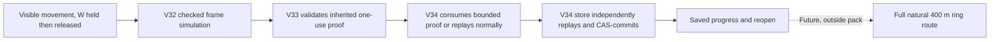
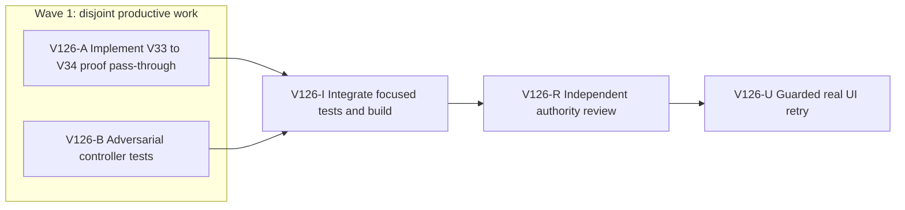

# V126: checked frame-proof pass-through for longer exploration

## Ask and implementation understanding

**Original ask:** complete Wizard Realms as a sustained third-person single-player RPG across a connected roughly 2 km world, with authentic exploration, progression, saves and recovery. The immediate open proof is walking the real route between the two fairy rings under the one-renderer RAM guard. The user's 1 GiB number is an automated-browser safety ceiling, not a game setting.

**Input spec:** the active full-game goal and V125 self-contained V34 save pack. No new user approval for production migration, PR creation or GitHub mutation is implied.

**Aligned problem:** V34 can persist authentic Mireglass discovery and synthetic two-way travel, but long WebGL movement bursts still allocate hundreds of MB at checked-save boundaries. V32 already creates a private one-use frame proof and V33 consumes it, yet V33 does not pass that proof to V34. V34 therefore replays the same frame transition before its writer performs an independently checked replay and CAS. Remove only this redundant V34 controller replay when an internal valid proof is present. Keep the store's independent replay and all mismatch checks.

**Goals:** preserve exact V33/V34 save semantics and V34's separate development save; reduce transient frame-save allocation enough to make longer natural travel practical; rerun the same guarded visible route. **Non-goals:** raising the RAM ceiling, changing save cadence, weakening the V34 store, production route activation, new game mechanics, a PR, or treating the synthetic ring fixture as earned exploration.

**Constraints:** dirty `ben/wizard-playable-v2` checkout and private U5/persistent profiles remain untouched except disposable copies. One exact-PID renderer at a time, stop at 870,400 KiB and enforce the 1,024,000 KiB hard ceiling. No state export. Keep ports 5193/5194 live. Preserve older V32/V33 flows. No `codex/` branch or work GitHub identity.

**Success criteria for this pack:** a V33 private proof reaches V34 only on checked frame saves, is one-use and revision/witness bound, malformed or absent proofs fall back to normal replay, actions/Return Home still replay, V34 store remains independent and strict, focused tests/typecheck/build pass, independent review GO, and a sequential guarded WebGL retry reports actual movement/save, RSS, console/network and persistence. A synthetic fixture or a unit test alone cannot close authentic route performance.

**Open question:** the exact headroom gain is empirical. If the same guard failure survives this grounded repair, profile the remaining V34 store decode/replay before considering a larger architecture change. Do not assert that the full 400 m journey is complete from this pack.

**System translation:** not_qualified, this is a narrow in-place controller optimization. **Product agent runtime:** not_required, the product game simulation is deterministic and no shipped agent runtime changes. **Goal status:** aligned to the active full-game objective; this pack is one milestone, not a new terminal condition.

# Ticket Pack: V126 Checked Frame-Proof Pass-Through

## Summary

Pass an internally generated frame proof from the V33 controller to the V34 controller so the latter need not replay a frame transition already checked by inherited simulation. The V34 writer and atomic store continue their own checked replay and CAS. The revision-bound development preview at `http://127.0.0.1:5194/?publicWorld=v34` remains available for user interaction; automated browsers use isolated profiles.

Locked design:

- Proof is optional, ephemeral, one-use, and accepted only for `frame-batch/v1` with exact revision and witness value. It is never persisted or returned from `committed()`.
- V33 must retain its existing local expected-progress check and ring/static-field checks. V34 must compare a consumed proof result with the inherited controller preview; a failed proof triggers ordinary replay, never unchecked acceptance.
- `commitPublicV34`, `decodePublicV34Root`, `atomicV34Database`, migration and older V32/V33 public behavior remain unchanged.

Important repo truth:

- `PublicV32ControllerRuntime.ts` already emits a one-use private frame proof to V33. `PublicV33ControllerRuntime.ts` consumes it but its `Writer` accepts only three arguments, so `PublicV34ControllerRuntime.ts` always calls `replayPublicV33Witness` before writing.
- V34's store independently decodes/replays before CAS. Prior split CDP evidence attributed about 509 MB sampled allocation to the keyup checked-save phase, with V14 validation and V13 copying prominent. Surface-only reads were reduced from 9 chunks to 1, and the authentic ring discovery now persists under the guard with short bursts.
- Baseline controller file hashes at planning: V33 `e26c7788d953`, V34 `5045b33abf18`, V34 test `629c96bff9f1`. Working tree is dirty; only these scoped files may be touched by lanes.

## Proposed Flow

## Public Interfaces

No external interface, schema or database change. `PublicV33ControllerRuntime.ts` extends only its internal `Writer` callback with optional fourth `frameProof?: (revision: number, witness: unknown) => PublicV33Progress | null`. `PublicV34ControllerRuntime.ts` consumes that callback argument for frame batches only. All callers that ignore a fourth argument retain behavior. No proof is forwarded to the V34 store or serialized.

## Lane Graph

## Topology Audit

- Productive lanes: A owns two controller source files and the proof behavior; B owns the existing controller test file and independent one-use/malformed-proof evidence. Both consume the fixed callback contract and neither consumes the other's edit. Maximum parallel width is two.
- Fan-in: I runs the integrated tests and build; R reviews whether proof use can weaken authority; U tests actual WebGL movement, save and persistence with a single guarded renderer. I, R and U do not count as the two productive lanes.
- Serial edges: A/B to I consume both code and tests; I to R consumes the integrated current source; R to U is required because a browser write to a private save-derived disposable profile must not exercise an unreviewed authority change.
- Certainty: B distinguishes valid one-use proof from stale, mismatched and repeated use; R independently checks V34's store replay remains mandatory; U distinguishes real memory headroom from a unit-only improvement. A failed or missing proof must fall back to replay. If RSS still trips the same guard, stop and profile the remaining owner rather than increasing the cap.
- Broad-lane split: A source only, B tests only, no shared file ownership. No conditional repair is preauthorized beyond the observed-error fast path in A's exact files. No PR finisher: the user has not requested a PR for this milestone and the branch has extensive unrelated dirty work. Reviewer required for save authority risk.
- Dispatch verdict: PASS for this bounded pack; no artificial second implementation surface or shared runtime/dependency change.

## Smallest Viable Diff

Behavior delta: optional internal V33→V34 one-use frame proof, ordinary replay otherwise.

Expected diff budget: three files total, fewer than 200 net new lines, zero new files, zero dependencies, no broad refactor.

Expected changed files: `engine/src/PublicV33ControllerRuntime.ts` (fourth optional callback and one-use proof), `engine/src/PublicV34ControllerRuntime.ts` (consume proof for frames with preview equality, fallback replay), `engine/src/PublicV34ControllerRuntime.test.ts` (adversarial and behavior tests).

Forbidden: V34 snapshot/flow/store, older stores, app entry/UI, shared runtime, package/lockfiles, user saves and GitHub state.

Reuse scan: V32 private proof closure, V33 `checkedFrame`, `samePublicV14Value`, existing V34 `checked()` reply validation, existing V34 controller fixtures. Config, docs or save cadence cannot remove redundant deterministic replay. Simplify the unconditional V34 replay branch instead of adding a parallel persistence path. Tripwires: any fourth production file, >300 net lines, schema/store change, or proof leaving the controller requires replanning before edit.

## Tickets

### Paste now to: Implementer A

Ticket: V126-A. Lane type: Parallel. Delivery phase: pr_hardening. Delivery milestone: SURFACE_READY. Shortest complete user flow: V34 visible movement, release, saved progress and reopen. Current surface: `http://127.0.0.1:5194/?publicWorld=v34`, leave live. Test-writing policy: B owns tests; do not edit tests. Review blocking class: any authority bypass or V33 regression. Depends on: none.

Role: `implementer` ONLY under `auto-planner-ticket-pack` and `smallest-viable-diff`. Transport: `native_spawned_subagent`, inherited model, local runtime, same child for follow-ups. Existing-task routing: not_authorized for durable tasks; this is an ephemeral native child with recent V33/V34 controller capability. Custody: edit only the two named source files in `/private/tmp/pa-wizard-playable-v2`; B owns the test file. No interruption of other work. Fallback: none. Branch: existing `ben/wizard-playable-v2`; no commit, PR or GitHub action. Agent spec: narrow save-controller implementer. Read repository instructions and the two skills completely; no nested workers. Do not use em dashes in prose.

Implement exact internal callback contract above. V33 passes a proof only when its existing `checkedFrame` is valid. Snapshot exact revision, witness and progress, consume at most once, return null on mismatch. V34 consumes only a frame proof, checks against `core.preview()`, and otherwise uses `replayPublicV33Witness`. Preserve `checked()`'s response validation and all action/Return Home paths. Never pass proof to V34 store. Run `npx tsc -b --pretty false` from `games/wizard-realms/engine` and `git diff --check` on owned files. Return exact changed files, net lines, reuse/deletion/tripwire accounting, a key diff excerpt, command output, and any caveat. No browser for this lane.

### Paste now to: Implementer B

Ticket: V126-B. Lane type: Parallel. Delivery phase: pr_hardening. Delivery milestone: SURFACE_READY. Shortest complete user flow: same V34 visible save; this lane validates its internal proof contract, not rendering. Test-writing policy: required. Review blocking class: proof forgery or reuse accepted. Depends on: none.

Role: `implementer` ONLY under `auto-planner-ticket-pack` and `smallest-viable-diff`. Transport: `native_spawned_subagent`, inherited model, local runtime, same child for follow-ups. Existing-task routing: not_authorized for durable tasks; ephemeral native child with recent V34 test fixture capability. Custody: edit only `engine/src/PublicV34ControllerRuntime.test.ts`, no source files. Fallback: none. Branch: existing `ben/wizard-playable-v2`; no commit, PR or GitHub action. Agent spec: adversarial controller-test implementer. Read repository instructions and the two skills completely; no nested workers. Do not use em dashes in prose.

Reuse `makeRoot`/V33 builder in the existing file. Add a V33 writer-interception test that accepts a frame batch, observes the optional proof, confirms exact revision/witness produces checked expected progress once, repeated use and wrong revision/witness return null, and a non-frame action has no proof. Keep existing V34 save, action and Return Home tests as regressions; add only the smallest V34 check needed for malformed writer replies if absent. Do not fabricate a proof into storage or require new production test hooks. If the source edit has not landed, a red test is expected. Run `npx vitest run src/PublicV34ControllerRuntime.test.ts --maxWorkers=1` after A lands, then `git diff --check` on owned file. Return exact changed files, net lines, reuse/deletion/tripwire accounting, assertion coverage, command output and caveats. No browser.

### Wait for A and B, then paste to: Integration gate I

Ticket: V126-I. Lane type: Dependent. Role: direct orchestrator evidence gate, no code edits. Run from `engine`: `npx vitest run src/PublicV34ControllerRuntime.test.ts src/domain/publicWorldV34Flow.test.ts src/domain/publicWorldV34Snapshot.test.ts --maxWorkers=1`, `npx tsc -b --pretty false`, `npm run build`; record exact outputs and current hashes. If a same-scope test fails, return exact observed error to A for bounded repair and rerun the identical command. Keep the V34 dev preview available.

### Wait for I, then paste to: Reviewer R

Ticket: V126-R. Lane type: Dependent. Delivery phase: pr_hardening. Role: `reviewer` ONLY under both skills. Transport: `native_spawned_subagent`, inherited model, local runtime, same child for follow-ups. Existing-task routing: not_authorized for durable tasks; ephemeral native child with recent V34 authority-review capability. Custody: read-only integrated source/tests. Fallback: none. No Git action or browser. Review exact one-use/revision/witness semantics, V33 ring/static checks, V34 preview equality, fallback replay, reply validation, V34 store's independent replay/CAS and V32/V33 regression risk. Findings first, GO/NO-GO, smallest viable diff verdict, residual risk and test gaps. A generic reread is insufficient; target accidental trust in a producer-owned proof.

### Wait for R GO, then paste to: UI proof U

Ticket: V126-U. Lane type: Dependent. Delivery phase: pr_hardening. Role: `reviewer` ONLY for UI proof under `test-from-ui` final_proof. Transport: `native_spawned_subagent`, inherited model, local runtime, same child for follow-ups. Existing-task routing: not_authorized for durable tasks; ephemeral native child with recent guarded V34 UI capability. Custody: one isolated browser/profile derived from the private U5 checkpoint, never edit the original checkpoint or authentic persistent ring profile; no source/Git edits. Fallback: none. Use the original 5194 origin and visible Copy entry, then the same W500/A500/W900/W950 route used before this repair. Only one exact-PID renderer, early stop 870,400 KiB, hard 1,024,000 KiB, no state export or second browser. Capture visible result, per-step renderer RSS, checked save latency, JS heap/GC if safe, console/network and screenshot. If headroom permits, try one longer W burst then clean close/reopen; if guard trips, stop and report `observed error | change | restart | retry result | next action`. Do not claim the full 400 m journey from this probe. Keep previews live and close owned browser/guard.

## Assumptions

- The real user-facing V34 surface has already passed its minimal honesty gate; this is post-surface hardening and may write tests immediately.
- No new production deployment or PR is authorized. V34 remains development-only, explicitly separate from V33.
- The preferred proof optimization is invalid if it changes V34's durable replay/CAS or hides a malformed witness. In that case the reviewer returns NO-GO and the planner revises this pack.

## Current execution receipts, 2026-10-11

- A changed only the V33/V34 controller source files, by 17 added lines total. V33 now snapshots a one-use frame proof and V34 consumes it only when it equals the inherited preview, otherwise replays. TypeScript passed. Source hashes: V33 `370a477bbb70`, V34 `bafc36a80129`.
- B changed only the existing V34 controller test file, adding 51 and deleting 1 line. Three separate frame saves verify exact first use, repeat rejection, wrong revision rejection and altered witness rejection; a non-frame ring action receives no proof. The first test tried to reuse a closure after a wrong call, correctly failed, and was corrected to use independent saves. Focused V34 runtime tests passed 8/8. Test hash: `f39fbe21978f`.
- I ran the integrated 3-file Vitest gate: 16/16 passed. `npx tsc -b --pretty false` and `npm run build` passed. Build retained its existing large-chunk warning.
- R independently reviewed the exact hashes and returned GO for a guarded UI benchmark. It confirmed V33's upstream V32 proof and ring/static checks, V34 preview equality and replay fallback, reply validation, and the unchanged V34 store's independent replay/CAS. Non-blocking test gap: no targeted V34 fallback-path test. No production or authority bypass found.
- U attempted the identical V34 WebGL route in a disposable U5-derived profile after visible Copy. W500 visibly saved and peaked at 682,016 KiB; A500 peaked at 731,136 KiB; W900 reached 884,240 KiB, crossing the 870,400 KiB early stop. The watchdog closed that exact browser below the 1,024,000 KiB hard ceiling. W950, a longer burst and reopen were not attempted. JS heap after W900 was about 118.3 MB used / 177.9 MB total; renderer RSS was much larger. The post-Copy renderer baseline was about 621 MiB, higher than the V125 comparison run, so the data proves neither a causal improvement nor a causal regression from the proof pass-through. No gameplay exception appeared; a separate request log was not captured. The original U5 and earlier authentic profile remain untouched, both previews return HTTP 200, and owned browsers are closed.

**Pack verdict:** source behavior and authority gates passed, but the motivating longer-travel memory outcome remains unproven and the guarded user journey stopped earlier than V125's last matched run. Do not activate production V34 or claim natural 400 m travel. Under the observed-error loop: `W900 renderer early guard | frame-proof pass-through | fresh isolated browser on unchanged 5194 preview | same class of memory stop, with a higher initial baseline | attribute save-phase RSS before another long-route attempt`. A bounded follow-up diagnosis is required before deciding whether the added proof code earns its maintenance cost.
