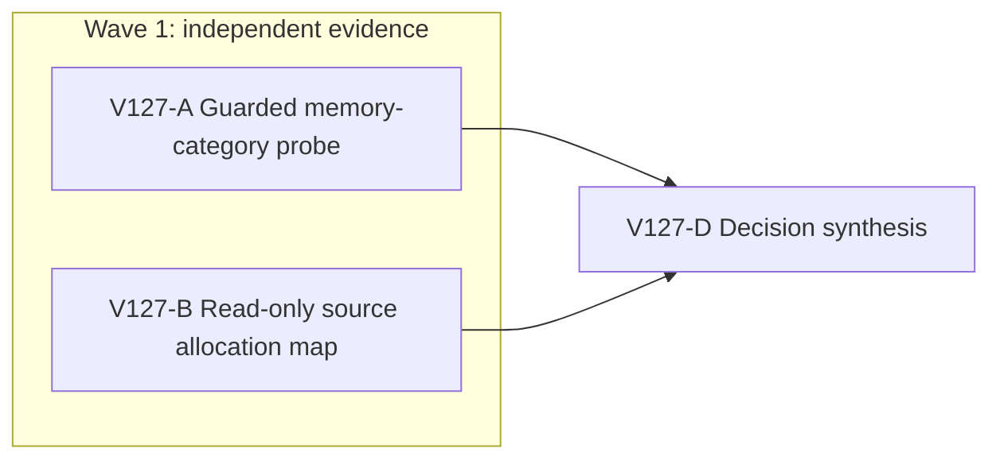

# V127: attribute the guarded V34 movement RSS

## Ask and implementation understanding

**Original ask:** finish Wizard Realms as a sustained third-person RPG, including long exploration and reliable saves across the connected world. The immediate failure is an automated high-resolution renderer crossing its early RAM guard during ordinary V34 movement. This guard protects the user's machine; it is not a game limit.

**Supporting spec and evidence:** the active full-game goal, V125 self-contained save migration pack and V126 checked frame-proof performance pack. V126 changed only the V33/V34 controller proof handoff. Its 16 focused tests, TypeScript, build and source review passed, but a guarded WebGL run reached 884,240 KiB during W900, before W950 or a clean reopen. The renderer started around 621 MiB, higher than the earlier comparator, and JS heap after W900 was only about 118 MB used / 178 MB total. That evidence proves a memory stop, not a causal regression or improvement from V126.

**Aligned problem:** decide which memory category and phase is responsible for the large renderer RSS baseline and movement rise before making another production change. Distinguish JS retained state, transient checked-save allocation, native renderer/Skia/WebGL residency, and separate GPU-process growth. Do not treat the 1 GiB safety ceiling as a game requirement or lower visual fidelity merely to make a test pass.

**Goal:** produce one decision-grade attribution receipt and a next smallest owner. **Non-goals:** code edits, new save format, build/PR/deployment, relaxed RAM guard, a 400 m playthrough, touching user Chrome or authentic saves. **Constraints:** one owned browser renderer at a time; exact-PID 50 ms guard at 870,400 KiB early stop and below 1,024,000 KiB hard ceiling; no raw state export; private U5 source read-only; disposable same-origin profile; ports 5193/5194 remain live; no work GitHub identity or Git action.

**Success evidence:** synchronized visible UI save events, CDP heap/DOM/canvas and Three resource counts, exact renderer and GPU RSS, and macOS `vmmap -summary` category snapshots before movement and after one safe movement/save. Source audit maps those measurements to specific clone/replay/view owners. The decision states what observation would warrant a code repair, a smaller test viewport diagnostic, or no code. Missing/blocked `vmmap` is reported honestly and replaced only with safe read-only process metrics.

**System translation:** not_qualified. **Product agent runtime:** not_required. **Goal status:** aligned; this diagnostic does not reduce the full-game completion contract. **Delivery phase:** post-surface hardening; the development preview already exists and must remain available. **Environment repair authority:** none.

# Ticket Pack: V127 Renderer Memory Attribution

## Summary

Run two independent, narrow evidence lanes before another code change. One measures real renderer memory categories during a guarded V34 save; the other maps source allocation and retention paths without running a browser. Their findings converge into a causal next-action decision. No production, test or configuration files change in this pack.

Locked design:

- Preserve V34 authority, stores, migrations, UI graphics and save cadence during measurement.
- Never compare RSS peaks from different initial baselines as a causal code result. Record baseline and delta in the same exact renderer PID.
- The watchdog, not manual observation, remains the final safety stop. Do not run `vmmap` after RSS approaches the early guard.

Important repo truth:

- V34 save calls `readChecked`, replay, `commit`, successor decode, structured cloning and native IndexedDB CAS. V33/V34 controller proof optimization removes one local replay but leaves these independent checks.
- The WebGL scene uses DPR `[1, 1.5]`, PCF shadows and antialiasing in normal mode. WebGL GPU residency and renderer RSS are distinct process metrics.
- Prior split CDP sampling attributed about 509 MB of sampled allocation to a keyup checked-save phase; V14 validation and V13 copying were large JS allocation sites. Later WebGL RSS can grow despite a much smaller used JS heap.

## Public Interfaces

None. This pack adds no API, schema, profile format, browser route or runtime option. Evidence artifacts remain outside the repository except this human-readable pack receipt. No private save contents or browser profile is copied into source.

## Lane Graph

## Topology Audit

- Productive lanes: A owns empirical UI/process evidence, B owns independent source-path evidence. Neither changes files or consumes the other's result. Maximum safe parallel width: two; B cannot disturb A's renderer.
- Fan-in D consumes both receipts and decides the next repair owner; it does not rerun measurement or edit code.
- Serial edges only A→D and B→D because the decision must use both measurements and code ownership. There is no synthetic validation lane or PR finisher.
- Certainty: A distinguishes heap/native/GPU process categories and movement vs save phase, with stop at first decision-grade sample or guard. B distinguishes duplicate strict validation, retained application state and scene resource lifecycle from source. Contradictory metrics trigger a second bounded probe, not speculative edits.
- Reviewer/finisher rationale: A and B are read-only reviewer/evidence roles; separate generic review would add no new constraint. No PR packaging is authorized. Conditional code repairs are deliberately not preauthorized because their owner depends on this evidence.
- Dispatch verdict: PASS; no artificial implementation lane, file ownership or unbounded environment repair.

## Smallest Viable Diff

Behavior delta: none in this pack. Expected changed files: only this planning/evidence document. Net production lines, new production files and dependencies: zero. Reuse existing CDP guard, original 5194 preview, `vmmap -summary`, `ps`, and prior V125/V126 traces. No prompt/config/code alternative is relevant until attribution. Tripwire: any proposed source edit, graphics-quality change, guard increase, new browser surface or private-save write outside the disposable profile returns to planner before action.

## Tickets

### Paste now to: V127-A UI/process evidence reviewer

Lane type: Parallel. Role: `reviewer` ONLY under `auto-planner-ticket-pack` and `test-from-ui` final_proof. Transport: `native_spawned_subagent`, inherited model, local runtime and continued child session. Existing-task routing: durable task coordination not authorized; reuse the current ephemeral UI child only if completed and available. No fallback transport. Branch/cwd: existing `ben/wizard-playable-v2`, `/private/tmp/pa-wizard-playable-v2/games/wizard-realms/engine`. No code, test, doc, Git or GitHub edit; no nested workers. Do not use em dashes in prose.

Use a fresh disposable profile restored from the unchanged private U5 checkpoint at its original `127.0.0.1:5194` origin. Arm exact owned Chrome/renderer PID watchdog before loading state. Visible Copy V33→V34, then capture baseline after scene settles: renderer RSS, GPU process RSS, CDP JS used/total heap, canvas count/dimensions, Three `gl.info.memory` if safely exposed, and `vmmap -summary` for exact renderer PID. Use a single W500 movement release, wait for the visible checked save, then capture the same metrics and `vmmap` before another input. If still safely below 700,000 KiB after W500, one A500 step may distinguish trend; do not attempt W900 merely to reproduce a known stop. If `vmmap` is denied or too slow, report it and use only read-only process/CDP metrics. Do not export save state, touch user Chrome, run two owned renderers or force GC before the first comparison. Keep guard at early 870,400 KiB and hard 1,024,000 KiB. Close owned browser and watchdog, preserve previews. Return exact visible journey, timestamps, phase-specific metrics and `vmmap` categories/deltas, screenshot, console/network, ownership/cleanup, and a findings-first classification. Stop when evidence discriminates a category or the guard fires.

### Paste now to: V127-B source allocation reviewer

Lane type: Parallel. Role: `reviewer` ONLY under `auto-planner-ticket-pack` and `smallest-viable-diff`. Transport: `native_spawned_subagent`, inherited model, local runtime and continued child session. Existing-task routing: durable task coordination not authorized; reuse a completed recent V34 source reviewer if available. No fallback transport. Branch/cwd: existing `ben/wizard-playable-v2`, `/private/tmp/pa-wizard-playable-v2/games/wizard-realms/engine`. No edits, browser, profile, heavy tests, Git or GitHub action; no nested workers. Do not use em dashes in prose.

Audit exact current V34 flow/store/snapshot/controller save call path and `PublicV23Controller.tsx` scheduler plus `WizardScene.tsx` resource lifecycle. Produce a bounded map of what allocates or retains per frame, keyup save, and scene render, naming line references and whether each is renderer JS, browser-native or GPU-process likely. Check whether V126 proof pass-through actually avoids its local replay in the normal frame path and whether it adds material clone overhead. Do not infer measured magnitude from source. Identify the smallest plausible production owner for each possible A outcome and a focused validation that would distinguish it; preserve V34 independent replay/CAS and visual quality. Return findings-first with explicit uncertainties and no code proposal outside the measured branch.

### Wait for A and B, then V127-D decision

Top-level planner consumes both receipts, classifies `heap-retained | transient-JS/save | native-renderer | GPU | mixed | unresolved`, states observed phase and source owner, and either authors one bounded repair pack or declares the exact further measurement needed. It must not enlarge the browser cap, change graphics, declare full-route proof or mark the durable goal complete from this diagnostic.

## Assumptions

- The previous V126 browser was closed and only unrelated user/other-task Chrome remains. A must verify this anew and never terminate unrelated processes.
- `vmmap -summary` may be unavailable or perturb timing; it is optional if denied or unsafe, not an excuse to bypass the guard.
- A single W500 with matched before/after memory categories is more decision-relevant than another unprofiled W900 guard trip.

## Integrated receipt and decision

V127-A completed one guarded, visible V34 W500 movement and checked save in a disposable profile. The page renderer was PID 92712 and the separate GPU process was PID 92702. The UI displayed `V34 progress saved on this device.` 907 ms after key release. The browser and watchdog were then closed, the authentic profile was untouched, and both preview ports remained HTTP 200. The numerical log is `/private/tmp/wizard-v127-a-metrics.tAn2Yl`; the saved-state screenshot is `engine/.playwright-cli/page-2026-10-11T15-03-03-604Z.png`.

| Same-PID phase | Renderer RSS | GPU RSS | CDP JS heap used / total |
| --- | ---: | ---: | ---: |
| Before W500 | 451,120 KiB | 155,952 KiB | 50.9 / 55.5 MB |
| Visible checked save | 706,320 KiB sampled peak | 160,912 KiB sampled peak | 66.2 / 193.4 MB |
| Natural idle | roughly 451 MiB eventually | roughly 156 MiB | 54.7 / 60.5 MB |

The renderer rose by at least 255,200 KiB at save and recovered naturally. The GPU process rose by only 4,960 KiB. JS heap capacity temporarily expanded by about 138 MB, but used heap rose by only about 15 MB at the measured save point and was near baseline after idle. That supports a transient renderer-side allocation burst, with a JS component, not a retained JS state or primarily GPU-process growth. It does not prove the allocation owner or that V126 caused the spike. The 50 ms sampler averaged 78.5 ms in practice, so the observed peak is a lower bound. The first save measured 706,192 KiB, above the optional 700,000 KiB gate for A500, so no second movement was attempted.

`vmmap -summary` ran on the exact renderer PID, but warned that Chrome's PartitionAlloc zone could not be resolved. Its category totals are incomplete and do not justify an exact native-byte assignment. The page had one 1800×1234 backing canvas before movement; post-save canvas dimensions and Three resource counts were unavailable. Console showed only favicon 404 and a THREE.Clock warning, with no gameplay failure.

V127-B found that held movement performs a roughly 50 ms authoritative frame step, repeated preview validation and React repaint; key release invokes V28 flush and V34 checked store read, replay, successor decode, clone and native IndexedDB CAS. It also confirmed that V126 skips one V34-local replay but adds one full progress `structuredClone` plus one preview clone on normal frame proof. The Canvas is not keyed by movement/revision, and the store removes read proofs on commit. These facts identify plausible transient JS and browser-native save owners but do not quantify any one of them.

**Classification:** mixed transient JS/renderer allocation during checked save; GPU-process growth and retained JS are not supported by this run. **Production decision:** no graphics downgrade, guard increase, migration change or speculative code edit. Next, isolate the specific repeated checked-save allocation with phase-separated allocation evidence and a bounded source contract, then modify only that owner while preserving independent replay and CAS. V34 is still a dev-only preview; this receipt does not prove a long natural route or full-game completion.
