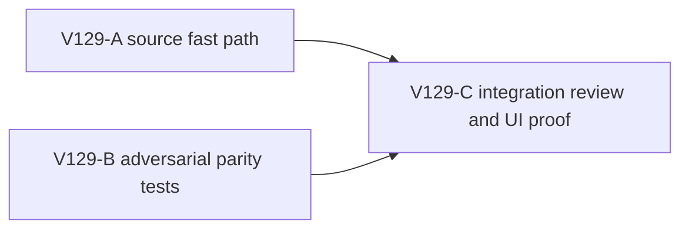

# V129: V34 checked-successor fast path

## Ask, evidence and implementation understanding

The durable goal is a complete Wizard Realms RPG with reliable long movement and saves. V128's guarded V34 W500 save passed, but all-object allocation sampling measured 493.5 MB of short-lived JS allocation during keyup/save, led by V14 validation (114.4 MB) and V13 copying (42.6 MB). Source tracing identifies an avoidable repeat: V34 `readChecked()` already fully decodes and replays the exact stored root, then `decodePublicV34CheckedSuccessor()` fully decodes the candidate's unchanged lineage, prior head and new head again. That repeats deep V31→V14 progress validation on checked prior values. The sample does not reveal exact invocation counts for this call path, so impact must be measured, not assumed.

**Goal:** specialize only the ordinary V34 checked successor path to reuse the private checked prior lineage/head after proving the candidate's lineage and previous are structurally equal to them, while fully decoding and independently replaying the new head. Preserve a complete decoder fallback for benign representation/cap differences. **Non-goals:** skipping untrusted stored-root validation, weakening semantic CAS, touching V28/V31 frame replay, changing save format, visual quality, guard, or production activation. No PR or GitHub action is authorized by this pack.

**Constraints:** source branch `ben/wizard-playable-v2` in the existing dirty checkout. Preserve all unrelated files and authentic profiles. One guarded owned WebGL renderer at a time, exact PID early stop 870,400 KiB, hard below 1,024,000 KiB. The existing development surface at original 5194 stays available. The user requires `gh-bioscopics`, Bioscopics noreply and `ben/` if a future GitHub action is explicitly requested, never the work identity.

## Design lock and interface

Keep the existing exported `decodePublicV34CheckedSuccessor(before: PublicV34Root, value: unknown): PublicV34Root | null` interface. The store calls it only after `readChecked()` has fully decoded the raw stored root and secured `before` in a private one-use proof. The fast path may accept a candidate only if its exact outer keys are valid, candidate lineage equals `before.lineage` and candidate previous equals `before.head` under bounded strict raw comparison, and the candidate new head passes the existing `decodeHead` with exact keys/progress/witness/highland checks. It must require revision `before.head.saveRevision + 1`, preservation from genesis, monotonicity from prior head, and `replayPublicV33Witness(progressOf(before.head), head.witness)` equal to `progressOf(head)`. Return a detached/owned checked root shaped `{lineage: before.lineage, previous: before.head, head}` without exposing internal proof state to the caller; `commit` still clones the candidate before async transaction.

If bounded strict comparison returns false because of an oversized but otherwise valid candidate or representation difference, the existing full `decodePublicV34Root` plus semantic `samePublicV14Value` checks remain the fallback. Malformed envelopes, proxies, accessors, cycles and aliases must not be silently treated as a trusted equal object. Both paths reject forged lineage, previous, head, witness and revision. The store keeps full raw `readChecked` validation, one-use proof deletion, independent new-head replay, candidate detach and native transaction semantic CAS. No cache, hash-only acceptance, or persistent trust token is introduced.

## Public interfaces

No new public interface or persistent schema. Only the existing checked-successor implementation and focused tests change.

## Lane graph and topology

A and B work in different files against the already locked function signature, so they can proceed in parallel. C waits for both and performs independent authority review, focused tests, TypeScript, build, then one guarded W500 save with source-level call-count/all-object allocation evidence. No separate PR unit or stack is proposed. Source and tests are one cohesive candidate merge unit. If A/B disagree on semantics, stop for interface reconciliation before C.

### V129-A, source implementer only

Own only `engine/src/domain/publicWorldV34Snapshot.ts`. Reuse `sameStrictBoundedRaw` from `strictBoundedRaw.ts` with a bounded cap consistent with V33's 3 MiB precedent. First inspect the exact comparator failure modes and V33 checked-successor pattern. Implement a small fast path inside or immediately adjacent to existing `decodePublicV34CheckedSuccessor`; reuse `decodeHead`, `progressOf`, `publicV32Preserves`, `publicV32Monotonic` and witness replay. Keep fallback full decoder and its exact semantic equality checks. Do not alter `decodePublicV34Root`, store, V33, migration, or unrelated files. Run focused existing V34 tests and TypeScript. Report changed lines, fast/fallback conditions and security invariants. Do not claim a measured performance win.

### V129-B, adversarial test implementer only

Own only `engine/src/domain/publicWorldV34Snapshot.test.ts`, using the existing exported checked-successor function. Cover rev0→1 and rev1→2 ordinary frame and non-frame cases, an unchanged-but-over-cap predecessor that exercises full fallback, forged lineage/previous/head/witness/revision, caller mutation, proof reuse and stale CAS where existing store tests apply, plus proxy/accessor/cycle/alias inputs. Avoid fragile timing assertions. If strict comparator cannot distinguish a benign over-cap case in an inexpensive fixture, test the fallback directly with an equivalent representation rather than manufacturing a multi-megabyte save solely for tests. Do not edit source or other files. Run focused tests and TypeScript. Flag any mismatch to A directly.

### V129-C, integration/reviewer/UI proof

Main planner merges receipts, checks scope and runs independent authority review. Execute V34-focused tests, TypeScript and production build with no owned browser open. Then one fresh disposable U5→V34 visible W500 checked save on original 5194 under exact-PID guard. Record visible save, renderer/GPU/heap baseline and sampled peak, and collected-object allocation profile or stage-specific validation call counts. Compare within-run delta and call sites only; different initial baselines cannot prove a memory win. Stop before A500/W900 if headroom is insufficient. Close browser/watchdog; preserve authentic U5, live previews and private records. Report remaining measured owner if save allocations still dominate.

## Smallest viable diff and tripwires

Expected product files: `publicWorldV34Snapshot.ts` plus its existing test file. Net production code should stay small; no new package, config, schema, store or controller files. A full-decoder fallback exists for compatibility and migration safety. Any test indicating forged candidate acceptance, changed raw CAS, missing replay, under-tested alias behavior, or performance guard breach is a stop/replan condition, not permission to weaken checks or graphics. The full-game goal remains active beyond V129.

## Integrated receipt and next owner

V129-A changed only `publicWorldV34Snapshot.ts` (net +12 production lines). The checked successor now compares the candidate lineage and previous head together with the private checked prior under the existing 3 MiB strict raw comparator. On strict equality, it decodes and replays only the new head, enforcing next revision, preservation and monotonicity. On any strict miss, the original full decode plus semantic comparison remains. V129-B changed only the existing V34 snapshot test (net +75 lines) and covered valid frame/non-frame successors, fallback representations, forgeries, malformed graphs and caller detachment. Focused tests passed 11/11, TypeScript and production build passed. Independent source review found no authority regression; the raw stored root is still fully checked, proof is consumed once, and native semantic CAS is unchanged.

V129-C visibly copied a fresh disposable U5 profile into V34 and completed W500 with `V34 progress saved on this device.` 900 ms after keyup. The exact page renderer rose from a settled 440,016 KiB to a 707,024 KiB sampled peak, still below the 870,400 KiB early guard but leaving only 163,376 KiB. GPU RSS stayed about 161,392–162,112 KiB. The sole owned browser/watchdog closed; ports 5193/5194 remained HTTP 200 and the authentic U5 checkpoint was unchanged. Evidence: `/private/tmp/wizard-v129-c-evidence.1kz4WQ/before.png` and `saved.png`.

All-object keyup/save sampling measured 466.3 MB, led by V14 validation (113.1 MB), V13 copying (34.4 MB), world-chunk value noise (22.0 MB), V17 decode (18.4 MB), and V23 decode (14.2 MB); the new strict comparator accounted for 7.94 MB. Profiling overhead and unmatched baselines prevent a causal gain claim. A500/W900 was intentionally not attempted because headroom was too narrow. The dominant repeated validation/copy path remains. The next bounded step must distinguish per-frame V28/V31 replay from writer/store decoder calls using stage-specific counters, then repair only the proven repetition while preserving witness replay and saved-root authority. V129 is a checked functionality and authority milestone, not proof of sustained travel or full-game completion.

A read-only V130 source review returned **NO-GO** on immediately skipping V14 validation in per-frame replay. The V28 bridge path validates input through V23 and validates a candidate after allowing airborne intermediate state; these can be first necessary checks, not redundant copies. Zero-bridge and raised-soil branches differ, and the retained allocation profile lacks raw caller-path data. The next diagnostic should count V23 input/output and V28 candidate/dry-probe decodes by replay branch and by controller flush versus V34 writer/read/successor, without persisting or trusting the counters. Only then can a private checked-state optimization be specified safely.
