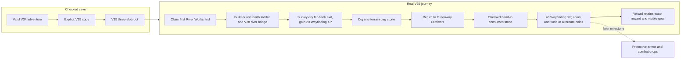
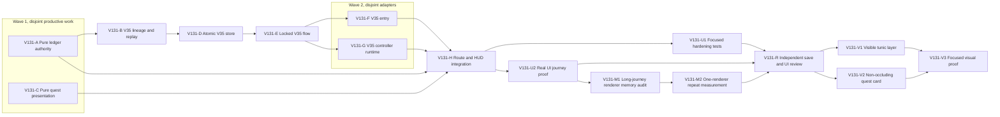

# Ticket Pack: V131 Outfitters' Ledger checked quest

## Summary

This pack implements the aligned problem in `V131_LEDGER_QUEST_UNDERSTANDING.md`. A player who has finished the first find can chart a built connected-river crossing, dig one real stone sample, return to Greenway Outfitters, and receive a one-time checked coin, XP, and visibly equipped garment reward. V35 is a separate opt-in save copied from a checked V34 head; V34 remains playable and unchanged. This pack advances the campaign but does not complete the full game.

Locked design:

- The new `ledger-survey/v1` witness contains only canonical `bridgeId`; `ledger-deliver/v1` contains no client-selected reward. An authoritative reducer recomputes location, gear/sample and reward branch.
- Survey requires an existing first-find claim, a saved canonical V28 connected-river bridge, revealed exit, streamed owner, grounded dry far-bank pose within 3 m of `site.exit`, and no prior survey. It grants 20 character XP plus 20 Wayfinding XP.
- Delivery requires a saved survey, one `terrain.bag.stone`, Greenway owner and grounded player within 3 m of Greenway Outfitters, and no prior delivery. It consumes one bag stone and grants 40 character XP plus 40 Wayfinding XP, 50 coins and an owned, equipped `traveler_tunic`. If a tunic is already in inventory or trade slots, it grants 85 coins instead. Persist the exact branch in `ledgerClaimReward`. Safe integers and the existing `1 + floor(xp/100)` level rule apply. No armor stat is implied.
- `PublicV35Progress` is `PublicV33Progress` plus `ledgerSurveyBridgeId: string | null` and `ledgerClaimReward: 'traveler_tunic' | 'coins' | null`. V35 root uses exact `wizard-world/v35` keys, a self-contained V34-head copy lineage, strict three-slot witness replay, monotonic quest facts, and atomic revision CAS. Inherited V33 witnesses and return-home still replay through their unchanged rules. V34 source data is never written or cleared.
- V35 is dev-only at `?publicWorld=v35`. The current V34 route on port 5194 stays available. Use only one game renderer for automated UI proof and close test tabs. No GitHub action.

Important repo truth:

- V34's exact snapshot accepts only inherited V33 witnesses. A new payout inside V34 would make existing saved histories fail replay.
- `traveler_tunic` is already a valid ItemId and visible when equipped in `WizardScene`; persisted equipment ownership requires a matching inventory stack. V34 starter UI does not provide general tunic equip, so the checked quest delivery equips this one reward directly.
- `terrain.bag.stone` is separate from ordinary inventory, is earned by checked digging, and contributes to carried capacity. The first quest's virtual basic pick can enable the deeper dig needed for stone.
- V30 first-find claim may be from an early creek bridge. It is a prerequisite only; V35 independently verifies a V28 connected-river survey.

System translation: `not_qualified`. Product agent runtime: `not_required`. Goal: `aligned`, full-game goal remains active. Worktree: `/private/tmp/pa-wizard-playable-v2`, branch `ben/wizard-playable-v2`, dirty and ahead of origin. Existing changes are user-owned. No PR unit is being packaged in this pack.

## Proposed Flow

The shortest complete user flow is: open `?publicWorld=v35`, explicitly copy a checked V34 adventure, inspect the Ledger journal, survey a built V28 far-bank post, dig one stone, travel back to Outfitters, deliver once, see currency/XP and tunic on the character, reload, then continue moving. If the source save already has a first-find claim and a built connected-river bridge, those stages are recognized rather than repeated.

## Public Interfaces

- New domain module `src/domain/publicWorldV35LedgerAction.ts` exports `PublicV35Progress`, `PublicV35LedgerWitness`, `decodePublicV35LedgerWitness`, `previewPublicV35LedgerAction`, and `confirmPublicV35LedgerAction`. Rejection codes must distinguish invalid progress/site, prerequisite, unbuilt/unrevealed, wrong region/pose, too far, no stone, already surveyed/claimed, and invalid value. Failed actions are state-neutral.
- New `src/domain/publicWorldV35Snapshot.ts` exports `PUBLIC_V35_SCHEMA`, `PUBLIC_V35_DATABASE_NAME`, `PublicV35Lineage`, `PublicV35Head`, `PublicV35Root`, `createPublicV35Root`, `decodePublicV35Root`, and `decodePublicV35CheckedSuccessor`. Lineage is `{origin:'v34-migration',rulesProfile:'outfitters-ledger/v1',seed,sourceRevision,genesis}`. `genesis` is the exact decoded inherited V34 progress, excluding V34 schema, revision, and witness. Head adds the two ledger fields, V35 schema/revision and `PublicV33Witness | PublicV35LedgerWitness | null` witness. Revision zero has both quest fields null and matches genesis; later heads replay the previous edge exactly.
- New atomic V35 store and locked V35 flow expose inspect, explicit copy from checked V34, resume, commit, and return-home. They preserve V34 source unchanged. The V35 writer is the only authority for ledger rewards.
- New `src/view/publicV35LedgerQuest.ts` exports a pure summary `{id:'outfitters-ledger/v1',title,stage,objective,reward,complete}`. Stages: first-find, route, survey, sample, return, complete. It consumes the public projection plus structural saved quest/route/stone facts, no mutable UI checkbox. Completed copy reads the saved `ledgerClaimReward` branch.
- `createPublicV35ControllerRuntime(initial, write, returnHomeWrite?)` retains the inherited V34 `preview`, `view`, `status`, `advanceFrame`, `save`, `returnHome`, and `committed` methods. Its `action(raw)` accepts the inherited V34 action type or `PublicV35LedgerWitness`, flushes pending frames, writes one checked ledger witness, verifies the writer reply, and rebuilds inherited play from the committed successor.
- New V35 intents are exactly `{type:'v35.ledger.survey',bridgeId:string}` and `{type:'v35.ledger.deliver'}`. The controller maps these to the two witnesses; the HUD never calls a state setter for reward effects.
- `WizardViewProjection.v35LedgerQuest` and `v35LedgerSurvey`/`v35LedgerDeliver` advisory choices exist only in V35. The existing objective region shows the current quest without covering Works or prompts; Survey and Deliver buttons send new V35 intents through the V35 controller, never edit state directly. The older V130 quest and V34 route remain unchanged.

## Lane Graph

## Topology Audit

- Productive lanes: A owns pure checked survey/delivery; C owns one pure presentation helper. They are incomparable and immediately runnable under the fixed interfaces above. B owns exact V35 lineage/replay, D atomic store, E locked flow, F entry, G runtime, H shared integration. U1 adds focused authority tests while U2 tests the assembled journey through the visible UI. R is an independent risk review, not a substitute for either proof.
- Maximum initial safe width: 2 (A and C). Later safe width: 2 (F and G, then U1 and U2). No concurrently writable file overlaps.
- Fan-in: H consumes the settled reducer, view helper, entry, and runtime; U1 and U2 provide independent code and browser evidence. U2 observed one likely game renderer at 1.34 GiB after the long journey, so M1 identifies a bounded measurement gap and M2 attempts a repeat. R found that equipped tunic visibility and quest-card/terrain-panel separation fail visual acceptance, so V1 and V2 make disjoint bounded repairs, then V3 checks them in one browser. A and C are productive in their own right, not synthetic validation lanes.
- Broad-lane split: authority, snapshot, store, flow, entry, runtime, and integration are separate because V35 is an unavoidable cross-boundary migration. Each worker owns at most four files and targets under 300 net lines. The total feature exceeds five files; splitting is the explicit smallest-diff replan, not permission for unrelated refactors or a new framework. A lane crossing its budget stops for replan.
- Certainty: A closes whether the two checked transitions can enforce all quest prerequisites and rewards. B/D/E close strict saved history and atomicity. C closes truthful stage/reward presentation. U1/U2 close migration, claim, reload, visual gear and narrow-screen outcomes. M1 addresses the observed >1 GiB renderer process without opening another browser. R specifically seeks forged reward, alternate branch, stale source, post-claim inherited action, occlusion and memory omissions. Surprise triggers: inherited movement rejecting the tunic reward, V35 copy modifying V34, unsafe far-bank support, any duplicated payout, >1 GB game renderer, or mobile action interception.
- Serial edges consume exact artifacts: A→B reducer witness and replay; B→D root decoder; D→E store proof/CAS; E→F/G flow signatures; A/C/F/G→H action, view, entry and runtime APIs; H→U1/U2 real surface; U2→M1 measured resource concern; M1→M2 one-renderer repeat plan; U1/U2/M2→R current browser, test, and memory evidence; R→V1/V2 named visual defects; V1/V2→V3 exact visual proof. No earlier downstream lane can prove its contract without that artifact. R completed NO-GO; dispatch verdict: `PASS` for V1 and V2 in parallel with disjoint file ownership. The memory verdict remains unverified, not green.
- Reviewer is required for replay/migration and UI integration risk. PR finisher is omitted because no PR or GitHub action was requested. No child orchestrator: one dependent pack.

## Smallest Viable Diff

Behavior delta: one V35-only, checked quest with exact reward and separate save. Expected production files: A one action file under 230 net lines; C one view helper under 100; B one snapshot file under 220; D one store file under 130; E one flow file under 220; F one entry file under 170; G one runtime file under 160; H four surgical controller/HUD/contracts/main edits under 250 combined. No dependencies or shared runtime changes. Reuse scan: V30 claim pose checks, V28 canonical bridge resolver, V26 terrain bag, V34 root/store/flow/entry/runtime patterns, V130 journal, existing tunic mesh and XP/level rule. A config or prompt cannot create replayable currency or gear. Simplify the V35 UI by reusing the current compact journal and existing River Works post rather than adding a second overlay or new model. Tripwire: any lane over five files or 300 net lines, dependency, change to V34 witness meaning, shared engine refactor, or reward behavior not replayable from a witness triggers a planner stop.

## Tickets

The common runtime contract for every lane is native ephemeral subagent, inherited model, no Cursor runtime, no existing-task contact, no provider CLI fallback, no nested workers, no GitHub mutation, no commit, and no unrelated dirty-file edits. All worker first contacts must read `auto-planner-ticket-pack` and `smallest-viable-diff` fully and receive the exact role lock. Coding conventions come from current game source and the user-provided AGENTS.md preferences; generated prose has no em dashes. The user-facing V34 preview on 5194 stays live. All tickets use `/private/tmp/pa-wizard-playable-v2/games/wizard-realms/engine` for commands. Pre-surface tickets do not add new tests. The V35 UI stays gated until type/build and checked-copy safety probes pass.

### Paste now to: V131-A pure authority implementer

Ticket V131-A. Role `implementer` ONLY. Delivery phase implementation, pre_surface. Own only new `src/domain/publicWorldV35LedgerAction.ts`. Implement the exact Public Interface and locked rules above. Decode exact witness keys; reject malformed or client-provided reward fields. Reuse canonical V28 and V30 pose/discovery helpers without editing old versions. Survey and delivery must be pure, deterministic, safe-integer checked, and state-neutral on rejection. `ledgerClaimReward` records the actual tunic/coin branch. `traveler_tunic` grant must add one owned inventory stack and set `equipment.chest` only when not already owned; alternate branch adds no item. Inherited progress fields otherwise preserved. Acceptance: `./node_modules/.bin/tsc -p tsconfig.json --noEmit`, `git diff --check`, plus a small read-only in-memory reducer probe if needed for safety. No new tests or browser pre-surface. Return exact exports, changed lines, reuse proof, case results, risk and tripwire receipt. Visual proof not applicable to pure reducer. No PR.

### Paste now to: V131-C pure quest-view implementer

Ticket V131-C. Role `implementer` ONLY. Delivery phase implementation, pre_surface. Own only new `src/view/publicV35LedgerQuest.ts`. Define a structural argument interface independent of V35 snapshot imports so A and C can run concurrently. Derive first-find, route, survey, sample, return and complete from `WizardViewProjection`, saved `claimedBridgeheadId`, V28 `riverBridgeIds`, `ledgerSurveyBridgeId`, `ledgerClaimReward`, `terrain.bag.stone`, and legacy/Works4 north ladder facts. Do not infer completed reward from current inventory; use saved branch. A saved V28 bridge is canonical via resolver. Clearly tell the player to equip the basic pick and dig to stone when sample is absent. No authority or HUD edits. Acceptance: `./node_modules/.bin/tsc -p tsconfig.json --noEmit`, `git diff --check`; no new tests/browser pre-surface. Return exact signature, stage examples, changed lines, reuse/tripwire receipt. Visual proof deferred to H/U.

### Wait for A, then paste to: V131-B lineage and replay implementer

Ticket V131-B. Role `implementer` ONLY. Delivery phase implementation, pre_surface. Own only new `src/domain/publicWorldV35Snapshot.ts`. Use A's exact witness/progress exports. Copy the current V34 source head into lineage as specified; no V34 writes. Exact decoder for root, lineage and head; revision-zero genesis check; saved survey/claim monotonicity; replay inherited V33 witnesses through existing replay; replay ledger witnesses through A; strict previous/head and checked-successor validation. Reject extra keys, wrong source seed, forged reward, stale revision, and noncanonical bridge survey. Keep three-slot memory bounded. Acceptance: TypeScript, diff check, and read-only root round-trip/forgery probe; no new tests pre-surface. Return schema/decoder exports, proof cases, diff/tripwire receipt. No browser.

### Wait for B, then paste to: V131-D atomic store implementer

Ticket V131-D. Role `implementer` ONLY. Delivery phase implementation, pre_surface. Own only new `src/domain/atomicV35Database.ts`. Reuse the V34 one-root IndexedDB proof-token, size-bound, strict decoded root and revision CAS pattern with V35 decoders. Database name is `wizard-realms:world:v35`; never open V34 for writes. Acceptance: TypeScript, diff check, in-memory fake-indexeddb read/commit/stale-proof probe if needed. No tests/browser pre-surface. Return proof/CAS receipt and diff/tripwire fields.

### Wait for D, then paste to: V131-E locked flow implementer

Ticket V131-E. Role `implementer` ONLY. Delivery phase implementation, pre_surface. Own only new `src/domain/publicWorldV35Flow.ts`. Expose inspect, explicit start/copy, resume, commit and return-home. Under `PUBLIC_V7_LOCK_NAME`, read checked V34 source and V35 target, refuse bad source/conflicting target, commit V35 genesis atomically without mutating V34. For commit, decode ledger or inherited witness, replay exactly, advance one revision with previous=head, commit via CAS, return precise rejection reason. Return-home computes time only inside lock as V34 does. Acceptance: TypeScript, diff check, read-only copy/commit/repeat/stale-root probe. No tests/browser pre-surface. Return function signatures and proof receipt.

### Wait for E, then paste in parallel to: V131-F entry implementer

Ticket V131-F. Role `implementer` ONLY. Delivery phase implementation, pre_surface. Own only new `src/PublicV35Entry.tsx`. Reuse V34 entry choice but bind just checked V34 source plus separate V35 target and flow. Show clear copy/continue/blocked states, explain the branch does not sync back, and never silently create or replace a save. `PublicV35EntryApp` accepts renderSession callback and exposes store/locks. Acceptance: TypeScript and diff check; no tests/browser pre-surface. Return exact props and diff receipt.

### Wait for E, then paste in parallel to: V131-G runtime implementer

Ticket V131-G. Role `implementer` ONLY. Delivery phase implementation, pre_surface. Own only new `src/PublicV35ControllerRuntime.ts`. Wrap the existing V34 controller for inherited movement/actions, flushing pending frames before new quest actions; preserve post-claim tunic, coins, XP, bag and sidecar in committed state. Verify writer reply's revision, lineage, witness, exact replayed progress, and no stale writes. Support return-home through V35 flow. Export `createPublicV35ControllerRuntime(initial, write, returnHomeWrite?)` with `action(raw)` accepting the inherited V34 action union or `PublicV35LedgerWitness`, and the inherited methods listed in Public Interfaces. On ledger success rebuild inherited play from the V35 successor; never apply an unvalidated state patch. Acceptance: TypeScript, diff check, an in-memory inherited-next-move after reward probe. No tests/browser pre-surface. Return exact API, proof and diff receipt.

### Wait for A, C, F and G, then paste to: V131-H integration implementer

Ticket V131-H. Role `implementer` ONLY. Delivery phase user_flow_probe then implementation, pre_surface. Own only `src/PublicV23Controller.tsx`, `src/view/WizardHud.tsx`, `src/view/contracts.ts`, `src/main.tsx`. Add dev-only `?publicWorld=v35` entry, V35 runtime selection and version propagation. Project C's journal and A's advisory preview only under V35. Show actionable Survey at the checked far-bank site and Deliver at Outfitters, both with precise failure hints; route intents through G and E. Reuse the existing compact objective region, no second fixed overlay and no V34/V33/V32 behavior change. Minimum safety gate: TypeScript/build, exact V35 copy/round-trip probe and one real isolated UI copy/resume showing the Ledger stage without data loss or product errors. At `SURFACE_READY`, immediately report revision-bound URL `http://127.0.0.1:5195/?publicWorld=v35`, screenshot, inputs, console/network and memory; keep 5194 V34 accessible. Use `test-from-ui` early_smoke with one renderer; do not add tests before surface. If the first browser action fails, use the observed-error loop and repeat the identical action. Return diff/reuse/tripwire and visual receipt.

### Wait for H surface receipt, then paste to: V131-U1 hardening test implementer

Ticket V131-U1. Role `implementer` ONLY. Delivery phase pr_hardening, final_complete. Own only new focused `src/domain/publicWorldV35LedgerAction.test.ts`, `src/domain/publicWorldV35Snapshot.test.ts`, `src/domain/publicWorldV35Flow.test.ts`, and `src/view/publicV35LedgerQuest.test.ts`. Tests must cover both reward branches, every guard, forged fields, stale CAS, V34 preservation, reload, and inherited movement after reward. No browser or production edits; U2 owns visible proof. Commands: `npx vitest run src/domain/publicWorldV35LedgerAction.test.ts src/domain/publicWorldV35Snapshot.test.ts src/domain/publicWorldV35Flow.test.ts src/view/publicV35LedgerQuest.test.ts`, `npx tsc -b --pretty false`, `npm run build`. Route a reproducible product blocker to H for bounded repair. Return exact cases, commands, diff/tripwires. Keep V34 surface available.

### Wait for H surface receipt, then paste to: V131-U2 real UI journey tester

Ticket V131-U2. Role `tester` ONLY. Delivery phase pr_hardening, final_complete. No source edits. Use `test-from-ui` final_proof on a genuine separate V35 save through the real browser; reach survey, dig, return, deliver, verify coin/XP and visible tunic, reload and continue inherited movement. Begin with the earliest available realistic V34 source, or create it through the visible V34 UI. State any test setup distinctly from product actions. One renderer under 1 GB, no second test tab, close it after proof. Use the same-origin route for the user's save and isolated port 5195 for automated proof. If the full journey is not reached, state the exact unproven gate; route a reproducible product blocker to H for bounded repair. Return URL, screenshots, actions, console/network, resource use, and pass/fail. Keep V34 surface available.

### Wait for U1, U2 and M2, then paste to: V131-R independent reviewer

Ticket V131-R. Role `reviewer` ONLY, read-only. Delivery phase pr_hardening, final_complete. Review the exact integrated revision for source-copy safety, V34 immutability, canonical survey pose, one-time reward branch, stone conservation, XP/level and equipment ownership, post-claim inherited action, HMR/reload behavior, narrow-screen action accessibility, and unchanged older versions. Seek a named omission in cross-boundary proof, not generic rereading. Return GO/NO-GO, severity/path/line findings, pass/fail for each point, Smallest Viable Diff/reuse/deletion/tripwire verdict, residual risks and unproven UI coverage. No code, browser, GitHub, or PR.

### After U2 memory observation, paste to: V131-M1 memory auditor

Ticket V131-M1. Role `researcher` ONLY, read-only. Delivery phase pr_hardening. Audit the observed single likely game renderer at 1,408,896 KB RSS after the full V35 journey, versus an earlier rough ~340 MB and the user's one-renderer/RAM constraint. No browser, no source edits. Inspect exact streaming/render cache and disposal owners in Wizard Realms, trace whether long traversal/reload can retain chunks, geometries, materials, render targets, or listeners, and distinguish app-owned memory from unproven Chrome process attribution. Return ranked concrete hypotheses with path/line evidence, a smallest bounded in-scope repair owner if found, and a one-renderer repeat-measurement plan using the persisted isolated V35 save. If evidence is insufficient, say so without inventing a leak. R should receive this receipt before verdict.

### After M1 audit, paste to: V131-M2 memory tester

Ticket V131-M2. Role `tester` ONLY, no source edits. Delivery phase pr_hardening. Use one browser tab/renderer to resume the already checked isolated V35 save on port 5195; no second preview or HMR. Establish actual tab-to-PID mapping if the transport supports it, otherwise report that attribution limit. Record OS renderer RSS and `performance.memory` or CDP post-GC JS heap after idle, one out-and-back route, a second identical route, and same-tab reload. Capture Three renderer memory counts only if accessible without source changes. Keep route distance modest but repeatable; the full quest was already proven by U2. Close the browser afterward. Return a table of measurements, exact command/route, whether the under-1 GB target is met, and smallest next action if growth is reproducible. No source edits, GitHub, or commit.

### After R visual findings, paste in parallel to: V131-V1 and V131-V2

Ticket V131-V1. Role `implementer` ONLY. Own only `src/view/WizardScene.tsx`. Make the existing `traveler_tunic` chest flag produce a discernible, tasteful over-robe garment from both front and rear at normal third-person camera distance, while leaving the unequipped baseline unchanged. Reuse static geometry/material constants and existing avatar gear mapping; no per-frame allocations, new dependency, broad avatar remake, or change to save logic. The tunic should not clip or read as a bare cylinder. TypeScript/build/diff check and static visible-surface reasoning. No browser until V3; no GitHub/commit. Return changed lines, design/reuse proof, risks.

Ticket V131-V2. Role `implementer` ONLY. Own only `src/view/WizardHud.tsx`. Correct the reviewer-observed expanded Outfitters' Ledger card overlap with lower-right Terrain tools at 1280×720, while preserving compact collapsed card and 360×600 touch targets. Keep journal text scrollable/readable and buttons unobscured; no second overlay or shared-layout refactor. TypeScript/build/diff check, source-bound geometry reasoning. No browser until V3; no GitHub/commit. Return changed lines and risks.

### Wait for V1 and V2, then paste to: V131-V3 visual tester

Ticket V131-V3. Role `tester` ONLY. One renderer and one tab, no source edits. Reopen V35 in an isolated profile with a clearly labeled visual setup that can show `traveler_tunic` equipped and unequipped at the same camera/pose; do not claim a second full quest journey. Capture matched screenshots at normal camera distance, desktop 1280×720 and mobile 360×600. Also open expanded Ledger journal in sample/complete state while Terrain tools are visible and verify no text/action interception. Verify revised spade/Dig then pick/Mine copy is readable. Capture console/network and RSS, close browser. If a product blocker appears, use observed-error loop with V1/V2 and repeat identical action. Return pass/fail with screenshot paths and limits; memory budget remains separately unverified unless measured.

## Assumptions

- The V34 source being copied is a checked, self-contained root. V35 stores its decoded inherited progress at genesis and never needs to reopen older V33 databases after copy.
- The existing Traveler Tunic mesh and owned/equipped inventory validation are sufficient for a visible travel-gear reward; protective armor semantics are explicitly later work.
- Terrain-bag stone can be obtained from a valid dig under current tool and depth rules. The quest does not promise every location yields stone.
- A full campaign, creature raising, mounts, boats, combat and endgame are still future dependent milestones. V131 success is not the durable goal's terminal condition.

## Validation receipt, 2026-10-11

- Functional quest path: GO for this milestone. Eleven focused tests, TypeScript, and production build passed. One real isolated browser journey copied a checked V34 save into V35, built the routes, surveyed, mined stone, delivered it, received 50 coins and the owned/equipped Traveler Tunic, reloaded, and continued movement. The alternate 85-coin branch and replay rejection have automated coverage. The user-facing same-origin preview remains available at `http://127.0.0.1:5194/?publicWorld=v35`.
- Visual and touch controls: GO for the repaired targets. A second single-renderer check used clearly labeled checked V35 visual fixtures, not a second full quest run. Matched equipped and unequipped front/rear views now show a distinct shaped tunic. At 360 by 600 with either spade or basic pick equipped, the Quest button, expanded Rewards drawer, Close control, and Dig/Mine buttons all passed center hit tests. Desktop journal and Terrain tools no longer overlap. The latest instructions say to tap or click valid ground, not hover.
- Memory: UNVERIFIED for a long session. The full quest journey observed a likely game renderer near 1.34 GiB RSS, but neither process attribution nor retained growth was established. Reopening the closed ephemeral browser lost its IndexedDB test save, so the requested same-save repeat could not run. A short visual fixture later showed roughly 404 MB in a probable renderer and 83 MB of used JS heap, which cannot clear the long-session under-1 GB target. A persistent single-renderer test profile and matched out-and-back measurements remain a separate performance gate.
- Residual coverage: the mobile Survey and Deliver buttons were exercised in the full journey before the bounded journal layout repairs, but not directly hit-tested at their later stages after those repairs. The repairs did not touch checked authority or replay. No PR, GitHub push, or commit was requested or made in this milestone.
