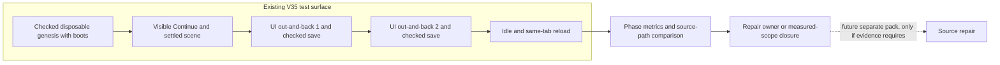
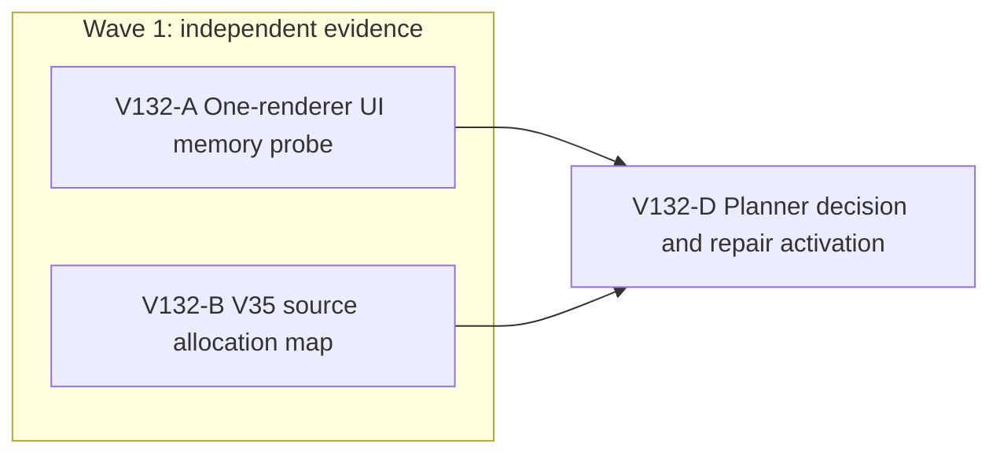

# Ticket Pack: V132 V35 long-session memory attribution

## Summary

This pack resolves the V131 memory warning with a bounded, one-renderer visible run and an independent V35 source-path map. It makes no production change. The result will decide whether a specific repair pack is justified or whether the 1.34 GiB observation remains unattributed.

Aligned problem and success criteria: [V132 understanding](V132_LONG_SESSION_MEMORY_UNDERSTANDING.md). Goal status: aligned with the active full-game contract. System translation: not_qualified. Product agent runtime: not_required.

Locked design:

- Do not change graphics, safety thresholds, checked save authority, existing profiles, app ports, or source during measurement.
- Use the existing 5195 V35 server in one owned browser tab. Keep the 5194 user preview available. The V35 fixture is test setup, not another quest completion claim.
- Do not interpret a single peak as a leak. Use same-PID baseline and recovery where possible, actual position delta, and phase timestamps.

Important repo truth:

- V131 full UI journey observed a likely renderer near 1.34 GiB, but process attribution and retained growth were not captured. Later visual fixtures showed roughly 404 MB in a probable renderer and 83 MB used JS heap, only at short duration.
- V127 through V129 showed substantial transient checked-save allocations in V34, with unmatched baselines and remaining V14/V13 validation/copy sites. V35 adds a wrapper around V34 and reprojects world view on ticks, so prior V34 results are not a V35 memory pass.
- Both 5194 and 5195 returned HTTP 200 at intake. The test browser from V131 is closed. The checkout is very dirty and all existing changes must be preserved.

## Proposed Flow

## Public Interfaces

None. Output is a private measurement receipt and a source map. No persistent save format, API, route, or schema changes.

## Lane Graph

## Topology Audit

- Productive lanes: A owns one real browser/process measurement artifact; B owns V35-specific allocation and retention path evidence. They are incomparable and can run in the same wave, since B has no browser or writes.
- Maximum safe width: two. Fan-in D consumes both distinct receipts and does not redo either lane. A alone cannot name a source owner; B alone cannot establish memory magnitude or retention.
- Certainty: A is a discriminating probe of transient versus retained versus unattributed RSS. Its stop is a matched same-PID route/reload table, a guard stop, or a classified setup blocker. A surprise is a peak above the early guard or a save/route no-op. B uses reasoning closure to map V35 per-frame/read/write/reload ownership; its stop is a path/line map with predicted metrics for each live cause. Its surprise is an unbounded cache or listener not present in the V131 audit.
- Serial edges A→D and B→D consume their evidence. No code repair lane is dispatched before causal evidence. A second generic reviewer would duplicate the two concern-specific evidence lanes. No PR finisher is present because no PR or GitHub action is requested.
- Broad-lane split: A changes no files and owns browser/resource observations; B changes no files and owns only source-path reasoning. Neither may invent a production repair. The decision node may author a separate bounded pack if a specific owner is identified.
- Conditional decision: A setup failure leaves performance unverified; an attributed retained heap points to V35 runtime/view ownership; stable heap with save-only RSS peak points to transient validation/native allocation; GPU resource count growth points to scene disposal. Contradictory metrics remain unresolved and require a new, named probe, not speculative code.
- Dispatch verdict: PASS. The graph is non-linear, maximally parallel, ownership-disjoint, and each evidence lane can change the next decision.

## Smallest Viable Diff

Behavior delta: none. Expected changed files: these two planning documents only. Production/test/config files: zero; net production lines: zero; new dependencies: zero. Reuse the current 5195 server, V131 checked visual fixture recipe, existing process/CDP tools, and V127 through V129 measurements. A no-code diagnostic is sufficient until evidence identifies a bounded owner. Do not delete or simplify product code in this pack. Validation is the visible UI/metrics and independent source map. Tripwires: source edits, another app port/profile identity, second owned renderer, authentic save access, guard increase, or browser infrastructure repair require a new authorized plan.

## Tickets

### Paste now to: V132-A empirical UI reviewer

Ticket V132-A. Your role is `reviewer` ONLY under `auto-planner-ticket-pack`, `smallest-viable-diff`, `test-from-ui` final_proof plus its generic reference, and `playwright`. Read those SKILL.md files completely before task actions. Continue the recent V131 visual tester native child only if its completed status and one-browser ownership remain safe; otherwise use a fresh ephemeral native child. Dispatch transport `native_spawned_subagent`, inherited model, local runtime, no Cursor, no existing durable Codex task, no provider CLI fallback, no nested workers. Branch/cwd: `ben/wizard-playable-v2`, `/private/tmp/pa-wizard-playable-v2/games/wizard-realms/engine`. No source/test/config/doc/Git/GitHub change. Do not use em dashes in prose. Do not set or repurpose `HOME` or `CODEX_HOME` environment variables.

Delivery phase `pr_hardening`, milestone `final_complete`; the user surface is already ready at `http://127.0.0.1:5194/?publicWorld=v35` and remains untouched. Automated isolation is the already live `http://127.0.0.1:5195/?publicWorld=v35`. Optional user-feedback wait: never. Environment repair authority: none; at first confirmed non-product setup blocker, do one bounded retry, then stop and report. Test-writing policy: no files. Visual proof: required because this is a visible movement/save journey.

Reuse your last V131 V35 checked visual fixture recipe, in a new disposable 5195 browser profile, with leather boots owned and equipped. Label this as a performance fixture, not a full quest run. Use one tab and one owned game renderer, 1280 by 720 viewport, fixed DPR if already supported. Arm the existing early RSS safety stop at 870,400 KiB and a hard stop before 1,024,000 KiB for an attributed renderer. If exact renderer attribution is not possible with the existing transport, document which processes are merely candidates and stop conservatively when any candidate approaches the early threshold. Do not open another tab, change ports, or alter the user's 5194 save.

Capture the fixture validity and visible V35 Continue state. At a settled, unobstructed starting point, record actual player position and heading. Drive a single repeatable out-and-back route through UI controls with boots running, then repeat the same route from the same position/heading. A route may be shortened to avoid a wall, river or tree, but both repetitions must use identical inputs and record actual position delta; a no-op is not evidence. On each loop, release input and wait for the visible V35 checked-save message. Capture metrics at baseline, post-loop save peak, natural idle, second loop save peak, idle, and same-tab reload. Keep the full route under the guard and stop early on rising risk. Where available, collect exact renderer PID RSS, separate GPU PID RSS, CDP used/total JS heap, and already exposed Three geometry/texture counts without source changes. Do not force GC before natural recovery is recorded. Capture at least initial and final screenshots plus console/network errors. Close the one owned browser/watchdog.

Unknown: whether V35 memory retains growth, transiently peaks at save, or was misattributed. Closure mode: discriminating probe. Stop at a phase-labeled same-session table, safety stop, or classified environment blocker. Surprise trigger: a no-op route, new product error, or early guard breach. Return exact fixture setup, URL/viewport, visible actions, positions, timestamps, process mapping method and confidence, RSS/heap/GPU table, screenshot paths, console/network, resource cleanup, and a scoped verdict. Do not claim a long-session under-1 GiB pass if the route is short or PID ambiguous. Receipt must state `native_spawned_subagent`, inherited model, continued child session, no fallback, no durable-task contact, and surface availability.

### Paste now to: V132-B V35 source reviewer

Ticket V132-B. Your role is `reviewer` ONLY under `auto-planner-ticket-pack` and `smallest-viable-diff`. Read both SKILL.md files completely before task actions. Continue the recent V131 renderer-memory source auditor native child only if completed and ownership-safe; otherwise use a fresh ephemeral native child. Dispatch transport `native_spawned_subagent`, inherited model, local runtime, no Cursor, no existing durable Codex task, no provider CLI fallback, no nested workers. Same branch/cwd as A. No source/test/config/doc/Git/GitHub change and no browser. Do not use em dashes in prose.

Delivery phase `pr_hardening`, milestone `final_complete`; 5194 remains user-accessible and A owns the only browser on 5195. Test-writing policy: no files. Visual proof: not applicable because this is read-only source reasoning. Inspect current `PublicV35ControllerRuntime.ts`, `PublicV34ControllerRuntime.ts`, `PublicV23Controller.tsx` projection/tick/save, V35 flow/store/snapshot, active terrain caching, and R3F scene resource disposal. Compare V127 through V129 and V131 memory receipts. Count which operations clone/decode/replay or allocate view objects on a V35 frame, save, action and reload, and identify bounded versus potentially retained structures. Do not infer measured bytes from source or repeat the generic V131 audit. Specifically distinguish the V35 wrapper's extra work from inherited V34 behavior and describe what A's measured heap/RSS/GPU patterns would imply for each candidate.

Unknown: which current V35 owner can cause phase-specific allocation or retention beyond V34. Closure mode: reasoning with source path/line evidence. Stop at a compact owner map, predicted discriminating metrics, and smallest plausible owner per outcome. Surprise trigger: a genuinely unbounded V35 cache, retained listener, or duplicated long-lived renderer that contradicts the current bounded model. Return findings-first, exact file/line references, what remains unmeasured, and one bounded repair candidate only if source evidence warrants it. Receipt must state `native_spawned_subagent`, inherited model, continued child session, no fallback, no durable-task contact, and no browser.

### Wait for A and B, then V132-D planner decision

The top-level planner reconciles both receipts without rerunning either lane. Classify `retained-js | transient-js/native | gpu-turnover | process-misattribution | mixed | unresolved`, state exact measured scope, and either author one bounded repair pack with an observed owner, accept the current short-route measurement only at its scope, or name the missing next discriminating probe. Preserve the under-1 GiB long-session gate until a true long route proves it. No code or GitHub action at this decision node.

## Assumptions

- The existing 5195 test server and the prior V131 fixture method remain available. If not, A reports the environment/setup blocker rather than building alternate infrastructure.
- The two route repetitions can be made input-identical and actual position delta can be observed in the existing UI. If not, the result is a bounded diagnostic with reduced confidence, not a performance pass.
- A and B can operate in parallel because B has no browser or writes and A does not edit source.

## Integrated receipt and decision

V132-A completed two identical checked V35 UI out-and-back loops from x0,z0,yaw0. Each S600 ms leg reached z2.88 m and W600 ms returned to z0, with visible saved revisions 1 through 4. A third identical replicate reached revision 6. One distinct S3000 ms attempt reached z5.76 m before the continuous river correctly blocked further movement, and saved revision 7. The one disposable 1280 by 720 browser used an owned/equipped-boots checked genesis fixture, not a completed quest save. The test browser and watchdog closed; both 5194 and 5195 remained HTTP 200.

The likely page renderer was owned PID 6148, identified with high confidence from the owned process tree and CDP CPU use, though no direct CDP target-to-PID mapping was available. Renderer RSS was 355,056 KiB at baseline, sampled at 533,904 KiB for the first matched loop, 537,728 KiB after the second save (not a continuous peak), 529,088 KiB for the third replicate, and 678,128 KiB during the distinct river-bound attempt. It recovered naturally to 384,352 KiB after the first loop, 378,464 KiB after the third, and 479,168 KiB after the longer attempt/map idle. Used JS heap remained roughly 59 to 67 MB across the sampled phases; GPU-process RSS stayed around 139 to 154 MiB. The early 870,400 KiB guard never fired. Game console had zero errors and one existing `THREE.Clock` warning; favicon 404 was the only failed static request.

V132-B mapped V35's extra checked-save work: its wrapper replays ordinary witnesses despite the inherited V34 frame-proof fast path, validates lineage on writer replies, and clones the returned state before rebuilding an inner shell. The shared 50 ms frame projection also allocates view objects, and V35 advisory Survey/Deliver previews deeply validate only when eligible. V35 saved history and terrain caches are bounded; source does not show an unbounded V35 cache or second renderer. These are candidate transient allocation owners, not measured causes of the V131 1.34 GiB observation.

**Decision:** classify the measured short-route behavior as `transient-js/native plausible, long-session unresolved`. Natural RSS recovery and near-baseline used heap do not support a retained-JS leak over the measured 2.88 to 5.76 m route. The route did not stream far into the roughly 2 km world, and the high V131 process was not definitively attributed. Therefore there is no causal basis for a speculative V35 source repair or an under-1 GiB long-session claim. The next performance proof should use one checked disposable save already beyond the river on an unobstructed streamed route, with a persistent one-browser profile, matched same-PID out-and-back distance and idle/reload measures. That is a separate bounded validation milestone. The full-game goal remains active.
