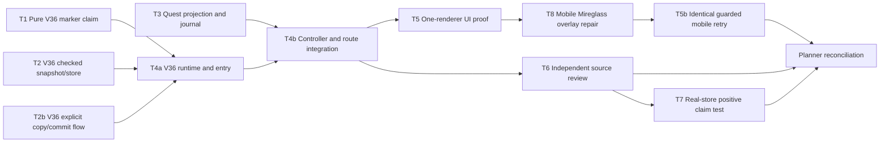

# V133 ticket pack: Beneath the Old Marker

## Contract and status

Aligned understanding: `V133_MARKER_QUEST_UNDERSTANDING.md`. Full-game goal remains active. This pack implements one V36 chapter on the current `ben/wizard-playable-v2` checkout, without pushing. V35 at `http://127.0.0.1:5194/?publicWorld=v35` stays usable. Preserve every existing dirty file not in a lane's assigned paths.

Delivery phase: `local_feature`; earliest honest V36 terminal/browser surface should be exposed as soon as it works, then continue tests. Milestone: checked V36 claim and a real UI quest journey, not a market release or full-game completion. Optional user-feedback wait: none. Environment repair authority: one bounded retry per setup fault, no browser/profiler infrastructure rewrite. Test-writing policy: focused unit/integration tests for authority and new projection; one isolated UI browser for acceptance. Long-session memory remains a separate unproven gate, with 870,400 KiB early stop and hard stop before 1,024,000 KiB on any candidate renderer.

## Frozen public interfaces

- `PublicV36MarkerProgress = PublicV35Progress & { markerClaimReward: 'fen_waders' | 'coins' | null }`.
- `PublicV36MarkerWitness = { kind: 'marker-claim/v1' }`, exact keys only. Advisory preview and checked confirmation use the same pure rule, but the locked writer reruns it.
- Confirmed claim requires `ledgerClaimReward !== null`, authoritative `mireglass.fringeMarkerStudied`, `cacheRevealed`, `cacheExcavated`, grounded canonical Mireglass salvager reach within 3 m, and no prior marker claim. Seal inventory is deliberately not a gate. If waders are not owned or escrowed, carried units must leave capacity for one pair.
- Reward branch is derived server-side from inventory and escrow. New pair: +80 coins, +50 character and Spellcraft XP, inventory +1 waders, no auto-equip. Existing pair: +230 coins and same XP. Saved branch is exact and one-time. `state.eventSequence` advances once. No new `ItemId` is needed.
- V36 root is a separate checked, atomic, versioned successor of V35. Explicit copy only; V35 is read-only during copy. V36 inherited movement and all V35 actions replay. No historical schema is edited. One-use CAS, lineage, monotonic marker claim and exact reward replay mirror current strict pattern.
- UI projection adds `v36MarkerQuest` and `v36MarkerClaim` without replacing V35 first-find/Ledger truth. If marked quest is active after Ledger completion, the compact journal displays it as the next chapter, with a clear switch/view of completed prior quests. No overlay may block Works, terrain tools, or the map on desktop or 360×600. Near outpost, Claim is an explicit button with rejection reason.
- New opt-in `?publicWorld=v36` dev entry copies an existing checked V35 save once. No implicit copy, no mutation of 5194 browser storage. Keep V35 route as is.

## Dependency and ownership graph

T1, T2, T2b and T3 have disjoint file ownership and fixed interfaces, so they run concurrently. T2 and T2b may initially typecheck only after T1's and T2's exports exist. T4 is split before dispatch: T4a owns the runtime/entry seam, T4b owns controller and route wiring. T4b can inspect the frozen T4a interface while T4a completes, but cannot claim completion before T4a's receipt. T5 owns the only browser. T6 is read-only and can run beside T5. G records exact passed and unproven gates and keeps the full-game goal active. The width of four in wave one is real parallelism: rules, snapshot/store, transactional flow, and player-facing quest projection are independent concerns; no two workers edit the same file. T2 was split after the V35 precedent showed a three-file copy would exceed the 300-net-line tripwire. T4 was split to keep its two integration seams below the same tripwire. Replan rather than let a lane exceed five production files or 300 net production lines without an explicit narrower split.

## Model and transport routing

All coding/review lanes use `planner_selected`, native ephemeral subagents, inherited task model, local repository tools and no provider CLI fallback. Native transport availability is verified by successful dispatch ID; no exact external model is required by the user. The required capabilities are TypeScript repository access and `apply_patch`; T5 additionally requires Playwright/browser and process memory observation. A native child may be reused only if completed, ownership-safe, and recently demonstrated the relevant capability. No durable Codex task messaging. Dispatch receipts must say actual child ID, inherited model, transport, fallback, and result. No GitHub account action is authorized.

## Tickets

### T1: Pure checked action and focused tests

Role `implementer`, read `auto-planner-ticket-pack` and `smallest-viable-diff` fully before edits. Own only `src/domain/publicWorldV36MarkerAction.ts` and `.test.ts`. Implement the frozen decoder, advisory preview, checked confirmation, strict malformed input handling, exact branch, capacity, pose/location and overflow gates. Use canonical `mireglassAnchors(seed).salvager` and current pose authority; do not trust caller-selected reward/pose. Demonstrate no mutation on rejection, no extra keys/proxy acceptance, sold seal still eligible, prior wader ownership including escrow, and no auto-equip. Do not edit V35. Focused test and `git diff --check` receipt. Unexpected dependency requiring change outside these two files: stop and report.

### T2: V36 checked snapshot/store and focused tests

Role `implementer`, same two skills. Own only `src/domain/publicWorldV36Snapshot.ts`, `src/domain/atomicV36Database.ts` and their V36-named tests. Reuse the V35 three-slot checked root and atomic store pattern, but accept an entire checked V35 root as source, use a distinct V36 database, strict replay of inherited V35 witness plus V36 claim, monotonic reward and read/write CAS. Export V35-parallel create/decode/replay/successor names and `createAtomicV36Store`. Do not alter V35 or old storage. Test V36 genesis/previous/head, forged successor/reward, inherited post-claim action and store CAS. Fixed T1 exports may be imported before T1 completes. If >5 production files or 300 net lines, report split before expanding.

### T2b: V36 transactional flow and focused tests

Role `implementer`, same two skills. Own only `src/domain/publicWorldV36Flow.ts` and `src/domain/publicWorldV36Flow.test.ts`. Import T2's frozen V35-parallel snapshot/store names, including `createPublicV36Root(source: PublicV35Root)`; pass the whole `old.root` returned by checked source read, not a proposed head. Export `inspectPublicV36`, `startPublicV36`, `resumePublicV36`, `commitPublicV36`, `requestPublicV36ReturnHome`, and `PublicV36Start`, mirroring V35 external contracts. Explicit one-time V35-to-V36 copy under shared lock; source unchanged; corrupt source/target refuse; commit writer replays marker and inherited witnesses under CAS; return-home remains checked. Test copy/resume, source preservation, conflicts and duplicate claim, inherited post-claim witness. Do not alter T1/T2/V35/UI files. You may typecheck after T1/T2 files land. No browser, Git or GitHub.

### T3: Player-facing quest projection

Role `implementer`, same two skills. Own only `src/view/publicV36MarkerQuest.ts` and `.test.ts`, `src/view/contracts.ts`, and `src/view/WizardHud.tsx` plus focused HUD test if necessary. Produce staged copy for trail, marker, cast, Excavation level 2, cache, salvager, complete. Derive stages from checked facts, not UI flags; explain training via chopped Mireglass stump when skill-locked and spade acquisition if absent. Distinguish existing spell/cache XP from the +50 claim reward, and show exact saved wader/coin branch. Existing waders are not armor and are not auto-equipped. Journal remains compact and prior quests remain inspectable. Do not wire controller or entrypoint. Typecheck after T1/T2 stubs exist; validate 360×600 layout in T5, not a second browser. If implementation would need cross-owned file edits, report.

### T4a: V36 runtime and entry after T1/T2/T2b receipts

Role `implementer`, same two skills. Own `src/PublicV36ControllerRuntime.ts`, `src/PublicV36Entry.tsx` and V36-named tests for these files only. Mirror V35 runtime and entry external shapes: `createPublicV36ControllerRuntime(initial: PublicV36Start, write, returnHomeWrite?)` with `preview`, `view`, `status`, `idleFrameNeeded`, `advanceFrame`, `save`, `returnHome`, `action`, and `PublicV36EntryApp` with `renderSession(start, bindings)`. The inner V35 runtime simulates inherited controls but cannot write to V35 storage. Checked V36 writer handles new claim. Entry explicitly copies V35 into separate V36 store; it never silently copies. Preserve V35 branch/store. TypeScript and focused tests; no browser, Git or GitHub. T4b owns controller/main and may proceed against this frozen interface.

### T4b: Controller and route integration after T1/T3 and T4a interface

Role `implementer`, same two skills. Own `src/PublicV23Controller.tsx`, `src/main.tsx` and one focused integration test only. Wire `?publicWorld=v36` gated to dev, V36 runtime creation, `publicV36MarkerQuest(view, facts)`, V36 advisory claim preview, `{type:'v36.marker.claim'}` intent, preserved V35/older routes, and view props. Use `PublicV36EntryApp` and `createPublicV36ControllerRuntime` external shapes frozen in T4a. The session must retain all inherited actions, movement and return-home. An honest V36 surface passes a local smoke only after T4a and T2b are in place; do not claim browser access from a source-only change. TypeScript, focused tests and production build must pass after all dependencies complete. Avoid touching T1-T3/T4a files; report actual delta and candidate merge unit, no commit or PR.

### T5: Isolated UI proof after working V36 surface

Role `reviewer`; read `test-from-ui` and `playwright` fully, including generic UI E2E reference, plus `auto-planner-ticket-pack`. Use a single disposable browser/profile at existing 5195 test origin, leaving 5194 save untouched. Test initial V36 copy or checked near-quest fixture, visible marker/cast/cache/claim path as far as realistically reachable; prove claim and exact reward from visible UI, repeat rejection, reload persistence, continued movement, 360×600 journal/Claim/terrain-tool hit targets, console/network. Start an RSS guard before loading the game, close tab/browser/watchdog at end. If full adventure is not completed, state exactly which part is fixture-based and which is unproven. No files or GitHub edits.

### T6: Independent bounded review after T4

Role `reviewer`, read `smallest-viable-diff` and `pr-review-deep-dive` fully. Read-only audit for migration/source safety, witness and reward forgery, seal-sale non-softlock, inventory/escrow/capacity math, duplicate payout, post-claim inherited actions, UI affordance and scope. Report findings first with file/line evidence. Do not open a second browser. No files or GitHub edits.

### T7: Close the real-store positive-claim proof gap from T6

Role `implementer`, read `auto-planner-ticket-pack` and `smallest-viable-diff` fully. Own only `src/domain/publicWorldV36Flow.test.ts`. T6 found that the positive runtime test uses a mock writer while the current real-store test has only rejection paths. Add a focused test that starts from a fully checked V35 source root, explicitly copies into the real V36 atomic store under the real lock test harness, performs a successful `marker-claim/v1` through `commitPublicV36`, reads/reloads the checked V36 root, verifies exact one-time coin/XP/unequipped-wader branch and unchanged V35 source, then commits an inherited movement or checkpoint witness and verifies persistence. Keep any fixture valid under the checked decoder; do not forge a V36 head. If a full checked near-quest V35 source cannot be constructed without expanding owner scope, stop and report rather than weaken the test. No production files, browser, Git or GitHub. Run the identical focused test after any repair and report exact evidence.

### T8: Repair observed mobile overlay and retry the same browser actions

Role `implementer`, same two coding skills. Reuse the completed T4b controller owner only if idle and safe; otherwise fresh ephemeral worker. T5 observed at exact `5195/?publicWorld=v36` after checked claim and viewport 360×600: `Mireglass actions` panel buttons intercept Terrain Dig/Fill/Mine and Place soil centers and cover the expanded quest reward text. Screenshot `engine/.playwright-cli/page-2026-10-11T19-29-18-710Z.png` and expanded `page-2026-10-11T19-29-36-859Z.png`. Smallest owner is `src/PublicV23Controller.tsx` fixed `.v24-actions` placement and markup. Own only that file and optionally its existing focused V36 integration test. For V36 mobile, make Mireglass actions a clear, at-least-44-pixel collapsible control; when closed it must not intercept Terrain/Works/journal taps, when opened its actions remain reachable and closable, and while the quest journal is expanded it must not cover reward/prior-quest text. Preserve V24/V35 behavior and desktop access. No second browser, Git or GitHub. Run typecheck/focused test/build. T5 then repeats the identical 360×600 hit test on its one guarded browser. Record the observed-error loop as `overlap | bounded owner change | HMR/reload | same entrypoint and tap result`.

## Earliest honest access and final gate

Expose V36 only after its checked copy, strict claim path, and render/session smoke pass. A source-only build is not user access. User access is a milestone, not completion; T5 and T6 continue concurrently. Final feature claim requires T1-T4 typecheck, focused tests, production build, UI evidence, review resolution and exact migration proof. Long-session memory gate remains unverified after V132's short route. Do not say armor stats, combat drops, full game, market launch, or under-1-GiB long session are done.

## Integration receipt, 2026-10-11

T1, T2, T2b, T3, T4a, T4b, T7 and T8 were implemented through native ephemeral workers with inherited model and no fallback. T6 independently found no confirmed authority or save-isolation blocker, then identified the missing successful real-store test, which T7 closed. T4a's combined production and test delta was 406 lines, but production was 252 lines across two production files; the ticket's production cap was met and the test lines were retained as necessary proof. No commits, pushes or GitHub actions were made for this chapter.

The scoped seven-file V36 suite passed 22/22 tests, and the targeted HUD quest test passed 1/1. `npm run build` passed. The existing large-chunk warning remains and is not a quest failure. The real locked-store test proves one exact claim, replay rejection, checked reload, inherited checkpoint and unchanged V35 source. The isolated 5195 UI test copied a validated V35 near-quest history into V36, clicked Claim, observed 170 to 250 coins and one unequipped Fen Waders with boots still equipped, then verified the checked V36 root, reload, duplicate refusal and continued movement. The 5194 user-facing preview and its saved V35 state were untouched.

Observed mobile failure loop: `fixed Mireglass actions covered Quest rewards and Terrain/Works at 360×600 | V36-only collapsed details control, hidden while Quest or Works expands | isolated 5195 reload | advanced: Quest rewards readable, Dig/Fill/Works receive center taps, action summary opens and closes`. T5b used a checked Mireglass-ring fixture, not the completed Old Marker save, for the exact post-repair mobile retry. It recorded zero console errors, all 937 captured requests HTTP 200, page renderer 331648 KiB, GPU 141312 KiB and JS heap 63.0 MB; the single browser and watchdog were closed afterward.

The marker-studied, Glow-revealed and cache-excavated facts in T5's successful claim fixture came from decoder-valid synthetic V34 history. This proves the reward path, not an organic fresh-player completion of marker, cast and cache actions. The V132 short-route memory evidence does not establish a long-session under-1-GiB gate. True armor, enemy combat and drops are roadmap work, not V36 claims. Keep the full-game goal active.
