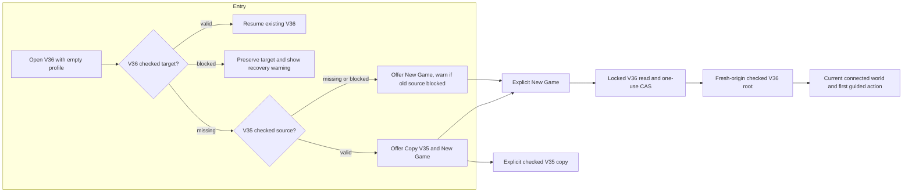
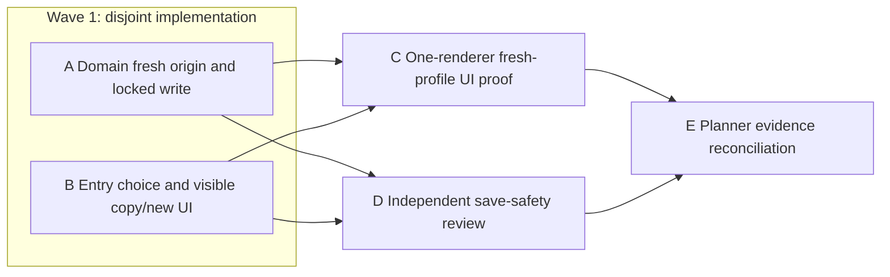

# Ticket Pack: V134 Current-Campaign New Game

## Summary

The V134 empty-profile browser probe proved that `?publicWorld=v36` blocks at `source-missing`; New Game first appears three version links later in V33. Add an explicit checked New Game action to V36 without overwriting any V36 or older save. Then prove a new player can enter the current world through the real UI and perform its first ordinary action. The full-game goal remains active.

Aligned understanding: `V134_FRESH_START_UNDERSTANDING.md`. Probe receipt: `V134_FRESH_START_PROBE_PACK.md` and screenshot `engine/.playwright-cli/page-2026-10-11T19-53-09-766Z.png`. Current branch is `ben/wizard-playable-v2` at `6bb8d39` plus extensive pre-existing uncommitted work. No commit, push, PR or GitHub action is authorized.

Locked design:

- The current V36 root is the only new write target. A fresh start must not write, clear or mutate V35 or any older store.
- An existing valid V36 root resumes. A corrupt or partial V36 target blocks; New Game never overwrites it.
- When V36 is absent and V35 is valid, show both explicit Copy V35 and New Game choices. When V35 is missing, show New Game. When V35 is blocked, allow a clearly labeled independent New Game while warning that the older branch cannot currently be copied and is untouched.
- Preserve the current explicit V35 copy behavior. A new V36 root must truthfully record fresh origin, not falsely claim a V35 database migration.
- Use canonical fresh seed `wizard-realms`. Compose existing pure version constructors to obtain the current world's initial progress; do not handcraft a late-version head or skip gameplay restrictions.
- Keep 5194 user save and preview available. Use only the isolated 5195 test browser, one renderer and the established RSS guard.

Important repo truth: `createPublicV23Root(seed)` produces a fresh checked initial root. V24 through V33 and V34/V35/V36 each have pure root constructors. `PublicV36Lineage` currently accepts only `origin:'v35-migration'`, so fresh origin requires a precise schema extension. `startPublicV36` already uses the V7 lock and target CAS; mirror that pattern for fresh start. `PublicV36Entry.tsx` owns the visible choice and currently treats missing V35 as a blocker.

Delivery phase: implementation, then pr_hardening. The 5194 V36 copy preview is already reachable, but V134's New Game feature reaches `SURFACE_READY` only after a fresh-profile 5195 New Game click creates a checked V36 root and shows a playable scene. Do not wait for optional user feedback. Environment repair authority: none beyond one confirmation of the already-running 5195 server; no alternate port or shared dependency work. Test-writing policy: narrow authority tests are mandatory before first fresh write because the schema and CAS are data-safety gates; UI proof runs as soon as that gate and build pass. Reviewer may run in parallel with the UI proof.

## Proposed Flow

The existing Copy V35 path remains distinct. Future multi-save slots and account sync are out of scope.

## Public Interfaces

- Add `createFreshPublicV36Root(seed: string): PublicV36Root` to `src/domain/publicWorldV36Snapshot.ts`. Its lineage is `{origin:'fresh',rulesProfile:'old-marker/v1',seed,sourceRevision:null,genesis}`. Existing migration lineage remains `{origin:'v35-migration',rulesProfile:'old-marker/v1',seed,sourceRevision:number,genesis}`. The checked decoder accepts exactly these two discriminated forms and rejects malformed combinations.
- Add `startFreshPublicV36(locks, store, seed): Promise<PublicV36Operation<PublicV36Start>>` to `src/domain/publicWorldV36Flow.ts`. It obtains the existing exclusive lock, requires the V36 target to be missing, creates the fresh root, commits with the missing-root CAS proof, and returns the checked head/lineage. A blocked/valid target refuses with no write. It does not inspect or mutate V35.
- Extend `PublicV36EntryDecision` with `{status:'fresh-available';sourceWarning:string|null}` and `Choice` with `'create'`. `copy-available` keeps `sourceRevision`, offers Copy and New Game. The create action rechecks target availability, then calls `startFreshPublicV36(...,'wizard-realms')`. The copy action retains source revision checking. `PublicV36EntryView` names the independent-save consequence. `source-missing` is no longer a V36 entry blocker.
- No external URL or database name changes. Older checked roots and V35 copy witnesses remain byte-compatible.

## Lane Graph

## Topology Audit

- Productive lanes: A changes checked lineage plus one-use fresh writer; B changes the entry decision and UI. They are incomparable after the public interface above is fixed and own disjoint files. Both converge at the real UI proof and save-safety review.
- Maximum safe productive width: two. A cannot own entry markup and B cannot edit snapshot/flow. C alone owns the browser because of the one-renderer rule. D is a targeted review of source integrity and branch selection, not a second browser or generic reread.
- Serial edges A/B to C consume a buildable integrated current-version entry; A/B to D consume the finished authority and UI code. Neither C nor D can prove a pre-integration result. C/D to E consume distinct runtime and adversarial source evidence.
- Certainty: A must show a fresh lineage is replay-valid, exact and non-migrated; B must show the chosen UI path; C distinguishes playable fresh start from a new runtime blocker; D tests save overwrite and migration-risk assumptions. A duplicate deterministic test lane is pruned.
- Surprise triggers: fresh root decoder failure, a V35 mutation, incorrect source precedence, inability to render the first world, or a renderer approaching the RSS stop. These cause local repair or replan, not a false pass.
- Scope and tripwires: A may touch two production files and focused tests, B one production file and its focused test. No dependencies, shared runtime rewrite, older schemas, or unrelated refactor. Any lane exceeding five files, 300 net added lines, or requiring another old-version edit stops and reports.
- No PR finisher is included because the user did not request a PR. The planner reconciles the integrated evidence. Dispatch verdict: PASS.

## Smallest Viable Diff

Behavior delta: V36 offers and securely creates a fresh current-world save while retaining copy/resume. Expected budget: A at most four files and under 300 net lines; B at most two files and under 180 net lines; zero dependencies. Expected files: `publicWorldV36Snapshot.ts`, `publicWorldV36Flow.ts` and their focused tests for A; `PublicV36Entry.tsx` and `PublicV36Entry.test.ts` for B. Forbidden: V35 and older production code, storage databases, main route, global UI, package/lockfiles. Reuse the existing pure version constructors, V36 checked decoder, V7 lock and atomic store, and existing entry choice view. A config/link-only fix is insufficient because a link to V33 still forces technical version hopping and creates no current checked root. Simplify the old `source-missing` dead-end text in V36 entry; do not introduce a second save manager. Validate with focused Vitest, `tsc -b`, build, and one real UI journey. Replan on any tripwire.

## Tickets

Paste now to: Domain Implementer
Ticket: V134-A. Role `implementer` ONLY. Read `auto-planner-ticket-pack` and `smallest-viable-diff` completely. Own only `src/domain/publicWorldV36Snapshot.ts`, `src/domain/publicWorldV36Flow.ts`, `src/domain/publicWorldV36Snapshot.test.ts`, `src/domain/publicWorldV36Flow.test.ts`. Implement the exact Public Interfaces above, composing `createPublicV23Root(seed)` through V24, V25, V26, V27, V28, V29, V30, V31, V32, V33, V34, V35 and V36 constructors without writing old stores. Preserve migration decoding and V35 copy. Do not fabricate an origin or manually assemble progress. Test fresh root strict decode, exact fresh lineage, initial player state, inherited checked witness, locked one-use commit, blocked/valid target refusal, and no source store writes. Acceptance: `./node_modules/.bin/vitest run src/domain/publicWorldV36Snapshot.test.ts src/domain/publicWorldV36Flow.test.ts`, `./node_modules/.bin/tsc -b --pretty false`, `git diff --check` on owned tracked files plus whitespace check for any untracked new file. No browser, Git, GitHub or other file edits. Return full implementer receipt, including actual changed lines, reuse scan, safety evidence, transport/child ID, no fallback, and tripwires.

Paste now to: Entry Implementer
Ticket: V134-B. Role `implementer` ONLY. Read the same two skills completely. Own only `src/PublicV36Entry.tsx` and `src/PublicV36Entry.test.ts`. Implement exact decision/choice UI above against frozen A export `startFreshPublicV36(locks,store,seed)`. Inspect checked V36 first; when missing, inspect checked V35 for copy availability or warning. Existing target blocked remains blocked. V35 valid exposes both choices; missing or blocked V35 exposes New Game, with accurate warning for blocked. Reinspect before choice; one-use CAS in A settles races. Preserve resume/copy behavior, sourceRevision check, and user data. Focused test all entry states and choice behavior, including no silent copy and blocked target. Acceptance: `./node_modules/.bin/vitest run src/PublicV36Entry.test.ts`, `./node_modules/.bin/tsc -b --pretty false` after A export exists, `npm run build` after integration, scoped diff check. No browser, Git/GitHub or other file edits. Return full implementer receipt and note visual proof remains C's job.

Wait for A and B, then paste to: UI Reviewer
Ticket: V134-C. Role `reviewer` ONLY. Read `test-from-ui`, generic reference and `playwright` completely. One disposable fresh browser/profile at existing `http://127.0.0.1:5195/?publicWorld=v36`, viewport 390 by 844, RSS guard before render. Click the visible New Game button, observe the current world and first obvious ordinary action, verify checked V36 save exists and V35 remains absent, reload and Continue. Inspect console/network and screenshot initial, action and resumed state. Do not seed state, change source or touch 5194. Close browser/guard. If first journey fails, report exact observed-error loop input for the smallest owner. Transport native inherited, no fallback. Do not claim a full Old Marker playthrough from a one-action smoke.

Wait for A and B, then paste to: Save-Safety Reviewer
Ticket: V134-D. Role `reviewer` ONLY. Read `auto-planner-ticket-pack`, `smallest-viable-diff` and `pr-review-deep-dive` completely. Read-only inspection of current A/B integrated files and focused tests. Findings first. Specifically prove fresh lineage cannot be mistaken for migration, V35 copy still validates an actual checked source, fresh create cannot overwrite valid/blocked V36, a source warning cannot silently discard old data, one-use CAS resolves two tabs, and the new root's initial world matches the canonical constructor chain. Inspect exact changed files and test output; no browser, source edits, GitHub action or generic style review. Report GO/NO-GO, line evidence, smallest-diff verdict and residual risks.

Wait for C and D, then Planner E reconciles the current revision against the aligned goal and V134 scope. It records an honest fresh-start milestone, preserves the 5194 surface, and schedules the organic quest journey and remaining full-game systems. A fresh-start smoke does not close full-game, long-session memory, combat or endgame gates.

## Assumptions

The existing 5195 Vite server remains available. Native ephemeral workers use inherited model and continue recent safe sessions; no external model or provider fallback is required. No durable task coordination or Github account action is authorized. The target's existing one-slot V36 save policy remains in force, so New Game appears only when V36 is missing.
