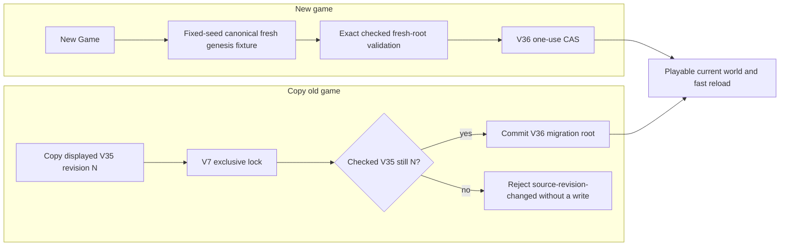
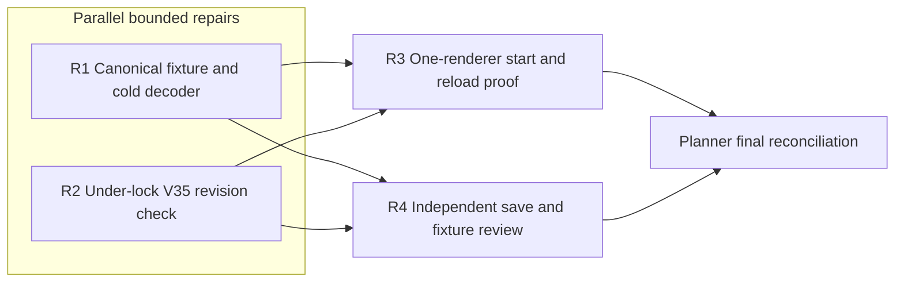

# Ticket Pack: V134 Fresh-Start Cold-Load and Copy-Race Repair

## Summary

V134 New Game reaches the current world and saves an action, but source review exposed two release-blocking edges. A cold fresh-root decode replays the whole V23 to V35 constructor chain for about 12 seconds, and an explicit V35 copy may capture a newer revision than the one selected in the entry UI. Repair these independently, then repeat the same real browser journey with a verified RSS guard. Aligned problem and probe: `V134_FRESH_START_UNDERSTANDING.md`.

Locked design: keep exact fresh-root validation, fixed `wizard-realms` fresh seed, current V36 database and schema rules, V35 read-only copy, one-use V36 CAS, blocked-target refusal and visible New Game/Copy distinction. Existing saved fresh V36 roots must remain decodable. No clear/reset, new account, alternate port, older-version production edit or GitHub action.

Important repo truth: `publicWorldV36Snapshot.ts` now caches one 396224-byte fresh genesis but needs about 12 seconds to populate it on a cold load. `PublicV36Entry.tsx` checks source revision before invoking `startPublicV36`; the latter rereads source under the V7 lock without comparing that revision. Both issues are grounded in current code and accepted review, not speculative polish. The 5194 preview stays available; the only test browser is 5195.

Delivery phase: implementation to pr_hardening. The current surface is an honest early preview; final V134 acceptance requires fast checked start/reload and exact copy revision. Source changes invalidate only V134 domain/entry timing and copy proof, not the earlier V36 quest reward tests. Test-writing policy: focused tests required for authoritative save boundaries. Optional-feedback wait: never. Environment repair authority: none.

## Proposed Flow

## Public Interfaces

- `createFreshPublicV36Root(seed)` remains exported but accepts only the canonical fresh seed `wizard-realms`; a different seed throws. Migrated V35 roots retain their prior seed policy. The fresh lineage decoder rejects a noncanonical fresh seed and compares its genesis exactly to a versioned fixture `src/domain/publicWorldV36FreshGenesis.json`. The fixture contains the deterministic pure V23 through V35 fresh result, generated mechanically once and pinned by a parity test that composes the real constructors. Runtime must not import or execute the slow constructor chain just to validate the fixture.
- `startPublicV36(locks,store,source,expectedSourceRevision)` requires a nonnegative safe integer. Under the existing exclusive lock, after `source.readChecked()` and before target write, compare the checked source head revision with the expected revision; mismatch returns `source-revision-changed`. The existing copy UI passes the displayed `sourceRevision`. Do not add an optional unsafe overload.
- `PublicV36EntryDecision` and New Game choices remain unchanged. Copy still rechecks before invoking the flow, but that advisory check is not the authority.

## Lane Graph

## Topology Audit

- Productive incomparable lanes: R1 owns fresh genesis validation in the snapshot file, JSON fixture and snapshot test. R2 owns copy flow/entry and their tests. They edit disjoint files and consume fixed interfaces above.
- Maximum safe width is two implementation lanes. R3 is serial because it needs the integrated browser bundle and alone owns the renderer. R4 can review integrated source concurrently with R3, adding adversarial save-safety and fixture-staleness evidence.
- R1 closes the empirical cold decode branch by replacing runtime constructor work with exact fixture comparison, with canonical-chain parity tested separately. R2 closes the TOCTOU branch by comparing the actual locked source revision. R3 distinguishes a real fast playable UI from source-only success; R4 detects a weakened decoder or remaining write race. No duplicate generic validation lane.
- Surprise triggers: fixture mismatch, import/build failure, noncanonical seed acceptance, V35 copy regression, target overwrite, first-load stall persisting, or renderer memory guard failure. Replan locally if a repair exceeds its owner or the same runtime failure survives two grounded attempts.
- No PR finisher because the user did not request a PR. All old roots, saves and tests are preserved. Dispatch verdict: PASS, pending the two scoped repair receipts.

## Smallest Viable Diff

Behavior delta: retain exact fresh genesis checking without a cold runtime chain, and bind copy to the displayed V35 revision under lock. Expected R1 budget: snapshot production and test plus one compact mechanically generated JSON fixture, no dependency; R2 budget: flow, entry and their focused tests, no dependency. Forbidden: historical snapshots, atomic store implementation, global routes/UI, package/lockfiles. Reuse the existing pure constructors in a parity test, `samePublicV14Value` for exact comparison, V7 lock and CAS. A prompt or CSS change cannot fix synchronous decoder work or source TOCTOU. Remove the one-seed runtime cache and constructor imports once fixture-based validation replaces them. Any extra new abstraction, >5 files in one lane, >300 net hand-authored lines, or fixture over 500 KiB triggers replan. The generated fixture is a bulk mechanical artifact, not hand-authored code; record exact bytes and parity proof. Validate focused tests, TypeScript, production build, current UI, console/network and RSS.

## Tickets

Paste now to: R1 Domain Implementer
Role `bugfixer` ONLY. Read `auto-planner-ticket-pack` and `smallest-viable-diff` completely. Own only `src/domain/publicWorldV36Snapshot.ts`, `src/domain/publicWorldV36Snapshot.test.ts`, and newly generated `src/domain/publicWorldV36FreshGenesis.json`. Mechanically generate the fixture from the exact existing pure V23 through V35 constructor chain for seed `wizard-realms`; never invent or manually edit its progress. Use `apply_patch` for code edits; a bounded mechanical generator may write only the exact JSON target. Runtime snapshot code imports the fixture and performs exact fresh-lineage genesis comparison without running the chain. Reject other fresh seeds, preserve migration lineage decoding. Move the slow chain into test-only parity code and assert fixture exactness there. Test cold module reload decode, fresh checked root, existing migration root and malformed fresh seed/fixture. Record cold domain timings and fixture byte size. Acceptance: `./node_modules/.bin/vitest run src/domain/publicWorldV36Snapshot.test.ts`, `./node_modules/.bin/tsc -b --pretty false`, `npm run build`, scoped whitespace check. No browser, Git/GitHub, other source edits or dependencies. Full smallest-diff and transport receipt.

Paste now to: R2 Copy-Race Bugfixer
Role `bugfixer` ONLY. Read the same two skills completely. Own only `src/domain/publicWorldV36Flow.ts`, `src/domain/publicWorldV36Flow.test.ts`, `src/PublicV36Entry.tsx`, `src/PublicV36Entry.test.ts`. Require expected V35 source revision in `startPublicV36`; validate and compare inside the existing V7 lock before any V36 commit. Entry passes `decision.sourceRevision`, still rechecks for useful UI feedback, and handles locked mismatch without clearing either save. Update existing direct flow tests to pass revision and add a deterministic race in which the advisory precheck observes N but the locked source read observes N+1. Verify source and target unchanged on rejection, normal copy succeeds, New Game and resume unchanged. Acceptance: `./node_modules/.bin/vitest run src/domain/publicWorldV36Flow.test.ts src/PublicV36Entry.test.ts`, `./node_modules/.bin/tsc -b --pretty false`, scoped diff check. No browser, Git/GitHub, other files or dependencies. Full smallest-diff and transport receipt.

Wait for R1 and R2, then paste to: R3 UI Reviewer
Role `reviewer` ONLY. Read `test-from-ui`, its generic reference and `playwright` completely. Use one fresh disposable browser at existing 5195/V36, viewport 390 by 844. Before opening the game, self-test a shell-safe RSS sampler on its own known PID, then start a continuously functioning page-renderer guard with 870400 KiB early stop and a hard stop below 1024000 KiB; never claim guarded proof if the sampler fails. Repeat New Game, observe preparing label, checked fresh root, first visible action, reload and Continue. Record cold click and reload-to-entry times. Also test a separate checked V35 copy only if it can be done in the same browser without erasing the fresh test; otherwise leave copy to focused tests. Console/network and screenshots, then close browser/guard. Do not touch 5194 or source/Git/GitHub. Report pass/fail and limits, including whether the 12-second stall disappeared.

Wait for R1 and R2, then paste to: R4 Independent Reviewer
Role `reviewer` ONLY. Read `auto-planner-ticket-pack`, `smallest-viable-diff`, `pr-review-deep-dive` completely. Read-only findings-first audit of exact R1/R2 changes: fixture was generated by canonical chain and parity test would fail on drift; production fresh decode is exact but fast and seed restricted; migrated roots remain valid; copy revision comparison is inside same lock as source read and target CAS; no valid/blocked target overwrite; no V35 mutation; no unnecessary cache or fixture bloat. Review current targeted command receipts and file/line evidence. No browser, edits or GitHub. GO/NO-GO and smallest-diff verdict.

Wait for R3/R4, then planner E reconciles the repair, V134 New Game and the original full-game objective. Do not call a fresh-start smoke a full Old Marker quest, a long-session memory pass, or a complete RPG.

## Observed R3 narrow-screen polish

R3 passed the start/save/reload and guarded-RSS journey, then reported two directly visible copy/layout defects at 390 by 844: the resume sentence rendered `#1is ready` without a space, and the movement-pace strip extended past the right viewport edge. These do not reopen the save-safety review. One bounded UI owner may fix only `PublicV36Entry.tsx` and the `.wr-gait` rule in `view/WizardSurface.tsx`, plus a focused existing test if needed. Repeat the same 5195 entry/scene viewport after the patch with one guarded browser, checking the exact text and horizontal fit; preserve the already passed save and lock behavior. No historical rules, game data, GitHub, or 5194 changes.

## Assumptions

The fixed seed is the only fresh-game seed exposed by the current UI; arbitrary seeds remain available only for migrated histories. The fixture is deterministic and contains only synthetic initial game state. Current V36 target storage remains one slot. The 5194 preview stays available, but isolated 5195 owns all validation. Native ephemeral workers use inherited models and no provider fallback; no durable task is created.
