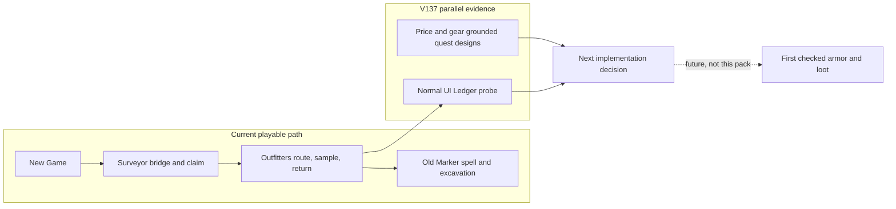
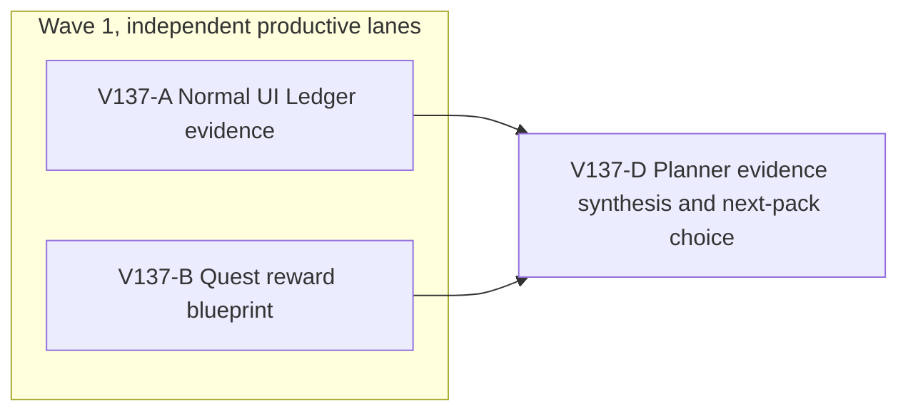

# Ticket Pack: V137 quest handoff and rewards

## Summary

This pack follows `V137_QUEST_NEXT_STEP_UNDERSTANDING.md`. It gathers one real player-journey result for the current second quest and authors one grounded next-quest design artifact. It does not implement unbuilt combat or call clothing armor. The two independent results determine the next bounded game change.

Locked design:

- The active full-game goal remains the terminal condition. V137 is only a quest-design and UI-evidence milestone.
- Main-story coin, XP, and practical gear are guaranteed by checked state. A future enemy drop may be optional, but never the only way to advance.
- The player sees world clues and returns to a recognizable place, not only a journal checklist. No client-authored payout.
- At most one owned browser renderer. Keep the 5194 user preview and its saves untouched. No GitHub or branch action.

Important repo truth:

- V36 has three named starter chapters. The first was completed and reloaded from a blank UI in V136; the full second and third chapters have not been proven from the same fresh journey.
- The existing Traveler Tunic and Fen Waders are travel clothing. There is no checked enemy health, damage mitigation, or defeated-encounter loot ownership yet.
- An earlier unpaced UI run stopped at 878672 KiB RSS. A paced fresh first-quest run peaked at 727120 KiB and recovered with idle. Long-session memory remains open.

## Proposed Flow

## Public Interfaces

No runtime API, schema, save, or UI interface changes. New artifact `docs/V137_QUEST_REWARD_BLUEPRINT.md` contains exactly three distinct quest briefs plus a source-anchored reward table and prerequisite gates. A browser receipt contains URL, revision, action trace, stage reached, first blocker or claim, screenshot paths, console/network status, and RSS/JS/GPU memory observations. The 5194 preview remains the user entrypoint.

## Lane Graph

## Topology Audit

- Productive-lane inventory: A is a one-concern real-browser evidence gate on organic Ledger guidance and memory. B creates a bounded quest-design artifact from actual item and price rules.
- Maximum parallel width: 2. A owns the sole renderer and browser receipt; B is source/docs only and must not open a renderer. Neither consumes the other.
- Fan-in: D compares player friction with the proposed reward cadence and chooses the next implementation or repair pack; D does not repeat either lane or modify production code.
- Broad-lane split audit: A only tests the chapter and records the first blocker. B only designs three quest briefs and calibrates rewards. No overlapping file ownership.
- Certainty/novelty: A resolves whether the second quest is discoverable under normal controls and whether memory permits the journey. B resolves what makes future coin, XP, armor, and drops meaningful relative to current rules without falsely claiming those mechanics exist.
- Surprise/escalation: if A hits the guard, gameplay failure, or unclear objective, stop at the exact first reproducible issue and plan a bounded repair. If B finds an existing combat/armor owner, cite it; do not assume it exists. Unexpected save incompatibility or data-loss risk stops the pack for replanning.
- Conditional activation: there are no preauthorized code repairs in V137. D will create a new bounded pack from a concrete finding. No finisher is needed because no PR is requested; no independent reviewer is needed because this pack changes no product runtime and D checks source anchors plus A's primary evidence.

| Serial edge | Exact consumed artifact | Why it cannot run concurrently |
| --- | --- | --- |
| A to D | UI trace, screenshot and guard receipt | The next change depends on the first actual player blocker or completed Ledger. |
| B to D | Price-grounded quest blueprint | Reward implementation scope depends on existing catalog and gear constraints. |

Dispatch verdict: **PASS**. The two narrow productive lanes are incomparable and converge at D.

## Tickets

Common runtime: native ephemeral subagent, inherited model, no Cursor runtime, no existing-task contact, no provider-CLI fallback, no nested worker, and no Git/GitHub mutation. Each first contact receives the exact `auto-planner-ticket-pack` role lock and relevant skills. The game worktree is `/private/tmp/pa-wizard-playable-v2`, branch `ben/wizard-playable-v2`, with pre-existing user-owned changes. Coding conventions source is the user-provided AGENTS.md and current Wizard Realms code. No em dashes in generated prose. No new tests or production edits in this pack.

### Paste now to: V137-A UI evidence reviewer

Ticket: V137-A. Lane type: Parallel. Delivery phase: user_flow_probe. Delivery milestone: final_complete. Shortest complete user flow: fresh V36 New Game, finish or resume the first quest through visible controls, follow the Ledger chapter through survey, stone, and Outfitters delivery, then reload. First-feedback evidence: the first actual confusing step or successful Ledger claim, whichever happens first. Test-writing policy: prohibited_until_pr_hardening. Review blocking classes: memory guard, invisible or misleading objective, save/reward inconsistency, input interception, actual browser error. Surface readiness gate: 5194 remains HTTP 200; 5195 is an isolated disposable profile; sampler self-test passes before scene rendering. Surface revision: current dirty worktree fingerprint and HEAD in receipt. Surface entrypoint: `http://127.0.0.1:5195/?publicWorld=v36`. Surface availability: leave 5194 untouched; close 5195 and guard when finished. Post-surface validation: no additional renderer. Optional-feedback wait policy: never. Depends on: none.

Lane role: Reviewer. Dispatch transport: native_spawned_subagent. Model: inherited. Cursor runtime: not_applicable. Existing-task routing: not_authorized. Existing-task capability and mission evidence: not_applicable. User-authorized task-coordination scope: not_authorized for durable tasks. Ownership/workspace collision evidence: sole renderer, no file edits. Current-status evidence: fresh child. Existing-task delivery policy: not_applicable. No-interruption disposition: not_applicable. Task/thread receipt: not_applicable. Final fallback transport: none. Fallback CLI/model/conditions/availability/first contact/follow-ups/session continuity: not_applicable. Runtime selection rationale: a fresh native reviewer can perform the UI journey with real screenshots while the disjoint design lane reads source, without changing any user-owned file. Agent spec: skeptical first-time player and RAM-conscious UI tester. Required skills: `auto-planner-ticket-pack`, `test-from-ui`, `playwright`. Session policy: initialize once and continue in the same child. Worker agent: Codex UI reviewer.

Required behavior: read the three skills fully; take no source-derived shortcuts in the player journey. Use exactly one disposable 5195 browser tab at 1280 by 720, normal UI and controls. The first quest has already been proven in V136, so avoid repeating analysis, but any new journey must truthfully log its own setup. A dev-boot/fixture shortcut may be used only in a separately labeled mechanical follow-up, not in the claimed fresh-player proof. Before rendering, identify the exact owned renderer/GPU PIDs, self-test a 50 ms RSS sampler, early stop at 870400 KiB, hard ceiling below 1024000 KiB; log stage/heap/GPU/RSS on each meaningful action and natural idle. Stop at the first actionable blocker, guard, or completed Ledger claim. Do not brute-force hidden coordinates. If claim succeeds, record visible coin, XP, tunic and checked reload; if not, state the exact unproven gate. Capture screenshots and console/network. Close the browser and guard. Required files: none. Acceptance: UI receipt plus screenshot files, no runtime code or test change. Certainty contract: unknown is normal Ledger legibility versus route/UX/performance blocker; closure by discriminating real UI probe; surprise is save corruption, missing journal, or guard crossing; stop at first decision-bearing observation. Visual proof: required, real gameplay screenshot and full action trace. Return receipt: branch/HEAD, URL, revision fingerprint, exact actions, screenshots, stage, reward/reload or first blocker, console/network, peak and recovery, process cleanup, `dispatch_transport=native_spawned_subagent`, child ID, inherited model, no fallback, and explicit limitations.

### Paste now to: V137-B quest reward blueprint implementer

Ticket: V137-B. Lane type: Parallel. Delivery phase: implementation, delivery milestone: final_complete. Shortest complete user flow: a designer reads one world-visible quest problem, sees a plausible player choice, and can trace its coin, XP, gear and optional-drop reward to current economy and future authoritative prerequisites. First-feedback evidence: `docs/V137_QUEST_REWARD_BLUEPRINT.md`. Test-writing policy: prohibited_until_pr_hardening. Review blocking classes: unsupported claim of implemented armor/combat, arbitrary prices, random main-story gate, client-minted reward. Surface readiness gate: source-backed design artifact only; no runtime surface change. Surface revision: current HEAD plus dirty-worktree fingerprint. Surface entrypoint: existing 5194 V36 preview unchanged. Post-surface validation: planner source-anchor check. Optional-feedback wait policy: never. Depends on: none.

Lane role: Implementer, documentation artifact only. Dispatch transport: native_spawned_subagent. Model: inherited. Cursor runtime: not_applicable. Existing-task routing: not_authorized. Existing-task capability and mission evidence: not_applicable. User-authorized task-coordination scope: not_authorized for durable tasks. Ownership/workspace collision evidence: owns only new blueprint doc, no renderer. Current-status evidence: fresh child. Existing-task delivery policy: not_applicable. No-interruption disposition: not_applicable. Task/thread receipt: not_applicable. Final fallback transport: none. Fallback CLI/model/conditions/availability/first contact/follow-ups/session continuity: not_applicable. Runtime selection rationale: narrow source synthesis needs repo inspection and design judgment but no special provider or browser. Agent spec: gameplay and economy designer with checked-save discipline. Required skills: `auto-planner-ticket-pack`, `smallest-viable-diff`. Session policy: initialize once and continue in the same child. Worker agent: Codex design implementer.

Required behavior: read both skills fully. Create only `games/wizard-realms/docs/V137_QUEST_REWARD_BLUEPRINT.md` using `apply_patch`. Read the current catalogs and gear definitions in `engine/src/domain/world.ts`, `mireglassExpedition.ts`, and the current V35/V36 quest actions and roadmap before setting exact rewards. Write exactly three concise briefs: (1) optional highland signal using exploration and a learned spell, (2) one first-combat contract with a single telegraphed foe and guaranteed first truly protective armor, and (3) one follow-on regional choice quest that uses a different rhythm such as repair, creature care, or trading. Each brief must state world-visible problem, clue, normal action, complication, turn-in, guaranteed coin and named skill/character XP, useful gear or persistent consequence, optional drop if meaningful, and prerequisite systems. Include price anchors and label numbers proposed versus shipped. State authoritative one-time claim, inventory overflow, duplicate alternative, and save/reload constraints. Do not invent shipped combat or armor stats. No runtime code, tests, browser, other doc edits, Git action, or PR. Smallest viable diff: one new Markdown file, target under 160 lines, no dependencies; reuse roadmap and current catalog; no deletion necessary; tripwire any need to modify runtime or rewrite quest roadmap. Acceptance: `git diff --check -- games/wizard-realms/docs/V137_QUEST_REWARD_BLUEPRINT.md`, source-line citations in the doc, and one self-review for reward utility relative to prices. Visual proof: not applicable, design-only artifact. Return receipt: exact path, line count, source anchors, reward summary, unimplemented dependencies, smallest-diff proof, command result, transport/model/child ID, no fallback, and tripwires.

### Wait for A and B, then: V137-D planner decision

The primary agent compares A's actual first blocker or completion with B's design artifact. It validates source anchors and the no-unbuilt-feature claims, updates the pack status, and chooses one next bounded implementation or repair pack under the active full-game goal. It does not treat this pack as a completed game, and it does not create a PR.

## Assumptions

- 5195 remains available for one isolated test browser. If not, A reports the environment blocker without touching 5194.
- The player-facing V36 remains buildable at the current dirty revision; the previous V134/V135 targeted tests and build passed, but A must report any new runtime failure.
- `traveler_tunic` and Fen Waders are visible travel gear, not damage-mitigating armor. First combat needs checked enemy, damage, loot, armor, and recovery systems before its quest can ship.

## V137 receipts and decision

- B completed the 49-line, source-anchored `V137_QUEST_REWARD_BLUEPRINT.md` with three distinct proposed quests and explicit combat/armor/drop prerequisites. It changed no runtime or test file and opened no browser.
- A ran one isolated, organic 1280 by 720 V36 New Game with a self-tested 50 ms guard. The player equipped the axe, discovered Greenway Ring, inspected the map, and saw the Surveyor objective and a cliff-ladder hint. Before collecting the first of eight logs, renderer RSS reached 872640 KiB and the 870400 KiB early stop fired. GPU peaked at 155872 KiB; one post-movement JS heap sample was 149594 KiB. Browser and guard closed, 5194 remained HTTP 200. The final frame is `games/wizard-realms/.playwright-cli/page-2026-10-11T21-11-54-459Z.png`; console had only a favicon 404 and Three Clock warning, no gameplay error.
- Decision: the design artifact is accepted, but organic Ledger play remains unproven. The memory stop recurred before quest work, so a measured allocation-owner probe takes precedence over adding another runtime quest. V138 will target the movement/save/scene allocation phase and then repeat the same protected New Game path after a justified bounded repair. Do not treat V137 as long-session safety, Ledger completion, or full-game completion.
