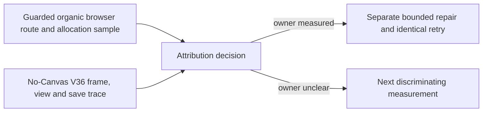

# Ticket Pack: V138 movement-memory attribution

## Summary

This pack follows `V138_MOVEMENT_MEMORY_UNDERSTANDING.md`. The V137 organic New Game route hit 872640 KiB renderer RSS before the first log was chopped. Two independent traces will separate browser allocation from V36 simulation allocation. No production repair or new quest is authorized until a source owner is measured.

The full-game goal remains active. Keep the 5194 player preview available, use only one disposable 5195 renderer, preserve all dirty user-owned work, and do not perform a GitHub action.

## Proposed Flow

## Public Interfaces

No production interface, schema, save, UI, or graphics changes. Lane A returns a phase-labeled browser receipt with screenshots and bounded allocation evidence. Lane B may add one gated diagnostic Vitest file under `engine/src/testSupport/`; it must not change a production module. A and B can run together only while B does not execute its Node allocation probe. B may prepare its harness while A owns the renderer, then run it after A confirms browser and guard closure.

## Lane Graph

Wave 1 has incomparable productive lanes A and B. A alone owns the browser and 50 ms guard. B alone owns its diagnostic test file and has no browser access. A's cleanup receipt unlocks B's memory-intensive execution. Both evidence receipts feed D. D is the primary planner's measured attribution and next-pack decision, not another investigation lane.

## Topology Audit

- Maximum parallel width is 2 for source inspection and harness preparation, then 1 for actual memory sampling. This honors the one-renderer rule and avoids a Node heap load overlapping the browser profile.
- A produces real user-route evidence that a no-Canvas test cannot provide. B identifies bounded simulation allocation that RSS alone cannot attribute. Neither duplicates the other or edits the other's files.
- Serial edges: A cleanup receipt to B's harness execution, because running both measurements could perturb RAM and endanger the guard; A and B evidence to D, because repair scope depends on both.
- If A hits the early guard, it stops immediately and closes browser. If B needs a production edit, it reports the owner and stops. No speculative reduction in foliage, distance, checked state, or threshold.
- No PR or independent review lane is needed for diagnosis-only artifacts. A later production repair requires a new bounded implementation and UI validation contract.

Dispatch verdict: **PASS**.

## Tickets

Common runtime is native ephemeral subagents with inherited model and no Cursor runtime or durable task contact. No nested worker. Existing worktree `/private/tmp/pa-wizard-playable-v2`, branch `ben/wizard-playable-v2`, is dirty. Source-of-truth instructions are user-provided AGENTS.md and current Wizard code. No em dashes in generated prose. No Git or GitHub mutation. The currently live 5194 URL must remain usable.

### V138-A: guarded browser allocation reviewer

Lane type: parallel. Delivery phase: `user_flow_probe`. Milestone: `final_complete`. Shortest flow: disposable `http://127.0.0.1:5195/?publicWorld=v36`, New Game, equip axe, discover Greenway Ring, inspect map, walk toward the first cliff hint, then stop before extra quest work. First-feedback evidence is the exact phase where RSS rises or the safety guard fires. Test-writing policy: prohibited. Surface readiness: 5194 and 5195 HTTP 200, correct current revision, sampler self-test before scene render. Acceptance: phase table for renderer RSS, GPU RSS, JS heap, idle recovery, and bounded allocation stack sample, plus screenshot, console/network, and cleanup receipt. Profiler perturbation must be distinguished from unprofiled V137 peak.

Role: read-only UI/performance reviewer. Transport: `native_spawned_subagent`, inherited model. Existing-task routing: not authorized. Workspace ownership: sole browser and no files. Required skills, read completely: `auto-planner-ticket-pack`, `test-from-ui`, `playwright`. Use one browser tab at 1280 by 720. Use a pre-render self-tested 50 ms RSS guard, early stop 870400 KiB, hard below 1024000 KiB. A bounded CDP sampling profiler is allowed only if its own RSS overhead stays inside the guard. Take snapshots of memory at action boundaries, not a full heap dump. Do not raise limits or use hidden coordinates. Stop at the first guard or attribution-bearing failure. Close browser and guard. Return exact HEAD/dirty fingerprint, actions, timings, per-phase peaks, top sampled stacks with source locations, screenshot paths, limitations, process cleanup, 5194 health, child ID and transport receipt. If profiling cannot safely run, provide the unprofiled phase table and state why.

### V138-B: no-Canvas V36 allocation implementer

Lane type: parallel preparation, then serial execution after A cleanup. Delivery phase: `pr_hardening` diagnostic only. Milestone: `final_complete`. Shortest flow: create a fresh V36 root, run fixed movement frames, call `view()` at the same cadence as the controller, perform one checked save, measure heap/ RSS peak and settled allocation for each phase. First-feedback evidence is which phase retains or spikes memory when Canvas is absent. Test-writing policy: one gated diagnostic test is permitted now that the V36 UI surface is ready. No production code edit. Acceptance: repeatable command, phase numbers, top source allocation sites where possible, and comparison limitations.

Role: implementer of diagnostic harness only. Transport: `native_spawned_subagent`, inherited model. Existing-task routing: not authorized. Workspace ownership: one new file under `games/wizard-realms/engine/src/testSupport/`, no browser. Required skills, read completely: `auto-planner-ticket-pack`, `smallest-viable-diff`. Prepare a Vitest test gated by `WR_V138_PROFILE=1` using current V36 test/root helpers. It must use deterministic fixed inputs, no media renderer, one worker, and explicit low Node heap cap. Do not execute the memory-intensive probe until A sends a browser-closed receipt. Then run once, allowing a second paced run only if the first measurement is ambiguous. Do not change production controller or save code. Return exact file, command, per-phase heap/RSS peak and settled values, source stack or allocator clues, baseline comparison if feasible, `git diff --check`, risk/limitations, child ID and transport receipt. Smallest viable diff: one gated test, no dependencies and no production files; stop if a meaningful profile requires changing production API.

### V138-D: primary attribution decision

Validate both receipts, inspect only the cited hot paths, and classify the result as controller/checked state, scene/render, mixed, or unresolved. If source ownership is measured, create a bounded repair contract with before/after target and an identical guarded UI retry. If not, define the next smallest discriminating observation. Do not claim the game is complete or the Ledger quest works on this evidence alone.

## Assumptions

- The V36 isolated preview is currently usable, but Lane A must verify availability and revision.
- Browser profiling can perturb memory; its own guard and the unprofiled V137 result are separate evidence.
- A no-Canvas trace can narrow simulation behavior but cannot prove WebGL allocation.
- The worktree is shared. All unrelated edits belong to the user and remain untouched.

## V138 receipts and decision

- A completed a guarded 5195 New Game, axe, ring, map, and short cliff route. Renderer RSS peaked at 485872 KiB and fell to 375712 KiB after five seconds idle; GPU peaked at 162656 KiB. The 870400 KiB guard did not fire. The organic V137 872640 KiB peak was **not reproduced** on this shorter route. The browser and guard closed, 5194 remained HTTP 200. Browser allocation samples included V17 world-view construction, V28 checked reply and view, but were too sparse to assign the RSS peak to one owner.
- B added one gated, no-Canvas diagnostic test, `engine/src/testSupport/v138MovementAllocation.test.ts`. Its 32 accepted movement frames and checked save passed. A capped V8 allocation sample measured about 330 MiB cumulative allocation for each 16-frame block and 335 MiB for save, dominated by fail-closed V14 validation, V13 bounded copying, and V17/V23/V28 decode and replay. Heap settled near 27 to 30 MiB after GC; RSS peaked at 213.2 MiB. These are allocation-volume findings, not retained-heap or browser-RSS proof. Focused Vitest, TypeScript, and whitespace checks passed. No production file changed.
- Decision: V36 simulation has a measured hot path, but bypassing validation would weaken checked-state integrity and is not authorized. The larger browser spike still has no unique source owner. V139 should independently establish a safe optimization contract for redundant local replay validation and repeat a longer, precisely phase-labeled organic browser route under the same guard. Only then should a bounded production change be selected and retried against identical inputs. Quest design from V137 remains proposed, not shipped.
