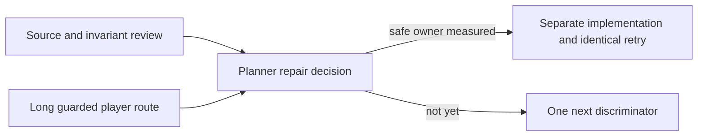

# Ticket Pack: V139 longer route and safe replay contract

## Summary

This pack follows `V139_MEMORY_REPAIR_UNDERSTANDING.md` and V138's paired measurements. One reviewer proves the trust and replay boundary for a minimum allocation repair; another repeats a longer normal-player route with the same RAM guard. No production edit is made until the results converge.

## Proposed Flow

## Public Interfaces

No runtime or schema changes. Lane A returns an actionable source-line contract and test matrix. Lane B returns a browser journey receipt with phase, memory, visual and health evidence. Player entrypoint 5194 remains available. The V138 diagnostic test is read-only for both lanes.

## Lane Graph

Wave 1: A and B are independent productive reviewer lanes. A is source only with no browser or Node memory run. B has sole browser/renderer ownership. Both feed D. Maximum width two; one renderer. No serial edge between A and B, and no duplicate ownership. D consumes exact A contract and B route evidence before authorizing a separate repair. No review lane is needed because there is no code change. No PR lane is authorized.

## Topology Audit

- A resolves whether a local trusted-state optimization is safe and where its guardrail lies. B resolves whether and when the high RSS recurs under a longer real-player route. Neither can answer the other's question.
- Both are read-only, so worktree ownership cannot collide. B alone opens disposable 5195 and self-tests the guard. A does not run V138's Node profile while B runs the browser.
- A source contract and B browser receipt are hard inputs to D. A source hypothesis without route evidence cannot be called a browser fix; a browser peak without trust analysis cannot justify skipping validation.
- Guard, console gameplay error, unsafe save behavior or inconclusive attribution stops the route and triggers a bounded new decision, never threshold increase or visual reduction.

Dispatch verdict: **PASS**.

## Tickets

Common runtime: native ephemeral subagent with inherited model, no Cursor or durable-task contact, no nested worker, no Git/GitHub action. Worktree `/private/tmp/pa-wizard-playable-v2`, branch `ben/wizard-playable-v2`, existing dirty changes user-owned. User-provided AGENTS.md governs. No em dashes in prose.

### V139-A: safe local replay contract reviewer

Lane type: parallel; delivery phase: `user_flow_probe` planning evidence; milestone: `final_complete`. Role lock: Reviewer, read-only. Transport `native_spawned_subagent`, inherited model, no fallback. No browser, Node profile, file edits or production change. Required skills, read fully: `auto-planner-ticket-pack`, `smallest-viable-diff`. Inspect `PublicV23ControllerRuntime.ts`, `publicWorldV23Transitions.ts`, V17 greenway session, V14/V17/V23 validation, V13 bounded copy, V28/V36 wrappers, and relevant tests. Use V138 allocation stacks. Return a concrete smallest safe repair candidate, ownership/callgraph, which inputs are trusted or untrusted, which validations must remain, precise invariants, adversarial tests, baseline and target metrics, and any reason not to optimize. Do not recommend bypassing fail-closed public decoding, writer reply proof or save migration. Acceptance: line-anchored source contract and explicit safety verdict. If no bounded safe repair is evident, say so and propose one discriminator. Return child ID and transport receipt.

### V139-B: longer organic guarded route reviewer

Lane type: parallel; delivery phase: `user_flow_probe`; milestone: `final_complete`. Role lock: Reviewer, read-only. Transport `native_spawned_subagent`, inherited model, no fallback. Required skills, read fully: `auto-planner-ticket-pack`, `test-from-ui`, `playwright`. Sole disposable browser at 1280 by 720 on `http://127.0.0.1:5195/?publicWorld=v36`, not 5194. Before rendering, identify owned browser PIDs and self-test a 50 ms RSS guard; stop early at 870400 KiB, hard below 1024000 KiB. Start New Game, equip axe, discover ring, use map, then continue normal visible movement until at least one accessible oak or the first guard/blocker. Do not use hidden coordinates or debug boot. Record action times, movement duration, auto-save messages, map/discovery changes, phase-local and overall renderer RSS, GPU and JS heap, natural idle recovery, screenshot at key phase, console/network. Browser sampling need not run an allocation profiler if it materially raises RSS. Stop at first guard, actual gameplay blocker, or first accessible oak; do not chase later quests. Close the browser and guard; verify 5194 HTTP 200. Return exact route, results, limitations, child ID and transport receipt. No file edits or GitHub action.

### V139-D: primary decision

Check both receipts and identify whether the measured allocation path and browser route justify a production optimization. If yes, author a bounded repair contract for one owner, with tests and identical UI retry. If no, choose the smallest new discriminator. Do not claim V137 RAM issue fixed, organic Ledger completed, or the full game done without proof.

## Assumptions

- The 5195 preview remains available for one isolated browser; B verifies it.
- A can inspect existing code without allocating substantial memory.
- The 5194 player preview remains untouched and HTTP 200.

## V139 receipts and decision

- A found one narrow, integrity-preserving candidate in `publicWorldV27Snapshot.ts`: V27 frame replay decodes the starting V23 progress and V14 frame witness, then `visitPublicV23FramesWithEvents` decodes both again. The visitor rejects malformed or empty batches before iteration. Its first segment callback checks both initial and next projected poses. Keep terrain and cooldown decoding, segment rules, final pose, checked writer/reply and migration validation. The recommendation is conditional and does not claim a browser RSS fix.
- B completed a longer organic 5195 New Game route to a visible oak. The axe and Greenway Ring were checked, the map grew from 29 to 65 revealed tiles, and an `E Chop Greenway oak` affordance appeared. Renderer RSS peaked at 646064 KiB, stayed below the 870400 KiB guard, and settled to 425632 KiB after eight idle seconds. Browser and guard closed; 5194 and 5195 HTTP 200. No gameplay console error. The earlier V137 872640 KiB spike remains unreproduced and long-session safety remains unproven.
- Decision: authorize one bounded V27 duplicate-validation removal with adversarial parity tests and a same-command V138 allocation comparison. The success claim is allocation reduction only. An identical guarded organic UI rerun is needed before claiming even short-route visual acceptance. If reduction is below 10%, failures change, or RSS still threatens the guard, do not call it a RAM fix; continue attribution. No quest or gameplay feature is blocked from design work, but V137 organic Ledger play remains unproven.
