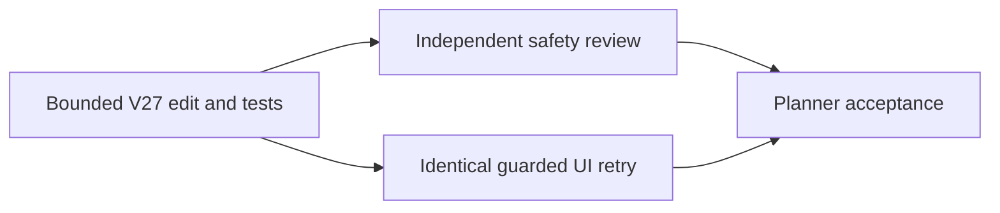

# Ticket Pack: V140 V27 replay allocation repair

## Summary

This pack follows `V140_V27_REPLAY_ALLOCATION_UNDERSTANDING.md`. The one-source-owner repair removes duplicate decoding in V27 frame replay while retaining the V23 visitor's fail-closed decoding and all crossing/save gates. It is an allocation optimization, not a claim that the earlier high browser RSS is fixed.

## Proposed Flow

The implementer makes and measures the single-owner change. After its tests pass, independent source and browser reviewers validate it in parallel. The primary planner accepts or rejects it from all three receipts.

## Public Interfaces

No public API, schema or save change. `replayPublicV27FramesWithEvents` must produce identical accepted progress/events and reject malformed input as before. The only product edit is `engine/src/domain/publicWorldV27Snapshot.ts`; focused test edits are in `engine/src/domain/publicWorldV27Snapshot.test.ts`. The existing V138 diagnostic may be run read-only. The 5194 player URL remains available.

## Lane Graph

## Topology Audit

- Wave 1 has one implementation owner A. Splitting this three-line trust-boundary edit among parallel workers would create artificial parallelism and code collision. A runs focused tests, TypeScript and the no-Canvas benchmark before any test browser opens.
- Wave 2 has two incomparable productive lanes: B independently audits integrity and diff scope, while C exercises the actual game in one guarded 5195 browser. Neither edits product code. They may run in parallel after A's tests and benchmark pass, because B is source-only and C owns the sole renderer.
- D consumes A's before/after sample, B's safety verdict and C's UI evidence. If B finds a bypass or C hits the guard, D does not accept the repair and chooses one grounded next step. No PR packaging because user did not request it.
- Serial edges: A to B/C uses code plus test receipt; B/C to D uses independent review and browser trace. Surface ready: 5194 and 5195 currently HTTP 200. No optional feedback wait.

Dispatch verdict: **PASS**, with one intrinsically serial owner in Wave 1 and two independent validation lanes in Wave 2.

## Tickets

Common runtime: native ephemeral subagent, inherited model, no Cursor runtime or durable task contact, no nested workers and no Git/GitHub action. Worktree `/private/tmp/pa-wizard-playable-v2`, branch `ben/wizard-playable-v2`, dirty user-owned changes. No em dashes in prose. All worker first contacts receive role lock and full required skills.

### V140-A: V27 bounded repair implementer

Role: Implementer. Transport: `native_spawned_subagent`; inherited model, no fallback. Required skills, read fully: `auto-planner-ticket-pack`, `smallest-viable-diff`. Ownership only `engine/src/domain/publicWorldV27Snapshot.ts` and `engine/src/domain/publicWorldV27Snapshot.test.ts`. Apply the V139-A reviewed contract: in `replayPublicV27FramesWithEvents`, remove the outer V23 progress and V14 frame witness decoding and initial `projectPublicV26Pose`. Pass `progress(before), frames` directly into `visitPublicV23FramesWithEvents`. Keep terrain decoding, next-home validation, per-segment `acceptsSegment`, post-replay projection, and all other V27 and higher-level checks. Do not remove imports used elsewhere. Add focused accepted output parity and malformed/proxy/empty/airborne rejection tests to the existing test file. Baseline V138 diagnostic is about 330 MiB cumulative sampled allocation per 16 frames; use the same 512 MiB heap-capped, one-worker command for before/after, not concurrent with a browser. Target at least 10% lower movement allocation; if not achieved, report the miss and do not claim a RAM fix. Run focused V27 tests, TypeScript, `git diff --check` for touched files, and one self-review for failure behavior. No new abstraction or dependency. Stop and report if validation semantics differ or production scope expands. Return exact diff, tests, allocation figures, limitations, child ID and transport receipt.

### V140-B: independent integrity reviewer

Role: Reviewer, read-only. Transport: `native_spawned_subagent`; inherited model, no fallback. Depends on A finished with test receipt. Required skills, read fully: `auto-planner-ticket-pack`, `smallest-viable-diff`. Inspect only the V27 product/test diff and preserved V23 visitor behavior. Challenge malformed state, proxy getter, empty and malformed frame, initial pose, per-segment river/rim/pit/ladder, airborne durable save, checked writer/reply and migration paths. Classify GO or NO-GO with source lines, test coverage and unproven cases. No files, browser, Node profile or GitHub action. Return child ID and transport receipt.

### V140-C: guarded UI acceptance reviewer

Role: Reviewer, read-only. Transport: `native_spawned_subagent`; inherited model, no fallback. Depends on A finished with tests and Node benchmark. Required skills, read fully: `auto-planner-ticket-pack`, `test-from-ui`, `playwright`. Sole disposable 5195 browser, 1280 by 720, normal `?publicWorld=v36` New Game. Follow V139's route: equip axe, discover ring, map, normal visible movement to first accessible oak, then idle eight seconds. Do not use hidden coordinates, dev boot or second renderer. Pre-render self-test 50 ms RSS sampler; early stop 870400 KiB, hard below 1024000 KiB. Log exact action durations and phase-local/overall renderer RSS, GPU, JS heap, autosave/discovery, screenshots, console/network and idle recovery. Close owned browser and guard and verify 5194 HTTP 200. A before/after difference in RSS is suggestive only, since browser path and process history vary. No file/GitHub edit. Return child ID and transport receipt.

### V140-D: primary decision

Accept only if safety tests and review pass and the browser journey advances safely. Describe the measured allocation result honestly. If allocation target misses, guard fires, or integrity behavior changes, do not call the repair a RAM fix. The full-game goal remains active and quest implementation remains separate.

## Assumptions

- The V139 longer route to first oak is reproducible from a fresh isolated 5195 origin.
- The V23 visitor's first segment callback rejects an invalid initial pose, and its decoder rejects empty batches. A must verify with tests rather than assume.
- No other agent edits the two V27 files during A's ownership.

## V140 receipts and decision

- A removed only the duplicate V27 outer V23 progress and V14 witness decode plus initial projection, relying on the already fail-closed V23 visitor. The 14 focused V27 tests and TypeScript passed. A same-command, 512 MiB-capped no-Canvas V138 profile measured cumulative sampled allocation for 16 movement frames falling from 347.4 to 243.8 MiB (29.8%) and movement plus view from 327.1 to 229.4 MiB (29.9%). These are allocation-volume reductions, not browser RSS proof. Only the untracked V27 source and test files were touched.
- B independently gave code-safety GO: initial progress and nonempty frame witness still decode inside the visitor; every segment and final pose remain checked, with malformed/proxy, crossing and airborne behavior covered. It did not rerun wider writer/migration tests. Its planning-format objection was corrected by separating the `Lane Graph` and `Topology Audit` sections before closeout.
- C completed one isolated, guarded 5195 New Game route to a visible `E Chop Greenway oak`. Axe, ring, map expansion from 29 to 70 cells, and saved status worked. Renderer RSS peaked at 720528 KiB, below the 870400 KiB stop, and fell to 611696 KiB later during idle. No gameplay console error. Browser and guard closed; 5194 and 5195 HTTP 200. This run's RSS exceeded V139's 646064 KiB, but routes and process histories differ, so it is not a controlled browser comparison.
- Decision: accept the bounded allocation optimization and short-route integrity/UI proof, but **do not claim** the V137 high-RSS stop or long-session performance is fixed. No PR, commit, deployment or GitHub action was made. The organic Ledger and Old Marker quests remain unproven. The next memory discriminator should compare identical longer routes and scene/controller phase metrics under one guarded renderer, or isolate the heavy scene churn with a separate no-Canvas/Canvas pairing, before changing visual density or safety checks.
