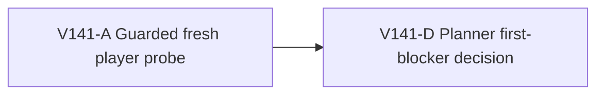

# Ticket Pack: V141 fresh Surveyor to Ledger probe

## Summary

This read-only early user-flow probe follows `V141_FRESH_QUEST_JOURNEY_UNDERSTANDING.md`. It tests the existing quest path from New Game under one guarded browser and returns the first decision-bearing blocker or Ledger claim. It does not implement or package a quest.

Locked design:

- Normal player controls and visible cues only, no fixture, hidden coordinates, debug boots or source-derived route instructions.
- Stop at the first actionable blocker or RAM guard, and keep the 5194 player preview intact.
- A successful Surveyor claim is progress toward, not proof of, a playable Ledger chapter or the full game.

Important repo truth:

- `QUEST_CAMPAIGN_ROADMAP.md` says the first three chapters should be proven from a fresh save before adding more.
- V140's first-oak route peaked at 720528 KiB RSS and did not reach log collection or bridge construction. V137 stopped at 872640 KiB under the guard before Ledger.

## Public Interfaces

No code or schema interface changes. Existing `http://127.0.0.1:5194/?publicWorld=v36` stays available. One isolated browser uses `http://127.0.0.1:5195/?publicWorld=v36`. The lane returns a phase-labeled UI/health/memory receipt plus screenshots.

## Lane Graph

## Topology Audit

- This is the skill's bounded `user_flow_probe` exception, not a substantive implementation pack. One narrow evidence lane is the fastest adequate attempt at the earliest missing integrated player result. A second browser or speculative source reviewer would duplicate or perturb the probe, so no artificial parallel lane is added.
- Productive lane A owns only the sole test renderer and UI evidence. D consumes its actual first blocker or claim and chooses a later implementation pack; D changes no files.
- Serial edge A to D consumes the observed player trace; the next repair cannot be chosen before the first failure or success is known. There is no PR finisher because this pack does not change product code or request packaging. An independent reviewer is omitted because the direct planner can reconcile one read-only UI receipt against the roadmap and browser evidence.
- Unknown: whether the path reaches Ledger before a UI or RAM blocker. Closure: one guarded discriminating UI probe. Stop: first blocker, guard, or Ledger claim/reload. Surprise: data-loss risk, save mismatch, reproducible runtime exception or unactionable world boundary; stop and replan.

Dispatch verdict: **PASS for the bounded early user-flow probe exception**. This is not a non-linear implementation pack.

## Tickets

### Paste now to: V141-A UI evidence reviewer

Ticket: V141-A. Lane type: Parallel. Delivery phase: `user_flow_probe`. Delivery milestone: `final_complete`. Shortest complete user flow: isolated V36 New Game, equip axe, chop eight accessible oaks, build the supported creek bridge, reach and claim Surveyor, then follow the visible Ledger objective to first blocker or checked claim/reload. First-feedback evidence: real screenshot and exact first decision-bearing blocker or Ledger reward. Test-writing policy: prohibited_until_pr_hardening. Review blocking classes: RAM guard, invisible objective, inconsistent save/reward, actual gameplay error, input interception. Validation environment: existing 5195 local Vite preview. Environment repair authority: none. Environment stop condition: first confirmed external blocker plus at most one documented retry. Surface readiness gate: 5194 and 5195 HTTP 200; exact owned PIDs and 50 ms guard self-test before rendering. Surface revision: current HEAD `6bb8d3982f1706229769d61f16c7cea9dd18e40e` plus a fingerprint of V27 source and dirty status. Surface entrypoint: `http://127.0.0.1:5195/?publicWorld=v36`. Surface availability: preserve 5194 and close only owned 5195 browser/guard. Post-surface validation: planner uses evidence for bounded repair or next campaign pack. Optional-feedback wait policy: never. Depends on: none.

Lane role: Reviewer. Dispatch transport: `native_spawned_subagent`. Model: inherited, planner_selected because one capable host-native UI agent is sufficient. Cursor runtime: not_applicable. Existing-task routing: not_authorized for durable tasks. Existing-task capability and mission evidence: not_applicable. User-authorized task-coordination scope: not_authorized. Ownership/workspace collision evidence: one disposable 5195 browser, no file edits or second renderer. Current-status evidence: fresh child. Existing-task delivery policy: not_applicable. No-interruption disposition: not_applicable. Task/thread receipt: not_applicable. Final fallback transport: none. Fallback CLI/model/activation/availability/first contact/follow-ups/session continuity: not_applicable. Runtime selection rationale: native ephemeral reviewer has real browser and process tools, a long route with safety guard, and no need for another provider; inherited model preserves context. Agent spec: skeptical first-time player and RAM-conscious UI tester. Session policy: initialize once, continue same child. Worker agent: Codex UI Reviewer.

Required skills, read completely: `auto-planner-ticket-pack`, `test-from-ui`, `playwright`. Required behavior: use one 1280x720 disposable browser. Before game render, self-test a 50 ms exact-PID RSS sampler, stop at 870400 KiB early, hard below 1024000 KiB, and monitor GPU and JS heap at meaningful actions. Start truly fresh on isolated 5195, use visible controls and world clues, no code-derived waypoints. Pace naturally with short idle checks when prudent, but do not manipulate saves or raise thresholds. Stop on first decision-bearing blocker, guard or successful Ledger claim/reload. Capture screenshots and console/network. Close owned browser and guard; verify 5194 HTTP 200. No file, test, Git or GitHub edit. Visual proof: required, with landing, milestone, blocker/result frames. Return receipt: child ID, transport/model, exact revision fingerprint, URL and actions with timings, quest/inventory/coin/XP/save stages, screenshots, phase memory/guard self-test, console/network, blocker or claim/reload, cleanup and limitations.

## Assumptions

- The isolated preview accepts a fresh browser profile and has no incompatible save data.
- A normal player can find enough accessible trees and the bridge site through visible controls; if not, that is the result to report, not a reason to use hidden route coordinates.
- RAM safety may stop the run before the chapter does. The guard result is still useful evidence.

## V141 receipt and decision

- A completed a fresh normal-UI New Game through axe equip, Greenway Ring discovery, three oak interactions yielding 12 logs, and a supported creek bridge consuming eight logs. The bridge awarded 80 Construction XP and level 2; coins remained 120. Visible map and work-site guidance enabled placement. The avatar reached the physical deck, but an off-deck step produced a generic river-block message that still referred to building a bridge.
- During the next forward crossing, the exact owned renderer hit the 870400 KiB early stop at 870528 KiB after about 329.6 seconds, below the 1024000 KiB hard ceiling. Earlier sampled peak was 658832 KiB; GPU spot samples were roughly 114 to 148 MiB, while the only reported JS heap sample was 44655 KiB before the final phase. Browser and guard closed; 5194 and 5195 returned HTTP 200. No gameplay exception was observed. Evidence includes `.playwright-cli/page-2026-10-11T22-10-59-831Z.png` for built bridge and `.playwright-cli/page-2026-10-11T22-12-42-087Z.png` for the avatar on deck.
- Decision: the real player journey advanced farther than V137, but Surveyor claim and Ledger remain unproven because of a recurring high renderer RSS stop. V140's roughly 30% no-Canvas allocation reduction did not eliminate this longer-route risk. The next pack must discriminate retained JavaScript, transient V8 pages, scene/GL churn, and movement-boundary replay on an identical guarded route. Do not raise the guard, downgrade scenery, or claim quest completion. The river-block copy is a lower-priority UX issue to repair after the memory path is safe.

## V141-B saved-journey continuation

V142-C subsequently reached the dry far bank on the isolated 5195 origin through normal controls, after one explicitly diagnostic browser GC. Its renderer peaked at 789520 KiB, and the browser closed cleanly. The browser had an autogenerated temporary profile and no exported storage state, so persistence into another browser is **unverified and probably unavailable**. A new session must not claim continuity from C merely because the server still returns HTTP 200.

Ticket: V141-B. Lane type: dependent user-flow probe, milestone `final_complete`. Role: read-only UI Reviewer, `native_spawned_subagent`, inherited model, one child, no nested worker. Required skills: `auto-planner-ticket-pack`, `test-from-ui`, `playwright`, read completely. Depends on V142-C's browser closure. Entry: one new guarded browser on `http://127.0.0.1:5195/?publicWorld=v36`; preserve 5194. Before rendering, self-test an exact-PID 50 ms RSS guard with early 870400 KiB stop and 1024000 KiB hard ceiling. Use only visible controls. First check whether the actual far-bank save can be resumed in the new session; the prior temporary profile makes this unlikely. If no such Continue is present, start a genuinely fresh world in a browser profile explicitly kept for safe future continuation, then replay normal axe/ring/oak/bridge steps without fixture, storage manipulation, or source-derived coordinates. Keep one renderer and the guard, and stop at the first decision-bearing blocker or guard. If the River Works post is reached, claim the Surveyor's First Find and record in-UI coins, inventory, XP and quest history before/after. If claim succeeds and RAM is safe, follow the Outfitters' Ledger as far as the next blocker or reward/reload. A RAM guard, missing save, remote claim rejection, confusing post, or gameplay exception is an honest stop; do not call a fresh restart a continuation. Capture screenshots, console/network and phase RSS/GPU/JS heap; close only owned browser and guard, verify both ports. Return child/transport/revision/entrypoint/actions/reward/save/guard/cleanup receipt. No file, test, Git or GitHub action. A resumed profile is segmented quest-flow evidence, and a fresh route after V142's GC is a separate organic run.

V141-B receipt: the prior temporary browser had no Continue, so the reviewer started a fresh world in a persistent profile at `/private/tmp/v141b-wizard-profile-20261011`. Normal UI actions built the first creek bridge, claimed River Works for a saved basic pick, advanced to Outfitters' Ledger, and built its north cliff ladder for 60 Construction XP and level 3. The visible next objective requested eight logs and a connected-river bridge. During log collection the exact owned renderer reached the early guard, stopping at 874912 KiB (876032 KiB final stopped RSS), below the 1024000 KiB hard ceiling. No forced GC or gameplay exception occurred. The browser and guard closed; both preview ports returned HTTP 200. A persistent-profile IndexedDB directory exists, but actual Continue and checkpoint recency must be verified in a new browser.

### Paste next to: V141-C persistent-profile Ledger continuation

Ticket: V141-C. Lane type: dependent `user_flow_probe`, milestone `final_complete`. Role: read-only UI Reviewer, native continued child, inherited model, no nested workers. Required skills: `auto-planner-ticket-pack`, `test-from-ui`, `playwright`, already read in the same child session. Depends on V141-B browser and guard closure plus its persistent-profile path. Use exactly one guarded 5195 renderer with `--persistent --profile /private/tmp/v141b-wizard-profile-20261011`, not a new profile; preserve 5194. Before render, self-test an exact-PID 50 ms RSS guard, early stop 870400 KiB and hard ceiling 1024000 KiB. Verify visible Continue and a saved Surveyor claim, basic pick, and active Ledger. If the profile does not truly resume, stop and report; do not reset or recreate it. If it resumes, follow visible objective/controls to gather remaining logs, build the connected-river bridge, cross and continue toward Ledger turn-in until the first blocker or checked reward/reload. No fixture, direct storage edit, source-derived route, debug grant, forced GC, second renderer or Git/GitHub action. Record UI quest/inventory/coin/XP/save stages, phase RSS/JS heap/GPU, screenshots and console/network; stop on guard or first decision-bearing blocker. Close owned browser and guard, preserve the profile for future safe continuation, verify 5194/5195 HTTP 200, and return exact continuation/transport/cleanup receipt. Segmented save/reload proof is useful gameplay evidence but not uninterrupted memory acceptance.

V141-C receipt: the exact profile offered Continue for validated V36 save #31. Surveyor claim, basic pick, level 3, 120 coins, active Ledger and four logs restored correctly. The reviewer gathered four more logs, reached a west bank around x -25.9,z 2.2, but saw a river-block message and no marked connected-river site yet. During a southward attempt to follow the bank, the renderer reached the guard at 872544 KiB, below the hard ceiling. No bridge or Ledger claim followed. The browser/guard closed, the profile remained, and both previews stayed HTTP 200.

### Paste next to: V141-D Ledger crossing route audit

Ticket: V141-D. Lane type: source-only parallel with later browser resumption, milestone `final_complete`. Role: read-only Reviewer, native ephemeral child, inherited model, no nested workers. Required skills: `auto-planner-ticket-pack`, `smallest-viable-diff`, read completely. Input: V141-C's x -25.9,z 2.2 western bank, eight logs, active Ledger, and exact river-block copy; seed `wizard-realms`. Inspect generation, connected-river bridge site validity/window, visual/map discovery and Works selection, and Ledger guidance. Determine whether a valid site is actually reachable by normal dry-bank travel from this state and when it should appear in the visible 16 by 16 site window. Distinguish a missing route, too-distant undiscovered site, map cue defect, and simply not-yet-there. Cite exact source/tests, propose one smallest user-visible repair only if evidenced. No browser, edits, heavy Node, Git/GitHub action, or route coordinates sent to the UI tester. Report evidence, uncertainty, GO/NO-GO and transport receipt. This source review cannot substitute for an organic player route.

### Paste next to: V141-E guarded Ledger bank-following

Ticket: V141-E. Lane type: parallel with D, milestone `final_complete`. Role: read-only UI Reviewer, native continued child, inherited model, no nested workers. Required skills: `auto-planner-ticket-pack`, `test-from-ui`, `playwright`, read completely in the same child session. Entry: the exact persistent 5195 profile `/private/tmp/v141b-wizard-profile-20261011`; preserve 5194. Self-test one exact-PID 50 ms RSS guard before rendering, early stop 870400 KiB, hard ceiling 1024000 KiB. Verify Continue, active Ledger and saved logs; if state is missing, stop, do not reset. Follow visible map, journal, terrain and Works cues only to the connected-river bridge, using the bank where water blocks movement. Do not use source-derived coordinates from D, fixture, storage edit, forced GC, debug grant or second renderer. Buying boots through the visible normal shop is allowed if convenient and affordable, but is not required or a reason for a long detour. Stop at the first actionable ambiguity, RAM guard, saved bridge crossing, or Ledger claim. Record phase memory, map/Works state, screenshots, console/network, quest/save/reward; close owned browser and guard, preserve the profile, verify both preview ports. No file or Git/GitHub action. A resumed chapter is segmented flow evidence, not uninterrupted memory safety.
