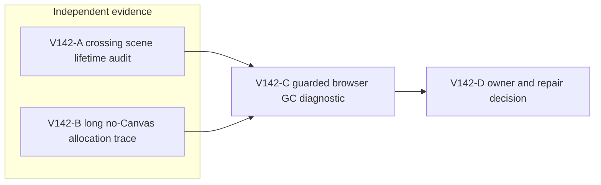
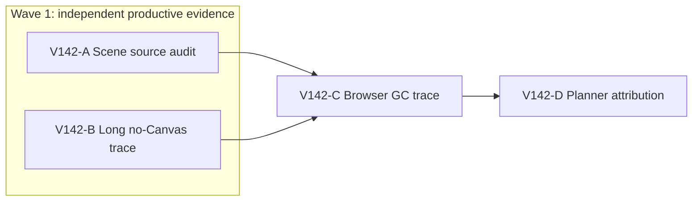

# Ticket Pack: V142 bridge-crossing memory attribution

## Summary

This pack follows `V142_CROSSING_MEMORY_UNDERSTANDING.md`. V141 proved the player can build the first bridge, but renderer RSS hit the guard during crossing. Two independent narrow lanes inspect scene lifetime and repeated no-Canvas simulation allocation. After the Node process exits, one guarded browser diagnostic measures what a forced V8 GC does near the bridge. No production code changes in this pack.

Locked design:

- Never raise the RAM guard or reduce visual density to manufacture a pass.
- The browser GC is labeled a diagnostic intervention, not a normal-player acceptance run.
- Keep the 5194 player preview available and untouched.

Important repo truth:

- V138's 32-frame no-Canvas sample settled JS heap near 27 to 30 MiB after GC; V140 reduced its cumulative movement allocation by about 30%.
- V141 hit 870528 KiB renderer RSS during a longer bridge-crossing UI run, with no contemporaneous JS heap sample at the stop.
- V136 source audit found bounded 31 by 31 visible terrain and scene disposal paths, but did not isolate bridge-specific churn.

## Proposed Flow

The player route is unchanged. These are measurements at the scene, simulation and browser seams, not a new gameplay path.

## Public Interfaces

No runtime or schema changes. B may extend only `games/wizard-realms/engine/src/testSupport/v138MovementAllocation.test.ts` with a gated `WR_V142_PROFILE=1` diagnostic. A and C are read-only. The user-facing entrypoint remains `http://127.0.0.1:5194/?publicWorld=v36`; C alone uses isolated 5195.

## Lane Graph

## Topology Audit

- Productive A is one source-only concern: crossing and discovery scene lifetime. Productive B is one diagnostic artifact and no-Canvas trace: repeated movement, view and checked-save allocation. They are incomparable and runnable together because A allocates no renderer or heavy Node process and owns no files. B alone owns the diagnostic file.
- Maximum safe productive width is two. C is a second decision-bearing evidence lane, serial only because it consumes A's hypotheses and B's measurements and process-cleanup receipt; running its renderer alongside B's capped Node fork would perturb RAM and violate the safety policy. D consumes C's trace. No lane duplicates another's measurement boundary.
- Serial edges: A to C provides exact crossing/scene locations to inspect; B to C provides the no-Canvas attribution branch and confirmation that Node exited; C to D provides browser phase and forced-GC result. These are real artifact/safety dependencies.
- A's unknown closes by source reasoning or reports the exact missing runtime metric. B's unknown closes by a deterministic capped probe. C's unknown closes by a guarded browser intervention. Surprise triggers are rising settled Node RSS, scene object growth without disposal, save inconsistency, browser guard before GC, or GC/RSS behavior contradicting both hypotheses. Stop and replan locally rather than speculative code.
- No reviewer or PR finisher: this is diagnosis with one gated test-support edit, no product code, package change or GitHub action. The primary planner checks the diagnostic's scope and evidence at D.

Dispatch verdict: **PASS**.

## Tickets

Common runtime: native ephemeral subagents, inherited model, no Cursor or durable Codex task contact, no nested workers, no Git/GitHub action. Worktree `/private/tmp/pa-wizard-playable-v2`, branch `ben/wizard-playable-v2`, HEAD `6bb8d3982f1706229769d61f16c7cea9dd18e40e`; all pre-existing dirty changes are user-owned. Existing 5194 and 5195 previews must be checked before use. No em dashes in prose.

### Paste now to: V142-A crossing scene reviewer

Ticket: V142-A. Lane type: Parallel. Delivery phase: `user_flow_probe`, milestone `final_complete`. Shortest user flow: source-trace the visible discovery and terrain/scene transition as a fresh player moves from built creek bridge to far bank. First-feedback evidence: exact source-line object creation/disposal and falsifiable metric. Test-writing policy: prohibited. Review blocking classes: unbounded scene object retention, mismatched disposal, unsupported performance claim. Surface readiness gate: source and V136 audit available; no browser. Surface revision: current V27/WizardScene hashes. Surface entrypoint: 5194 remains untouched. Post-surface validation: C browser measurement. Optional feedback wait: never. Depends on none.

Role: read-only Reviewer. Dispatch `native_spawned_subagent`, model inherited (`planner_selected`), Cursor runtime not_applicable. Existing-task routing not_authorized; candidate/mission/coordination/current-status/delivery/no-interruption/task-thread fields not_applicable. Workspace collision: no edits, no browser or heavy Node; B owns diagnostic file. Final fallback none; fallback fields not_applicable. Agent spec: WebGL scene-lifetime skeptic. Required skills: `auto-planner-ticket-pack`, `smallest-viable-diff`. Session policy: one child, no nested agent. Inspect `WizardScene.tsx`, `LandscapeDressingLayer.tsx`, `PublicWorldView.ts`, visible-terrain/discovery render path, and V136 audit. Report exact recomputation/remount/disposal boundaries as the bridge crossing reveals new cells, whether counts are bounded, which low-overhead scene metric C can access without a product edit, and one falsifiable scene hypothesis. Do not recommend deleting visuals. Return findings-first GO/NO-GO on a scene owner, source lines, uncertainty, child/transport receipt and 5194 safety. No file or GitHub action.

### Paste now to: V142-B long no-Canvas diagnostic implementer

Ticket: V142-B. Lane type: Parallel. Delivery phase: `pr_hardening` diagnostic; milestone `final_complete`. Shortest flow: fresh V36 no-Canvas runtime accepts 192 deterministic movement frames, calls `view()` after each, checked-saves every 16, and records memory through six forward/reverse cycles. First-feedback evidence: per-block peak/settled memory and whether settled RSS grows. Test-writing policy: one gated diagnostic addition allowed because surface is already ready. Review blocking classes: rejected frames, failed save, RSS safety stop, misleading comparison. Surface readiness gate: V138 diagnostic and current V36 test helpers available; no browser open. Surface revision: current HEAD plus V27 source hash. Surface entrypoint: existing 5194 untouched. Post-surface validation: C after B confirms Node cleanup. Optional feedback wait: never. Depends on none.

Role: Implementer, diagnostic file only. Dispatch `native_spawned_subagent`, inherited model (`planner_selected`), Cursor runtime not_applicable. Existing-task routing not_authorized; candidate/mission/coordination/current-status/delivery/no-interruption/task-thread fields not_applicable. Workspace collision: sole ownership of `engine/src/testSupport/v138MovementAllocation.test.ts`, no browser; A is read-only. Final fallback none, fallback fields not_applicable. Agent spec: deterministic V36 allocation profiler. Required skills: `auto-planner-ticket-pack`, `smallest-viable-diff`. Reuse V138's fresh root, checked store, phase sampler and profile gate. Add a separate `WR_V142_PROFILE=1` test or branch that makes exactly six cycles of 16 steps with delta `{x:0,z:-0.08}` and 16 reverse `{x:0,z:0.08}`, calls `view()` after each step, and saves after each 16-step block, for 192 accepted frames and 12 checked saves. After each save sample RSS, heap, external, arrays and optional GC-settled values; report block 1 vs 12 and maxima. One Vitest fork with `NODE_OPTIONS='--max-old-space-size=512 --expose-gc'`, one worker. Abort diagnostic safely if process RSS exceeds 450 MiB or any frame/save fails; do not raise cap. Run targeted test and TypeScript, whitespace check. No production edit, dependency, browser or GitHub action.

#### Smallest Viable Diff for V142-B

Behavior delta: gated long-run diagnostic only, no game behavior change. Expected diff: one existing untracked test-support file, target under 90 net new lines, zero new files, zero dependencies. Reuse scan: existing V138 phase helper and V36 fake-indexeddb checked flow. Prompt/config alternative: a one-off command cannot import these TypeScript and Vitest helpers reliably without duplicating them; an env-gated test is the narrowest repeatable surface. Deletion/simplification: reuse rather than copy V138 sampler; no obsolete production code to delete. Forbidden: all production source, configs, package files, docs other than planner-owned artifacts. Validation: exact capped Vitest command and `tsc --noEmit --pretty false`. Tripwire: more than one file, 90 net lines, new helper abstraction or dependency stops for replanning. Return full smallest-diff receipt, exact source line, per-block memory/acceptance, process cleanup, child/transport receipt and limitations.

### Wait for A and B, then paste to: V142-C guarded browser reviewer

Ticket: V142-C. Lane type: Dependent. Delivery phase: `user_flow_probe`, milestone `final_complete`. Shortest flow: isolated fresh V36 New Game, visible axe/ring/oaks/creek-bridge construction, then bridge crossing until guard or dry far bank, with one labeled diagnostic V8 GC at the high-RSS bridge phase. First-feedback evidence: JS heap, renderer RSS and GPU before/after GC and the crossing outcome. Test-writing policy: prohibited. Review blocking classes: RAM guard, save mismatch, invalid browser access, gameplay exception. Surface readiness gate: A source receipt, B no-Canvas result and Node process closure, 5194/5195 HTTP 200, pre-render 50 ms guard self-test. Surface revision: current V27/WizardScene hash, unchanged product code. Surface entrypoint: isolated `http://127.0.0.1:5195/?publicWorld=v36`. Availability: preserve 5194. Post-surface validation: D attribution. Optional feedback wait: never. Depends on A and B.

Role: read-only UI Reviewer. Dispatch `native_spawned_subagent`, inherited model (`planner_selected`), Cursor runtime not_applicable. Existing-task routing not_authorized; candidate/mission/coordination/current-status/delivery/no-interruption/task-thread fields not_applicable. Workspace collision: sole one owned renderer, B Node confirmed exited. Final fallback none; fallback fields not_applicable. Agent spec: guarded browser memory diagnostician. Required skills: `auto-planner-ticket-pack`, `test-from-ui`, `playwright`. Use 1280x720 one disposable browser with exact-PID 50 ms RSS guard, early 870400 KiB, hard below 1024000 KiB. Normal visible UI until bridge is built; no fixture, hidden coordinates or debug grant. Log phase-local RSS, GPU, JS heap at least at New Game, ring, 8 logs, bridge built, before crossing, after crossing or guard. At bridge or at first RSS above 700000 KiB, whichever comes first, perform one explicitly diagnostic CDP `HeapProfiler.collectGarbage`, then record JS heap and RSS at 0, 5 and 10 seconds idle; do not repeat GC or loosen guard. Continue crossing only if safe. Stop on guard or first decision-bearing blocker. Capture screenshots/console/network, close only owned browser/guard and verify 5194. State that GC-adjusted play is not organic acceptance. Return exact child/transport/revision/phase/cleanup receipt.

### V142-D primary attribution decision

Compare A's scene lifetime map, B's no-Canvas long-run trajectory and C's before/after-GC browser trace. Classify the best-supported source as simulation, scene/native, V8 allocator retention, mixed or unresolved. Author a bounded repair only for a measured owner, with an identical guarded organic UI retry after the change. If evidence still cannot distinguish an owner, define one smaller next metric rather than downgrading visuals or safety. This does not complete the full-game goal.

## Assumptions

- Six forward/reverse no-Canvas cycles stay within the initial supported ground. A rejected frame is a diagnostic failure, not permission to alter movement rules.
- A single GC call can help distinguish live heap from retained process pages, but RSS may remain allocated even when objects are freed.
- The browser diagnostic may stop at the guard before the requested GC; that still provides phase evidence and triggers safe cleanup.

## V142 receipts and decision

- V142-A, source-only scene audit: the visual terrain window is bounded at 31 by 31 cells, keyed scene objects leave with the window, and terrain, water, and dressing geometry have disposal paths. Discovery can regenerate up to six dressing instances per visible cell, a possible transient allocation source, but no retained scene leak was established. Native child `/root/v142_scene_lifetime_audit` made no edits or browser allocation.
- V142-B, no-Canvas diagnostic: 192 accepted frames, a view after every frame, and 12 checked saves passed in one guarded Vitest fork. GC-settled RSS rose from 183.3 to 330.6 MiB, JS heap used from 29.5 to 56.1 MiB, external memory from 4.4 to 12.5 MiB, and array buffers from 1.0 to 7.2 MiB. Peak RSS was 359.0 MiB, below its 450 MiB stop. The first valid fork hid console output; an identical guarded retry with console interception disabled supplied the measurements. The Node processes exited. Native child `/root/v142_long_no_canvas_trace` changed only the gated test-support file, net 79 lines; TypeScript passed.
- V142-C, isolated 5195 browser: a fresh player equipped the axe, discovered the ring, earned eight logs, built the creek bridge, and reached the dry far bank using visible controls. The one 1264 by 600 Canvas stayed constant. Renderer RSS peaked at 789520 KiB, below the 870400 KiB early stop; GPU RSS stayed around 137 to 153 MiB. At the first RSS sample above 700000 KiB, one labeled CDP GC reduced used JS heap from 52.6 to 43.9 MiB. RSS had already declined before GC and was about 540 MiB afterward, so the entire decline cannot be assigned to GC. This is not an organic acceptance pass. The browser and guard exited, and 5194/5195 returned HTTP 200. Native child `/root/v142_guarded_browser_gc` made no source edits.

Attribution: **mixed or unresolved**, not a scene-owned repair. No-Canvas saves and frames have rising settled memory, while browser RSS also naturally recovers and has stable sampled GPU residency. These measurements do not identify a safe production line to change. Do not raise the guard or reduce visuals. The next smallest memory discriminator is a capped no-Canvas comparison of equal frame counts with and without checked saves, followed by the same comparison with the runtime and store references released. In parallel, a guarded 5195 UI run can test the Surveyor claim, first checking whether prior save continuity exists. Neither a diagnostic GC nor a segmented route counts as uninterrupted long-session acceptance.

Correction: V142-C's browser used an autogenerated temporary profile and exported no storage. A later 5195 session cannot be assumed to contain that save. V141-B checks Continue honestly and starts a fresh guarded run if needed.

### V142-E source-only save-lifetime review

Ticket: V142-E. Lane type: parallel with V141-B's browser, milestone `final_complete`. Role: read-only Reviewer, native ephemeral child, inherited model, no nested workers. Required skills: `auto-planner-ticket-pack`, `smallest-viable-diff`, read completely. Input: B's 192-frame/12-save settled-memory trajectory and V142-C's transient browser RSS decline. Source-trace V36 `commitPublicV36`, `createAtomicV36Store`, controller closure layers and fake-indexeddb ownership to determine whether any growing retained chain is evident or whether the result is allocator/test-backend-specific. Do not edit, run Node, open browser, touch 5194, or perform Git/GitHub action. Return exact source lines, a falsifiable minimal capped no-save versus save discriminator, a safe production owner only if proven, uncertainties, and transport receipt. This is a source review, not a repair authorization.

V142-E receipt: NO-GO on a production repair. The test-only fake IndexedDB factory retains its raw database, whose transaction list retains completed transactions; its rollback closure captures overwritten records and is not cleared at completion. This is a plausible source of the V142-B GC-settled heap slope. In contrast, the production V36 root contains only current and previous heads, the store overwrites one key and deletes consumed proofs, and controller committed state is reassigned. The reviewer ran no Node or browser process and changed no files. A bounded 96-frame no-save versus six-save comparison could falsify the fake-backend attribution later, but is not necessary before testing the next player-facing quest step. Browser memory safety remains unproven for an uninterrupted long session.
