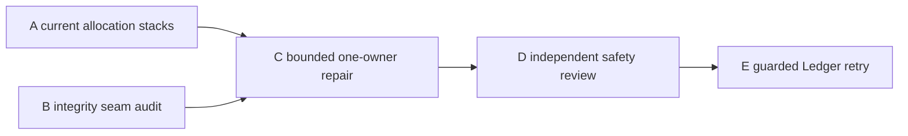
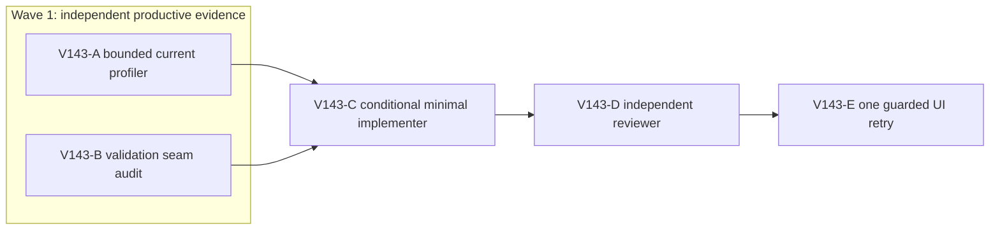

# Ticket Pack: V143 residual movement allocation repair

## Summary

This pack follows `V143_RESIDUAL_MOVEMENT_ALLOCATION_UNDERSTANDING.md`. Fresh UI proved the first quest and saved continuation, but the renderer repeatedly reached the unchanged RAM guard during Ledger. Wave 1 independently measures current source stacks and audits the safety of one possible deduplication. A repair is conditional on that evidence. Product code is not changed by the planner.

Locked design: preserve integrity, visuals, 5194 availability and the 5195 real save; never raise RAM limits or use a diagnostic GC for acceptance.

## Proposed Flow

The player's existing route and saved quest state remain unchanged. Only the simulation's allocation path may change after a safe seam is proven.

## Public Interfaces

No intended runtime API, save schema, UI or migration change. A may adjust only the existing gated test-support profiler if needed to enforce its RSS stop. C's exact production file is chosen at fan-in; if more than one production owner is necessary, replan before editing. E uses `http://127.0.0.1:5195/?publicWorld=v36` with the exact saved test profile. 5194 remains the player preview.

## Lane Graph

## Topology Audit

- A owns numeric source-stack evidence and any small test-support guard adjustment; B owns a read-only authority-boundary audit. Their questions are independent, files do not collide, and B consumes no browser or heavy Node. Maximum safe productive width is two.
- C depends on both a measured owner and a safe check-preservation contract. If either is absent, C returns NO-GO without code. D must inspect the exact C diff and adversarial tests. E runs only after C's Node tests and D's review complete, so one browser never overlaps the profiler.
- A closes its uncertainty with one bounded profile or exact failure; B closes with line-level check path or NO-GO. Surprise triggers include source stacks not matching V140, a second production owner, test regression, allocation reduction without browser improvement, or a RAM guard. Replan at the smallest affected seam rather than expanding scope.
- No PR finisher: the user has not requested packaging. The primary planner integrates receipts and decides whether a separate PR contract is warranted later.

Dispatch verdict: **PASS**.

## Tickets

Common: worktree `/private/tmp/pa-wizard-playable-v2`, branch `ben/wizard-playable-v2`, HEAD at pack creation `6bb8d3982f1706229769d61f16c7cea9dd18e40e`. Dirty changes are user-owned. Native ephemeral subagents, inherited model, no durable task contact, no nested workers or Git/GitHub action. Required worker skills: `auto-planner-ticket-pack` and `smallest-viable-diff`; E additionally `test-from-ui` and `playwright`. Read SKILL.md completely if not already read in the same child session.

### V143-A bounded current profiler

Role: Implementer for test-support instrumentation only. Lane type: parallel, milestone `final_complete`, transport `native_spawned_subagent`, inherited model, existing-task routing not_authorized, no-interruption disposition not_applicable, fallback none. Sole possible file owner: `engine/src/testSupport/v138MovementAllocation.test.ts`; no production file. Shortest flow: current V140 16-frame movement and movement-plus-view profile with top source stacks and phase RSS. First-feedback evidence: comparative allocation sites and exact profiling revision. Surface gate: no owned game browser and 5194 HTTP 200. Run at most one 512 MiB old-space, one-worker gated Vitest fork with an independently self-tested exact-PID 450 MiB RSS stop, then TypeScript if edited. If the existing V138 profiler runs safely without an edit, make none. Do not start a renderer, alter visual or game code, run an uncapped test suite, or touch GitHub. Return exact commands, peak/settled memory, source sites, limitations, process cleanup, child and transport receipt.

### V143-B integrity seam reviewer

Role: read-only Reviewer. Lane type: parallel, milestone `final_complete`, transport `native_spawned_subagent`, inherited model, existing-task routing not_authorized, no-interruption disposition not_applicable, fallback none. Shortest flow: inspect current V27/V23 replay, nested controller and V14/V13 validation/copy routes implicated by V138/V140; identify at most one duplicate movement check or copy and the exact downstream validator that replaces it. First-feedback evidence: source-line input rejection and accepted-frame parity argument. No file ownership, browser, Node profiler, Git or GitHub action. Report conditional GO/NO-GO, adversarial cases and source lines, or state that no safe single-file owner exists. Do not propose removing actual authority checks.

### V143-C conditional minimal implementer

Role: Implementer, milestone `pr_hardening`, transport native, model inherited, no existing-task routing, fallback none. Dispatch only after A and B identify the same one-file owner. Exact file and test ownership set in the dispatch message. Reuse existing validator/visitor and error semantics; do not redesign save/replay. Add focused malformed/proxy/rejected-motion and accepted movement/save/reload tests as applicable. Run focused Vitest, TypeScript, whitespace check and the same capped allocation benchmark. Stop if two production files or more than 120 net lines become necessary. No browser or Git/GitHub action. Return smallest-diff receipt, before/after alloc, validation and cleanup. This ticket is not automatically authorized by A/B if either says NO-GO.

### V143-D independent integrity review

Role: read-only Reviewer, milestone `final_complete`, transport native, inherited model, fallback none. Inspect C's exact diff and run or review focused tests under one capped Node process after C exits. Check malformed input, river/cliff/ladder restrictions, airborne durable save rejection, checked writer, migration and repeatable acceptance. Findings-first GO/NO-GO with exact lines and residual risk. No edits, browser or GitHub action.

### V143-E guarded saved-Ledger UI retry

Role: read-only UI Reviewer, milestone `final_complete`, transport native, inherited model, fallback none. Depends on D GO and Node cleanup. Use one persistent-profile 5195 browser with exact-PID self-tested 50 ms RSS guard, early 870400 KiB stop and hard 1024000 KiB. Verify real Continue and unchanged Surveyor reward/Ledger state. Follow only visible cues, no source coordinates, fixture, forced GC or debug grant. Stop at first blocker or Ledger claim/reload. Capture UI quest/save and phase RSS/JS/GPU, console/network, screenshots; close owned browser/guard and verify 5194/5195. A better benchmark alone is not a pass.

### Smallest Viable Diff

Expected behavior delta: allocation reduction only, no gameplay rules. Reuse scan: V140 already reused the V23 visitor to eliminate one outer V27 decode; search the residual source stack for another duplicate before editing. Prompt/config alternative: lowering resolution, increasing GC frequency or RAM limit does not eliminate observed per-frame allocations and is out of scope. File budget: one production file plus one focused test file, no new abstraction, dependency, schema or config, net <=120 lines. Delete only redundant work whose check is demonstrably performed downstream. Validation: adversarial tests, TypeScript, same capped baseline, guarded UI. Tripwires: second production owner, changed error semantics, integrity bypass, or no measured reduction means stop and replan.

## Assumptions

- The V138 profiler's current stack and metrics are repeatable under the 450 MiB process guard.
- A safe duplicate seam may not exist. NO-GO is a valid evidence result, not permission to weaken checks.
- The persisted 5195 test profile remains intact after the last guarded browser close.

## V143 result and bounded replan

- A ran the current gated profiler under a self-tested exact-PID 450 MiB RSS guard with no file edit. It passed 16 movement and 16 movement-plus-view frames; sampled allocations were 247.2 and 259.0 MiB. The dominant stacks remained V23 to V17 to V14 validation (about 65 MiB), V17 session construction and validation (about 32 MiB), and V13 bounded copies (about 58 MiB) per phase. The checked save phase sampled 306.1 MiB. Peak process RSS was 200.3 MiB; the Node process exited and 5194 stayed HTTP 200.
- B found the initial V23 decode, V17 session checks, and final durable V23 decode serve distinct input, session and output trust boundaries. The V13 descriptor copy rejects malformed or adversarial data. A final V27 pose check might repeat a segment check, but it was not on the dominant allocation stacks. **NO-GO** on C's one-file shortcut. C, D and E are not dispatched. No production code changed.

The recurring browser guard still needs an integrity-preserving allocation design. Two independent source-only options can be evaluated before any broader implementation pack:

### V143-F1 internal movement-session reuse review

Role: read-only Reviewer, native continued child, inherited model, no nested worker. Source-only trace the active V28 to V27 to V23 to V17 frame path and decide whether a controller-owned incremental V17/V23 session can be reused across accepted frames without bypassing public untrusted entrypoint validation, terrain/rim/pit/river policy, authoritative replay, checked save or migration. Identify exact API/owner files, cache invalidation on save/action/owner transition, negative tests, expected allocation stack eliminated and scope estimate. Compare against leaving current replay untouched. No edit, browser, Node profiler, Git/GitHub action. Return GO/NO-GO and line-level evidence, not implementation.

### V143-F2 checked-state provenance review

Role: read-only Reviewer, native continued child, inherited model, no nested worker. Source-only assess whether an internal, non-exported checked-state token or stable immutable clone could avoid V13/V14 deep copy on every runtime-owned frame while preserving every public decode, proxy/accessor/cycle rejection, save/reload and migration. Determine how mutation aliases and externally supplied state are excluded, exact invalidation and one-step adversarial proof, owner files, measurable stack removed and scope estimate. Do not weaken public validation, implement code, start browser/Node, or touch Git/GitHub. Return GO/NO-GO with source lines. A mere `WeakSet` of mutable objects is not a proof.

F1 and F2 are independent design questions with no file ownership and can run in parallel. Fan-in must choose at most one proven approach and create a new bounded implementation pack with a separate safety reviewer and guarded UI proof. If neither is safe, pursue a smaller browser-native allocation metric, not a speculative shortcut or guard increase.

F1 found a credible but broad four-production-file incremental-session design, roughly 200 to 300 production lines, whose expected direct win is about 32 MiB per 16 frames from amortized V17 session construction. F2 rejected a mutable checked-state token as unsafe because state/masks are structurally shared and visitor callbacks can mutate snapshots. Neither option is authorized for implementation in this pack. Before accepting the broader F1 cost, inspect one narrower seam:

### V143-F3 private V17 construction review

Role: read-only Reviewer, native continued child, inherited model, no nested worker. Determine whether V23's already decoded `PublicV23Progress` and freshly constructed V17 lineage allow a private, clone-owning V17 session constructor to avoid repeating the V17 initial head/progress validation on each one-frame Greenway replay. Keep the exported `createPublicV17ContinuousSession` fully checked; preserve V23 input and final output decode, per-frame policy, public replay and checked writer. A mere boolean `trusted` flag exposed to arbitrary callers is unacceptable. Give exact two-file-or-less interface, alias/mutation proof, adversarial tests, and expected source-stack reduction or NO-GO. No edits, Node, browser, Git/GitHub action. If proof requires a broad trusted-token mechanism, return NO-GO and prefer F1 or further measurement.

F3 returned conditional GO at one exact call site: V23's first Greenway frame immediately after V23 has cloned and validated the same state through V17. The private V17 helper must own a defensive clone, and later frames or streamed crossings keep the original fully checked constructor. The source-level `@internal` export is not a public trust grant; an independent reviewer must verify it has exactly one production import/call site. The target is at most the measured 31 to 32 MiB synthetic V17 construction stack per 16 frames, less the replacement clone cost.

### V143-G bounded two-file implementer

Role: Implementer, native continued child, inherited model, no nested worker, milestone `pr_hardening`. Exact production ownership: `engine/src/domain/publicWorldV17ContinuousSession.ts` and `engine/src/domain/publicWorldV23Transitions.ts`; focused existing V17/V23 test files may be touched. Move shared session body into one private constructor within V17; keep the exported checked constructor's validation and behavior. Add one `@internal` clone-owning helper for a V23-decoded first Greenway frame with explicit seed/owner/revision checks. Call it only at V23's first-frame Greenway path immediately following the existing progress and witness decode. Keep later new sessions, streamed crossings and all V23 final validation on the checked path. No Boolean trusted flag, shared mutable aliases, change to V14/V13 proof, V27/V28 terrain policy, writer, save schema or migration. Add adversarial and parity tests for malformed/proxied public starts, caller/visitor mutation, accepted/rejected frames, crossing and airborne durable save as needed. Run focused tests, TypeScript, whitespace, then the same one-worker 512 MiB old-space profiler under a self-tested exact-PID 450 MiB RSS stop, with Node alone and `--disableConsoleIntercept`. Compare against A's 247.2/259.0 MiB sampled movement baselines and checked-save 306.1 MiB; sampling variance is disclosed. If there is no meaningful total movement reduction, or tests require broader production changes, remove only this lane's edits with `apply_patch` and report NO-GO. Budget: two production files, at most two existing focused test files, zero new files/dependencies/configs, net <=150 lines. No browser, commit, GitHub action or unrelated edit. Return exact scope, source/benchmark evidence, process cleanup and transport receipt.

### V143-H independent integrity reviewer

Role: read-only Reviewer, native continued child, inherited model, no nested worker, milestone `final_complete`. Depends on G's diff and Node exit. Inspect every new helper caller and mutation path, public V17 malformed-input rejection, V23 first/later/crossing behavior, V27/V28 terrain and bridge policy, checked writer, save/reload and migration tests. Findings-first GO/NO-GO, exact lines, test gaps, scope receipt. One capped focused test process if needed, no browser/edit/GitHub. H must not approve solely because the benchmark improves.

### V143-I guarded saved-Ledger UI retry

Role: read-only UI Reviewer, native continued child, inherited model, no nested worker, milestone `final_complete`. Only after H GO and all Node processes exit. Exact persistent profile `/private/tmp/v141b-wizard-profile-20261011`, isolated 5195 URL, preserve 5194. Verify real Continue and saved Ledger eight-log state, one pre-render self-tested exact-PID 50 ms RSS guard with 870400 KiB early stop and 1024000 KiB hard ceiling. Follow visible bank/map/Works cues, no source-derived coordinates, debug grant, storage edit, fixture or forced GC. Stop at first decision-bearing blocker, guard or saved bridge/claim. Capture screenshot, memory, console/network, save/reward and cleanup receipt. A changed benchmark is not a browser pass.

Revised topology: G depends on A, B, F3 and is one two-file production concern; H is an independent review of G; I is serial for one-renderer RAM safety and consumes H's verdict. F2's broader token route is excluded. The revised smallest viable diff replaces the earlier one-file V143-C contract only for G: two specified production files and two existing tests, net <=150, no new abstraction except the extracted common constructor and single internal helper; tripwire is any extra production owner, trust bypass or negligible measured reduction.

## V143-G through I result

- G changed the two specified production files and their two existing focused tests. The public V17 constructor remains checked. The new clone-owning helper has one production caller, V23's first ordinary Greenway frame after input and witness decode. Focused tests passed 33/33; TypeScript and whitespace checks passed. Under the exact-PID 450 MiB Node guard, sampled movement allocation fell from 247.2 to 166.3 MiB (32.7%), and movement plus view fell from 259.0 to 189.1 MiB (27.0%). Checked save sampled 275.0 versus 306.1 MiB. No owned Node process remained.
- H independently reviewed the live four-file scope and passed 72 focused V17/V23/V27/V28 tests. Its current-call-graph verdict was GO, with one residual maintenance boundary: `@internal` is not a runtime barrier, so the helper's single, post-decode production caller must remain a review gate. No V36 wrapper or direct hostile-helper test was added.
- I resumed the genuine saved V36 Ledger on isolated 5195, preserving level 3, 120 coins, axe, basic pick and eight logs. The player followed visible bank cues but found no connected-river marker and Works offered only the original creek bridge. Peak exact renderer RSS was 801072 KiB, below the 870400 KiB early stop. The run stopped on route ambiguity, not a memory guard; no bridge or Ledger claim was made. Browser and guard closed, profile retained, both previews returned HTTP 200. This is not long-session memory acceptance.

The next observed-error loop is V144: prove the intended built-ladder upper west route is continuously traversable before changing the Ledger cue, then repeat that saved UI entrypoint. Do not use an undiscovered marker or relaxed Works eligibility to conceal an actual route obstruction.
