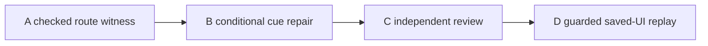

# V144 Ledger route cue ticket pack

## Summary

Prove the saved north-ladder route actually reaches a supported connected-river crossing, then repair the misleading Ledger guidance and repeat the same guarded real-save UI journey. The first Surveyor quest and save/reload are proven; the Ledger route remains unproven. Do not reveal hidden map cells or weaken Works authority.

## Proposed Flow

1. Start from the observed low-bank pose and matching checked built-ladder, eight-log progress. Use legal, short walking frames, not a teleported fixture at the river, to climb, cross the Greenway west boundary, descend, and reach the bridge source bank.
2. If the route is traversable, change the directly visible Ledger route instruction to describe the ladder, upper westward bypass, dry descent, and discovery requirement. If no checked path exists, stop and identify the exact physical barrier for a separate route repair.
3. Independently review the cue against the proven route and run the preserved 5195 save through the same journey with one guarded renderer.

## Public Interfaces

No save schema, replay policy, bridge eligibility, map-reveal radius, player spawn, or store change is authorized. A may add one existing-test-file witness using current checked movement APIs. B may edit only the Ledger quest projection and its existing test if A proves the route. The player URL remains `http://127.0.0.1:5194/?publicWorld=v36`; 5195 uses the existing isolated test profile. The 870400 KiB early renderer stop and 1024000 KiB hard ceiling remain.

## Lane Graph

## Topology Audit

A is the earliest uncertainty-closing probe, and B cannot safely edit text without its result. C and D are serial because D uses the browser and must test the reviewed code. The current game browser is closed; the 5194 preview stays available. No artificial parallel production edits. V143 allocation tests and independent review are complete. If A returns NO-GO, cancel B through D and replan physical route support; do not hide the issue with copy. If D reaches an actionable new error, use the observed-error repair loop at its exact owner. No PR requested.

Dispatch verdict: **PASS for A; B through D conditional.**

## Tickets

Common: worktree `/private/tmp/pa-wizard-playable-v2`, branch `ben/wizard-playable-v2`, pre-existing dirty and untracked source preserved, no GitHub action. Native continued children, inherited model, no nested worker. Read `auto-planner-ticket-pack` and `smallest-viable-diff` skills completely if not already in the same child session. A and D also read `test-from-ui` or `playwright` only if actually using browser; A must not use browser.

### V144-A checked route witness

Role: Implementer for one focused test-support witness, milestone `final_complete`. Owner: one existing V27/V28 movement or route test file, chosen before edit and declared in the receipt. Reuse current seeded, checked V36 progress and built north ladder; reproduce the observed low-bank pose and eight logs without touching the real profile. Advance only legal short movement frames through the upper route and owner handoff to a supported river bridge's dry source-bank cell. Assert every accepted move has support, no low-wall bypass, and that the initial site is absent before reveal. At destination, verify the complete footprint can become discovered, the marked Works site is exposed and checked Ready with eight logs. Do not use teleporting once the walking sequence starts, force a frame, or modify production movement/eligibility. One Node process with 512 MiB old-space, one Vitest worker, exact-PID 450 MiB RSS stop, no browser. If route fails, return exact first rejection/coordinate/source owner and NO-GO; do not broaden edits or spend long brute-forcing. No new dependencies/configs. Keep a passing regression witness only if the route truly works. First-feedback evidence: a source-executed checked walking trace or its first obstruction. Return test command/result, frame count, path landmarks, memory/process cleanup and real transport receipt.

### V144-B conditional Ledger cue implementer

Role: Implementer, milestone `pr_hardening`, dispatch only on A GO. Own `engine/src/view/publicV35LedgerQuest.ts` and `engine/src/view/publicV35LedgerQuest.test.ts`, no other production file. Change only the route-stage objective for the ladder-built state to explain the proven upper westward bypass, dry descent, and marked site discovery. Preserve earlier and later quest stages, rewards, checks and number of logs. Test exact text semantics without brittle full-string snapshot. Run focused tests, TypeScript and whitespace. Net <=40 lines, no new files/deps/configs. Return smallest-diff and validation receipt; NO-GO if a map/scene/backend owner is truly required.

### V144-C independent review

Role: read-only Reviewer, milestone `final_complete`, dispatch after B. Inspect A's path witness and B's exact change. Confirm the instruction describes a physically traversable path and does not imply an unmarked bank is buildable. Verify no reward, authority, save or map-discovery change; focused test and TypeScript receipts. No browser, edit or GitHub action. Findings-first GO/NO-GO with exact lines.

### V144-D guarded saved-UI replay

Role: read-only UI Reviewer, milestone `final_complete`, dispatch only after C GO and Node exit. Reuse `/private/tmp/v141b-wizard-profile-20261011` on isolated 5195, preserve player 5194. Exact-PID guard self-tested before rendering at 50ms, 870400 KiB early stop, below 1024000 KiB hard ceiling. One owned browser and renderer, no forced GC/debug grant/storage edit/source-derived navigation coordinates. Continue real save, follow newly visible guidance and normal controls through ladder and upper west route. Stop at first actionable blocker, guard, or saved bridge/claim; screenshot map/world/Works, capture console/network and phase RSS/JS/GPU, close owned browser/guard and verify ports. The route test and text check alone cannot count as UI acceptance.

## Smallest Viable Diff

The bridge site and checked authority already exist. The observed no-marker state at low Greenway bank is intended, so do not expose undiscovered terrain, enlarge search radius, move a river, or grant a bridge. A's one test file validates physical continuity; B's two view/test files change only actionable guidance. No prompt/config workaround or RAM-limit increase. A failed route witness requires an explicit new physical-route contract rather than expanding this pack silently. No PR split or stack decision is needed now.

## Assumptions

- The real save's north ladder is a canonical checked built site and its low-bank observation can be represented with a seeded test progress.
- The upper west route described by existing collision and guide text is not yet proven as one continuous checked path.
- The existing persistent test profile and both preview servers remain available, with no owned browser currently live.

## V144-A result and diagnostic replan

The one bounded A test built the canonical north ladder, retained eight logs, climbed from the observed low pose and crossed the west owner boundary. It stopped on a rejected 0.16 m westward step from x -34.06, y 1.959896, z -12 at frame 479. The test rebased each frame on a preview instead of preserving the controller's in-flight origin and accumulated frames, so it does not prove physical impassability. An additional V23 diagnostic had the wrong input shape and is discarded. A removed its failed test via `apply_patch`; no source/test edit remains. B through D remain undispatched.

Two independent bounded diagnostics may now run before deciding B. A source reviewer traces the real controller flight/replay contract and specifies a faithful harness; a UI reviewer uses the preserved save and only visible in-game route guidance to attempt the built north ladder and upper west shelf. The UI diagnostic does not count as B's post-fix acceptance. These lanes share no file ownership or Node/browser process. Either can reveal a concrete new blocker; they must report the first one instead of brute-forcing. The source reviewer may not run Node or a browser. The UI reviewer may not inspect source-derived coordinates or edit the save.

### V144-A2 visible-route UI diagnostic

Role: read-only UI Reviewer, native continued child, inherited model, milestone `first_feedback`. Reuse the persistent 5195 profile and real Continue. Open the player's in-game route guide and map, then follow its visible north-ladder and upper-route guidance using normal controls. Do not receive target coordinates from source or inspect the hidden bridge site. Stop at the first actionable world/Works collision, a visible candidate, guard, or time-bounded route result. Use the same pre-render self-tested exact-PID 50 ms RSS guard, 870400 KiB early stop, below 1024000 KiB hard ceiling; one browser/renderer only. Capture screenshots and exact on-screen rejection with player pose, map, Works state, console/network, peak RSS/JS/GPU. Close owned browser/guard, preserve profile and 5194, verify both ports. No code/Git/GitHub action.

### V144-A3 faithful persistent-controller route witness

The source audit established why A's rebased preview is invalid: normal V28 control retains a grounded flight origin plus accumulated airborne frames and saves a checked full batch only after landing. A one-frame durable replay can reject a valid descending step. A3 is conditional on A2's browser and guard being closed, because Node and browser must not overlap under the RAM constraint.

Role: Implementer, native continued child, inherited model, milestone `final_complete`. Exact owner: existing `engine/src/PublicV28ControllerRuntime.test.ts` only. Begin from seeded validated low-bank progress, canonical built north ladder and eight logs. Hold one `createPublicV28ControllerRuntime` instance with its existing `writerFor` checked-replay writer and use normal `advanceFrame` with legal 0.16 m walking intents. Preserve its accumulated airborne flight; release movement for bounded empty frames until grounded, and save at grounded checkpoints before excessive pending frames. At the old frame-479 location record vertical velocity, support/floor, pending count, rejection and post-step pose. Reach a grounded bridge source bank by normal frames or return the first genuine controller rejection as NO-GO. Verify site is absent before reveal, then full discovered footprint and checked Works Ready with eight logs; do not change production code, authority or map reveal. One 512 MiB old-space one-worker focused Vitest process with self-tested exact-PID 450 MiB RSS guard. Keep the test only if it is a truthful passing witness; otherwise remove only A3's edits with `apply_patch` and return the exact blocker. No browser, real-profile edit, Git/GitHub or new file/dependency. This is the corrected A path; B remains conditional on route GO.

## V144-A3 through C result and typecheck replan

A3 passed: one persistent checked V28 controller walked 706 frames, including 17 idle landing frames and 15 grounded checked saves, climbed the built north ladder, crossed the west owner boundary, arrived at a supported dry source-bank cell and returned a checked Ready Works preview after full footprint discovery with eight logs. Its one-file regression passed under the 450 MiB Node guard; a duplicate `label` test initializer was then removed and the focused test passed again. B changed only the Ledger route-stage objective and its existing test, net +16 lines; its 4/4 focused tests and targeted TypeScript passed. C found no route-copy, scope, authority or discovery defect.

The first build-style TypeScript attempt was stopped at 479712 KiB RSS, and C's project `tsc --noEmit` attempt at 542528 KiB RSS, both above the originally chosen 450 MiB Node stop. Neither is a TypeScript success or a code diagnostic. Browser is closed, all owned Node processes exited, and system-wide memory free percentage was about 50%. One serial, no-browser project `tsc --noEmit` retry with a self-tested exact-PID 768 MiB RSS stop is authorized as V144-C2. Do not raise that cap or run a renderer concurrently. If it passes, D may run under the original strict renderer guard; if it fails with a real diagnostic, repair the smallest owner; if it hits the cap, report validation unverified and do not call this change compile-proven.

### V144-C2 bounded TypeScript retry

Role: read-only Validator, native continued child, inherited model. No file edits. From `games/wizard-realms/engine`, run `tsc --noEmit -p tsconfig.json` in one process with Node old-space 512 MiB and a pre-armed self-tested exact-PID 768 MiB RSS stop. Capture actual compiler exit and diagnostics independently of launcher exit; guard trip is unverified, never PASS. No browser or simultaneous profiler. Close process/guard and verify 5194/5195 HTTP 200. Return exact peak, stop/result and transport receipt.

C2's guard tripped at 892768 KiB with no compiler diagnostic, so it remains unverified. All owned processes exited. A fresh `memory_pressure` reading showed 51% system-wide free memory and no renderer is open. One **final** no-browser C3 compiler attempt may use an exact-PID 1536 MiB RSS stop and Node old-space 1024 MiB. This is a TypeScript-only resource allowance, not a renderer limit change. Do not escalate again if it trips. A real compiler nonzero exit with diagnostics is a code failure to route to the smallest owner; a guard stop remains unverified. The UI diagnostic may still be useful afterward, but must not be called compile-accepted without a C3 pass.

### V144-C3 final bounded compiler attempt

Role: read-only Validator, native continued child, inherited model. Same exact project command and pre-armed, self-tested exact-PID guard as C2, with the final 1536 MiB RSS stop and 1024 MiB old-space. No browser/parallel profiler, edits or GitHub. Capture direct compiler process exit and peak RSS, stop flag, diagnostics, cleanup and preview HTTP checks. No additional cap increase or retry.

## V144-C3 and D result, crossing diagnostic

C3 passed with a true direct TypeScript exit 0 and no diagnostic. Exact compiler peak RSS was 1089872 KiB under the final 1572864 KiB stop. All owned processes exited before browser work.

D resumed the genuine saved Ledger, followed the revised instruction into Mireglass, found a visible marked crossing and a checked Ready Works preview, and built `works6:river-bridge:-11` through normal UI. Eight logs were spent, 80 Construction XP awarded, level advanced to 4, and the Ledger moved to Survey. A straight walk from the build stance was blocked at x -42.69, z 1.95 with the exact message, “The river blocks this step. Approach the built bridge from its dry end and stay on the deck.” The world screenshot shows the avatar left of the visible deck, but the UI run stopped at its first blocker as required. It has not established a mechanic defect or a successful crossing. Renderer peak 745648 KiB, under the 870400 KiB early stop; browser/guard closed and save retained.

### V144-D2 visible-deck alignment diagnostic

Role: read-only UI Reviewer, native continued child, inherited model, milestone `first_feedback`. Reopen the same isolated persistent 5195 profile, real Continue, and confirm the saved bridge and Ledger Survey stage. Use only the visible deck and in-game map to line the avatar up with its dry near end, then walk across with normal controls. Do not use source-derived coordinates, storage edit, debug grants, fixtures, forced GC or teleportation. Stop at the first actionable rejection, successful far-bank Survey/reward opportunity, or RAM guard. Capture world/map screenshots, exact pose/rejection, save stage, console/network and phase memory. Same pre-render self-tested exact-PID 50 ms RSS guard, 870400 KiB early stop and hard below 1024000 KiB; one owned renderer; close owned browser/guard and verify both ports. If alignment succeeds, plan the smallest player-visible cue improvement; if it fails on the deck, trace the precise movement owner before editing.

### V144-D3 independent crossing-cue source audit

Role: read-only Reviewer, native continued child, inherited model, milestone `first_feedback`. May run alongside D2 because it uses only source reads, no browser/Node or file ownership. Inspect V28 bridge passage/corridor and the scene, map and HUD cues for a built bridge. Determine whether normal visible-deck alignment should work and the smallest player-visible owner for communicating the dry-end approach. Distinguish likely misalignment from a height/collision defect, give exact source lines and focused tests. No edit, Git/GitHub or implementation until D2's observation. D2 and D3 fan in before any next change.
