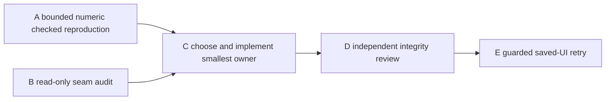

# V145 river deck crossing ticket pack

## Summary

Diagnose and repair the observed saved-bridge wet-seam stop without weakening the connected-river barrier. The real player has built the bridge but cannot yet reach the far bank and claim Ledger.

## Proposed Flow

1. Reproduce saved bridge `works6:river-bridge:-11` at the observed dry/wet transition. Compare on-center and lateral normal short steps under checked V28 movement, support and replay.
2. Choose the smallest observed owner: a built-deck approach cue if true centerline crosses, or a V28 passage/support repair if centered movement fails.
3. Independently review safety and repeat the preserved-save normal UI crossing, Survey and reward path with the strict renderer guard.

## Public Interfaces

No save schema, bridge ID, deck width, river site eligibility, discovery radius, reward or inventory rule may be changed by diagnosis. A may add one existing focused test. A later repair gets exact file ownership only after A's result. Player preview remains 5194; isolated saved test profile remains 5195. Browser and Node may not overlap. Early renderer stop 870400 KiB, hard below 1024000 KiB; Node diagnostic one-worker 512 MiB old-space and exact-PID 450 MiB RSS stop.

## Lane Graph

## Topology Audit

A's focused test and B's source audit are independent and can run in parallel without two renderers. B uses no Node. C cannot be dispatched until both identify the same causal class. D reviews C's exact diff, and E is serial after all Node exits. If centered crossing passes, do not edit movement; use an existing cue owner. If centered crossing fails, do not cover it with a tooltip. If evidence conflicts or no small owner emerges, stop and replan rather than weakening checks. No PR requested.

Dispatch verdict: **PASS for A and B, C through E conditional.**

## Tickets

Common: worktree `/private/tmp/pa-wizard-playable-v2`, branch `ben/wizard-playable-v2`; preserve dirty/untracked files and the real browser profile. Native continued children with inherited model, no nested worker or Git/GitHub action. Read `auto-planner-ticket-pack` and `smallest-viable-diff` SKILL.md completely if not already read in the same child session.

### V145-A checked numeric reproduction

Role: Implementer for test only, native continued child, milestone `first_feedback`. Exact owner: existing `engine/src/domain/publicWorldV28RiverPassage.test.ts` only. Build canonical saved `works6:river-bridge:-11` progress using existing checked fixture helpers, matching the observed near-bank/seam height where possible. Probe legal <=0.16 m outward segments at x=-44 center, x=-43.48 observed lateral and one outside-lane control. Capture V28 pose/support floors, direct passage result and exact V27/V28 replay rejection if available. Test no-bridge blocked, centerline outbound/return and off-lane rejected. No production edit, browser, profile edit, source-derived UI navigation or GitHub. One self-tested exact-PID 450 MiB RSS guard, Node old-space 512 MiB, one worker. If the fixture cannot faithfully model observed state, remove only this lane's test changes and report the missing witness, not a false pass. Return exact numeric table, command/result, memory/process receipt.

### V145-B seam source reviewer

Role: read-only Reviewer, native continued child, milestone `first_feedback`. Inspect V28 wet-contact supercover, carrier floor, bridge support interpolation, V27/V28 replay and exact saved `-11` geometry. Determine which predicates can reject an in-width step at z≈1.96 and whether a valid centerline path is expected. Identify minimum file/test owner for either cue or physics, and negative cases. No Node/browser/edit/GitHub. Return source lines and conditional GO/NO-GO.

### V145-C conditional minimal repair

Role: Implementer, native child, milestone `pr_hardening`. Dispatch only after A/B fan-in with exact chosen files and <=100 net lines. If centerline works, own the already-existing visible built-bridge guidance and one focused test only, telling the player to align to the dry end and stay centered. If centered path fails, own the exact V28 passage/support check and focused test only, preserving no-bridge/off-deck/return/checked save. Run focused tests, TypeScript under a declared memory gate, whitespace, and report behavioral evidence. No renderer or GitHub.

### V145-D independent review

Role: read-only Reviewer, native child, milestone `final_complete`. Inspect A/B/C evidence, exact changed files, accepted centerline and rejected off-deck/no-bridge, save/replay and backward compatibility. Findings-first GO/NO-GO, tests and residual risk. No browser/edit/GitHub.

### V145-E guarded real-save UI retry

Role: read-only UI Reviewer, native continued child, milestone `final_complete`. Depends on D GO and Node exit. Reuse persistent `/private/tmp/v141b-wizard-profile-20261011` on isolated 5195, preserve 5194. Real Continue with built bridge and Ledger Survey, normal controls, visible deck only, no source-derived coordinates/fixture/storage edit/forced GC. Cross, Survey, mine and deliver as reachable; stop at first actionable blocker, claim or guard. Pre-render self-tested exact-PID 50 ms RSS guard, 870400 KiB early stop, hard below 1024000 KiB, one browser/renderer. Capture screenshots, exact errors, reward/save/reload if reached, phase memory, console/network and process cleanup.

## Smallest Viable Diff

Reproduce before changing a mature movement authority. The bridge geometry and saved route already exist; changing site layout, width or river world to conceal one seam is larger and unsafe. Prefer cue-only if the legal centerline works. If physics must change, edit only the false-negative predicate and its focused test; retain invalid-state and no-bridge guards. No dependency, config, save schema or generated fixture. Tripwire is evidence of a second independent seam or need for a broader movement rewrite.

## Assumptions

- The player save contains the V28 built bridge ID and the observed world screenshot reflects the actual deck path.
- The exact stopped lateral segment can be represented by a deterministic checked progress fixture without touching the real browser profile.
- Full project TypeScript already passed V144-C3 at a 1536 MiB exact-PID RSS cap, after a 450 MiB cap proved too restrictive for this codebase.

## V145-A/B result and faithful-controller replan

A built the canonical `wizard-realms/-11` fixture, but used a synthetic unchanged-Y endpoint because one-frame V23 replay yielded no destination carrier. Its numeric `river-needs-bridge` result is not a faithful movement verdict. It removed its failing test; no A edit remains. B's source audit found the observed avatar x -43.48 within the bridge lane and z 1.96 just before the wet seam at z 2. It identified two credible site/passage mismatches: V28 accepts up to 0.55 m bank grade but its passage probe tolerates only 0.03 m difference from the old wet-tile floor; the interpolated first deck segment may also lie below the wet tile's constant floor, causing pose projection to reject. The runtime's “off deck” copy recomputes with synthetic unchanged Y, so it is not a causal diagnostic. These hypotheses require a persistent-controller witness, not a cue change or authority relaxation.

### V145-A2 persistent-controller seam witness

Role: Implementer for test only, native continued child, inherited model, milestone `first_feedback`. Exact owner: existing `engine/src/PublicV28ControllerRuntime.test.ts` only, separate new focused case; retain the passing V144 route test. Start from validated default-seed progress with canonical saved `works6:river-bridge:-11` and grounded dry near-bank pose, using the file's existing checked `writerFor` runtime helper. Feed ordinary <=0.16 m southward walking frames to one persistent `createPublicV28ControllerRuntime` instance, preserve `flight.origin` and accumulated frames, add bounded idle frames until grounded, and save only grounded full checked batches. Probe x -44 center and x -43.48 observed lateral independently, with no-bridge and outside-lane controls. At z 1.96 to 2.12 capture actual frame vector, pre/post carrier Y and vertical velocity, old wet-tile floor, interpolated deck floor, passage and pose results, and the runtime rejection. Continue to far bank and back if accepted. Do not substitute synthetic unchanged-Y endpoint or rebase a one-frame preview. One 512 MiB old-space, one-worker Vitest run under pre-armed self-tested exact-PID 450 MiB RSS stop; Node alone, no browser/profile/production edit. If faithful fixtures cannot be constructed, remove only this test addition and report exact gap. Keep a truthful passing regression even if it records an expected failed centerline, clearly labeling bug reproduction rather than game acceptance. Return result table, first real rejected frame, command/memory/process receipt.

Revised topology: A2 follows A/B and runs alone under Node cap. C is still blocked until A2 distinguishes the exact predicate. A centered failure is a genuine physics-path candidate; a centered pass would send C to cue/visual input, not passage relaxation. The no-bridge and off-lane checks remain hard negative controls.

## V145-A2 result and physics-design gate

A2 confirmed the saved bridge is untraversable at the observed first wet seam even on its centerline. It built `wizard-realms/works6:river-bridge:-11` through a checked controller action and used four independent persistent controllers. At dry z1.96, both x -44 center and x -43.48 observed lateral rejected the real 0.16 m move to wet z2.12 with `terrain_missing` and unchanged pose; x -42.69 outside the lane and center without a bridge also rejected as intended. Pre-step carrier Y was 1.28978497 with zero vertical velocity; old wet-tile floor at z2.12 was 1.13501971, interpolated deck floor 1.37458497 and pre-step V28 effective deck floor 1.36818497. The focused regression passed under the 450 MiB Node guard and is retained as an explicitly labeled known-bug test; no production edit. Browser remains closed.

Before C, a read-only B2 reviewer must trace which exact V28 predicate rejects the genuine controller trial and specify a bounded change preserving forged-Y, no-bridge, off-lane, diagonal wet corner, open pit, reverse and checked writer. C may not merely relax the 0.03 m tolerance globally or widen the bridge. If one-file-safe proof is unavailable, stop and replan a larger scoped repair. This review can use source only; no Node or browser.

### V145-B2 physics seam design review

Role: read-only Reviewer, native continued child, inherited model. Trace the actual V23 streamed trial and V28 passage/pose from A2's measured facts. Identify exact false-negative predicate, replacement scoped only to a saved bridge's covered wet contact and authentic grounded dry entry, and required negative/return tests. Give production/test file budget and GO/NO-GO; no edits, Node, browser or GitHub.

## V145-B2 result and bounded two-owner repair

B2 found two independent false-negative gates for the genuine down-grade first wet step. V23 carries the old dry Y into the wet tile and marks downward velocity. `groundedDeckCarrier` in V28 replay rejects its 0.15476526 m old-floor gap because it only permits 0.03 m, leaving an airborne candidate that cannot be durably saved. Separately, the river passage supercover checks the raw trial carrier Y against the lower old wet-tile floor with the same 0.03 m tolerance, so even a snapped checked candidate would fail passage. A one-predicate repair is explicitly **NO-GO**. The deck pose at the actual wet floor is valid.

### V145-C2 two-owner downward saved-deck seam repair

Role: Implementer, native continued child, inherited model, milestone `pr_hardening`. Exact production ownership: `engine/src/domain/publicWorldV28Replay.ts` and `engine/src/domain/publicWorldV28RiverPassage.ts`; focused existing tests `engine/src/PublicV28ControllerRuntime.test.ts` and `engine/src/domain/publicWorldV28RiverPassage.test.ts` only. Preserve the V144 route regression. Add or reuse one narrow downward bank-to-first-wet predicate in the passage owner, shared by replay snap and wet-contact proof if practical. It may normalize the old-floor carrier only when the prior pose is exactly grounded on the saved bridge's canonical dry source tile, the ordinary segment enters that same bridge's first wet tile within `PUBLIC_RUN_STEP_METERS`, both endpoints are within the deck width and same saved unique bridge, dry-to-wet old-floor drop is positive and <= site grade allowance, dry Y is authentic, deck covers every wet contact, and there is no open pit. The ordinary 0.03 m tolerance remains for all other steps; do not widen the deck, move the river, bypass V23 decode or change save schema. Include no-bridge, wrong bridge, off-lane, forged Y, diagonal wet corner, pit, reverse and checked-save/return tests. Update the A2 known-bug centerline regression to assert accepted crossing, far-bank arrival and durable checked save; include observed lateral if safe. Run focused one-worker Vitest with 512 MiB old-space and self-tested exact-PID 450 MiB RSS stop, then a no-browser full project `tsc --noEmit` under the established final 1536 MiB RSS and 1024 MiB old-space caps, plus whitespace. Stop/replan if >2 production files, >2 tests, >180 net lines, unclear trust boundary or any guard trip. No browser, real profile or Git/GitHub. Return exact source predicate, tests, no-bridge/off-deck proof, TypeScript, peak/process receipt.

The revised topology is A2+B2 -> C2 -> D independent integrity review -> E saved UI. C2 owns the two necessary V28 predicates as one cohesive crossing fix; there is no safe one-file split. D cannot approve merely from a successful crossing; it must inspect every exceptional authorization branch and saved replay parity. E remains one guarded renderer after all Node exits.

## V145-C2 result and V146 symmetric-seam replan

C2's narrow outward-only proof made both center and observed lateral wet entry work, reached the far bank, and saved twice, but a return step from wet z≈2.12 to near dry z1.96 failed with `terrain_missing` and “no supported route.” The C2 worker removed all its changes via `apply_patch`; no partial one-way repair remains. It did not run TypeScript after the tripwire. A read-only V146 audit located a second passage-only return check: V23 raises the wet carrier immediately to the higher dry floor with zero velocity, but the passage's wet supercover interpolates Y through above-floor probes and rejects them at its general 0.03 m tolerance. Replay needs no snap on return. A symmetric exception can stay within the same two production owners and two focused tests, but requires authenticated same-bridge adjacent dry/wet pairs in both directions. The generic tolerance must remain unchanged.

### V146-C3 symmetric saved-deck seam implementer

Role: Implementer, native continued child, inherited model, milestone `pr_hardening`. Exact production ownership remains `engine/src/domain/publicWorldV28Replay.ts` and `engine/src/domain/publicWorldV28RiverPassage.ts`; tests remain existing `engine/src/PublicV28ControllerRuntime.test.ts` and `engine/src/domain/publicWorldV28RiverPassage.test.ts`, preserving V144/A2 regressions. Add one narrow authenticated saved-bridge adjacent-bank/wet predicate in the passage owner for both outward raw dry-Y carry and reverse V23-consistent wet→dry Y interpolation. Preconditions: one canonical saved site, matching footprint dry-source/wet-first or wet-first/dry-source tile pair, grounded old carrier at old floor, target Y consistent with V23 transition for its direction, both XZ endpoints and all wet contacts within the same deck, ordinary max step <= `PUBLIC_RUN_STEP_METERS`, no open pit in touched cells, no forged/teleported Y. Replay may use it only for the outward downward snap; return remains V23's ordinary grounded candidate. Passage may normalize only the authenticated seam's wet contact floor; keep general 0.03 m check for all other contacts. Do not widen bridge, alter site resolver, bypass V23 decode, or change save schema. Tests must prove center and lateral outbound, far-bank return, checked save/reload, no bridge, wrong bridge, off lane, forged Y, diagonal wet, open pit, and existing V27 non-bridge behavior. Two production + two tests, net <=220 lines; stop on additional owner or guard trip. Run focused one-worker Vitest under self-tested exact-PID 450 MiB RSS stop and 512 MiB old-space, then no-browser full project TypeScript under the previously proven 1536 MiB RSS and 1024 MiB old-space caps, plus whitespace. No browser/real profile/Git/GitHub. Return exact predicate, tested directions/negative cases, memory/process cleanup and native transport receipt. If a safe symmetric rule cannot fit, revert only C3 edits and report NO-GO.

### V146-D independent integrity reviewer

Role: read-only Reviewer, native continued child, inherited model, milestone `final_complete`. Only after C3 production/tests and Node exit. Inspect both exceptional entry and return branches for saved-bridge uniqueness, correct bank tile IDs, width and wet coverage, authentic Y, pit/no-bridge/wrong-bridge rejection, V23/V27 replay and checked save/reload parity. Findings-first GO/NO-GO with exact source/test lines. No browser/edit/GitHub.

### V146-E guarded saved-game acceptance

Role: read-only UI Reviewer, native continued child, inherited model, milestone `final_complete`. Only after D GO and Node exit. Reuse real preserved 5195 profile with built `works6:river-bridge:-11`, preserve player 5194. Normal visible-deck alignment, outward crossing, Survey, return if needed, mine and Ledger delivery as reachable; stop at first actionable blocker, claim or RAM guard. One owned renderer with pre-render self-tested exact-PID 50 ms RSS guard, early 870400 KiB stop and hard below 1024000 KiB. No source coordinates, fixtures, debug/storage edits or forced GC. Capture screenshots, exact error, save/reload/reward if reached, phase memory, console/network and process cleanup. A unit test pass is not UI acceptance.

Revised topology: the V146 source audit and C2 outcome jointly authorize C3 as one cohesive two-owner bidirectional fix. D and E remain serial review and one-renderer proof. The wider net-line budget reflects symmetric negative tests, not permission to broaden world rules or save format.

## V146-C3 through E result and residual validation

C3 completed the symmetric saved-bridge seam repair in exactly two production files and their two focused tests, net +136 lines. Center and observed lateral paths crossed outward, reached the far bank, returned, made four checked saves each and reloaded. Focused tests passed 3/3 with 30 other tests skipped; no-bridge, wrong-bridge, off-lane, forged-Y, pit, diagonal and V27 parity controls were included. TypeScript passed under the 1536 MiB exact-PID stop. All Node processes exited. D independently found no blocking integrity issue and approved guarded UI, while noting the older full bridge suite had not been rerun.

E resumed the real saved V36 game, crossed the built `works6:river-bridge:-11` from z1.96 to z10.58 with normal controls, enabled and claimed the far-bank Survey, then reloaded. Continue preserved far-bank pose, level 4, 120 coins, claimed Survey progress and the next stone objective. This is the first genuine saved UI proof of this Ledger segment. The renderer peaked at 851088 KiB under the 870400 KiB early stop, no guard event; browser and guard closed, profile retained, 5194/5195 HTTP 200. It did not prove reverse crossing, mining or Ledger delivery. The inventory has a basic pick but no field spade; Terrain tools correctly ask to equip a field spade.

### V146-F bounded broader bridge regression

Role: read-only Validator, native continued child, inherited model, milestone `final_complete`. After E's browser/guard exit, run the existing V28 river/bridge, controller-runtime and adjacent V27 movement/terrain test files as one focused one-worker Vitest suite, no `-t` filter, with pre-armed self-tested exact-PID 450 MiB RSS stop and Node old-space 512 MiB. Do not run the entire game suite or a renderer. Report pass/fail/skip counts, first exact failure, peak and cleanup. Do not edit or Git/GitHub. Guard trip is unverified and requires replan, not cap increase. This hardens C3 while the next normal-UI Ledger leg is scoped.

V146-F passed all 79 tests across seven V27/V28 files without editing any file. The runner and observed workers exited and both previews returned HTTP 200. Its guard followed the runner and first worker (first-worker peak 453952 KiB, under 460800 KiB), but Vitest rotated workers and the guard did not follow every replacement. Therefore the test result is valid while the claimed per-worker 450 MiB memory ceiling is **not fully proven** for this broad run. Do not describe it as a fully capped suite. The guarded real-UI acceptance and narrower C3 tests retain their own valid exact-PID memory receipts.
