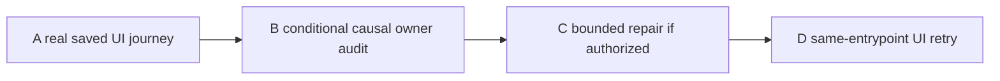

# V147 Ledger stone delivery ticket pack

## Summary

Complete or locate the first real blocker in the saved player's remaining Outfitters' Ledger route, from far-bank Survey claim to spade, stone and final delivery reward.

## Proposed Flow

1. Resume the genuine V36 save and verify the far-bank stone objective and claimed Survey after reload.
2. Use the visible bridge, map and route guide to return to Outfitters; buy/equip a field spade through normal store controls.
3. Use Terrain Dig then basic-pick Mine on legal revealed dry ground, keep one stone, deliver at the store, verify coin/XP/tunic and checked reload. Stop earlier at the first actionable blocker or RAM guard.

## Public Interfaces

No production code, save schema, economy, reward or world-state change is authorized by the first UI probe. Player preview 5194 remains available. Isolated test browser 5195 reuses `/private/tmp/v141b-wizard-profile-20261011`. One browser/renderer, pre-render exact-PID 50 ms guard with 870400 KiB early stop and hard below 1024000 KiB. No Node profiler or other browser overlaps.

## Lane Graph

## Topology Audit

A is the shortest uncertainty-closing path because code fixtures already prove parts of the reward. B through D are conditional and must bind to A's first exact visible error. No artificial parallel browser or speculative production edits. The source-only reward blueprint is already available and does not block A. No PR or GitHub action requested. Dispatch verdict: **PASS for A, later lanes conditional.**

## Tickets

Common: `/private/tmp/pa-wizard-playable-v2`, branch `ben/wizard-playable-v2`; preserve all dirty/untracked files and the real test profile. Native continued child, inherited model, no nested worker or Git/GitHub action. Read `auto-planner-ticket-pack`, `smallest-viable-diff`, `test-from-ui` and `playwright` SKILL.md completely if not already read in the same child session.

### V147-A guarded real-save UI journey

Role: read-only UI Reviewer, native continued child, milestone `first_feedback`. Real Continue on 5195 with preserved profile and 5194 untouched. Verify Survey claimed, level/coins/gear/stone objective. Follow visible deck, map, journal and store cues only, no source-derived target coordinates, storage edit, fixture, debug grant or forced GC. Normal controls: return across bridge, reach Outfitters, buy/equip spade, Dig then Mine one stone, deliver. Stop at first actionable blocker, early guard or final claim; do not brute-force invisible target cells. Capture exact UI actions, toast/rejection, world/map/store/terrain screenshots, coin/XP/gear before and after, save/reload if claimed, console/network, phase RSS/JS/GPU. Pre-render self-test exact-PID guard at nominal 50 ms, 870400 KiB early stop and hard below 1024000 KiB. Close owned browser/guard, preserve profile, verify both ports. Return real dispatch receipt and limitations.

### V147-B conditional causal audit

Role: read-only Reviewer, native continued child. Dispatch only if A finds a concrete blocker. Correlate exact visible error/pose with relevant controller/console/source; identify smallest owner and negative cases. No browser, Node profiler, edit or GitHub. Do not use a source route to claim the player saw a cue.

### V147-C conditional repair

Role: Implementer, native child. Dispatch only after B identifies one bounded in-scope owner. Exact files and test budget must be stated then; do not change reward amounts or authority to hide a UX mistake. Run focused tests and TypeScript under prior safe resource caps. No browser/GitHub. If wider architecture is needed, replan rather than silently broaden.

### V147-D guarded same-entrypoint retry

Role: read-only UI Reviewer, native continued child. Dispatch only after C and independent review where trust or reward state changes. Repeat real Continue and the same input/action journey under the strict one-renderer guard. Stop at next blocker or reward/reload proof, capture exact evidence and cleanup.

## Smallest Viable Diff

A is read-only. Repair only the observed owner, if any. Existing checked Ledger claim, store pricing, visible tunic and terrain tools are reused; no new quest, item, migration, prompt, dependency, asset or configuration in this pack. A guard stop is memory evidence, not a license to increase the renderer limit. The first source-visible hint must not be treated as player-discoverable without UI proof.

## Assumptions

- The preserved V36 profile still holds the claimed Survey and far-bank pose after prior browser close.
- The player can use the saved bridge for reverse travel as the focused checked tests show, but real reverse UI remains unproven.
- A normal store has an available field spade at the documented price, while the player has enough coins.
