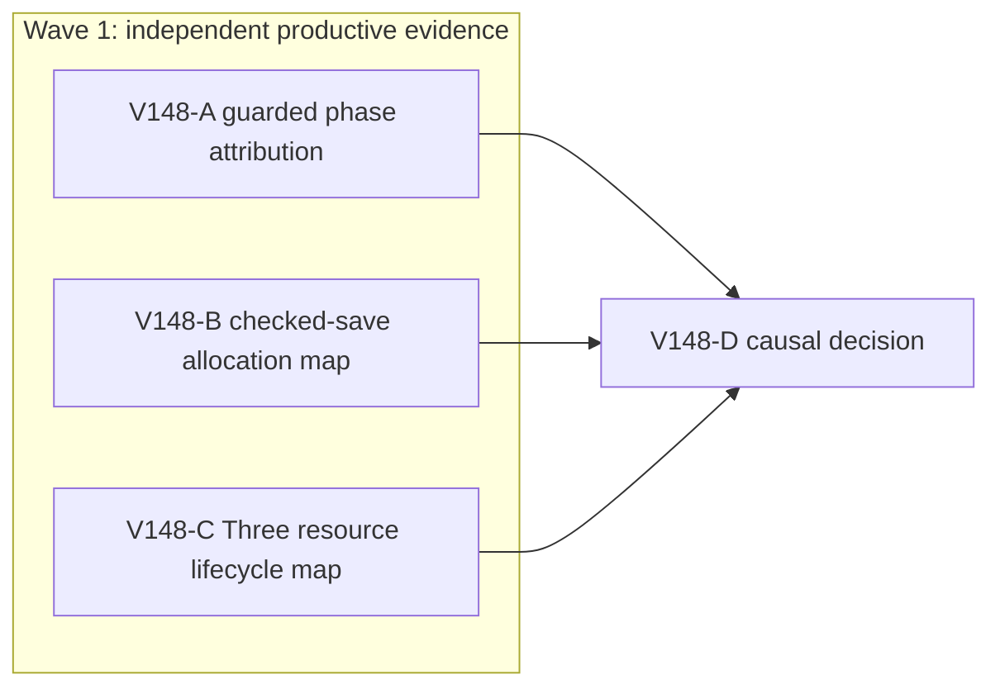

# Ticket Pack: V148 Ledger Return Memory Attribution

## Summary

This pack follows `V148_LEDGER_RETURN_MEMORY_UNDERSTANDING.md`. The authentic V36 Ledger return advanced across the bridge, then hit the existing renderer RAM early stop. Measure the phase and map current code ownership before any edit. The user-facing 5194 preview and saved 5195 test profile remain available.

Locked design:

- No guard increase, visual downgrade, independent replay/CAS weakening, private-save rewrite or extra renderer.
- A diagnostic forced GC, if used only after organic measurements, is not acceptance evidence.
- Preserve every existing dirty and untracked file. Do not use GitHub or the work-associated identity.

Important repo truth:

- V127 matched a V34 renderer RSS save spike to transient renderer-side allocation, while the GPU process barely changed, but it did not identify a causal owner for current V36.
- V143 reduced sampled movement allocation by about 27% without proving long UI residency. V147-A's genuine V36 return went from roughly 356 MiB initial phase to a guard stop at 877,552 KiB, sampled peak 891,936 KiB.
- The V146 bridge seam is now traversable in the genuine saved UI. Do not re-open that physics fix absent contradictory evidence.

## Proposed Flow

The player continues a genuine V36 Ledger save, crosses the existing bridge in reverse, returns to Outfitters, buys a spade, digs and mines a stone, then claims the tunic and coin/XP reward. This pack diagnoses only the memory barrier encountered after reverse movement. Future quest implementation is out of scope.

## Public Interfaces

None changed. The diagnostic browser uses `http://127.0.0.1:5195/?publicWorld=v36` and a disposable copy of `/private/tmp/v141b-wizard-profile-20261011`, preserving its original 127.0.0.1 origin. The player preview stays at 5194. Evidence lives outside the repository except this planning document and its appended decision receipt.

## Lane Graph

## Topology Audit

- Productive lanes: A measures one real UI/process concern; B audits the current V36/V28 checked-save path; C audits scene/graphics resource lifetime. All return distinct evidence, have no file ownership, and consume only fixed evidence. Maximum safe width is three.
- Incomparable pairs: A || B, A || C, B || C. Source-only B/C neither launch renderers nor write files, so they cannot disturb A's one-renderer measurement.
- Fan-in: D consumes phase metrics, save ownership and scene ownership. It must map observations to the smallest next owner or exact unresolved probe, without editing code.
- Certainty: A closes held vs release vs scene timing with synchronized metrics or an explicit early-stop limitation. B closes the current save/copy/replay call-path question by source. C closes current scene allocation/disposal and visibility-bound question by source. A guard stop, source contradiction, or evidence of two owners triggers local replanning.
- Serial edges A/B/C to D are necessary because D cannot attribute a measured phase without both process evidence and current code ownership. No extra review or PR finisher is useful for read-only diagnostics; no PR requested.
- Dispatch verdict: **PASS**. This is a diagnosis-oriented pack, not a fabricated implementation wave.

## Tickets

Common first-contact role bootstrap: `auto-planner-ticket-pack` skill, role `reviewer` ONLY, `smallest-viable-diff` skill, and full lane ticket. For A also `test-from-ui`, `playwright` and relevant generic UI reference. Read required files completely before task actions. Work in `/private/tmp/pa-wizard-playable-v2`, existing branch `ben/wizard-playable-v2`, current dirty state. Native ephemeral subagent with inherited model, local runtime, continued child session; existing durable task routing `not_authorized`, no-interruption `not_applicable`, task/thread receipt `not_applicable`, fallback `none`. No nested workers, source edits, tests, Git or GitHub actions. Do not use em dashes in prose.

### Paste now to: V148-A guarded phase reviewer

Ticket: V148-A. Lane type: Parallel. Delivery phase: `user_flow_probe`; milestone: `pre_surface`. Transport: `native_spawned_subagent`, model inherited, Cursor runtime not applicable. Runtime rationale: a real browser plus guarded CDP/process observations on a known local preview, no separate provider needed. Shortest complete user flow: real Continue on 5195, briefly reverse across the saved bridge, capture the first memory phase that stops the return or a safe checked-save result. First-feedback evidence: phase-stamped UI, renderer/GPU RSS and CDP heap metrics, screenshot, console/network. Surface readiness gate: 5194/5195 HTTP 200 and exact-PID guard armed before navigation; 5194 remains available, A alone owns its disposable browser. Post-surface validation: D decides whether repair or a smaller probe is needed. Optional-feedback wait policy: never.

Use one disposable copy of the authentic closed browser profile; verify original profile untouched. Self-test an exact Chrome renderer-PID nominal 50 ms guard with 870400 KiB early stop and 1024000 KiB hard ceiling, then navigate. Measure phase baseline after Continue, a short S200 to S300 ms held segment before release, release/checkpoint, natural idle if safe, and at most one repeat short segment only if the first stays comfortably below 700000 KiB. Capture same-PID RSS min/peak/current, JS used/total, GPU RSS, one-canvas count and visible checkpoint timing. Avoid expensive heap snapshots, `vmmap` near guard, forced GC before organic readings, raw save export, fixture/edit/debug grants and a long input known to stop the renderer. If the guard fires, stop immediately; do not attempt further UI actions in that renderer. Close exactly owned browser and guard; preserve both preview ports and profile. Report metrics unavailable after stop honestly. Exact acceptance is a coherent phase trace or a bounded guard-stop limitation, not Ledger completion. Visual proof required for the visible saved pose and objective, screenshot plus console/network status. Certainty mode: discriminating probe; surprise trigger is high RSS during idle before input or GPU growth dominating. No changed files.

### Paste now to: V148-B checked-save source reviewer

Ticket: V148-B. Lane type: Parallel. Delivery phase: `user_flow_probe`; milestone: `pre_surface`. Transport: `native_spawned_subagent`, model inherited, Cursor runtime not applicable. Runtime rationale: bounded source tracing of deterministic TypeScript, no browser or heavy tests. Shortest complete user flow: correlate V36 frame and release/checkpoint call path with A's phases. First-feedback evidence: exact line-level call chain and potential allocation/retention sites, each marked as hypothesis. Surface 5194 stays available; optional-feedback wait never.

Read current V36 controller/entry, V28 controller/flush, V27/V23 frame handoff, checked store and IndexedDB code. Name which operations occur while held, on key release, and on checkpoint; identify cloning, validation, serializing, transaction lifetime and scene-independent retention. Name one falsifiable prediction for A's trace and the smallest possible owner if confirmed. Preserve independent replay, reject semantics, save migration and CAS. Do not infer byte magnitude from source, run browser/tests, or edit. Certainty mode: reasoning closure of call-path ownership; surprise trigger is a current call path materially different from V127/V143. Visual proof not applicable. No changed files.

### Paste now to: V148-C scene resource reviewer

Ticket: V148-C. Lane type: Parallel. Delivery phase: `user_flow_probe`; milestone: `pre_surface`. Transport: `native_spawned_subagent`, model inherited, Cursor runtime not applicable. Runtime rationale: bounded source audit of rendering lifecycle with no renderer contention. Shortest complete user flow: correlate continuous player travel and region streaming to scene resource creation/disposal. First-feedback evidence: exact line-level scene owners, object/geometry/material/texture keys and disposal paths, plus one falsifiable prediction for A. Surface 5194 stays available; optional-feedback wait never.

Read current `WizardScene.tsx`, `TerrainSurfaceLayer.tsx`, `LandscapeDressingLayer.tsx`, `MireglassWaterLayer.tsx`, and their V36 entry call sites. Trace React keys/memo boundaries as the player moves across terrain, what persists, what is disposed, and any per-frame `new` graphics object. Compare actual bound of visible terrain to V142 prior bounded-scene claim. Include renderer-native vs GPU-process caveat. No browser/tests/edit. Certainty mode: reasoning closure of scene lifecycle; surprise trigger is unbounded live resources or unique geometry/material churn on each frame. Visual proof not applicable. No changed files.

### Wait for A, B and C, then V148-D decision

Top-level planner synthesizes only decision-relevant evidence. Classify `held-frame allocation | release/save transient | scene/native growth | GPU | mixed | unresolved` with confidence and limitations. If one bounded source owner is measured, author a new smallest-owner repair contract and repeat the same authentic UI entrypoint under the same guard after repair. If not, choose only one smaller discriminating probe. No code, guard, graphics, save or quest action is authorized by D itself.

## Smallest Viable Diff

Behavior delta: none in V148. Expected diff budget: zero production files, zero production lines, zero new dependencies; this planning document only. Forbidden surfaces: runtime, tests, save schema/profile, render quality, guard, 5194/5195 topology. Reuse: V127 process/JS/GPU instrumentation, prior exact-PID guard, current V36 source and real profile. Prompt/config alternative: diagnosis cannot be achieved by a content cue or config change. Deletion/simplification target: none because no production edit is allowed. Validation: one guarded real-browser trace plus two independent source receipts. Tripwire: any proposed production change returns to planner with a separate bounded pack.

## Assumptions

- The V147 owned browser and guard are closed; A rechecks process ownership before launch.
- A copied profile opens on the same 127.0.0.1 origin and can show the saved Ledger return without changing the authentic original.
- The 870400 KiB early stop can still fire before a post-release CDP snapshot; that is a valid bounded failure, not license to repeat a long movement blindly.

## Integrated V148 receipt and decision

All three read-only lanes returned. A used one copied authentic V36 profile and one game canvas. It self-tested the exact-PID 50 ms guard twice before navigation, reached visible Continue with the saved Ledger objective, then made one scheduled S250 ms reverse movement and observed a checked-save message. Original profile hash was unchanged. The first same-origin bootstrap URL returned 404 before app load; A closed that owned browser and the one documented retry used `/@vite/client`. Both owned browsers and guards exited. 5194 and 5195 returned HTTP 200. Two disposable profile copies remain only in the evidence directory because command review rejected removal.

| Same game-renderer phase | RSS KiB | JS used / total MB | GPU RSS KiB |
| --- | ---: | ---: | ---: |
| Settled before input | 451,520 | 42.13 / 118.15 | 172,336 |
| Held input sampled peak | 486,928 | unavailable | unavailable |
| Immediately after release | 494,176 | 102.13 / 155.25 | 176,544 |
| Checkpoint observation, 1.2 s later | 620,480 | 49.54 / 152.63 | 176,768 |
| Natural idle, 3 s later | 448,704 | 42.36 / 45.15 | 172,640 |

Guard did not fire; 620,480 KiB was the run's game-renderer peak. The save message was first observed about 1.5 seconds after release, but its onset is not exact. B established that 64 pending frames or the 96 reserve can trigger a save while held. It mapped V28 frame replay/copies and the nested V35/V36 checked write, which replay and copy a full successor under IndexedDB CAS. C confirmed the visible terrain is bounded to at most 31 by 31 cells with stable keys and explicit geometry disposal in the inspected layers. It found no per-frame unique geometry/material construction, but did not verify React Three Fiber's runtime disposal behavior. Console had only a resource 404 and THREE.Clock deprecation warnings, no gameplay page error or failed network request. Evidence: `/private/tmp/v148-a-JZoPD8/events.jsonl`, `after-continue.png`, and `after-first-save.png`.

**Classification:** mixed transient renderer-side allocation associated with a short movement/checkpoint cycle, not a demonstrated retained JS or unbounded scene leak. The 60 MB JS-used jump immediately after release and later RSS peak despite JS-used recovery do not by themselves locate the exact copy or native allocation. GPU RSS rose only about 4 MB and returned to baseline. The short run naturally recovered to below its renderer baseline; the earlier V147 long movement still hit the guard. Do not claim the RAM problem is solved or blame a specific source line yet.

**Next decision:** continue the genuine Ledger return through short guarded normal inputs while independently auditing one integrity-preserving V36/V35 checked-save copy seam. If the UI continues only by forced micro-pauses, classify sustained travel performance as unresolved even if the quest claim succeeds. No guard or graphics change. A source repair needs a separate bounded ticket and a same-entrypoint browser retry.
