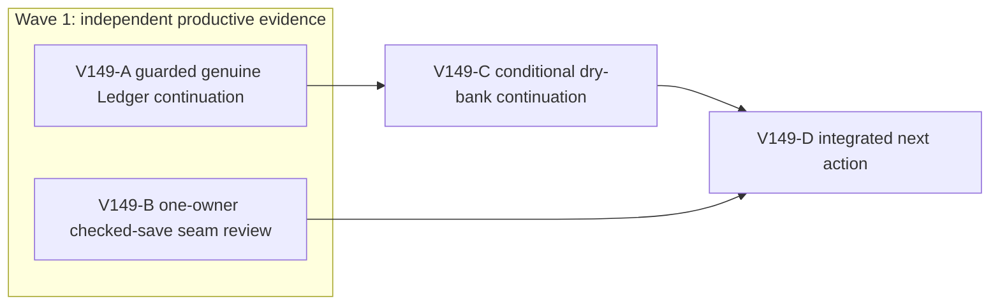

# Ticket Pack: V149 Ledger Return and Checked-Save Seam

## Summary

Follow the V149 understanding. The genuine saved player needs a normal-control return and Ledger claim, while the V36 checked-save copies need an integrity review before any RAM repair. Two independent productive lanes run now; neither changes code.

Locked design: keep one renderer, same 870400/1024000 KiB safety thresholds, authoritative replay and CAS, V36 save/migration shape, visual fidelity and authentic saved quest progress.

Important repo truth: V148 proved a short input's renderer RSS rise naturally recovers. V147 long movement still hit the early guard. V36 and V35 controller shells each clone a committed start and replay/compare checked write results; V28 has its own flush and independent store replay.

## Proposed Flow

Genuine saved far-bank Continue -> reverse bridge and dry route -> Outfitters spade -> legal Dig and Mine -> Ledger delivery -> reward and reload. The read-only source review identifies whether a copy can be removed in a separate future repair. It does not change this flow.

## Public Interfaces

No interface change. Browser entrypoint `http://127.0.0.1:5195/?publicWorld=v36`, authentic profile `/private/tmp/v141b-wizard-profile-20261011`. Player preview 5194 remains reachable. No PR or GitHub action.

## Lane Graph

## Topology Audit

- A produces genuine browser quest and safety evidence; B produces independent source integrity evidence. They are incomparable, have disjoint read-only ownership and can run in the same wave. Maximum safe width two.
- D consumes B and the final UI receipt, A or conditional C, and chooses quest blocker repair, safe allocation repair, or exact further proof. A to C is activated only by an ordinary navigational rejection, not a code defect. These are real evidence dependencies; there is no artificial code lane.
- A's discriminating probe closes whether authentic normal play advances through the return or finds a specific blocker, stopping at first blocker/guard/claim. B's reasoning audit closes whether one identified V36/V35 copy is redundant with preserved validation. Surprises include save corruption, a gameplay rejection, unbounded RAM even with short input, or a needed multi-file trust redesign.
- No reviewer after B because both lanes are reviewers. No PR finisher because no PR requested. Dispatch verdict **PASS**.

## Tickets

Common: branch `ben/wizard-playable-v2`, worktree `/private/tmp/pa-wizard-playable-v2`, all dirty and untracked files preserved. Native ephemeral subagents, inherited model, local runtime, no durable task coordination, no nested workers, no Git/GitHub. Role `reviewer` ONLY under completely read `auto-planner-ticket-pack` and `smallest-viable-diff`; A also completely reads `test-from-ui`, its generic UI reference, and `playwright`. Continued child session, fallback none, existing-task routing not_authorized, no-interruption not_applicable, task/thread receipt not_applicable. No em dashes in prose.

### Paste now to: V149-A guarded UI reviewer

Ticket V149-A. Parallel, `user_flow_probe`, milestone `pre_surface`, transport native, model inherited, Cursor not applicable. Runtime rationale: existing local browser surface and genuine profile, no provider needed. Shortest complete flow: normal Continue, bridge return, Outfitters, spade, stone, claim/reload. First-feedback evidence: visible objective/action/reward or first exact blocker. Surface gate: both ports 200 and one self-tested exact-PID guard before navigation; keep 5194 available. Test writing prohibited. Post-surface: D decides next action. Optional feedback wait never.

Use the original genuine saved profile through normal UI only. Before navigation, arm and self-test exact owned renderer guard, nominal 50 ms, early 870400 KiB, hard 1024000 KiB. Verify level, coins, survey/stone state. Use normal map, objective, keyboard, Works, store and Terrain controls. Prefer bounded 200 to 300 ms movement segments and idle recovery if that remains natural play; do not use source-derived coordinates, debug storage, fixtures, teleport, forced GC or a second renderer. Do not claim sustained-travel performance from paced inputs. If RSS approaches 700000 KiB, allow natural idle before further input; if guard fires, stop. At first gameplay blocker, record exact visible text/actions/pose and relevant console/network, then stop for causal repair. If claim succeeds, prove reward, equipment and save/reload. Capture screenshots and phase RSS/GPU/heap when safe. Close only owned browser/guard and verify 5194/5195. Visual proof required. No file edits.

### Paste now to: V149-B checked-save integrity reviewer

Ticket V149-B. Parallel, `user_flow_probe`, milestone `pre_surface`, transport native, model inherited, Cursor not applicable. Runtime rationale: bounded TypeScript source reasoning with no browser or tests. Shortest complete flow: one checked V36 frame save through V35 and V28 wrappers. First-feedback evidence: exact source-line ownership, one clone seam GO/NO-GO, adversarial test contract and expected allocation saved if measurable later. Surface remains available, optional feedback wait never.

Read current V36/V35/V34 wrapper `asV*Start`, `checked`, `makeCore` and V28 flush/checked write, plus existing V143 V17 clone-owning private helper and tests. Identify at most one repeated `structuredClone` of an already exclusively owned, validated value that could be removed or moved without weakening public input checking, hostile alias mutation rejection, local replay, independent writer replay, CAS, save/reload or migration. Prove object ownership and exact invalidation across every save/action/return-home; if not possible in one or two production files, return NO-GO and specify the missing contract. Name current line references and 3 to 5 adversarial tests. No edit, Node or browser. Visual proof not applicable. Certainty mode reasoning; surprise is an unavoidable cross-wrapper redesign.

### Wait for A and B, then V149-D decision

Top-level planner records quest state and safety status, checks B's proof against A's memory trend, and authors only the bounded next repair or continuation. It does not code, raise guards, weaken checks or call the full-game goal complete.

## Smallest Viable Diff

Behavior delta: no production behavior in this diagnostic pack. Expected diff: zero production/test files or dependencies, this planning document only. Forbidden: controller/store/source edits, save migrations, render settings, guard, profile direct edit, fixture, GitHub. Reuse: real V36 Continue, existing exact-PID guard, V143 private session precedent, V36 checked writer. A content cue/config change cannot reduce observed allocations. Deletion/simplification: none now; B explicitly evaluates a redundant copy. Validation: actual UI journey and source GO/NO-GO. Any proposed production edit requires a separate repair contract, with <=2 production owners or replan.

## Assumptions

- V148 closed its browser and guard and preserved the authentic original profile hash.
- The next genuine pose is still on the return side of the saved bridge, though normal V149-A Continue decides the authoritative state.
- A short input does not guarantee staying below the guard; the guard remains authoritative.

## Wave 1 receipt and bounded continuation

V149-A used the authentic saved UI and eight paced S250 ms inputs to cross the saved river bridge. Every segment had a checked V36 save. It reached the near bank at map x about -43.46, y 1.36, z 1.64 m. A later W300 ms input pointed off the narrow dry/deck boundary and produced: `The river blocks this step. Approach the built bridge from its dry end and stay on the deck.` The [world screenshot](/private/tmp/v149-a-aehyWi/river-block.png) shows a visible dry bank adjacent to the deck. This is a normal collision response, not evidence that the return route is impossible. No Outfitters, spade, stone or claim yet. Guard-sampled renderer peak was 657504 KiB, below early stop; owned browser/guard closed, profile retained, ports 5194/5195 HTTP 200. The paced path is not sustained-travel performance proof.

V149-B identified one candidate private V36 adapter copy: `structuredClone(genesis)` in `PublicV36ControllerRuntime.ts` line 33 is followed by a full V35 ownership clone. It returned conditional GO on ownership reasoning but NO-GO on deploying without hostile-alias, asynchronous reply, action, Return Home and CAS tests. No byte benefit is measured. This does not justify a repair by itself.

The first A rejection is normal steering rather than a product blocker, so the observed-failure fast path does not authorize code. Continue the same UI journey once from the saved position with visible dry-bank steering. This continuation consumes A's position and screenshot. It is a narrow follow-up within this pack, not a new renderer topology.

### Wait for V149-A, then paste to: V149-C guarded dry-bank continuation

Role: read-only UI Reviewer under the already acknowledged skills. Transport: the same native child `/root/v148_ui_phase`, inherited model and continued session, no fallback or durable task. Delivery phase `user_flow_probe`, milestone `pre_surface`. Use real Continue on 5195 and the authentic profile, one self-tested exact-PID 50 ms 870400/1024000 KiB guard before navigation. From the V149-A saved near-bank position, use only the visible world/map dry ground adjacent to the deck to steer toward the saved Greenway ladder and Outfitters. The previous rejected W heading is not a route instruction. Bounded 200-300 ms ordinary inputs with natural idle as needed, no source-derived coordinates, fixture, direct storage, debug grant, forced GC, second renderer or long hold. Stop at first repeated route obstruction after at least two visibly distinct dry approaches, RAM guard, Outfitters arrival, or one 10-minute guarded session, whichever comes first. Record exact normal UI actions, map/quest/rejection, screenshots, renderer/GPU/heap when safe, console/network, saved/reload status and owned-process cleanup. If the store is reached safely, the next separate segment can purchase the spade; do not conceal a missing route. No code, test, profile-direct, Git or GitHub edit.

Revised graph edge: A -> C -> D and B -> D. The original A and B remain independent wave-1 productive lanes; C consumes A's first route rejection and saved pose. D now consumes B and C. No source change is authorized by C.

## V149-C closeout decision

C ran the authentic save for 10 guarded minutes using 25 bounded normal-control inputs. It reached map x -32.89, y 1.38, z -5.35 m along dry ground, with visible checked saves and no further route rejection. The guard did not fire, but renderer RSS peaked at 827648 KiB in release/checkpoint and JS heap used at one checkpoint reached 308044504 bytes. RSS later fell to 404096 KiB. The [final world](/private/tmp/v149-c-IsnynL/final-world.png) and [map](/private/tmp/v149-c-IsnynL/final-map.png) document the position. Owned browser/guard closed, profile retained, 5194/5195 HTTP 200. Outfitters, spade, stone, Ledger claim and reward reload remain unproven. Pace-limited play took 10 minutes for only part of the return; it is not acceptable sustained-travel performance evidence.

Decision: do not blame river physics or edit route rules. Take the separately identified V36 synthetic-genesis copy as a measured, adversarially tested candidate, retaining it only if a capped before/after checked-save profile shows a material reduction. In parallel, determine how to provide a separate, save-valid equipped developer test profile without altering authentic onboarding or bypassing public save validation. Neither step may raise the renderer guard or use a second game renderer.
