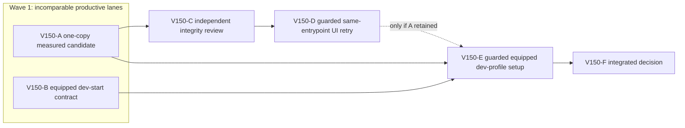

# Ticket Pack: V150 Save Copy Measurement and Developer Test Start

## Summary

This follows `V150_SAVE_COPY_AND_DEV_TEST_START_UNDERSTANDING.md`. Test one precisely identified V36 synthetic-genesis copy for safety and meaningful allocation benefit, while independently specifying a separate equipped development profile for efficient exploratory play. The authentic barefoot player save and 5194 preview remain unchanged.

Locked design:

- V36 public start and checked writer boundaries, independent replay, CAS, migrations and saved geometry remain fail-closed.
- No debug gear, teleport or artificial save is inserted into the authentic first-player journey.
- No lowered graphics or raised renderer RAM guard. Only one game renderer in any subsequent UI retry.

Important repo truth:

- `asV35Start` in `PublicV36ControllerRuntime.ts` line 33 clones synthetic `genesis`, then V35 immediately takes its own full ownership clone at construction or after checked reply.
- V149's genuine quest return advanced under 25 short inputs, but checkpoint renderer RSS reached 827648 KiB and 10 minutes did not reach Outfitters. This does not prove sustained travel.
- Fresh V36 lineage is checked against a canonical genesis, so naively adding boots to a fresh root invalidates it. `createAtomicV36Store` accepts a distinct database name and the V36 entry is dev-gated, which may help isolation, but a valid acquisition path still needs proof.

## Proposed Flow

One candidate copy is removed only if hostile-input tests and the identical capped before/after no-Canvas checked-save benchmark demonstrate a useful reduction. If accepted, an independent reviewer checks the trust boundary, then one guarded authentic UI Continue/save checks compatibility. Separately, a source design receipt defines how a tester can start equipped in an isolated dev profile through valid game rules, without modifying current gameplay or save data.

## Public Interfaces

No public API or save schema change permitted in A. B proposes but does not implement a development-only test-start interface. Candidate code owner is one expression in `games/wizard-realms/engine/src/PublicV36ControllerRuntime.ts`; existing focused test owner is `games/wizard-realms/engine/src/PublicV36ControllerRuntime.test.ts`. D uses 5195 with `/private/tmp/v141b-wizard-profile-20261011`; 5194 stays available.

## Lane Graph

## Topology Audit

- A owns one runtime expression, its focused tests and capped no-Canvas measurement. B owns read-only dev-profile design evidence. Their files and processes do not collide; maximum safe productive width two. A || B is the required incomparable pair.
- C consumes A's retained diff and adversarial tests. D consumes C's GO and Node-process cleanup. E consumes B's source-proven zero-code dev-profile contract and A's Node-process cleanup, and follows D if D is activated, so only one browser renderer exists. F consumes E and A/B receipts. If A returns NO-GO and reverts its own edits, C/D become `not_required` and E starts after A and B.
- A closes whether the one-copy seam is safe and saves at least 10 MiB in the identical sampled checked-save workload; a lower result or unsafe alias is a stop and revert. B closes whether existing checked actions and isolated store can produce a booted dev profile without a production bypass; unresolved acquisition requires a separate design. C targets cross-layer alias/rollback omissions not covered by A. D targets browser compatibility and RAM safety, which Node cannot prove. Surprises include a benchmark variance larger than the benefit, mismatched replies, two-file production need, or a new UI guard stop.
- Reviewer C is conditional for the trust boundary. No PR finisher: user did not request a PR in this turn. Dispatch verdict **PASS**; if A's narrow change fails, do not manufacture a second optimization inside this pack.

## Tickets

Common: branch `ben/wizard-playable-v2`, worktree `/private/tmp/pa-wizard-playable-v2`, preserve all existing dirty/untracked files. Native ephemeral child, inherited model, local runtime, no durable task routing, no nested worker or Git/GitHub action, fallback none. First contact includes full `auto-planner-ticket-pack` and `smallest-viable-diff` skills and exact role lock. All prose avoids em dashes.

### Paste now to: V150-A measured implementer

Ticket V150-A. Parallel, role `implementer` ONLY, delivery phase `pr_hardening`, milestone `pre_surface` until retained diff passes tests and capped benchmark. Transport `native_spawned_subagent`, inherited model, Cursor not applicable, existing-task routing not_authorized, no-interruption not_applicable, task/thread receipt not_applicable. Runtime rationale: single TypeScript trust seam with deterministic tests and existing profiler, no outside model. Shortest user flow: unchanged V36 Continue, 16 accepted movement frames, checked save. First-feedback evidence: baseline and candidate sampled allocation, focused test result. Surface readiness gate: 5194/5195 HTTP 200, no owned game browser, no changed public state/schema; user preview remains up. Optional-feedback wait never.

Before editing, run the existing gated `src/testSupport/v138MovementAllocation.test.ts` fresh-V36 benchmark exactly once under `NODE_OPTIONS='--max-old-space-size=512 --expose-gc'`, `WR_V138_PROFILE=1`, one Vitest fork/worker, `--disableConsoleIntercept`, and a self-tested independent exact-worker-PID 450 MiB RSS stop. Record `checked_save` sampled MiB and top stacks plus movement and RSS peaks. If it cannot be safely measured, do not edit. Then change only `structuredClone(genesis)` to `genesis` in private `asV35Start` of `PublicV36ControllerRuntime.ts`. Do not touch other clones, exports, V35/V28, store, schema or migration. Add focused tests in existing `PublicV36ControllerRuntime.test.ts` for: original nested input mutation after construction; writer-held valid reply mutation across resolution; forged lineage/witness/revision rejection; two saves across V35 Ledger and V36 marker actions; successful/rejected Return Home and stale CAS as feasible with the existing harness. Tests should preserve current public malformed/proxy/cyclic behavior. If more than 2 existing files, 120 net lines, or new helper is needed, stop before edit/replan.

Run focused Vitest `node node_modules/vitest/vitest.mjs run src/PublicV36ControllerRuntime.test.ts --pool=forks --maxWorkers=1`, TypeScript `node node_modules/typescript/bin/tsc -b --pretty false` with prior 1024 MiB old-space and 1536 MiB exact-PID RSS guard, and `git diff --check` (read-only validation). Re-run the identical gated profiler once under the same guard and settings. Retain only if checked-save sampled allocation falls by at least 10 MiB without adverse movement allocation and every adversarial test passes. Otherwise remove only this lane's edit/test additions using `apply_patch`, report NO-GO with data and leave all pre-existing changes intact. No browser. Return exact changed files, net lines, reuse, deletion, tripwires, before/after metrics, commands, source excerpt, process cleanup and native child receipt. Visual proof not applicable to A; D owns browser proof.

### Paste now to: V150-B dev-start reviewer

Ticket V150-B. Parallel, role `reviewer` ONLY, delivery phase `implementation`, milestone `pre_surface`, transport `native_spawned_subagent`, inherited model, Cursor not applicable, existing-task routing not_authorized, fallback none. Runtime rationale: source-grounded design of a development test start, no code or browser. Shortest user flow to specify: opt into a dev-only V36 tester profile, start with boots equipped, move/run quickly, save/reload through the checked V36 store without touching the authentic profile. First-feedback evidence: one exact proposed interface and acquisition/replay proof, or NO-GO. Surface 5194 remains available. Optional-feedback wait never.

Read `PublicV36Entry.tsx`, `main.tsx`, `publicWorldV36Snapshot.ts`, `publicWorldV36Flow.ts`, `atomicV36Database.ts`, boot purchase/equip rules and test-support fixture precedents. Name the smallest way to produce a valid boot-equipped V36 start through ordinary authoritative actions, or prove why a dev-only canonical genesis/migration branch is necessary. Specify isolation via store name/profile, explicit DEV gating, no direct mutation of authentic IndexedDB, and visual run/save/reload acceptance. No code, Node, browser, Git/GitHub. Return exact candidate files, contracts, risks, likely diff budget and 3 negative tests. Certainty mode reasoning; surprise is an unavoidable production schema fork. Visual proof not applicable to read-only design.

### Wait for V150-A retained candidate, then paste to: V150-C independent reviewer

Ticket V150-C. Role `reviewer` ONLY, read-only `pr_hardening`, native inherited child, no fallback. Inspect exact A diff and focused result. Challenge one-expression alias ownership across constructor, async reply, action rebuild, Return Home and CAS; inspect hostile input tests. Check smallest viable diff, reuse, deletion and tripwires. Return findings-first GO/NO-GO with source lines and residual risks. No browser, edit, heavy duplicate benchmark or GitHub. If A reverted after a failed measurement, mark `not_required`.

### Wait for C GO and all Node exit, then paste to: V150-D guarded UI reviewer

Ticket V150-D. Role `reviewer` ONLY under `test-from-ui` early_smoke and `playwright`, native inherited child, no fallback. One authentic-profile 5195 browser, pre-navigation self-tested exact-PID 50 ms 870400/1024000 KiB guard, 5194 preserved. Real Continue from current saved Ledger dry-bank pose, one normal short movement and checked save, then reload and verify identical quest/gear/coins/revision without error. No forced GC, fixture, debug grant, second renderer or direct profile edit. Capture screenshot, renderer/JS/GPU phase, console/network and cleanup. Stop at guard or first blocker. This is compatibility proof, not sustained RAM acceptance. If C NO-GO or A reverted, mark `not_required`.

### Wait for A/B and D if activated, then paste to: V150-E equipped dev-profile UI reviewer

Ticket V150-E. Role `reviewer` ONLY under `test-from-ui` early_smoke and `playwright`, native inherited continued child, no fallback. Use exactly one new dedicated browser profile under `/private/tmp/v150-wizard-equipped-tester-profile-20261011`, never the authentic `/private/tmp/v141b-wizard-profile-20261011`. Use DEV-only `http://127.0.0.1:5195/?publicWorld=v36` on the same 127.0.0.1 origin. Arm a self-tested exact-PID nominal 50 ms guard before navigation, early stop 870400 KiB and hard 1024000 KiB. Via visible UI, choose New Game, walk to Greenway Outfitters, buy leather boots for 25 coins, equip them, confirm `Running in leather boots` or equivalent gait and remaining 95 coins, save, close, reopen the same dedicated profile and Continue to verify equipment/coins/revision. Do not call domain helpers, write IndexedDB directly, import a fixture, modify canonical genesis, add query parameters, or touch the authentic profile. Before and after, compare the authentic profile's aggregate hash read-only if safe; no direct writes. If the store or equip flow blocks, stop at first exact visible error. Capture entry/store/equipped/reload screenshots, console/network and peak/settled renderer/GPU/JS memory. Close owned browser and guard, verify both ports. The dedicated profile is the reusable tester artifact; do not clean it up. This proves a quick exploratory tester start, not fresh-player onboarding or sustained RAM safety.

### Wait for E, then V150-F integrated decision

Top-level planner accepts only measured, review-GO and UI-compatible code. A tiny benchmark win is not a browser RAM solution. If E passes, retain its dedicated checked tester profile and route future exploratory UI tests there; keep the authentic profile separate for onboarding. Continue the authentic Ledger journey only when sustained movement can be tested without breaching the guard. Keep the full-game goal active.

## Smallest Viable Diff

Behavior delta: remove one redundant private synthetic-genesis copy only if a material measured win and safety proof. Expected budget: one production file, one existing focused test file, <=120 net lines, zero new files/dependencies/config/shared runtime. Forbidden: V35/V28, checked writer/store, schema/migration, scene, render settings, authentic save/profile. Reuse scan: V36 `asV35Start`, V35 constructor/checked clone, V143 private clone-owning precedent, existing V36 controller tests and V138 profiler. Prompt/config alternative is insufficient because duplicate allocation is deterministic code, while B's dev-start is design-only. Deletion target is exactly the duplicate clone expression, no replacement abstraction. Validation: adversarial focused test, identical capped sampled benchmark, TypeScript, independent review and guarded same-entrypoint UI. Tripwire: unsafe alias, less than 10 MiB win, additional production owner/helper, changed public rejection, or any guard breach means revert only candidate edit or replan.

## Assumptions

- The V149 owned browser and guard are closed before A's Node profiler.
- The existing gated V138 profiler still runs under a 450 MiB exact-worker-PID stop; if not, A returns NO-GO rather than running uncapped.
- B's design does not mutate the game or authentic save while A profiles.

## A/B result and E activation

A's identical guarded V138 workload measured 277.0 MiB sampled checked-save allocation before and 285.5 MiB after the candidate, an 8.5 MiB increase. Focused 6/6, TypeScript and whitespace passed, but the measured-win tripwire failed. A reverted only its candidate source/test edits; final net runtime/test diff is zero, and all observed Node processes exited. C and D are `not_required`; do not review or browser-test a reverted candidate.

B returned conditional GO for a zero-code dedicated browser profile. Fresh canonical V36 starts barefoot with 120 coins at the Greenway spawn, Outfitters sells 25-coin boots within 3 m, and ordinary purchase/equip actions replay through the checked V36 writer. A pre-provisioned profile is therefore possible through the visible DEV-only V36 route without changing save schema or production behavior. The actual walk/purchase/equip/reload is not yet proven; E owns that proof. E is now runnable, with no concurrent browser or Node profiler.

## E result and F integrated decision

V150-E passed through the visible DEV-only V36 UI using one dedicated browser profile at `/private/tmp/v150-wizard-equipped-tester-profile-20261011` on port 5195. A fresh barefoot level-1 character started with 120 coins, reached Greenway Outfitters through normal controls, bought leather boots for 25 coins, and equipped them. The UI showed 95 coins, `Feet: Leather boots`, and `Run now in leather boots`. After closing and reopening the same profile, the entry showed a validated V36 save at revision 9; Continue restored the boots, running gait, 95 coins, Surveyor quest, and equipped woodcutter axe. Evidence: `/private/tmp/v150-e-AcXSDH/boots-equipped.png` and `/private/tmp/v150-e-reload-TBaeen/after-continue.png`.

The exact-PID renderer guard was armed and self-tested before navigation. Its 870400 KiB early stop did not trigger. First-session renderer RSS peaked at 701632 KiB and settled at 628336 KiB; reload peaked at 447184 KiB. Both owned browsers and guards exited, and ports 5194 and 5195 returned HTTP 200. The authentic player's separate profile was not navigated and its read-only aggregate SHA-256 was unchanged before and after (`843a73a3c6866083840ecdbcb1df7964db04ac3780541ed5a6e81662d629c4ac`). The dedicated equipped profile remains available for further exploratory testing.

Decision: retain the zero-code equipped developer profile for faster testing and leave canonical new-player V36 barefoot. The failed copy candidate remains reverted; no production change from V150 is accepted. This single guarded acquisition/reload is not sustained-travel RAM proof and does not finish the authentic Ledger chapter. Future UI testing must use only one renderer at a time under the same RAM guard. Quest rewards in `V137_QUEST_REWARD_BLUEPRINT.md` remain proposals, not shipped features.
