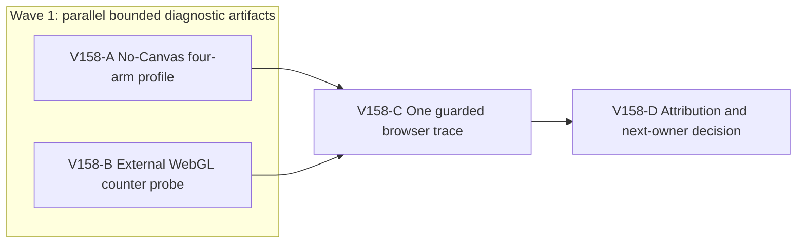

# Ticket Pack: V158 bounded memory attribution

## Summary

This pack implements the measurement contract in [V158 understanding](V158_MEMORY_DISCRIMINATOR_UNDERSTANDING.md). It does not change game behavior. Two disjoint diagnostic artifacts are prepared in parallel, then one isolated browser run follows the no-Canvas worker's exit. A production repair requires the resulting attribution decision, not intuition.

Locked design:

- Never raise the Node or renderer guards. Never run two game renderers or a heavy Node worker beside a game renderer.
- Preserve the 5194 player preview, authentic barefoot save, checked save semantics, visuals, and all dirty work.
- No GitHub action, branch creation, or production source edit. Use Bioscopics identity and `ben/` if a later authorized Git action occurs.

Important repo truth:

- V142's 192-frame no-Canvas trace rose from 183.3 to 330.6 MiB post-GC RSS with 12 saves, but fake IndexedDB may retain overwritten transactions.
- V157 stopped at the renderer's 870,400 KiB early guard before the connected-river Ready bank. GPU and JS samples were not phase-matched.
- The V36 root stores only head and previous, while view terrain is bounded to 31 by 31 cells. Neither is proof of the remaining memory owner.

## Public Interfaces

None. `WR_V158_PROFILE=1` gates one new test in the existing test-support file. The external browser instrumentation is disposable under `/private/tmp`, never imported into the game bundle. The only real player entrypoint remains `http://127.0.0.1:5194/?publicWorld=v36`; diagnostic browser uses 5195.

## Lane Graph

## Topology Audit

- Productive A owns one existing Vitest test-support file and establishes the save versus view allocation signature. Productive B owns one disposable external browser probe artifact and establishes resident WebGL create/delete counters. Their ownership and preparation are incomparable.
- Maximum safe preparation width is two. A alone may run one capped Node worker while B performs source/script preparation and syntax checks. C starts only after A's exact worker PID is gone and B's artifact is accepted, because running a renderer beside the Node worker would invalidate the RAM contract.
- Fan-in C consumes the matched Node measurements, process-cleanup receipt and WebGL probe. D consumes C's trace to classify a repair owner. No generic duplicate review is added. No PR finisher exists because no PR or package action is requested.
- Certainty: A closes whether checked saves or view calls dominate no-Canvas allocation, subject to fake-IDB caveat. B closes whether the browser resource probe is safe and externally installable. C closes whether resident WebGL counts trend across a repeat route. A surprising guard hit, rejected frame, failed save, instrumentation failure or mismatched visible window stops the affected lane and returns to planning.
- Every serial edge consumes the exact upstream measurement or safe-exit receipt. A to C is both an evidence and resource-safety dependency; B to C supplies the probe script; C to D supplies browser counts and screenshot/log evidence.
- Conditional production repair is intentionally not preauthorized. D must not dispatch one without a new smallest-diff plan and measured owner.
- Dispatch verdict: **PASS**. Two productive, narrow, incomparable artifact lanes precede a safety-serialized browser gate.

## Tickets

Common coding conventions: user-provided `/Volumes/git/weave-agents/AGENTS.md`; no em dashes in generated prose. Worktree `/private/tmp/pa-wizard-playable-v2`, branch `ben/wizard-playable-v2`, current dirty files belong to the user. Native ephemeral children only, inherited model, no Cursor, no durable task, no nested workers. Existing-task routing: not authorized for user-owned tasks; existing-task mission/capability, status, delivery policy and task/thread receipt: not applicable. Final fallback transport: none; fallback CLI/model/activation/commands/session: not applicable. Never touch GitHub.

### Paste now to: Implementer A

Ticket: V158-A. Lane type: Parallel. Delivery phase: `pr_hardening` diagnostic, milestone `final_complete`. Shortest complete flow: fresh V36 runtime accepts 96 deterministic movement frames per arm under no Canvas and produces checked-save/view comparison. First feedback: `V158_MEMORY` JSON lines and allocation summary. Test-writing policy: one gated diagnostic test allowed. Review blocking: rejected movement, failed save, missing exact-PID guard, unbounded memory. Surface readiness: existing player preview is HTTP 200; no owned browser. Surface revision: current worktree source hash. Surface entrypoint: 5194 stays available. Post-surface validation: C, only after worker exit. Optional-feedback wait: never. Depends on none.

Lane role: Implementer ONLY. Dispatch transport: `native_spawned_subagent`; model: `inherited`; Cursor runtime: `not_applicable`. Existing-task routing: `not_authorized`; capability/mission evidence, user task-coordination scope, status, delivery policy and no-interruption disposition: `not_applicable`. Collision evidence: sole ownership of `games/wizard-realms/engine/src/testSupport/v138MovementAllocation.test.ts`; B touches only external probe, C not running. Task/thread receipt: `not_applicable`. Runtime selection rationale: one local child can extend a deterministic test with exact memory safety and report source-bound measurements. Agent spec: careful V36 allocation profiler. Session policy: initialize once, use the same native child for follow-ups; no nested worker. Required skills: `auto-planner-ticket-pack`, `smallest-viable-diff`. Worker agent: Codex Implementer. Launch: native spawn with this role lock and ticket; follow-up: same child.

Required behavior: Reuse existing V138 `phase`, V36 store/controller and allocation sampler. Add `WR_V158_PROFILE=1` gated four matched *isolated* arms: `save+view`, `save+no-view`, `no-save+view`, `no-save+no-view`. Each arm starts a fresh V36 store/runtime and runs six 16-frame alternating forward/reverse blocks with `{x:0,z:±0.08}`. Save arms call checked `save()` after each block; no-save arms must never exceed 96 pending frames. Log per-block peak and post-GC RSS/heap/external/array buffers, accepted frames, checked revisions, and visible tile total. Outside measured phases, log current/previous witness frame counts and serialized root byte length without retaining copies. Sample top allocation stacks for one save block and one no-save counterpart only. Keep arm order fixed and record it; never claim causal proof from a single run. If RSS reaches 450 MiB, stop safely and report partial evidence.

Required files to update: only `games/wizard-realms/engine/src/testSupport/v138MovementAllocation.test.ts`. Files to add: none. Required tests: gated diagnostic only. Smallest Viable Diff: expected one file, <=130 net lines, no new helper abstraction if `phase` suffices, no dependencies. Reuse scan: `phase`, `allocationSites`, existing V142 forward/reverse loop. Non-code alternative is insufficient because the matched arms need the real TS V36 runtime. Simplify duplicated per-arm logic; no production deletion applies. Tripwire: second repo file, >130 net lines, any production or config change, or cap increase returns to planner. Forbidden: all production source, package files, preview profiles, browser, GitHub. Visual proof: not applicable, no rendered state.

Acceptance: from `games/wizard-realms/engine`, run exactly one targeted Vitest fork with `WR_V158_PROFILE=1 NODE_OPTIONS='--max-old-space-size=512 --expose-gc' npx vitest run src/testSupport/v138MovementAllocation.test.ts --pool=forks --maxWorkers=1 --disableConsoleIntercept`, under an independently self-tested exact-worker-PID 450 MiB RSS stop. Then `npx tsc --noEmit --pretty false` under the established 1536 MiB compiler guard, and `git diff --check` read-only. If the 450 MiB stop fires, do not retry at a larger cap. Return exact command/output, per-arm metrics/limitations, source hash, process cleanup, changed lines, reuse/deletion/tripwire fields, candidate merge unit, native child ID and transport receipt.

### Paste now to: Implementer B

Ticket: V158-B. Lane type: Parallel. Delivery phase: `pr_hardening` diagnostic, milestone `final_complete` for preparation only. Shortest complete flow: a disposable Playwright init script can count live WebGL resources before and after a journey without editing game code. First feedback: syntax-checked probe path plus documented `snapshot()` fields. Test-writing policy: diagnostic artifact only. Review blocking: instrumentation that changes rendering semantics, per-frame traversals, or auto-started browser. Surface readiness: 5194 remains unchanged. Surface revision: current source hash. Surface entrypoint: 5195 reserved for C. Post-surface validation: C runs the script after A exits. Optional-feedback wait: never. Depends on none.

Lane role: Implementer ONLY. Dispatch transport: `native_spawned_subagent`; model: `inherited`; Cursor runtime: `not_applicable`. Existing-task routing: `not_authorized`; capability/mission, user coordination, status, delivery policy and no-interruption fields: `not_applicable`. Collision evidence: sole ownership of `/private/tmp/v158-webgl-init-probe.js`; no game source or browser. Task/thread receipt: `not_applicable`. Runtime selection rationale: bounded local JS artifact, independent of A's test-support file, can be checked without a renderer. Agent spec: WebGL instrumentation skeptic. Session policy: initialize once then continue same child, no nested worker. Required skills: `auto-planner-ticket-pack`, `smallest-viable-diff`, `playwright`. Worker agent: Codex Implementer. Launch: native spawn with role lock and ticket; follow-up: same child.

Required behavior: Create only `/private/tmp/v158-webgl-init-probe.js` as a Playwright `page.addInitScript`-compatible function body. Before page navigation, wrap WebGL1 and WebGL2 prototype `create`/`delete` methods for buffer, texture, framebuffer, renderbuffer, program, shader and vertex array when those methods exist. Call original functions with original `this` and arguments, and return their exact result. Track object identities in `Set`s, expose `window.__v158WebglProbe.snapshot()` returning only scalar live/created/deleted counts per type, canvas count, and timestamp. No per-frame traversal, calls to `gl.finish`, collection of pixels, forced GC, requests, storage mutation, or game state modification. If prototypes cannot be patched safely or the Playwright CLI cannot inject this file without another dependency, report `NO-GO` rather than editing game code.

Required file to add: only `/private/tmp/v158-webgl-init-probe.js`. Required repo files to update: none. Smallest Viable Diff: zero repo files, one disposable <=100-line script, zero dependencies. Reuse scan: existing Playwright CLI `run-code` and `page.addInitScript`; no production telemetry hook. Prompt/config alternative cannot expose WebGL resource lifetime. Deletion/simplification: external artifact is disposable after evidence, no production code added. Tripwire: any repo edit, new dependency, second browser, or >100 lines. Visual proof: not applicable to preparation; C owns browser proof. Acceptance: `node --check /private/tmp/v158-webgl-init-probe.js` only, no browser and no heavy Node test. Return artifact path/content summary, exact injection command shape, syntax result, changed-file/line accounting, reuse/tripwire fields, native child ID and transport receipt.

### Wait for A and B, then paste to: Reviewer C

Ticket: V158-C. Lane type: Dependent. Delivery phase: `user_flow_probe`, milestone `final_complete`. Shortest complete flow: in one isolated browser on 5195, start fresh V36, move through a short visible out-and-back route, idle, and use the visible Save action while stationary; compare WebGL live counts at initial, away, return, idle and save. First feedback: phase table with one screenshot and console/network evidence. Test-writing policy: prohibited. Review blocking: guard fire, instrumented page failure, extra renderer, profile mutation, invalid resource counts. Surface readiness: A confirms Node worker absent, B script syntax passes, exact-PID guard self-test, 5194/5195 HTTP 200. Surface revision: A/B source hashes. Surface entrypoint: `http://127.0.0.1:5195/?publicWorld=v36`; preserve 5194. Post-surface validation: D decision. Optional-feedback wait: never. Depends on A and B.

Lane role: Reviewer ONLY, read-only game source. Dispatch transport: `native_spawned_subagent`; model: `inherited`; Cursor runtime: `not_applicable`. Existing-task routing: `not_authorized`; all existing-task evidence fields and task/thread receipt: `not_applicable`. Collision: sole one owned renderer, A worker exited. No-interruption disposition: `not_applicable`. Final fallback: none, all fallback fields `not_applicable`. Runtime rationale: independent UI evidence with existing Playwright CLI. Agent spec: guarded browser resource diagnostician. Session policy: one native child, no nested worker. Required skills: `auto-planner-ticket-pack`, `test-from-ui`, `playwright`, `smallest-viable-diff`. Worker agent: Codex Reviewer.

Use the CLI's real Playwright `page.addInitScript` before navigation, not game source, to inject B's probe. One 1280 by 720 disposable browser/profile; exact Chrome renderer PID 50 ms guard self-tested before navigation, early stop 870400 KiB, hard ceiling 1024000 KiB. Use only visible game controls, a short out-and-back route and visible Save. At each phase call the scalar `snapshot()` once; also sample exact renderer/GPU RSS, JS heap, visible terrain/window clue where available, console/network. Do not force GC, traverse every frame, continue after guard, or disturb player preview. If a comparable return window cannot be established, say so and do not call the counts a retention comparison. Close owned browser/guard and verify 5194/5195 HTTP 200. Return findings-first GO/NO-GO on scene retention, screenshot, phase table, exact inputs, safety/cleanup and native transport receipt.

### V158-D primary attribution decision

Compare A's per-arm allocation and root-size trend with C's stationary-save and out-and-back WebGL count trajectory. Decide one of: save/replay churn, fake-IDB-only retention, view/reveal churn, scene/WebGL retention, mixed, or unresolved. A counted change must be repeatable under the same window; flat WebGL counts do not disprove renderer-native allocator pressure. Do not edit production code from this pack. If an owner is established, author a separate narrow repair with identical-entrypoint guarded browser retry. If unresolved, specify one smaller discriminating metric. The full-game goal remains active.

## Assumptions

- Alternating 16-frame movement remains on legal starting ground in all four arms; rejection ends the diagnostic rather than changing movement.
- A probe script can be injected before game navigation with the installed Playwright CLI; B must prove this is feasible or stop before C.
- Browser instrumentation is diagnostic and may perturb timing; it cannot by itself establish organic memory safety.

## V158 receipts and attribution

- V158-A passed one guarded no-Canvas Vitest fork and guarded TypeScript. Each of four fresh-store/runtime arms accepted 96 frames. The two save arms reached six checked revisions; the no-save arms stayed at 96 pending frames and revision zero. In fixed order, save+view post-GC RSS rose from 186.6 to 312.0 MiB over six blocks; the remaining arms started near 323 MiB and stayed near that process high-water mark. The first sampled save+view block allocated 386.2 MiB, versus 163.1 MiB for the sampled no-save+view block. The fake IndexedDB backend and one shared Node process limit retained-memory attribution. Source: `engine/src/testSupport/v138MovementAllocation.test.ts`; no production file changed. The exact-worker 450 MiB RSS guard and 1536 MiB compiler guard did not fire; processes exited.
- V158-B prepared a 92-line disposable `/private/tmp/v158-webgl-init-probe.js`, with a passing syntax check and no repo edit. Its strong Sets mean live counts are observed creates minus observed deletes, not GPU bytes or an organic memory run.
- V158-C ran one isolated 5195 browser with a self-tested exact-PID 50 ms guard. Initial, away, matching return, idle and stationary manual Save phases showed buffer counts 236, 247, 247, 247, 247; VAOs 146, 144, 144, 144, 144; textures 7 and programs 18 throughout. Renderer RSS was 333872 KiB initially, 552496 away, 588528 on return, 589024 idle and 442672 after the checked Save UI confirmation. The guard peak was 602784 KiB, below the 870400 KiB early stop. The browser, guard and capped workers exited. Both preview ports returned HTTP 200. The visual receipt is `/private/tmp/v158-c-manual-save.png`, with earlier phase images beside it.

Attribution: **mixed or unresolved**. The save path has high transient allocation, but the fixed-order Node process cannot separate its RSS high-water from fake IndexedDB retention; the browser's short matching-window trace gives no evidence of monotonic live WebGL resource growth. Flat counted resources do not rule out renderer-native allocation or a longer-session scene issue. No production repair is authorized from this pack. The next smallest probe is the same six-block no-Canvas save/no-save comparison in separate capped worker processes, with matched fresh starts and an alternate arm order. Compare the per-process slopes and a store-only fake-IDB overwrite control before touching save/replay code. Keep the existing renderer guard for any later organic browser retry. The full-game goal remains active.
