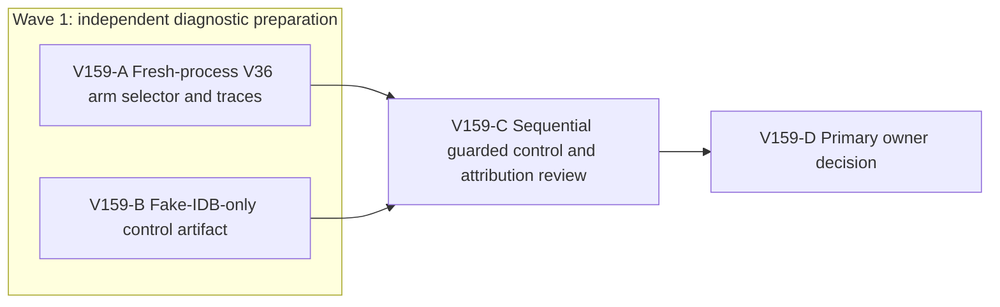

# Ticket Pack: V159 process-isolated memory comparison

## Summary

This pack follows [V159 understanding](V159_MEMORY_PROCESS_ISOLATION_UNDERSTANDING.md). V158 found heavy transient checked-save allocation, but its four arms shared one Node process and fake IndexedDB may retain overwritten records. Prepare two disjoint diagnostic surfaces, then run their probes sequentially under the existing RAM guard. No game behavior or public preview changes.

Locked design:

- No production code, save contract, visual, dependency, browser, profile, GitHub, or guard-threshold change.
- Keep the 5194 player preview available. No renderer starts in this pack.
- Run only one heavy Node worker at a time. Preserve all user-owned dirty files.

Important repo truth:

- `engine/src/testSupport/v138MovementAllocation.test.ts` already contains `WR_V158_PROFILE=1` with four matched 96-frame arms, each using a fresh fake-IDB store/runtime. Its fixed-order one-process result showed a first-arm RSS high-water rise.
- V158 browser probe saw flat live WebGL resource counts on a short out-and-back and did not identify scene retention.
- V36 checked roots are about 1.2 MB after saves; the fake-IDB source may keep completed transaction rollback closures, but that has not been measured apart from game replay.

## Public Interfaces

No game interface changes. Add only a diagnostic `WR_V159_ARM` selector to the existing gated V158 test. One disposable external `.mjs` control script accepts `write` or `no-write`; it is never imported into the game or committed. No PR is requested.

## Lane Graph

## Topology Audit

- Productive A owns one existing test-support file and four separate-process V36 traces. Productive B owns one external fake-IDB control script and syntax proof. They are incomparable, can prepare in parallel, and touch no common file or behavior.
- Maximum safe preparation width is two. B must not run its heavy control until A's last worker and compiler are gone. C consumes A's cleanup and metrics plus B's syntax-checked artifact, then runs write/no-write controls sequentially and reviews the combined evidence. D consumes C's findings.
- Serial edges: A to C supplies fresh-process metrics and exact-PID process release; B to C supplies the control executable; C to D supplies the fake-IDB comparison and support limits. No generic validation lane is counted as productive.
- Certainty: A distinguishes first-arm high-water from per-arm save/view slopes. B makes a backend-only counterfactual executable. C asks whether fake-IDB overwrites alone retain memory at the measured root size. Surprises include an arm above cap, rejected frame, failed save, control importing game code, or a rising no-write control; stop instead of broadening.
- No conditional repair is authorized by this diagnostic pack. No PR finisher because no PR, branch packaging, or GitHub operation was requested. The primary planner performs final coverage reconciliation.
- Dispatch verdict: **PASS**, two narrow productive lanes with disjoint ownership, one safety-serialized convergence gate.

## Smallest Viable Diff

Behavior delta: select exactly one existing V158 arm per process and prepare a backend-only control. Game behavior is unchanged.

Expected diff budget: one existing test-support file with <=15 net lines, one disposable external script with <=100 lines, zero production files, zero dependencies.

Expected changed files: `/private/tmp/pa-wizard-playable-v2/games/wizard-realms/engine/src/testSupport/v138MovementAllocation.test.ts` for `WR_V159_ARM` selection; `/private/tmp/v159-fake-idb-control.mjs` for isolated backend control.

Forbidden surfaces: every production source file, package/lock files, browser profiles, 5194/5195 processes, GitHub.

Reuse scan: V158 `armOrder` and body; Node `createRequire` anchored at the engine package; existing fake-indexeddb package. A new profiler/test suite or telemetry hook is forbidden.

Prompt/config alternative: a new environment selector is the smallest way to run the existing arm unchanged per fresh process. An external script is required to test fake-IDB without importing V36 game code.

Deletion/simplification: reuse the V158 loop and avoid copied arm code; control script is disposable. No production deletion applies.

Validation: four isolated targeted Vitest invocations and two external control invocations, each under a self-tested exact-worker-PID 450 MiB RSS stop; targeted TypeScript and `node --check` after preparation.

Tripwire: >15 net test lines, >100 script lines, any new dependency, production change, or memory-cap change stops for replanning.

## Tickets

Common runtime: `/private/tmp/pa-wizard-playable-v2` on `ben/wizard-playable-v2`, with user-owned dirty changes. Coding conventions: user-provided `/Volumes/git/weave-agents/AGENTS.md`, including no em dashes in prose and Bioscopics identity for any later authorized GitHub action. This pack performs no GitHub action. All worker lanes use `native_spawned_subagent`, inherited model, no Cursor, no durable Codex task, no nested worker, no provider CLI fallback. Existing-task routing is `not_authorized`; candidate mission/status/delivery and task/thread receipt are `not_applicable`. Same native child is used for follow-ups. The active full-game goal is aligned; system translation is `not_qualified`; product-agent runtime is `not_required`.

### Paste now to: Implementer A

Ticket: V159-A. Lane type: Parallel. Delivery phase: `pr_hardening` diagnostic. Delivery milestone: `final_complete`. Shortest complete flow: each of four fresh Node workers runs one existing V158 arm for 96 legal frames and outputs its six-block memory trajectory. First-feedback evidence: one arm's `V158_BLOCK`/`V158_SUMMARY` logs with exact worker exit; final evidence includes four. Test-writing policy: existing gated test may be edited; no new test file. Review blocking classes: rejected frame, failed save, guard fire, ambiguous arm selection. Validation environment: existing local engine Vitest. Environment repair authority: none; stop after one confirmed toolchain blocker. Surface readiness gate: 5194 HTTP 200 and no browser. Surface revision: current test hash. Surface entrypoint: 5194 remains available. Validation isolation: no renderer and one Node worker at a time. Post-surface validation: C backend control and D attribution. Optional-feedback wait: never. Depends on none.

Lane role: Implementer ONLY. Dispatch transport: `native_spawned_subagent`; model `inherited`; Cursor runtime `not_applicable`. Existing-task routing `not_authorized`; capability/mission, user coordination, current-status, delivery policy, no-interruption disposition, task/thread receipt `not_applicable`. Workspace collision: sole owner of `engine/src/testSupport/v138MovementAllocation.test.ts`; B owns external script only. Final fallback transport `none`; all fallback fields `not_applicable`. Runtime rationale: one local child can make a tiny deterministic test selector and safely run four independent guarded workers; no specialized provider is needed. Agent spec: V36 memory measurement implementer. Session policy: first contact native spawn with role lock plus ticket, follow-up same child; no nested workers. Worker agent: Codex Implementer. Required skills: `auto-planner-ticket-pack`, `smallest-viable-diff`.

Required behavior: Add `WR_V159_ARM` selection to the existing `WR_V158_PROFILE=1` test. Accept exactly one of `save+view`, `save+no-view`, `no-save+view`, `no-save+no-view`; reject an invalid value. With no selector, preserve V158's four-arm behavior exactly. Do not duplicate the arm loop or change any frame, store, view, save, sampling, assertion or output logic. Run four fresh Vitest processes in this order: `no-save+no-view`, `no-save+view`, `save+no-view`, `save+view`. Each process runs exactly one arm, one Vitest fork/worker, old-space512, `--expose-gc`, console interception disabled, with a self-tested independent exact-worker-PID 450 MiB RSS stop. Do not overlap processes. Report block 1 and 6 post-GC RSS/heap, maximum RSS, sampled allocation if present, revision, witness counts, root bytes and worker cleanup. A process stop is a partial result, not a reason to raise the cap.

Required files to update: only `/private/tmp/pa-wizard-playable-v2/games/wizard-realms/engine/src/testSupport/v138MovementAllocation.test.ts`. Files to add: none. Smallest viable diff: target <=15 net lines, no new abstraction, reuse `armOrder` and V158 loop; no config change. Forbidden: production code, external B script, browser/profile, GitHub. Visual proof: not applicable, no rendered surface. Certainty contract: unknown is whether per-arm RSS slope depends on save/view when each process is fresh; discriminating probe is the four capped separate workers; stop after all or first guard; surprise is high no-save slope or mismatch with V158.

Acceptance commands, each under the independent 450 MiB exact-worker guard from `games/wizard-realms/engine`: `WR_V158_PROFILE=1 WR_V159_ARM='<arm>' NODE_OPTIONS='--max-old-space-size=512 --expose-gc' npx vitest run src/testSupport/v138MovementAllocation.test.ts --pool=forks --maxWorkers=1 --disableConsoleIntercept`, replacing `<arm>` with the four exact values above, in four separate invocations. Then `NODE_OPTIONS='--max-old-space-size=1024' npx tsc --noEmit --pretty false` under the established 1536 MiB compiler guard, and `git diff --check`. Return the full smallest-diff receipt, per-process logs/guard proof, source hash, exact process cleanup, native child/session/transport, and limitations. Do not run B's control or C's review.

### Paste now to: Implementer B

Ticket: V159-B. Lane type: Parallel. Delivery phase: `pr_hardening` diagnostic. Delivery milestone: `final_complete` for script preparation only. Shortest complete flow: one external Node script exposes `write` and `no-write` fake-IDB control modes with six GC-settled samples. First-feedback evidence: syntax pass and exact command shape; C executes it only after A exits. Test-writing policy: disposable script only. Review blocking classes: game-code import, missing mode, unbounded payload, Node worker overlap. Validation environment: local Node and installed fake-indexeddb. Environment repair authority: none; stop on package-resolution blocker after one check. Surface readiness: 5194 HTTP 200; no renderer. Surface revision: script hash. Surface entrypoint: player preview unchanged. Validation isolation: syntax only in B. Post-surface validation: C runs both modes. Optional-feedback wait: never. Depends on none.

Lane role: Implementer ONLY. Dispatch transport: `native_spawned_subagent`; model `inherited`; Cursor runtime `not_applicable`. Existing-task routing `not_authorized`; candidate/mission, user coordination, status, delivery policy, no-interruption and task/thread fields `not_applicable`. Collision: sole owner of `/private/tmp/v159-fake-idb-control.mjs`; A owns test support. Final fallback `none`, fallback fields `not_applicable`. Runtime rationale: a self-contained control script can be prepared without a heavy process or game renderer while A profiles. Agent spec: fake-IDB backend-only probe implementer. Session policy: native spawn first contact with role lock, same child for follow-up, no nested workers. Worker agent: Codex Implementer. Required skills: `auto-planner-ticket-pack`, `smallest-viable-diff`.

Required behavior: Create only `/private/tmp/v159-fake-idb-control.mjs`. Use Node `createRequire('/private/tmp/pa-wizard-playable-v2/games/wizard-realms/engine/package.json')` to load the already installed `fake-indexeddb` `IDBFactory`; do not add a dependency. Accept exactly `write` or `no-write` as argv mode. Open one fresh fake database with one object store; generate a distinct checked-root-sized 1,200,000-character string payload in each of six blocks. In `write`, put `{ id:'root', payload }` to the same key in six completed readwrite transactions. In `no-write`, perform the same payload generation and `structuredClone` but no transaction after open. Drop per-block local references, invoke exposed `global.gc`, and log block number, mode, RSS, heap used, external and arrayBuffers in MiB as `V159_IDB` JSON. Log final factory ownership details only if accessible without private mutation. Invalid mode or missing GC exits nonzero. No game runtime imports, production edits, browser, request, or GitHub action.

Required file to add: only `/private/tmp/v159-fake-idb-control.mjs`, <=100 lines. Repo files to update: none. Smallest viable diff: one disposable external artifact, no new abstraction/dependency, reuse fake-IDB package. A prompt cannot make a repeatable backend-only memory control. Deletion/simplification: script can be discarded after evidence, no production code added. Visual proof: not applicable. Certainty contract: unknown is whether same-key fake-IDB writes alone create a GC-settled slope; B prepares the probe, C runs it; stop at syntax pass or package-resolution NO-GO; surprise is an API mismatch requiring extra dependencies.

Acceptance: `node --check /private/tmp/v159-fake-idb-control.mjs` and one read-only `node -p "require.resolve('fake-indexeddb')"` from engine cwd. Do not execute the six-block modes yet. Return script hash, syntax and resolution result, exact commands for C, changed-file/line/reuse/tripwire receipt and native child ID. No repository file touched.

### Wait for A and B, then paste to: Reviewer C

Ticket: V159-C. Lane type: Dependent. Delivery phase: `pr_hardening` evidence. Delivery milestone: `final_complete`. Shortest complete flow: after all A processes exit, run B's fake-IDB script in two fresh capped Node processes and compare write/no-write GC-settled slopes to A's four arm slopes. First-feedback evidence: six `V159_IDB` lines per mode plus guard cleanup. Test-writing policy: prohibited, read-only. Review blocking classes: guard fire, invalid script, source-mismatch, overclaimed causality. Validation environment: local Node, no browser. Environment repair authority: none. Surface readiness: A full cleanup receipt and B syntax/hash receipt. Surface revision: A test hash and B script hash. Surface entrypoint: 5194 remains available. Isolation: one Node control process at a time, no renderer. Post-surface validation: D attribution. Optional-feedback wait: never. Depends on A and B.

Lane role: Reviewer ONLY. Dispatch transport: `native_spawned_subagent`; model `inherited`; Cursor runtime `not_applicable`. Existing-task routing `not_authorized`; related candidate/mission/scope/status/delivery/no-interruption/task receipt `not_applicable`. Workspace collision: A workers absent, B script immutable, no source writes. Final fallback `none`, fallback fields `not_applicable`. Runtime rationale: independent read-only interpretation of two bounded diagnostic boundaries. Agent spec: fake-IDB and save-allocation skeptic. Session policy: native spawn first contact with role lock, same child follow-up, no nested workers. Worker agent: Codex Reviewer. Required skills: `auto-planner-ticket-pack`, `smallest-viable-diff`.

Required behavior: Verify B script hash, then run `NODE_OPTIONS='--max-old-space-size=512 --expose-gc' node /private/tmp/v159-fake-idb-control.mjs no-write` followed by the same command with `write`, each in a separate fresh process under an independently self-tested exact-PID 450 MiB RSS stop. Never overlap. Compare post-GC slope and peak with A's four processes. Report findings-first GO/NO-GO for each inference: save-path transient allocation, fake-IDB retention, view-only churn, and whether a production owner is proven. List what the synthetic control cannot represent. Confirm all owned processes absent and 5194 HTTP 200. Do not edit or open a browser.

Return exact output/guard/PID/cleanup, severity-ordered findings, explicit pass/fail on scope and smallest-diff, residual risks, testing gaps, source hashes, native child and transport receipt. No PR finisher is authorized.

### V159-D primary decision

Reconcile A and C receipts against this pack and the full-game goal. Decide whether the no-Canvas evidence supports a specific production allocation owner or only a test-backend artifact. If owner is proven, write a separately scoped minimal repair pack with identical safety caps and a real UI retry. If not, preserve unresolved state and choose one further decision-bearing metric. Do not convert a diagnostic into a gameplay or save rewrite by assumption.

## Assumptions

- Node startup variance is handled by comparing block slopes within each fresh process, not raw RSS across processes alone.
- A 1.2 MB synthetic payload approximates root size, not V36 root structure or Chrome IndexedDB implementation.
- The previous WebGL counter result remains limited to one short instrumented browser journey; this pack does not repeat it.

## V159 receipts and primary decision

- V159-A added only the three-net-line `WR_V159_ARM` selector to the existing gated test. Four fresh, serial, 450 MiB guarded workers each accepted 96 frames. Post-GC RSS rose 144.1 to 186.7 MiB for no-save/no-view, 143.6 to 187.2 for no-save/view, 184.7 to 310.1 for save/no-view, and 192.9 to 314.5 for save/view. Save arms reached six checked revisions; all guards and the guarded TypeScript compiler exited cleanly. The save+view first-block allocation sample was 439.9 MiB versus 184.6 MiB for no-save+view. The player preview stayed HTTP 200.
- V159-B prepared only a 62-line disposable external script, `/private/tmp/v159-fake-idb-control.mjs`, with passing syntax and installed-package resolution checks. It did not execute a heavy process or edit the repo.
- V159-C independently ran two fresh, serial, 450 MiB guarded backend controls. Six clone-only blocks changed post-GC RSS 47.234 to 48.859 MiB and heap 5.015 to 5.333 MiB. Six same-key fake-IDB overwrites changed RSS 48.578 to 61.938 MiB and heap 6.186 to 18.021 MiB. The installed fake-IDB backend retains completed transaction entries and overwrite rollback closures, a concrete test-only retention path. Both processes and guards exited; 5194 stayed HTTP 200.

Decision: **GO** on material save-path transient allocation and fake-IDB retention in the Node backend; **NO-GO** on naming a production browser memory owner. The synthetic control differs from V36 root structure, browser IndexedDB and Canvas, so its slope cannot be subtracted mechanically from V36's. V158's short matching-window browser trace did not show live WebGL resource growth, while V157's longer real journey still hit the renderer guard. No production save, replay or renderer edit is justified solely by V159. Next, keep the same renderer cap and use one shorter, cue-led UI journey to advance the first-region quest. If that journey again approaches the guard, pair phase-local browser JS heap and scene-resource counts with the exact route and save cadence before choosing a memory owner. The full-game goal remains active.
