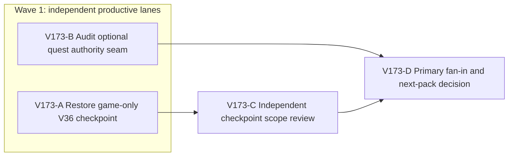

# Ticket Pack: V173 Wizard Realms checkpoint and next quest seam

## Summary

This pack preserves the playable V36 game snapshot in a complete local Git checkout, then identifies the narrow authoritative seam for the next optional quest. It does not implement V37 or publish a build. [Aligned understanding](V173_QUEST_CHECKPOINT_UNDERSTANDING.md).

Locked design:

- Keep the full-game goal intact; a V36 checkpoint is not a completed RPG.
- Never treat `/private/tmp/pa-wizard-playable-v2` as a complete Git checkout or stage its apparent repository-wide deletions.
- No GitHub write. If a local commit is made, both author and committer are `Ben Fowlersmith <79104665+Bioscopics@users.noreply.github.com>` on a `ben/` branch.
- Keep 5194/5195 and all saved browser profiles untouched. No renderer or preview restart in this pack.

Important repo truth:

- `/Volumes/git/games/pocket-aquarium` is the complete clean repository. Local `ben/wizard-playable-v2` tip is `6bb8d39`; the partial V36 snapshot contains 571 engine source files, 239 game docs and 73 authored-art files, while that branch tracks 164 source files and 18 docs. Only five old game docs are absent from the snapshot.
- The snapshot includes `node_modules`, `dist`, `output`, `.playwright-cli`, and build metadata. None belongs in the checkpoint import.
- V35/V36 quest claims use checked witnesses, one-time reward flags, replayable versioned roots and explicit migration. [V36 marker action](../engine/src/domain/publicWorldV36MarkerAction.ts) is a precedent, not a reusable generic quest system.

## Public Interfaces

No player-facing or save interface changes in V173. Output is a local Git branch `ben/wizard-campaign-checkpoint-v36` in `/private/tmp/pa-wizard-campaign-checkpoint-v36`, plus a findings-first V37 seam receipt. The visible V36 diagnostic entry stays at the existing preview and remains unreleased.

## Lane Graph

Runnable wave 1: A changes only a new local worktree and branch; B reads the original snapshot and returns a quest-interface finding without editing any file. Neither consumes the other's output. C starts only after A's commit and integrity receipt. D consumes B and C.

## Topology Audit

- Productive lanes: A creates a recoverable game-only branch and manifest; B closes the uncertain V37 quest witness/migration boundary with a distinct read-only architecture receipt.
- Maximum parallel width: 2. A and B are incomparable because B reads immutable V36 source in the original snapshot while A copies those families to a new checkout; B does not consume the new branch.
- Fan-in: C checks A's high-risk deletion and author-scope boundary; D combines C with B's quest seam to decide the next implementation pack.
- Broad-lane split: A owns only mechanical game-source recovery and local validation; B owns only quest architecture, no code; C owns only checkpoint integrity, not quest design.
- Certainty: A proves recoverability and buildability empirically; B closes the next quest's versioned-authority question by source reasoning; C independently checks unexpected staged paths, deletions, ignored/generated files and identity.
- Surprise: any missing game runtime file, changed package lock, non-game path, tracked deletion, source hash mismatch, unsafe file size, build error from imported source, or incompatible quest seam stops the affected lane for planner re-evaluation.
- Conditional repairs: none pre-authorized. C's NO-GO returns to planning; there is no hidden repair lane.
- Serial edges: A→C consumes the committed branch and manifest; B→D consumes the quest seam receipt; C→D consumes integrity verdict. D cannot decide V37 implementation until both inputs exist.
- Dispatch verdict: **PASS**. No artificial reviewer-before-surface edge: this pack adds no new user-facing surface, and the existing 5194/5195 previews remain available.

## Tickets

### Paste now to: Implementer, V173-A

Your role is `implementer` ONLY under `auto-planner-ticket-pack` and `smallest-viable-diff`. Read both complete skill files, acknowledge role boundaries, and follow this ticket exactly. Do not spawn workers.

- Lane type: Parallel. Delivery phase: implementation. Milestone: pre_surface, then final_complete for this checkpoint. Shortest user flow: unchanged existing 5194/5195 previews; this lane changes no running player entrypoint. Test-writing policy: none in this recovery pack. Visual proof: not applicable to mechanical source recovery.
- Dispatch transport: `native_spawned_subagent`; model `inherited`; Cursor runtime not applicable. Existing-task routing: no qualified recent-context candidate for source recovery; user permits parallel delegation but no unrelated task contact. Custody: new local worktree only. No-interruption disposition: not applicable. Task/thread receipt: not applicable. Final fallback: none.
- Base: `/Volumes/git/games/pocket-aquarium` local `ben/wizard-playable-v2` at `6bb8d39`. New branch `ben/wizard-campaign-checkpoint-v36`; new worktree `/private/tmp/pa-wizard-campaign-checkpoint-v36`. Before creation, verify branch/path do not already exist, base tip and complete repo status. Never use destructive reset, checkout, `rsync --delete`, broad staging or root copy.
- Copy only `/private/tmp/pa-wizard-playable-v2/games/wizard-realms/engine/src/`, `engine/art/`, and `games/wizard-realms/docs/` to matching new-worktree paths with non-deleting bulk mechanical copy. Retain all base branch files missing from the snapshot. Do not copy `node_modules`, `dist`, `output`, `.playwright-cli`, root folders, engine package/config, binaries outside authored art, or build metadata.
- Produce a file/path and SHA-256 comparison receipt for every imported file, counts by family, total size and largest file. Stop if any symlink or file above 20 MiB appears in these families. Before staging prove `git status --short` has no `D` and every changed path begins `games/wizard-realms/engine/src/`, `engine/art/`, or `games/wizard-realms/docs/`. Prove package.json/package-lock unchanged.
- Stage only these three allowed families. Run `git diff --cached --check`, inspect staged name-status and size, and commit once locally using per-command author/committer environment for Bioscopics. Do not push, PR or merge. Verify `git show -s --format='%an <%ae> | %cn <%ce>' HEAD` and clean status.
- If dependency installation is needed, run only the engine's ordinary `npm ci`, with no renderer and RAM awareness. Run `npx tsc -b --pretty false` and `npx vite build` in the new worktree. A build that retains the closed V36 entry gate is expected. If package installation or build fails due to an environment issue, capture the first error and one bounded documented retry at most, then return an honest incomplete validation receipt. Never repair host services or shared caches.
- Smallest viable diff: behavior delta is source-control recovery, no gameplay change. Expected budget is about 68 modified tracked game files plus about 700 game-only additions, zero deletions, zero dependency changes. This exceeds the five-file tripwire by necessity because the prior playable V36 work spans versioned roots, views, tests, authored art and docs; do not broaden beyond those three families. Reuse the existing branch and snapshot, no new abstraction; do not create copied fallback code. Deletion target is none, since this is non-deleting recovery.
- Return: dispatch ID, exact branch and commit, author/committer, status, changed-path counts, added/deleted line counts, hashes/manifest path, out-of-scope audit, files retained from base, exact test/build outputs, any blocker, and no-GitHub-write confirmation. Candidate merge unit is checkpoint only, not a proposed public PR yet.

### Paste now to: Reviewer, V173-B

Your role is `reviewer` ONLY under `auto-planner-ticket-pack` and `smallest-viable-diff`. Read both complete skill files, acknowledge read-only boundaries, and follow this ticket exactly. Do not spawn workers.

- Lane type: Parallel. Delivery phase: implementation evidence. Milestone: pre_surface. No source or profile mutation, no renderer. Dispatch transport `native_spawned_subagent`, model `inherited`, Cursor runtime not applicable; existing-task routing no qualified candidate; no-interruption disposition not applicable; task/thread receipt not applicable; fallback none.
- Read only `/private/tmp/pa-wizard-playable-v2/games/wizard-realms/docs/QUEST_CAMPAIGN_ROADMAP.md`, `V137_QUEST_REWARD_BLUEPRINT.md`, and the narrow V35/V36 checked action, flow, snapshot, persistence, projection and relevant world/spell files. Define the optional Highland Signal as a genuinely different loop: world-visible clue, learned Windward Step or other existing spell action, a discoverable vantage, an in-world return, 30 coins, 35 Spellcraft XP and 35 character XP, plus a saved map clue. No protective armor or random drop in this quest. Do not change implementation scope to make the spec easier.
- Answer the decision: does V36 have a safe existing progress field/witness path for this optional quest, or must V37 add a versioned root/migration? Name exact current authority and UI seams and the minimal next pack file families. Identify where reward duplication, bag capacity, forged/repeated/remote claims, save/reload, and visible payoff must be checked. Clearly separate shipped mechanics from proposed quest content.
- Certainty contract: unknown is the actual extension seam, live branches are existing spare field vs V37 root. Use source reasoning, stop once exact types, decoder, replay and UI projection prove one branch; surprise if source shows a generic extensible quest system not reflected in V137. Return findings-first GO/NO-GO for a decision-complete V37 pack, with file/line references, test gaps and no-code confirmation. Do not write a new quest feature.

### Wait for V173-A, then paste to: Reviewer, V173-C

Your role is `reviewer` ONLY under `auto-planner-ticket-pack` and `smallest-viable-diff`. Read both complete skill files, acknowledge read-only boundaries, and follow this ticket exactly. Do not spawn workers.

- Lane type: Dependent. Delivery phase: pr_hardening of the local checkpoint, with no PR. Milestone: final_complete for this pack. Dispatch transport `native_spawned_subagent`, model `inherited`, Cursor runtime not applicable; existing-task routing no qualified candidate; no-interruption disposition not applicable; task/thread receipt not applicable; fallback none. Read only the new branch and A's manifest/receipt.
- Inspect one concern: source integrity. Verify base ancestry, no missing/deleted tracked repository file, no modification outside the three allowed game families, unchanged package/lockfiles, correct Bioscopics author and committer, no ignored/generated import, accurate hash parity for imported files, no accidental `node_modules`/`dist`/`output`/`.playwright-cli` content. Verify A's typecheck/build evidence names the checkpoint revision, and state any unproven tests.
- Certainty contract: unknown is whether the large mechanical import preserved repository scope. Use Git inventory and hash comparison, stop at a sound GO/NO-GO. Surprise is any unexplained out-of-scope path, deletion, missing source byte, wrong identity or copied generated output. Return severity-ordered findings, explicit smallest-diff and tripwire assessment, required shrink requests, residual risks, exact revision reviewed. Do not repair or push.

### Wait for V173-B and V173-C: Primary fan-in V173-D

The primary agent checks both receipts and the actual local branch. If C is GO, record the checkpoint and use B's finding to author the separate V37 implementation pack. If C is NO-GO or B finds a design contradiction, return to Planner mode. Do not call this a shipped quest or complete game. No PR finisher is included because the user did not request a PR or remote packaging in this continuation, and the branch is a local checkpoint only.

## Assumptions

- The existing local `ben/wizard-playable-v2` tip remains available; this pack does not fetch or change it.
- The snapshot game families are the intended V36 source; the build and independent hash/scope audit test that assumption. The snapshot's omitted repository files belong to the complete base and must remain there.
- The existing previews can remain available while source recovery occurs in another worktree.
