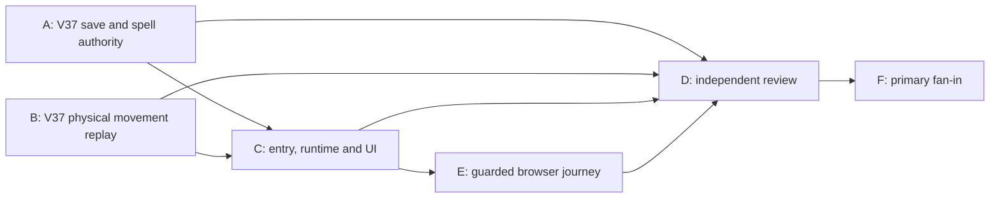

# V175 ticket pack: working Windward Step in a separate V37 preview

## Contract

Build the smallest honest prerequisite for the proposed Highland Signal quest: a player can discover the Quarry Crown glyph, study Windward Step, cast it on eligible dry Highland trail, experience a measured 1.25x westbound movement effect, practice it for checked XP, save/reload, and see its status through normal controls. This is a **V37 spell milestone**, not the V38 quest or a complete game. [V174 quest plan](V174_QUEST_CONTENT_PLAN.md), [V174 spell seam](../engine/src/domain/publicWorldV36Snapshot.ts).

Keep V36 and every older save readable and unchanged. V37 uses `wizard-world/v37`, a separate `wizard-realms:world:v37` database and an explicit, development-only entry. Copy a fully checked V36 root only by deliberate choice at its expected revision; fresh V37 starts use the same canonical world seed. Malformed V37 data blocks entry and must not be overwritten. Rollback means reopening untouched V36, never writing V37 progress backward. Do not open the normal release gate, push, create a PR, merge, use a work GitHub identity, or restart 5194/5195. If any local commit is needed, use `ben/` and `Ben Fowlersmith <79104665+Bioscopics@users.noreply.github.com>` for both author and committer.

The physical rules must remain consistent: normal input carries a gait-valid <=0.16 m walk, V37 privately derives an eligible <=0.20 m wind-assisted step, and the same result passes river, rim, pit, bridge and raised-soil support checks in both preview and saved replay. No global loosening of V23 or earlier movement. The historic V12 route partly conflicts with V32 cartography; only use its actually traversable dry/revealed suffix unless a new, pinned V37 route and practice ledger are proven. Never show an active effect that does not move the player. Preserve practiced segment XP once per eligible segment.

## Lane Graph

## Topology Audit

- A and B are independent at dispatch: A owns new V37 root/action/store files, while B owns a frozen replay export and narrowly optional movement plumbing. Their shared type is `PublicV36MarkerProgress`, not a mutable file.
- C consumes both A and B, so it starts after their file/result receipts. D can inspect A/B early but cannot issue full GO until C and E return. E starts at C's first safe live V37 preview and runs in one isolated renderer; it does not wait for optional broad review.
- This is practical parallelism rather than duplicate implementation: A proves saved authority, B proves physical replay, C binds normal controls, E proves the real product surface, and D checks integration risk.
- The known surprise boundary is airborne preview: durable B replay must reject an unfinished airborne save, but C must preserve the inherited provisional jump-preview and landing flow. A normal jump rejection is a product blocker for C to repair and identically retry, not a reason to weaken durable replay.
- C's narrow new pure `PublicV37WorldView.ts` and an optional `checkedActions` Windward view flag are authorized presentation seams. Old-version behavior must remain unchanged and C must test the projection.
- Dispatch verdict: **PASS** for this bounded topology. A/B use distinct files; C follows their interface; D is read-only; E owns the single renderer. No GitHub packaging lane exists because no PR was requested.

## Replan R1: assisted downhill preview and save parity

Independent review found a decoder-valid V37 active-Windward state at `(462.18, -428)` where two ordinary westbound 0.16 m inputs preview grounded at x461.98 and x461.78 but the pending batch cannot save (`local-replay`, zero writes). The private 1.25x impulse crosses a shallow downhill edge before C's ordinary-flight precheck reaches it. Earlier separate jump and gentle-descent preview fixes passed their identical retries; this third mismatch is the same preview-versus-durable policy class. Stop C-only proxy repairs and share B's actual policy.

New serial dependency: B2 adds and tests a V37-only `previewPublicV37FrameBatch(before: PublicV36MarkerProgress, rawWitness: unknown): PublicV36MarkerProgress | null` in `publicWorldV37Movement.ts`. It reuses the same private move policy as `replayPublicV37FrameBatch`: return strict replay when it succeeds; otherwise return the same-policy `allowAirborne` V31 observation only while the resulting effective pose remains genuinely airborne. Never return a grounded state that the strict batch cannot replay. Do not relax old-version functions or the existing durable export. B2 tests the exact assisted-downhill input and proves preview airborne/deferred until a landed, strict-replayable batch, plus jump and dry-descent regression.

After B2 receipt, C2 replaces ordinary-flight/settled-prefix proxy logic in `PublicV37ControllerRuntime.ts` with one whole-pending-batch call to B2 preview from the last committed progress. `save()` remains strict and defers while airborne; normal action/copy/reload behavior remains unchanged. C2 adds the exact assisted-downhill controller regression and reruns fresh jump, terminal descent, V36 regression, typecheck and build. D2 independently repeats all three exact UI-free traces before issuing code GO/NO-GO. Browser E was environment-blocked after two isolated Chromium launches spawned two renderers near the 1 GiB guard, so no visual acceptance is inferred; do not initiate a third browser workaround in this pack without separate environment authority. Keep the 5196 preview live but label it development-only/incomplete during repair.

## Interface and custody

Wave 1 has two incomparable implementation lanes in one worktree, `/private/tmp/pa-wizard-campaign-checkpoint-v36`, currently clean at `84d0df7`:

- A owns **new** `engine/src/domain/publicWorldV37WindwardAction.ts`, `publicWorldV37Snapshot.ts`, `publicWorldV37Flow.ts`, `atomicV37Database.ts` and their focused tests. A may add a narrow V37 fresh-genesis fixture if needed. No edits to old-version modules, controller, entry or UI. A imports B's frozen `replayPublicV37FrameBatch` interface for frame witnesses. A exposes exact payload-free `windward-study/v1` and `windward-cast/v1` witness decoders, checked action confirmation, V37 root/lineage/head/progress/witness decoding/replay and checked successor, deliberate V36 migration, fresh genesis, CAS/lock flow and one-edge proof. Existing `state.windstep` stores learned/active/cooldown/practice facts; do not add a duplicate ledger. V37 roots replay inherited V36 witnesses exactly unless the witness is a frame batch and B's V37 function applies. Frozen B interface: `replayPublicV37FrameBatch(before: PublicV36MarkerProgress, rawWitness: unknown): PublicV36MarkerProgress | null` from `engine/src/domain/publicWorldV37Movement.ts`. A and B may coordinate type details by message, but only A may change V37 snapshot/action/flow/database files.
- B owns **new** `engine/src/domain/publicWorldV37Movement.ts` and tests, plus the minimum optional-policy plumbing in existing V23/V27/V28/V30/V31 movement/replay modules required to replay one V37-scoped assisted frame through all current physical gates. V30 is included because V31's mandatory replay passes through its checked bridge and active-pick reconciliation; bypassing that gate is not allowed. Default policy must preserve old-version behavior byte-for-byte. B does not edit A's new action/snapshot/flow/store files or controller/entry/UI. Implement the frozen export above. Accept only an ordinary unmodified `frame-batch/v1` witness and a learned, active, streamed, effectively grounded, dry and revealed westbound trail step. Privately derive 1.25x only when start, midpoint and end are safe and within the same legal path. Fall back to the ordinary move where ineligible; reject forged/oversized or physically invalid frames. Both local preview and durable writer will use this same replay. Tests cover dry trail 0.16→0.20 m, no boost off-trail/wet/airborne/cooldown, no bypass of V25/V26/V28/V30/V31 gates, practice XP only once, and old V36 replay unchanged.

Neither A nor B runs a renderer. They may use focused tests, typecheck and build with memory awareness. They do not commit. `node_modules` remains the existing engine install and is not staged. The A/B boundary is an explicit import contract, not permission to edit each other's files. A failing shared typecheck while the other lane is incomplete is not a validated failure; capture focused evidence and coordinate before fan-in.

Wave 2 starts only when A and B return actual file receipts:

- C, implementer, owns new `PublicV37Entry.tsx` and `PublicV37ControllerRuntime.ts`, and narrow updates to `PublicV23Controller.tsx`, `main.tsx`, `PublicV13WorldView.ts` only if necessary, `view/contracts.ts` and the existing HUD projection seam. C wires V37 study/cast intents to checked V37 witnesses, not Mireglass Glow. It projects learned/active/cooldown from the checked V37 state and effective V31 pose into the existing Windward HUD and glyph. The V37 entry is an explicit DEV-only URL choice, with independent V36 copy/new/continue and honest save-warning copy. Old V36/default routes remain unchanged. C adds focused controller/entry tests and runs typecheck/build. First safe working V37 preview is exposed promptly on one new local port, without changing 5194/5195. No second renderer.
- D, independent reviewer, examines the complete V37 diff, source version isolation, reward/XP monotonicity, replay and migration tests, and browser proof. D is read-only and findings-first. A blocker returns to the observed owner for a bounded repair, then identical retry. No PR/push.
- E, browser tester, after C's first safe preview is live, uses exactly one renderer under a 1 GiB guard for a normal-control study/cast/assisted-walk/reload attempt. It records visible UI, console/network, save revision and measured before/after pose. It does not claim the whole quest or a full fresh-player campaign if it uses a checked fixture. Keep the user-facing preview available; perform disruptive validation in an isolated profile. Close unused tabs and owned renderer when done.

## Model and transport routing

A: `planner_selected`, native ephemeral subagent, exact live-listed `gpt-6.1-sol`, requires repository code tools and versioned save reasoning; verify with focused tests, typecheck and independent replay review. B: `planner_selected`, native ephemeral subagent, exact live-listed `gpt-6-astra`, requires deep movement/geometry and code tools; verify numeric motion, physical boundary regressions and independent review. C: `planner_selected`, native ephemeral subagent, exact live-listed `gpt-6.1-sol`, requires React/TS integration and real app build. D/E use task-fit native models selected when their contracts are dispatched. No provider fallback is authorized to weaken capability or safety. The actual dispatch ID and receipt are required for completion claims.

## Acceptance and budget

Unit/integration proof: fresh V37 creation and deliberate checked V36 copy; stale revision/cross-tab CAS; malformed, extra-key, repeated, remote, airborne and undiscovered study/cast refusal; active/cooldown boundaries; genuine normal-control 0.16→0.20 m checked movement on safe westbound dry trail; ordinary movement elsewhere; all inherited physical gates; once-only practice XP; save/reload of position, spell clocks and learning; old V36 save untouched and old replay unchanged. UI proof: visible glyph and actionable button, cast status matching a measured movement effect, reload and rollback, desktop/mobile non-occlusion where the HUD is used. If normal UI cannot reach the authored trail, do not manufacture a hidden test shortcut and call it accepted; report the gap and continue the smallest causal repair.

Smallest viable diff expected: multiple new V37 versioned files, narrow optional movement-policy threading, one controller branch and one DEV-only entry, plus focused tests. The five-file tripwire is intentionally exceeded by separate checked storage, physical replay and visible controls. No world/store/armor/combat/drop/dependency change is authorized. Every new abstraction must be V37-specific or a strictly optional policy with zero old-version behavior delta. No unrelated cleanup or generated output. The V37 spell milestone can be locally committed after D GO, but no PR until separately requested.
