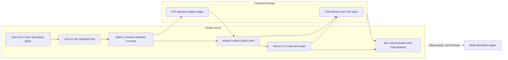
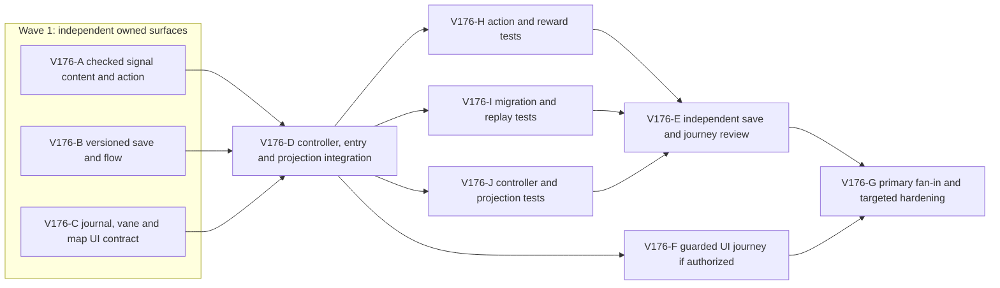

# Ticket Pack: Checked Highland Signal V38

## Summary

Build the first new optional quest in the continuous Wizard Realms world. Study Windward Step, make a real assisted crossing on the dry Highland trail, inspect a visible signal vane, return to Quarry Crown, then claim one saved reward of 30 coins, 35 Spellcraft XP, 35 character XP, and a map bearing. This is a DEV-only V38 campaign increment, not the full-game release.

Locked design:

- V38 has `wizard-world/v38` and `wizard-realms:world:v38`, with an explicit checked V37 copy or independent fresh start. Older saves and movement writers are untouched.
- Only the writer's accepted V37 assisted movement ledger and checked world pose can qualify the quest. No client coordinate, reward choice, timestamp, or completion flag is trusted.
- The signal vane is on a previously authored dry trail cell near `(512,-472)`, within the route index range 236 through 244. The canonical point must be physically proved before integration. The Crown is the return and claim point.
- The map bearing points to `Stormline Foothill` at `(540,-500)` as a clue within the existing streamed world. It does not reveal terrain or assert that a future region, shop, or route is built.
- Do not modify or open production default routes, loosen V37 physical rules, or add armor, combat, loot, mounts, PRs, or GitHub actions.

Important repo truth:

- V37 already records `state.windstep.learned`, active and cooldown ticks, and once-only `practicedRouteIndices` after realized supported assisted segment crossings.
- V36 claims demonstrate one-time checked rewards and exact witness replay. V37 has a separate save, checked copy, frame replay, controller, journal, scene landmark, and lazy world overview seams to reuse.
- The previous isolated UI browser twice spawned two renderers near the 1 GiB guard. No third isolated retry is authorized by this pack. Real UI proof stays pending unless the human authorizes one existing tab or a different bounded environment.

## Proposed Flow

## Public Interfaces

- New `PublicV38SignalProgress = PublicV36MarkerProgress & { signalVantageInspected: boolean; signalClaimed: boolean }`.
- New exact, payload-free witnesses: `{ kind: 'signal-vantage/v1' }` and `{ kind: 'signal-claim/v1' }`.
- `highlandSignalVane(seed)` returns the pinned route cell and tile for the canonical seed. `HIGHLAND_SIGNAL_BEARING` is `{ x: 540, z: -500, label: 'Stormline Foothill' }`.
- New `PUBLIC_V38_SCHEMA`, `PUBLIC_V38_DATABASE_NAME`, lineage, root, checked successor, atomic store and locked flow modeled on V37.
- New view-only `projection.v38SignalQuest` and `projection.v38SignalVane`; intents are `v38.signal.inspect` and `v38.signal.claim`.
- DEV URL `?publicWorld=v38`; V37 remains `?publicWorld=v37` and its saved root is never written by V38.

## Lane Graph

## Topology Audit

- Productive lanes: A owns only new signal content/action, B owns only new V38 persistence/flow, C owns only presentation contracts and journal/scene. All consume the fixed interfaces above. Maximum productive width is 3. A, B and C are pairwise incomparable by file ownership and acceptance artifact.
- D consumes A's action, B's checked store/flow, and C's view interfaces to wire the single real journey. H/I/J are independent post-integration hardening proofs for action, storage, and controller/UI contracts. E reviews migration, replay and claim/idempotency interactions that no lane-local test closes. F is a cross-boundary UI proof, not a second implementation owner.
- Serial edges A/B/C to D consume concrete exports and exact types; D to H/I/J/F consumes the integrated runtime and revision; H/I/J to E supplies independent focused proofs. E/F to G consume their decision-bearing receipts. No other serial edge is justified.
- Coarse model: V37 assisted route indices truthfully prove actual movement and V36/V37 save patterns can be versioned without old-writer changes. Surprise triggers: chosen vane is wet/unreachable; inherited replay drops V38 flags; malformed copy overwrites V37; UI cannot reach the vane; real renderer exceeds the guard. Each requires local diagnosis or replan, not a weakened witness.
- Diff tripwire is deliberately above 5 files and 300 lines because separate versioned storage, checked action, visible quest, and normal controls cross independent boundaries. No dependency or shared framework changes are allowed. Each lane must still shrink duplicate logic where safe.
- Reviewer required for migration and reward integrity. PR finisher omitted because no PR or push was requested. Browser F is conditional on an authorized one-tab environment; its absence cannot be called visual proof. Conditional failure is reported honestly, not silently waived.
- Dispatch verdict: **PASS**. No agent may edit another lane's files; the primary only authors this pack, integrates receipts and validates, never directly implements code.

## Tickets

Shared dispatch contract for every coding lane: worktree `/private/tmp/pa-wizard-campaign-checkpoint-v36`, branch `ben/wizard-campaign-checkpoint-v36`, base `6bb8d39` plus current local commits. Native ephemeral subagents use `Model: inherited`, `Cursor runtime: not_applicable`, `Existing-task routing: not_authorized`, `No-interruption disposition: not_applicable`, `Final fallback transport: none`, `fallback_used: false`. First contact includes the complete `auto-planner-ticket-pack` and `smallest-viable-diff` role contract, the exact lane ticket, and the no-em-dash preference. Continue the same child ID for follow-ups. No lane commits, pushes, creates PRs, opens browser renderers, or alters another lane's files. If a local commit later becomes necessary, the primary uses `Ben Fowlersmith <79104665+Bioscopics@users.noreply.github.com>` as both author and committer. Worker receipts require child ID, files, added/deleted lines, reuse scan, deletion pass, tripwires, exact commands/results, visible proof applicability, and out-of-scope touch list.

### Paste now to: Implementer A

Ticket: V176-A. Lane type: Parallel. Delivery phase: implementation. Milestone: pre_surface. First-feedback target: the signal action can reject forged, remote, repeated, and non-assisted attempts without writing a save. Test-writing policy: prohibited until hardening, except an existing targeted check needed for the save safety gate. Surface: pending DEV `?publicWorld=v38`; keep existing 5196 V37 preview intact. Runtime: `native_spawned_subagent`, inherited model, exact shared dispatch contract above. Agent spec: checked game-domain implementer. Required skills: `auto-planner-ticket-pack`, `smallest-viable-diff`.

Files: add `engine/src/domain/highlandSignalContent.ts` and `engine/src/domain/publicWorldV38SignalAction.ts`. No other files. Freeze exports `highlandSignalVane(seed)`, `HIGHLAND_SIGNAL_BEARING`, `PublicV38SignalProgress`, `PublicV38SignalWitness`, `PUBLIC_V38_PROGRESS_KEYS`, `decodePublicV38SignalWitness`, `confirmPublicV38SignalAction`, and `previewPublicV38SignalAction`. Confirm vane tile dry, traversable, and on the real canonical trail; choose `(512,-472)` if valid, otherwise return an exact candidate and evidence for primary contract update before implementation. Vantage witness requires streamed owner, grounded effective terrain support, revealed vane tile, distance <=3 m, Crown discovered, learned and currently active Windward, and at least one checked practiced route index in the last dry approach to the vane. Claim witness requires vantage flag, revealed Crown tile, grounded and <=3 m of Crown, unclaimed flag, and safe integer reward arithmetic. It adds exactly 30 coins, 35 Spellcraft XP, 35 character XP, recomputed level, one event, and sets claimed true. Reject payload extra keys and repeated/remote/airborne attempts. Never trust witness fields beyond `kind`.

Reuse scan: V37 Windward action, V36 marker claim, `highlandWindTrailLocation`, `highlandCorridorCells`, `projectPublicV31Pose`, discovery mask, V31 decoder. New code is necessary because the action is a new checked transition, not a prompt or config preference. Simplify by sharing fixed content coordinates and not copying a second windstep ledger. Budget: 2 new files, around 200 net lines, no dependency. Tripwire: wet or unreachable vane, >300 new lines, or need to edit old-version files, stop and report. Acceptance: `npm run build` after B exports exist, plus a small read-only physical/content probe; before that, static inspection and `npx tsc -b --noEmit` may legitimately be blocked by missing B files. Return a concrete candidate journey and gate results, not just intent. Visual proof: not applicable to pure domain action.

### Paste now to: Implementer B

Ticket: V176-B. Lane type: Parallel. Delivery phase: implementation. Milestone: pre_surface. First-feedback target: V38 can create a fresh root and make an explicit checked copy from V37 without touching V37. Test-writing policy: prohibited until hardening except safety-critical existing checks. Surface: pending DEV `?publicWorld=v38`. Runtime and skills: shared contract, `native_spawned_subagent`, inherited model, checked persistence implementer.

Files: add `engine/src/domain/publicWorldV38Snapshot.ts`, `publicWorldV38Flow.ts`, `atomicV38Database.ts`. No other files. Reuse V37 snapshot/flow/database with only the necessary V38 schema, database and progress deltas. `createPublicV38Root` accepts only `decodePublicV37Root` success and copies its checked head at expected revision; fresh root derives the canonical V37 fresh genesis plus both false flags. Lineage records `origin: 'v37-migration' | 'fresh'`, source revision or null, seed, genesis, and `rulesProfile: 'highland-signal/v1'`. Exact head/witness decoding, one-edge rollback, CAS, locked commit and malformed-root blocking match V37. Inherited V37 witnesses preserve both V38 flags and use `replayPublicV37Witness` (which includes V37 movement); signal witnesses call A's `confirmPublicV38SignalAction`. Both booleans are monotonic, with `signalClaimed` implying inspected. V37 store is read-only. No extra schema keys or silent migration.

Frozen imports from A are the exports in Public Interfaces. Reuse scan: V37 snapshot/flow/database, `sameStrictBoundedRaw`, V36 claim reward replay. New versioned files are required by save compatibility; do not create a generic version framework. Budget: 3 new files, likely >300 lines due strict snapshot/store/flow; tripwire is more than these 3 files, any old-writer edit, or a relaxed decoder. Acceptance: `npm run build` when A is present, existing focused V37 tests still pass, and report the exact fresh/copy/stale/malformed/reload proof still needed for hardening. Visual proof: not applicable to persistence.

### Paste now to: Implementer C

Ticket: V176-C. Lane type: Parallel. Delivery phase: implementation. Milestone: pre_surface. First-feedback target: a player can see what the Signal asks and visually find the vane through existing projection data. Test-writing policy: prohibited until hardening. Surface: pending DEV `?publicWorld=v38`. Runtime and skills: shared contract, `native_spawned_subagent`, inherited model, frontend presentation implementer.

Files: add `engine/src/view/publicV38SignalQuest.ts`; update `engine/src/view/contracts.ts`, `WizardHud.tsx`, `WizardScene.tsx` only. No controller/domain edits. Define structural `v38SignalQuest` view with `id: 'highland-signal/v1'`, title, stage, objective, reward, completion, `inspect: { rejection, hint }`, `claim: { rejection, hint }`, and a separately projected `v38SignalVane: { position: Vec3; inspected: boolean } | null`. Pure journal state consumes checked facts (`windstep.learned`, active tick, practiced indices, inspected, claimed, player position) and does not award anything. The journal appears as the primary chapter after Old Marker is complete; while earlier chapters are active, provide a compact optional Signal entry under existing completed-chapter details without obscuring controls. Add exactly two view intents `v38.signal.inspect` and `v38.signal.claim`, 44 px touch targets, and bounded mobile expansion. The new landmark uses an existing mesh/material style, is visibly distinct from Crown, and appears only if the vane tile is revealed. Its presence is visual only, never an interaction authority. Keep old versions unchanged when V38 properties absent.

Reuse scan: `publicV36MarkerQuest`, `WizardHud` journal, `WizardLandmark` and scene `Landmark` renderer. Config or prose alone cannot make a physical landmark and actionable quest. Simplify existing journal priority condition if needed, do not add a second overlapping overlay. Budget: 4 files, <300 net lines, zero dependencies. Tripwire: UI requires another fixed panel or substantial HUD restructuring, stop for primary replan. Acceptance: `npm run build` after integration supplies V38 projections, inspect rendered tree or existing HUD test after SURFACE_READY. Visual proof: required; C supplies the exact UI journey and screenshot only when F has an authorized browser, otherwise labels it pending.

### Wait for A, B and C, then paste to: Implementer D

Ticket: V176-D. Lane type: Dependent. Delivery phase: implementation. Milestone: first honest DEV surface. First-feedback journey: `?publicWorld=v38` fresh or explicit checked copy, travel to Highland, study/cast, checked assisted crossing, inspect vane, return Crown, claim and reopen map. Runtime and skills: shared contract, `native_spawned_subagent`, inherited model, game-controller implementer.

Files: add `engine/src/PublicV38Entry.tsx`, `PublicV38ControllerRuntime.ts`, `PublicV38WorldView.ts`; update only `engine/src/PublicV23Controller.tsx`, `engine/src/main.tsx` and, if needed to expose a version type, the narrow associated controller type declaration. Use B's store/flow and A's signal action; preserve V37 frame preview/replay and all inherited intent handling. View projection injects C's journal and vane, plus a lazy map overview `Stormline Foothill bearing` label only after `signalClaimed`, with no terrain reveal. The checked action dispatcher maps the two intents to payload-free witnesses and displays rejection copy. Entry is DEV-only, separate V38 store, explicit V37 copy or New Game, checked continue, blocked malformed target, link to untouched V37. Do not automatically choose the older save or overwrite malformed V38.

Reuse scan: V37 entry, controller runtime, `PublicV37WorldView`, `PublicV23Controller` version branch and normal action queue. This is integration code, not a new framework. Simplify duplicated route conditionals if safe, but no unrelated refactor. Budget: 3 new and 2 updated files, >300 lines expected because versioned entry/runtime are distinct. Tripwire: inherited action shadowing drops flags, current V37 UI or movement changes, map clue reveals unknown terrain, or new shared runtime requirement, stop and replan. Acceptance: `npm run build`; server reachable by one real DEV URL; V37 route still reachable; targeted existing V37 frame tests pass. No new tests until user flow is honest; then move to hardening. Visual proof: required, F owns guarded browser attempt.

### Wait for D, then paste to: Implementers H, I and J in parallel

These are safety-critical hardening lanes. If browser `SURFACE_READY` remains unavailable solely because the two-attempt renderer environment guard blocked it, action, save-integrity and controller tests may proceed as mandatory data-loss and correctness floors, but no test may be presented as visual acceptance. Each lane remains owned by its original implementer session where safe; otherwise use a fresh native child, inherited model, the same role bootstrap and smallest-diff skill. No renderer, commit, push or PR.

- **V176-H, action and reward tests**, owns only new `engine/src/domain/publicWorldV38SignalAction.test.ts`. Run `npx vitest run src/domain/publicWorldV38SignalAction.test.ts --maxWorkers=1` from `engine`. Assert canonical vane dry/support and route index; malformed/extra-key, unlearned, unrevealed, remote, airborne, expired and no-practice refusal; valid inspect; remote/repeat claim refusal; exact 30/35/35 one-time reward and overflow. Use checked fixture facts, not a client-supplied completion flag. Full receipt includes test count and input fixture.
- **V176-I, migration and replay tests**, owns only new `engine/src/domain/publicWorldV38Snapshot.test.ts`. Run `npx vitest run src/domain/publicWorldV38Snapshot.test.ts --maxWorkers=1`. Assert fresh genesis, deliberate checked V37 copy, V37 read-only source, missing/blocked target behavior, malformed root refusal without overwrite, stale source/revision CAS, inherited frame and spell replay preserving both flags, one-edge rollback, claim/reload and repeated refusal. Use fake IndexedDB/locks from existing V37 test harness. Full receipt includes exact root revisions and store names.
- **V176-J, controller and projection tests**, owns only new `engine/src/PublicV38ControllerIntegration.test.tsx`. Run `npx vitest run src/PublicV38ControllerIntegration.test.tsx --maxWorkers=1`. Assert payload-free V38 intents reach the V38 runtime writer, visible V38 quest and revealed vane projection, bearing absent before claim and present after claim, V37 fallback unchanged, and fresh/copy/continue entry semantics. SSR is not browser proof. Full receipt identifies what still needs UI validation.

Each lane uses existing V37 test helpers before creating new fixture code, reports net lines and tripwires, and does not duplicate another lane's assertions. If one test needs an undeclared production-file edit, stop and route that exact defect back to its owning implementer under the observed failure loop.

### Wait for H, I and J, then paste to: Reviewer E

Ticket: V176-E. Lane type: Serial. Delivery phase: pr_hardening. Milestone: integrated code review. Runtime: native ephemeral subagent, inherited model, read-only findings-first reviewer. Required skills: `auto-planner-ticket-pack`, `smallest-viable-diff`. No edits or renderer.

Concern and new evidence: can the V38 copied root replay through every V37 witness while preserving both signal flags and refusing a second claim? Independently inspect migration, head/previous replay, overflow, stale revision, origin freeze, inherited frames/actions, and absence of old-store writes. Verify A's vane is physically dry/reachable and C's map clue remains a marker, not a terrain reveal. Inspect against an adversarial fresh/copy/claim/reload/rollback matrix, not just green build. Return GO/NO-GO, severity-ordered file/line findings, Smallest Viable Diff/reuse/deletion/tripwire verdicts, residual risks and exact proof gaps. Stop when decision-sufficient; surprise triggers a concrete counterexample to replay, rewards, or route reachability.

### Wait for D and human-authorized one-tab environment, then paste to: UI Tester F

Ticket: V176-F. Lane type: Dependent and conditional. Delivery phase: user_flow_probe, then final_proof after hardening. Runtime: native ephemeral subagent, inherited model; required skills: `auto-planner-ticket-pack`, `test-from-ui`. Use only one already-open user-authorized tab, one renderer, a disposable V38 profile if available, and a 1 GiB process guard. Never use or clear the user's existing game save. Do not launch a third isolated Chromium workaround. If authorization does not arrive, return `ENVIRONMENT_BLOCKED` and leave visual acceptance unproven while other work continues.

Journey: normal visible controls from fresh or checked V37 copy through study/cast, one measured assisted crossing, inspect, Crown return, claim, save/reload, map clue. Capture screenshot, UI state, console/network, revision and before/after coins/XP. Stop at the first real blocker and use the observed causal repair loop with exact retry. Do not claim full fresh-player campaign proof from a debug fixture. If the renderer hits the guard, stop and close only tester-owned tabs/processes.

### Wait for E and F disposition, then primary fan-in G

Primary reconciles current revision against the quest contract, H/I/J focused tests and build, independent review, and browser status. Tests are post-integration safety-floor work if browser access remains environment-blocked. Missing UI proof is reported as unproven, not hidden. If code passes, commit only local game changes under the Bioscopics identity. No PR or push until asked. The full-game goal remains active regardless of V38 result.

## Smallest Viable Diff

Behavior delta: one checked optional signal quest, one distinct V38 save branch, one visible vane/journal/map clue, normal controller wiring. Expected files: 2 A, 3 B, 4 C, 5 D; no dependencies, old-version writers, or broad refactor. Reuse scan is lane-specific above. Prompt/config alone cannot supply new checked state and renderer landmark. Delete or simplify only the obsolete V38-inapplicable copy while keeping version isolation. Validation: focused V38 replay/claim/migration/controller tests after surface, existing V37 movement tests, `npm run build`, one guarded UI journey when authorized, and independent review. Any undeclared owner, data-loss risk, or new dependency returns to Planner mode.

## Assumptions

- The active goal already supplies the north star; this pack does not create or complete a separate goal.
- Canonical V37 Windward movement and the shared 2 km world are the gameplay authority, not the old V12 isolated demonstration.
- The user has not yet authorized control of an existing tab for V38. UI testing must respect that pending choice.
