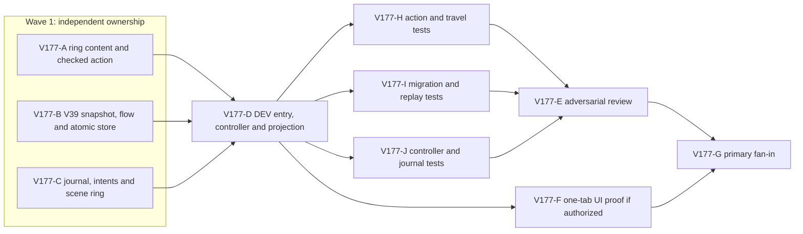

# Ticket Pack: Ringkeeper's Trail V39

## Summary and Locked Design

Implement [the aligned V177 problem](V177_RINGKEEPER_UNDERSTANDING.md): a physically found Highland Quarry fairy ring and a checked two-way Greenway shortcut. The player walks to the ring, returns to Greenway to establish the link, travels out and back through it, then claims exactly 25 coins, 30 Wayfinding XP, 20 Spellcraft XP, and 35 character XP. This is a DEV-only step toward the complete campaign, not a release or substitute for eventual protective armor and loot.

- Keep V38 and older databases, witnesses, writers, movement, and routes unchanged. V39 uses `wizard-world/v39` and `wizard-realms:world:v39`, with explicit checked V38 copy or independent fresh start.
- New ring ID is `ring-highland-quarry`, not the classic small-map `ring-highland`. Keep it in V39-only progress, not the old player's ring ID list.
- The new site is `(520,-488)` on the existing dry Highland trail edge. Its physical support and safe arrival must be proved before travel is exposed.
- The witness carries only its exact kind, plus `direction` for travel. Writer reconstructs all positions and rewards. No client-supplied completion or payoff.
- No new item, enemy, armor claim, random drop, shop, region, dependency, default production route, PR, push, or GitHub action. These belong to subsequent gameplay packs.

Important repo truth: V33 already has checked Greenway to Mireglass travel and a fairy-ring UI. V38 has versioned action, storage, entry and controller seams. `highlandLandmark`, `highlandCorridorCells`, `projectPublicV31Pose`, `resolvePublicV23Surface`, discovery masks, and river/pit predicates provide physical checks. A read-only canonical-seed probe found the proposed ring tile rocky and dry, but did not prove safe arrival or real player reachability. Previous isolated browser attempts hit the user's 1 GiB renderer guard twice; no third launch is in scope.

## Public Interfaces

- `highlandQuarryRing(seed)` returns `{ id: 'ring-highland-quarry', tile }`, with canonical position `(520,-488)` and server-derived Y.
- `PublicV39RingProgress = PublicV38SignalProgress & { quarryRingDiscovered; ringLinkEstablished; ringOutboundCompleted; ringReturnCompleted; ringkeeperClaimed }`, all booleans. Implication chain is claimed => returned => outbound => linked => discovered.
- `decodePublicV39RingProgress(raw)` is the one exact V39 progress decoder shared by the action and snapshot. It validates inherited V38 progress and the implication chain without creating a second validator.
- Exact witnesses: `{ kind: 'ringkeeper-discover/v1' }`, `{ kind: 'ringkeeper-link/v1' }`, `{ kind: 'ringkeeper-travel/v1', direction: 'greenway-to-highland' | 'highland-to-greenway' }`, `{ kind: 'ringkeeper-claim/v1' }`.
- Discovery: streamed owner, dry supported grounded pose within 3 m, site revealed, not discovered. Link: Greenway owner, discovered quarry ring and Greenway ring, grounded within 3 m of revealed Greenway ring, not linked. Travel: linked, grounded within 3 m of direction source, both sites revealed, target safe from water/open pit/unsupported landing, relocation with tick and event sequence, outbound/return flags in order. Claim: returned, Greenway ring proximity and revealed tile, safe integer reward arithmetic, not claimed.
- V39 projection includes `v39RingkeeperQuest`, `v39QuarryRing` and regular `fairyRings`/`visualWorld.fairyRings` entries for the new site and the unlocked destination. Existing ring travel UI remains the navigation control; new intents are `v39.ring.discover`, `v39.ring.link`, `v39.ring.claim`. The existing `fairy-ring.teleport` intent dispatches only the new V39 pair to the new writer, leaving the V33 pair unchanged.
- DEV entry is `?publicWorld=v39`; V38 remains `?publicWorld=v38`, with its source save read-only.

## Lane Graph

## Topology Audit

A owns only new pure content/action files; B owns only new versioned storage files; C owns only view contracts and presentation files. Their public interfaces are fixed above, their ownership does not overlap, and all three are independently runnable. Width 3 is the maximum safe first wave. D consumes their concrete exports and owns glue. H, I and J create non-overlapping post-surface evidence for physical rules, storage/replay, and controller/UI wiring. E tests the cross-boundary save, travel and reward assumptions that the authors could miss. F is conditional browser proof, not another implementation owner. G reconciles accepted receipts and current revision. Each serial edge exists because its downstream uses the upstream implementation or evidence. Generic duplicate testing and a PR finisher are omitted: no PR is requested.

Coarse model: adding V39-only flags leaves V38 replay and legacy ring IDs untouched. Surprise triggers: arrival unsafe, existing `ring-highland` alias leaks into the new portal, V38 replay drops V39 flags, duplicate claim or travel mints reward, old save modified, or the actual UI cannot reach or use the ring. Each requires bounded repair or replanning, never weakening checks.

The planned change necessarily exceeds the default 5-file and 300-line diff tripwires: separate checked save, domain action, presentation and normal controls are all needed. Version isolation is the reason, not permission for a generic framework. No dependency or old-writer changes are allowed. This is a single coherent local merge unit, with no stack topology decision. Dispatch verdict: **PASS**.

## Dispatch Contract

Worktree `/private/tmp/pa-wizard-campaign-checkpoint-v36`, branch `ben/wizard-campaign-checkpoint-v36`, base current local HEAD `e13906e`. Native ephemeral children, inherited model, no Cursor runtime, no existing user-owned task contact, no provider fallback. Each first contact must read the complete `auto-planner-ticket-pack` and `smallest-viable-diff` skills and this pack, acknowledge exactly one assigned role, and receive the full-game goal excerpt. Continue its same child ID for follow-ups. Do not use em dashes in generated prose. No child commits, PRs, pushes, browser renderers, or out-of-lane edits. The primary coordinates and later commits locally with both Git identities set to `Ben Fowlersmith <79104665+Bioscopics@users.noreply.github.com>`.

Every coding receipt reports child ID, changed files, added/deleted lines, reuse scan, config/no-code alternative, deletion pass, tripwires, out-of-scope touches, acceptance commands/results, current surface revision and visual-proof status. A concrete failure reports `observed error | change | restart | retry result | next action`. The same owner takes a bounded repair; architecture or ownership changes return to planner mode.

## Tickets

### Paste now to: Implementer A

Ticket V177-A, parallel implementation, pre-surface. Role: `implementer` ONLY. Transport: native spawned subagent, inherited model. Own only new `engine/src/domain/highlandQuarryRingContent.ts` and `publicWorldV39RingAction.ts`. No tests before surface; a read-only physical probe is mandatory. Exports: `highlandQuarryRing`, `PublicV39RingProgress`, `PUBLIC_V39_PROGRESS_KEYS`, `decodePublicV39RingProgress`, exact witness decoder, checked action, and advisory preview. Reuse V38 Signal action, V33 ring safety, V31 effective pose, discovery mask, river and pit checks. The site must be dry, effectively supported and reachable from the trail; fail with coordinates if not. All witnesses and transitions follow Public Interfaces, with monotonic flags, exact reward, overflow/refusal, one event per accepted action. Travel must reconstruct both canonical endpoints, avoid water/raised or open ground and establish destination support before moving. No legacy `ring-highland` ID or old domain edit. Budget 2 files, ~250 lines; if >300 or a shared helper/old-file edit is needed, stop and request planner decision. Targeted acceptance: read-only SSR numeric support/route probe, then `npm run build` once B exports exist. Visual proof not applicable to pure action.

### Paste now to: Implementer B

Ticket V177-B, parallel implementation, pre-surface. Role: `implementer` ONLY. Transport: native spawned subagent, inherited model. Own only new `engine/src/domain/publicWorldV39Snapshot.ts`, `publicWorldV39Flow.ts`, `atomicV39Database.ts`. Reuse V38 exact decode, lineage, one-edge rollback, proof CAS, locked flow and atomic store, not a new generic framework. Explicit checked V38 copy records source revision and never writes V38; fresh root derives V38 fresh genesis with five false flags. Schema/database as above, lineage rules profile `ringkeeper-trail/v1`. Decode, replay and store V38 witnesses without changing V39 flags. New witnesses invoke A's checked action. Each flag monotonic with implication chain. Malformed V39 root blocks overwrite; stale lineage/revision rejected; safe integer transitions. No old-version file edits. Budget 3 new files, >300 lines expected due strict version isolation, no dependency. Acceptance: `npm run build` after A exports exist and existing focused V38 snapshot tests pass. Visual proof not applicable to persistence.

### Paste now to: Implementer C

Ticket V177-C, parallel implementation, pre-surface. Role: `implementer` ONLY. Transport: native spawned subagent, inherited model. Own new `engine/src/view/publicV39RingkeeperQuest.ts`, updates only `view/contracts.ts`, `WizardHud.tsx`, `WizardScene.tsx`. Reuse existing journal details, ring panel, 44 px action buttons, and fairy-ring scene glyph. Keep V38 Signal playable: do not replace its primary journal or hide its inspect/claim buttons. Add a compact separate Ringkeeper chapter with stages find, return, link, outbound, return via ring, claim, complete, visible rewards and contextual checked-action hints. Buttons for discover/link/claim appear only when relevant; travel remains the existing ring destination panel. The ring visual appears only when the tile is revealed and is distinct from the Signal vane. View never awards or authorizes anything. No controller or domain edit, no new fixed overlay. Budget 4 files, <300 net lines, no dependency. If HUD structure must change broadly, stop for replan. Acceptance: build after D projection exists, inspect existing HUD SSR snapshot after surface. Visual proof required but pending F's authorized browser.

### Wait for A, B and C, then paste to: Implementer D

Ticket V177-D, dependent implementation, first honest DEV surface. Role: `implementer` ONLY. Transport: native spawned subagent, inherited model. Own new `engine/src/PublicV39Entry.tsx`, `PublicV39ControllerRuntime.ts`, `PublicV39WorldView.ts`, updates only `PublicV23Controller.tsx` and `main.tsx`. Reuse V38 entry/controller, V33 ring projection, normal checked queue, V38 movement preview, and V38 Signal action. Do not invent a second movement policy. Entry allows explicit checked V38 copy, independent New Game, checked resume and blocked malformed target; show V38 fallback link. Controller routes new Ringkeeper intents to payload-minimal V39 witnesses and routes only the new Greenway/Quarry teleport pair to V39. Existing Greenway/Mireglass pairing stays V33. Project revealed Quarry ring into scene, existing ring panel destinations, map marker and separate Ringkeeper journal. No undiscovered destination appears as travel-ready; no terrain reveal from the ring. Preserve V38-only flags through inherited actions and movement. Build and serve `?publicWorld=v39`; keep 5197 V38 reachable. Budget 3 new and 2 updated files, >300 lines due versioned entry/runtime; stop if old writer or shared runtime change needed. Acceptance: `npm run build`, HTTP 200 V39 and V38, existing focused V38 controller tests. HTTP/build is **not** browser SURFACE_READY. Visual proof required, pending F.

### Wait for D, then paste to: Implementers H, I and J in parallel

These are pr-hardening correctness lanes after the earliest honest surface. If browser proof remains environment-blocked, action and save-integrity floors may proceed; do not relabel them visual proof. Each uses its original implementer session if safe, otherwise a fresh native child. No production edits, commits or renderers.

- **V177-H** owns only new `engine/src/domain/publicWorldV39RingAction.test.ts`. Test dry supported site and an actual reachable approach; forged/extra witnesses, unrevealed/unvisited, remote/airborne/wet/open-pit source, unsafe target, order of link/outbound/return/claim, safe relocation and exact once-only 25/30/20/35. Run `npx vitest run src/domain/publicWorldV39RingAction.test.ts --maxWorkers=1`.
- **V177-I** owns only new `engine/src/domain/publicWorldV39Snapshot.test.ts`. Test fresh and checked V38 copy, read-only source, malformed target refusal, stale CAS/lineage, exact inherited V38 replay after link and claim, one-edge rollback, repeat-claim refusal, valid two-way relocation and reload. Run `npx vitest run src/domain/publicWorldV39Snapshot.test.ts --maxWorkers=1`.
- **V177-J** owns only new `engine/src/PublicV39ControllerIntegration.test.tsx`. Test that normal intents reach checked writer, Quarry ring renders only when revealed, old pair remains routed to V33, new pair routes to V39, journal can show alongside Signal, map marker never reveals cells, and entry choices do not mutate V38. Run `npx vitest run src/PublicV39ControllerIntegration.test.tsx --maxWorkers=1`. SSR is not real browser proof.

### Wait for H, I and J, then paste to: Reviewer E

Read-only `reviewer` ONLY, native child, inherited model, full skills. Name one concern: can player relocate and claim through a durable two-way ring without aliasing classic `ring-highland` or corrupting V38 save/movement? Inspect A/B/C/D against adversarial direction, discovery, target support, replay, CAS, reward and quest-hint matrices. Report findings-first GO/NO-GO, file/line references, smallest-diff/reuse/deletion/tripwire verdict, residual risks and UI proof gap. No edits or browser.

### Wait for D and an authorized one-tab environment, then paste to: UI Tester F

Role `reviewer` ONLY for UI evidence, native child, inherited model, required `test-from-ui` skill in early-smoke then final-proof mode. Use only one explicitly authorized existing tab, a disposable V39 save, and the 1 GiB guard. Do not open a third isolated browser, clear old saves or kill user Chrome. Journey: fresh visible controls to Highland ring, discover, walk back, link, travel out/back, claim, reload and use link again. Capture screenshots, exact controls, console/network and before/after reward state. If authorization absent, return `ENVIRONMENT_BLOCKED`, not a synthetic pass. If a product error is observed, route exact causal loop to owner.

### Wait for E and F disposition, then primary fan-in G

The primary verifies current revision, focused V39 plus V38 tests, build, reviewer and visual status, then makes a local Bioscopics-authored commit only if code is sound. No PR or push was requested. Full game goal remains active even if this pack passes.

## Smallest Viable Diff

Behavior delta: one discoverable checked ring, persistent two-way link and return quest, distinct V39 save, normal controls. Expected A 2 new, B 3 new, C 1 new plus 3 view updates, D 3 new plus 2 integration updates, and 3 post-surface test files. No dependency, old writer, generic framework or production-route change. The legacy `ring-highland` and V33 pair remain untouched. Config or prose cannot safely supply authoritative movement, save and reward. New versioned code is additive because no obsolete V39 implementation exists; reuse and minimize copied adapters where safe. Required proof is specific per lane, then focused regression/build and guarded real UI if authorized. Tripwires and their accepted justification are above; any new ownership or unsafe destination requires replan.
