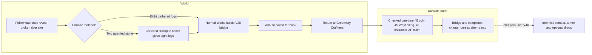
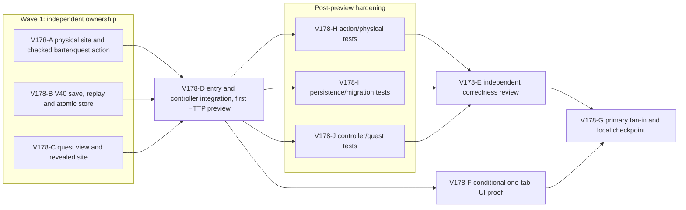

# Ticket Pack: V178 Windward Waystation

## Summary

The [aligned understanding](V178_WAYSTATION_UNDERSTANDING.md) and the active full-game goal call for a quest with a real material choice, a built and traversed world route, and a durable coin/XP payoff. V40 adds that beat at the connected river off the eastbound trail. This is one campaign increment, not completion of Wizard Realms.

Locked design:

- The crossing is an existing checked V28 connected-river bridge. Only normal Works can build it for eight logs and its existing 80 Construction XP. V40 never forges a built bridge or replaces its support/movement policy.
- A player may gather logs normally or barter exactly two owned stone for eight logs once at the north-bank stockpile. Barter is a checked material exchange, not the quest completion. The player must reach the saved bridge's far exit and return to Greenway Outfitters to claim exactly 45 coins, 45 Wayfinding XP and 45 character XP once.
- V39 source is read-only on explicit copy. Older writers, classic rings, the V39 ring, Signal quest, normal movement and discovery remain unchanged. V40 uses its own database. No new item IDs, protective armor or enemy drops are claimed.
- Do not open an extra browser renderer or touch a user-owned save. Keep the existing 5197 preview alive. If only HTTP/build is available, label browser journey unverified.

Important repo truth:

- `resolvePublicV28RiverBridge(seed, 'works6:river-bridge:20')` returns a dry supported site for `wizard-realms` and `greenway-alpha`. Canonical approach/exit are `(80,1.1915,8)` and `(80,1.1934,24)`. The highland route passes near `(80,0)`. V28 already renders built river bridges and checks their decks.
- V39 provides strict witness replay, one-edge rollback, CAS storage, explicit entry choices, checked movement and a separate Ringkeeper chapter. V32 quarry extraction yields two stone. Inventory counts include all backpack stacks, with capacity 20 initially.
- The current V39 and older save schemas cannot be widened in place without breaking their exact decoders. New V40 overlay files are justified; shared framework/dependency changes are not.

## Proposed Flow

## Public Interfaces

- `waystationRiverSite(seed)` selects the first non-null V28 site in the deterministic order `20,19,21,18,22,...,12,28,29,...,48`. It returns canonical V28 geometry or `null`; it never accepts a client coordinate. The default seed must select `works6:river-bridge:20`. A V40 migration with no supported site refuses safely and leaves V39 usable.
- `PublicV40WaystationProgress = PublicV39RingProgress & { timberBartered: boolean; southbankReached: boolean; waystationClaimed: boolean }`. Flags are monotonic; claim implies south-bank witness. Barter is optional. Exact witness kinds are `waystation-barter/v1`, `waystation-cross/v1`, `waystation-claim/v1`, each with only `kind`.
- Barter requires revealed north approach, grounded dry streamed pose within 3 m, bridge not built, one-time flag false, two stone in inventory and backpack capacity for the net six added stacks. It consumes two stone, adds eight logs and increments one event. Existing equipped/trade-slot items are never consumed. No XP/coins from barter.
- Cross requires the selected bridge ID in checked `riverBridgeIds`, revealed dry far exit, grounded streamed pose within 3 m of that exit and no open pit/raised soil. It increments one event and saves `southbankReached`; it does not move the player or reveal cells.
- Claim requires `southbankReached`, the selected bridge still built, grounded Greenway pose within 3 m of `store-greenway`, and safe integer reward counters. It increments one event and grants 45 coins, 45 Wayfinding XP and 45 character XP once; `level` follows the existing formula. Repeat/failed witnesses make no state, event or store change.
- New schema `wizard-world/v40`, database `wizard-realms:world:v40`, lineage profile `waystation-repair/v1`, fresh canonical seed or checked explicit V39 copy. Inherited V39 witnesses replay without changing the three V40 flags. V40-only witnesses replay through the checked action. One-edge rollback, exact decode, monotonic flags and CAS retain V39's guarantees.
- `?publicWorld=v40` is DEV-only. Existing 5197 origin serves the code so a player can explicitly copy a V39 save from 5197; the V39 entry remains available. The V40 projection adds a separate compact Waystation chapter and a revealed-only site marker/stockpile. It reuses Works for construction and Greenway Outfitters for claim, with 44 px touch targets.

## Lane Graph

## Topology Audit

- Productive lanes A, B and C own disjoint action/content, persistence, and view families under the fixed interfaces above. A || B || C is the maximum safe first wave; B can compile after A exports exist but does not need to wait to write its owned files. D consumes all three concrete exports and alone owns controller/entry glue. H, I and J test distinct deterministic boundaries after the first HTTP preview. E reviews replay and material/economy interactions the authors could miss. F is conditional browser evidence, not a product implementer. G does not code.
- Decision unknowns: A closes whether a dry V28 crossing is truly reachable and barter cannot mint materials; B closes V39-copy/replay/CAS durability; C closes whether the choice is legible without a new overlay; H/I/J protect the resulting contract; E probes cross-boundary duplication, path order and save isolation. Surprise triggers are unsupported site, unsafe far bank, hidden marker, old-store write, reward duplication, or UI inability to choose/build/claim. They route to the owning lane under the observed-error loop; architecture or ownership changes return to Planner mode.
- Exact serial edges: A/B/C to D because controller imports their exports; D to H/I/J/F because those tests target the integrated surface; H/I/J to E because review consumes current evidence; E/F to G because final status must distinguish code GO from browser proof. No review lane repeats a generic test. No PR finisher: no PR or push requested.
- Diff budget: A two new domain files under 300 net lines; B three new versioned files may exceed 300 because of strict save isolation; C one new view helper plus at most three owned view files under 300 net; D three new entry/runtime/projection files plus `PublicV23Controller.tsx` and `main.tsx`, with an explicit >300-line versioned entry exception. No dependency, old writer, broad framework or art-pipeline changes. Tripwires require a planner decision before another production owner or shared runtime edit. Topology verdict: **PASS**.

## Tickets

All worker lanes use `native_spawned_subagent`, inherited model, local runtime, no provider CLI fallback, same worktree `/private/tmp/pa-wizard-campaign-checkpoint-v36`, branch `ben/wizard-campaign-checkpoint-v36`, base `6e6337b0cd8a1817dfc391d854c5721d370979e1`. Existing durable Codex task routing is not authorized; reused native child sessions require fresh live status and recent same-mission proof. Each worker must read `auto-planner-ticket-pack` and `smallest-viable-diff` fully plus this pack, acknowledge an exact role lock, avoid nested workers, commits, PRs, pushes and browsers unless its ticket explicitly permits UI. Dispatch receipt includes child ID. No em dashes in prose.

Every coding receipt names files and added/deleted lines, reuse scan, no-code/config alternative, deletion pass, tripwires, out-of-scope touches, exact acceptance output, current revision and visual-proof status. A concrete product failure returns `observed error | change | restart | retry result | next action` to its owner. A lane does not complete from a summary alone.

### Paste now to: Implementer A

Ticket V178-A, role `implementer` ONLY, implementation/pre-surface. Own only new `engine/src/domain/waystationRiverContent.ts` and `publicWorldV40WaystationAction.ts`. Implement the exact selector, progress decoder, witness decoder, checked action and advisory preview defined above. Reuse V28 site geometry, V31 effective pose, discovery masks, wet/pit/raised-soil predicates and V39 reward guard. Barter removes only two inventory stone, checks net capacity and safe quantities, adds eight logs once. Cross checks the *selected* bridge and far bank, not any bridge; claim uses real Outfitters position and no client reward. Source and target support must be dry and reachable. Do not edit V28/V39. Budget 2 files, ~250 lines; if >300 or support geometry fails, return to planner. Before tests, perform a read-only numeric site/approach probe for canonical and `greenway-alpha`. Acceptance `npm run build` after B exports; before that `npx tsc -b --pretty false` may be gated by missing B/D imports. No browser. Return one complete deterministic barter/build/cross/claim action sequence and refusals.

### Paste now to: Implementer B

Ticket V178-B, role `implementer` ONLY, implementation/pre-surface. Own only new `engine/src/domain/publicWorldV40Snapshot.ts`, `publicWorldV40Flow.ts`, `atomicV40Database.ts`. Reuse V39 exact decode, lineage, one-edge rollback, locked replay and CAS. Fresh root inherits canonical V39 fresh genesis plus three false flags; checked V39 copy records source revision and leaves V39 DB untouched. V39 witnesses preserve V40 flags; new witnesses call A's action. If `waystationRiverSite(seed)` is null, refuse V40 creation/decoding without touching V39. Malformed V40 target blocks overwrite. Budget 3 files, >300 net justified solely by version isolation; no generic framework or old-file edit. Acceptance `npm run build` after A/D exports and `npx vitest run src/domain/publicWorldV39Snapshot.test.ts --maxWorkers=1`. No browser. Return fresh/copy/replay/CAS numeric probe and source-read-only evidence.

### Paste now to: Implementer C

Ticket V178-C, role `implementer` ONLY, implementation/pre-surface. Own new `engine/src/view/publicV40WaystationQuest.ts`; update only `view/contracts.ts`, `WizardHud.tsx`, `WizardScene.tsx`. The V40 chapter remains separate from existing starter, Signal and Ringkeeper journals. Its closed heading shows the next step; stages are find, choose-materials, build, cross, return, complete. Near the revealed north-bank stockpile, offer a 44 px `Barter 2 stone for 8 logs` action with checked rejection hint; direct path tells player to use normal B Works. After build, far-bank action appears only near exit. After crossing, claim appears only at Outfitters. Scene shows an angled broken brace and salvage stockpile only after local reveal, and never treats either as a physical barrier. The existing built bridge remains the real route. No new overlay, map reveal, controller action or reward authority. Budget 4 files, <300 net lines, no dependency. Acceptance existing `npx vitest run src/PublicV39ControllerIntegration.test.tsx --maxWorkers=1`, then build after D. Visual proof required but pending authorized browser lane F.

### Wait for A, B and C, then paste to: Implementer D

Ticket V178-D, role `implementer` ONLY, dependent implementation/pre-surface. Own new `engine/src/PublicV40Entry.tsx`, `PublicV40ControllerRuntime.ts`, `PublicV40WorldView.ts`; update only `PublicV23Controller.tsx` and `main.tsx`. Reuse V39 entry decisions, checked action queue, V37 private movement preview, V28 bridge projection and V39 Ringkeeper/Signal controls. New intents `v40.waystation.barter`, `.cross`, `.claim` send only exact minimal witnesses to V40 writer. All inherited V39 actions and movement go through V40 writer while preserving new flags. Normal Works remains V28; V39 ring travel remains V39 witness routed through V40 replay. Project revealed-only stockpile/marker, existing bridge and separate quest. Serve `?publicWorld=v40` on existing 5197 server without starting another process; V39 on 5197 remains reachable. Entry supports explicit checked V39 copy, independent New Game, checked resume, blocked malformed V40 target and V39 fallback link. Budget 3 new, 2 updated, >300 lines justified by versioned entry/runtime. Stop if an older writer, shared runtime or new dependency seems necessary. Acceptance `npm run build`, HTTP 200 V40/V39 on 5197, `npx vitest run src/PublicV39ControllerIntegration.test.tsx --maxWorkers=1`; return HTTP/build-ready URL immediately but do not claim browser SURFACE_READY. Keep prior preview available.

### Wait for D, then paste to: Implementers H, I and J in parallel

Post-preview `pr_hardening`; each reads both skills and this pack, owns only its new test file, runs one worker, never edits production or opens a browser. If a product failure appears, send exact evidence to its production owner for the bounded causal loop.

- **V178-H**, role `implementer` ONLY, `engine/src/domain/publicWorldV40WaystationAction.test.ts`: default/alternate seed safe site and accepted approach; forged/extra/remote/airborne/wet/pit witnesses; no stone/full bag barter refusal; exact once-only two-stone-to-eight-log exchange; unbuilt/wrong bridge and premature cross/claim refusal; physical far exit, Outfitters return, exact once-only 45/45/45 and overflow refusal. Command `npx vitest run src/domain/publicWorldV40WaystationAction.test.ts --maxWorkers=1`.
- **V178-I**, role `implementer` ONLY, `engine/src/domain/publicWorldV40Snapshot.test.ts`: fresh and checked V39 copy, source read-only, unsupported seed refusal, malformed target, stale CAS/lineage, inherited V39 ring travel and Signal witnesses after barter/claim, one-edge rollback, material/reward forgery refusal, saved built bridge and reload. Command `npx vitest run src/domain/publicWorldV40Snapshot.test.ts --maxWorkers=1`.
- **V178-J**, role `implementer` ONLY, `engine/src/PublicV40ControllerIntegration.test.tsx`: visible normal barter/cross/claim intents reach checked writer; existing Works builds selected bridge; V39 ring and Signal remain usable; hidden stockpile absent; map marker does not reveal cells; V39 source and fresh/copy/resume choices remain independent. Command `npx vitest run src/PublicV40ControllerIntegration.test.tsx --maxWorkers=1`. SSR is not browser proof.

### Wait for H, I and J, then paste to: Reviewer E

Role `reviewer` ONLY, read-only, full skills. Concern: can barter, construction, far-bank witness and claim be replayed once without material duplication, false route completion, save corruption or V39 regression? Inspect current action/save/view/controller/tests with adversarial inventory, bridge ID, proximity, discovery, CAS, reward and migration matrices. Findings-first GO/NO-GO, file/line references, smallest-diff/reuse/deletion/tripwire verdict, residual risks and browser proof gap. Run only an independent targeted command if it adds a named coverage constraint. No edits, browser or GitHub action.

### Wait for D and authorized one-tab environment, then paste to: UI Tester F

Role `reviewer` ONLY, `test-from-ui` early-smoke then final-proof skill. Use only one explicitly authorized existing tab and disposable V40 save under the 1 GiB guard. Do not open a new isolated renderer, clear old saves or kill user Chrome. Journey from normal controls: find sign, choose and execute one material path, build bridge via Works, cross, return to Outfitters, claim, reload and cross again. Capture screenshot, exact inputs, console/network and reward state. If authorization is absent, return `ENVIRONMENT_BLOCKED`; do not synthesize a browser pass. Product errors route to owner with exact observed loop.

### Wait for E and F disposition, then primary fan-in G

The primary verifies current revision, V40 and V39 focused tests, build, reviewer and visual status, then makes a local Bioscopics-authored commit only if code is sound. Preserve untracked `output/`; stage exact files. No PR or push was requested. The full-game goal remains active.

## Smallest Viable Diff

Behavior delta: one seed-derived V28 bridge site gets a real two-material-route quest and a one-time checked return claim. Existing V28 bridge/movement and V39 saves remain unchanged. Expected 2 new action/content, 3 new save, 1 new view plus 3 view updates, 3 new glue plus 2 updates, and 3 post-preview test files. No dependency or new framework. Reuse V28 site/action, V39 replay/storage/entry, V31 pose, discovery and existing journal/Works. Config/prose cannot authorize material transfer or saved reward. No obsolete V40 code exists; avoid duplicating old logic beyond required version isolation. Any old-writer edit, new item ID, broad HUD rewrite, unphysical site or extra renderer is a stop-and-replan tripwire.

## Assumptions

- The canonical 5197 preview remains the available same-origin V39 source; it may serve V40 code but V40 never implicitly copies a save.
- The Waystation is a side chapter. It may be discovered before Ringkeeper is claimed; ordinary world position and action prerequisites, not chapter order, gate completion.
- The later combat/armor/drop milestone is a separate, explicit pack after the route/trade quest, not silently declared complete by V40.
