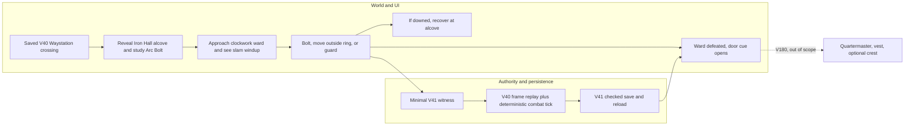
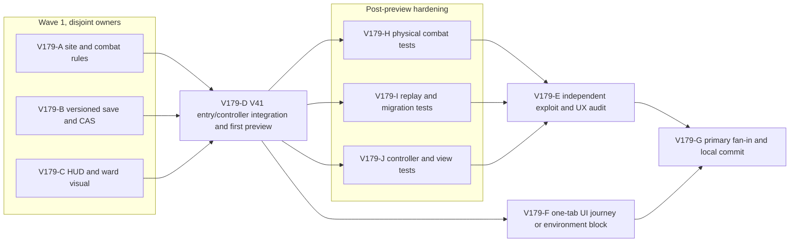

# Ticket Pack: V179 Iron Hall combat substrate

## Summary

This is the first playable, saved combat beat of Iron Hall Watch, not the finished armor-and-loot quest or the full RPG. A player who repaired the V40 crossing can reach a dry hall approach, study Arc Bolt, read a clockwork ward's slam tell, attack, dodge or guard, recover, and save/resume the defeated ward. V180 must add the quartermaster, protective vest, repair and once-rolled optional crest before Iron Hall Watch is claimed complete. The original full-game goal remains active.

Locked design:

- New schema `wizard-world/v41`, DB `wizard-realms:world:v41`, lineage `iron-hall-combat/v1`; explicit checked V40 copy or independent fresh start only. Never edit old V40 writers or silently copy/overwrite a save.
- The selected V40 Waystation bridge must be built and its southbank witness saved before Hall study or engagement. Site coordinates are seed-derived, never supplied by the client. The first ward is one clockwork construct, not a spawn system.
- Combat is real world-position play, not a detached turn menu. Attack telegraph, dodge distance and damage must derive from exactly replayed frame position at the strike tick. No unearned quest coins, vest or crest in V41.
- Browser validation uses at most one renderer and closes its test tab. `output/` and older saves remain untouched. No GitHub action; local commits use Bioscopics author/committer and `ben/` naming.

Important repo truth:

- V40 action/save/controller are version-isolated, with frame-batch private movement preview and checked CAS. `PublicV40WaystationProgress` is the inherited base.
- Fresh `wizard-realms` and copied `greenway-alpha` terrain probes: `(80,28)`, `(84,32)`, `(84,36)` are loam, dry, terrain-supported; y is seed-derived. Full collision and browser traversal remain acceptance gates.
- `PlayerState` has no health or Combat skill and existing `ItemId`/`SkillId` decoders are exact. V41 therefore owns a combat overlay; it does not broaden old schemas.

## Proposed Flow

Shortest initial journey: `http://127.0.0.1:5197/?publicWorld=v41`, explicitly copy a checked V40 save or start fresh, reach the Hall from the repaired bridge, study Arc Bolt, engage, avoid one visible slam, defeat the ward, reload and observe it remains defeated. The real browser proof may be environment-blocked by the 1 GiB renderer guard; HTTP/build is only an early surface, never acceptance proof.

## Public Interfaces

- `ironHallSite(progress)` returns `{ alcove, ward, door }` with seed-derived y and dry support or `null`. x/z are fixed at `(80,28)`, `(84,32)`, `(84,36)`. Both supported seeds must pass. `null` blocks V41 migration safely.
- `PublicV41CombatProgress = PublicV40WaystationProgress & { ironHall: { learnedBolt:boolean; engaged:boolean; playerHealth:number; wardHealth:number; phase:'dormant'|'windup'|'recovery'|'defeated'; phaseUntilTick:number; nextBoltTick:number; nextGuardTick:number; guardUntilTick:number; combatXp:number; wardDefeated:boolean; knockouts:number } }`. Genesis is health 12, ward health 9, other numbers 0, booleans false, phase dormant. Strict exact decode and monotonic learned/defeated/combatXp/knockouts.
- New exact, payload-free witnesses: `ironhall-study/v1`, `ironhall-engage/v1`, `ironhall-bolt/v1`, `ironhall-guard/v1`, `ironhall-rest/v1`. A client never sends coordinates, damage, target ID, health, XP or reward.
- Study: near revealed dry alcove, bridge/southbank prerequisites, grounded, once; grants 10 Spellcraft and character XP with safe counters. Engage: within 7 m of revealed dry ward, learned, grounded; starts a 20-tick windup. Bolt: within 7 m, engaged, learned, cooldown passed, grounded; deals 3 ward damage, grants 2 Combat and character XP, sets 12-tick cooldown. Guard: engaged and cooldown passed; protects through the next 20 ticks, next guard at current tick + 30. Rest: near dry alcove, not engaged, restores 12 health. Every accepted action increments the base event sequence once with safe-integer checks.
- Combat frame replay: when engaged, replay each member of an inherited V40 `frame-batch/v1` through V40's existing one-frame witness. At windup deadline, a player within 2.7 m of the ward takes 4 damage or 1 when guard is active; outside the ring takes 0. Then 15 ticks of recovery, then another windup while within 12 m. Moving beyond 12 m disengages and resets ward health to 9, retaining learned spell, health, Combat XP and any completed defeat. A downed player is moved to the supported alcove with 6 health, the ward reset, and one knockout; normal checked home recovery is not consumed. Replaying a batch per-frame must equal inherited V40 batch state apart from declared combat effects. Defeat sets phase defeated and wardDefeated once. No combat rewards beyond action XP in this pack.
- V41 HUD adds player/ward health, phase and next-step text plus 44 px `Study`, `Engage`, `Arc Bolt`, `Guard`, `Rest` actions when physically available. Scene shows a brass clockwork ward using current avatar proportions and an unmistakable 2.7 m windup ring, recovery pose, and defeated state. It does not reveal fog cells or clip the built bridge. Visual is a prototype subject to the character/asset workbench quality gate, not final art.
- `?publicWorld=v41` is DEV-only on existing port 5197. V40 stays reachable. A separate V41 entry offers checked V40 copy, fresh, resume and blocked target recovery without clearing any save.

## Lane Graph

## Topology Audit

- Productive lanes A, B, C own disjoint domain rules, persistence, and view families under fixed interfaces. They are incomparable and can run together. D alone owns the controller/entry seam and consumes their actual exports. H, I and J cover distinct post-surface behavior contracts and converge at E. No child orchestrator is warranted.
- Maximum first-wave productive width: 3. `A || B || C`; `H || I || J` after D. Every serial edge consumes source exports, integrated preview, or test findings rather than an artificial review pause.
- Certainty: A closes site/strike physics; B closes exact migration/replay/CAS; C closes visible telegraph/health affordance; D closes real routing and early preview; H/I/J close separate adversarial behaviors; E targets cross-owner duplication, invulnerability and false defeat; F is the only browser proof. A build or SSR test cannot substitute for F.
- Surprise triggers: a non-dry/unreachable site, non-equivalence of one-frame and whole-batch V40 movement, unsaved or double-applied damage, older save mutation, or renderer exceeding the guard. If observed, stop affected lane and replan or use the bounded causal loop.
- Reviewer is required by authority, migration and integration risk. No PR finisher because no PR/push is requested. Primary G handles local validation and commit. Dispatch verdict: **PASS**, conditional on the exact scope and interfaces below.

## Tickets

Runtime for all lanes: native ephemeral subagent or safe same-mission completed child session, inherited model, no provider fallback, no new durable task. Read `auto-planner-ticket-pack` and `smallest-viable-diff` completely; role lock per lane. Exact worktree `/private/tmp/pa-wizard-campaign-checkpoint-v36`, branch `ben/wizard-campaign-checkpoint-v36`, base current `cad0ef3`. No nested workers, browser, commit, push or PR unless a lane explicitly owns browser proof. Report exact changed files/lines, reuse and deletion scan, scope/tripwires, commands, revision, dispatch receipt and proof boundary. Use no em dashes in drafted prose.

### Paste now to: Implementer A, V179-A

Delivery phase `implementation`, milestone `pre_surface`. Own only new `engine/src/domain/ironHallSite.ts` and `publicWorldV41CombatAction.ts`. Implement the exact site, strict progress/witness decoders, actions, advisory previews and per-frame combat replay above. Reuse V28 bridge ID, V31 effective pose, V25 dry predicate, V40 progress and V40 frame replay. Do not edit an old writer or tests before surface. First perform read-only numeric support and route probe for canonical and `greenway-alpha`. Budget two new files, target under 300 net lines; if per-frame replay needs an old writer or unsupported site, return to planner. Acceptance before D: disposable TS probe for study/engage/bolt/guard/dodge/retreat/KO/defeat and exact rejection, plus `git diff --check`; shared build waits for D. Return named exports and one deterministic trace.

### Paste now to: Implementer B, V179-B

Delivery phase `implementation`, milestone `pre_surface`. Own only new `engine/src/domain/publicWorldV41Snapshot.ts`, `publicWorldV41Flow.ts`, `atomicV41Database.ts`. Exact schema/DB/lineage above. Fresh root inherits canonical V40 fresh genesis plus default combat; checked explicit V40 copy records source revision and leaves source DB byte-for-byte unchanged. Inherited V40 witnesses preserve combat, except frame-batches use A's per-frame combat transition. Exact decode, one-edge rollback, monotonic flags, CAS and malformed-target refusal match V40. Do not broaden V40 validators or edit old writers. Budget three new versioned files, >300 net lines justified only by strict save isolation. Acceptance before D: read-only fresh/copy/replay/CAS numeric probe and source hash proof; no tests until post-preview. Shared build waits for D.

### Paste now to: Implementer C, V179-C

Delivery phase `implementation`, milestone `pre_surface`. Own new `engine/src/view/publicV41IronHallQuest.ts`; update only `view/contracts.ts`, `WizardHud.tsx`, `WizardScene.tsx`. Add the separated Hall journal, health/telegraph controls and discovery-gated scene object described above. The quest heading exposes its next step while collapsed, and controls do not eclipse the 3D battle or mobile map. `v41IronHall?: { health, wardHealth, phase, phaseUntilTick, learnedBolt, wardDefeated, study/engage/bolt/guard/rest: {rejection,hint} }`; `v41IronHallSite?: { alcove, ward, door, revealed } | null`; intents are `v41.ironhall.study|engage|bolt|guard|rest` with no payload. Scene visual is presentation-only, no combat or reward authority. Budget four files, target <300 net; if asset-quality work needs a separate workbench, return a follow-up art pack rather than widening this lane. Existing V40 controller regression may run as a narrow guard; full build waits for D. No renderer in this lane.

### Wait for A/B/C, then paste to: Implementer D, V179-D

Delivery phase `implementation`, milestone first HTTP/build-ready preview. Own new `engine/src/PublicV41Entry.tsx`, `PublicV41ControllerRuntime.ts`, `PublicV41WorldView.ts`; update only `PublicV23Controller.tsx` and `main.tsx`. Bind A/B/C exports. All inherited V40 actions and movement go through the V41 writer; normal Works, Ringkeeper, Signal and Waystation remain available. Advance combat on the identical frame sequence used by V41 replay, and keep idle frames running only during active windup/recovery. Project revealed-only Hall cue and health/telegraph. Entry offers explicit checked V40 copy, fresh, resume and blocked state; V40 remains open on same origin. Stop if another owner/file or old writer is required. Budget 3 new and 2 edited with a documented versioned entry exception. Acceptance: one shared `npm run build`, HTTP 200 for V41 and V40 on 5197, and `npx vitest run src/PublicV40ControllerIntegration.test.tsx --maxWorkers=1`. Return the real URL immediately as HTTP/build-ready, not browser-proven; keep server/user surface live.

### Wait for D, then paste to: Implementers H, I, J in parallel

Delivery phase `pr_hardening`, milestone `final_complete`; each owns only its named new test, uses `--maxWorkers=1`, never edits production or starts a browser. Send exact product failures to its owner for observed causal retry.

- **H**, `engine/src/domain/publicWorldV41CombatAction.test.ts`: both seed sites, unsupported/wet/airborne/remote/forged refusals; true per-frame dodge vs guard damage; windup/recovery timing; cooldown; retreat/KO/rescue; study and bolt XP; once-only defeat. Command `npx vitest run src/domain/publicWorldV41CombatAction.test.ts --maxWorkers=1`.
- **I**, `engine/src/domain/publicWorldV41Snapshot.test.ts`: fresh/checked V40 copy, source immutability, inherited V40 Works/Waystation/Ring/Signal after combat, frame-batch parity, one-edge rollback, malformed target, stale CAS, false health/defeat/XP forgery, reload at every phase. Command `npx vitest run src/domain/publicWorldV41Snapshot.test.ts --maxWorkers=1`.
- **J**, `engine/src/PublicV41ControllerIntegration.test.tsx`: visible study/engage/bolt/guard/rest intents, normal movement advancing attack, revealed-only ward/marker, old V40 journeys preserved, fresh/copy/resume isolation, HUD phase and health. It must distinguish intent routing from accepted checked writes. Command `npx vitest run src/PublicV41ControllerIntegration.test.tsx --maxWorkers=1`. SSR is not browser proof.

### Wait for H/I/J, then paste to: Reviewer E

Role `reviewer` ONLY, read-only. Findings-first GO/NO-GO: try to find a double cast, skipped strike, position/health forgery, unearned defeat, invulnerable retreat, duplicate XP, malformed save acceptance, V40 corruption, or UI cue that lies about range/timing. Review current source and tests with file/line references; run a targeted independent command only for a named gap. Return smallest-diff/reuse/deletion/tripwire verdict and browser gap. No edits, browser or GitHub action.

### Wait for D and one safe renderer, then paste to: UI Tester F

Role `reviewer` ONLY, use `test-from-ui` early smoke, then final proof if the same tab stays below the user's RAM guard. One temporary IAB tab maximum, no user Chrome manipulation or old-save deletion. V41 fresh or explicit V40 copy must be honest. Through normal controls, reach the revealed hall, study, engage, observe and avoid or guard a slam, defeat, save/reload, and verify health/ward state. Record exact actions, screenshot, console/network and memory; close the tab afterward. A checked near-hall fixture may test a segment but cannot be labeled a fresh-player journey. If one renderer cannot be used safely, return `ENVIRONMENT_BLOCKED` and preserve the other evidence.

### Wait for E and F disposition, then primary G

Primary verifies current revision, focused V41/V40 tests, build, reviewer and browser status. Local Bioscopics-authored commit only if code is sound; stage exact files, preserve `output/`. No PR or push. If browser proof is blocked, mark V41 as a prototype, not full Iron Hall Watch or full-game completion. V180 armor/loot pack remains dependent on this combat substrate and its corrected UI feedback.

## Smallest Viable Diff

Behavior delta: one physical clockwork ward, a learned strike, readable timed slam, dodge/guard/recovery and saved defeat in a separate V41 branch. No payout, armor or drop yet. Expected A two new domain files <300 net, B three isolated save files with explicit >300 exception, C four view files <300 net, D three new glue plus two entry/controller edits with explicit >300 versioned exception, H/I/J three new focused tests. No dependency or shared framework. Reuse V28 site/bridge, V31 pose, V40 replay/storage, existing HUD/scene and legacy action queue. Config or prose cannot authorize health or damage. No V41 code exists to delete; simplify only redundant new code and avoid a parallel movement model. Any old-writer edit, ItemId/SkillId broadening, second renderer, unsupported site or new shared runtime is a stop-and-replan tripwire.

## Assumptions

- V41 is an experimental preview. The existing V40 site/bridge and prior quests remain the continuing world, not a separate dungeon instance.
- The V41 combat prototype must be fun enough to test, but its ward visual and timing may change from browser feedback. The armor-and-loot quest is explicitly V180, not claimed here.
- A copied `greenway-alpha` V40 root is possible even though new fresh V40 games use the canonical seed, so both seeds require site validation.
