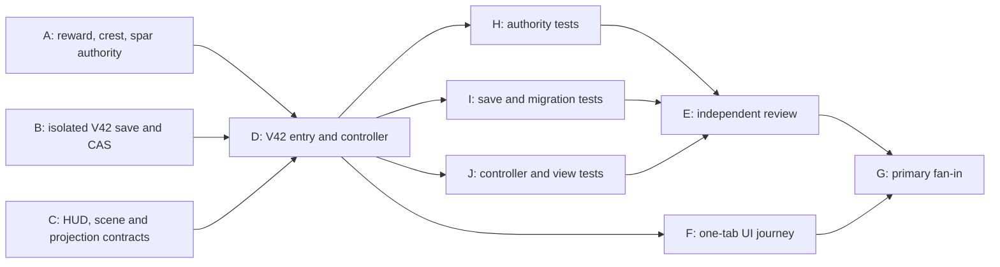

# Ticket Pack: V180 Iron Hall quest payoff

## Summary

Finish the first Iron Hall quest payoff in a separate V42 preview. A player who has defeated the V41 ward returns to a real quartermaster, receives 60 coins, 70 character XP, 70 Combat XP and one Guard Vest, and can prove the vest's damage reduction and repair in a checked spar. The first ward has one saved 10% cosmetic crest roll. This is not the full RPG or the later Iron Hall Depths chapter.

Upstream contract: [understanding](V180_IRON_HALL_REWARDS_UNDERSTANDING.md), [play moments](V180_QUEST_EXPERIENCE_BLUEPRINT.md), [V179 substrate pack](V179_COMBAT_SUBSTRATE_TICKET_PACK.md). The full-game goal remains active after V180.

## Locked design and public interfaces

- Schema `wizard-world/v42`, DB `wizard-realms:world:v42`, lineage `iron-hall-rewards/v1`. Start fresh from canonical V41 fresh genesis or copy an explicitly checked V41 root. Source V41 is read-only. Target conflict, malformed source and stale revision block safely. V41 and V40 previews remain reachable.
- Inherit `PublicV41CombatProgress`. Add `ironHallReward: { crestOutcome: 'unrolled' | 'won' | 'missed'; questClaimed: boolean; vestOwned: boolean; vestEquipped: boolean; vestDurability: number; spar: { active: boolean; strikeAtTick: number; nextReadyTick: number; strikesResolved: number } }`. Genesis has unrolled, unclaimed, unowned, unequipped, durability 0 and idle spar. Strict exact decode and bounded counters. `questClaimed` implies ward defeated, vest owned and crest resolved; equipped implies owned and durability > 0; unowned implies durability 0. A depleted vest remains owned but not effective.
- Site: `ironHallQuartermasterSite(progress)` near the existing hall approach, tentatively grid `(80,24)`, with y derived from supported terrain and all dry/revealed/grounded checks. If either supported seed fails reachability or support, stop for a documented site decision. The client does not pass a coordinate or reward value.
- On first V42 ward-defeat transition, set `crestOutcome` by a stable seed plus fixed encounter-ID hash with probability 1 in 10. Copying a V41 source already marked defeated resolves the same outcome in V42 genesis. Never reroll after `won` or `missed`. The cosmetic entitlement is represented by `won`, not a backpack stack; disclose 10% and no pity in the Hall UI.
- Exact payload-free witnesses: `ironhall-claim/v1`, `ironhall-vest-equip/v1`, `ironhall-vest-unequip/v1`, `ironhall-vest-repair/v1`, `ironhall-spar/v1`. Existing V41 and inherited witnesses remain valid through V42 replay. An accepted action increments the inherited event sequence once. Claim requires ward defeated, resolved crest, dry revealed quartermaster within 3 m and no previous claim. Add 60 coins, 70 player XP and 70 `ironHall.combatXp`, recompute level, set vest owned/equipped with durability 12. Overflow and duplicate refuse; backpack capacity is irrelevant because this quest-specific worn armor is not put in legacy inventory.
- Vest equip and unequip require ownership and no active fight or spar. A vest at durability 0 cannot be made effective. Repair requires quartermaster proximity, vest ownership, durability below 12, 18 coins and no fight/spar; deduct 18 and restore 12. Do not debit for a refused action. The vest is a scoped armor overlay that visually covers, but does not delete, the already-owned Traveler Tunic.
- Spar starts only after claim at the revealed ward site within 3 m, when idle and ready, with a clear 20-tick windup. The V41 ward remains permanently defeated; this is a reactivated practice automaton, not a second story defeat. Replaying each V41 movement frame at strike tick uses actual player position. Within 2.7 m it deals 4 damage unarmored or 2 with an effective vest and removes one vest durability on a landed protected hit. A player outside the ring takes 0 and no wear. On lethal hit, use V41's supported alcove recovery with 6 health and one knockout, preserving claimed rewards. End the spar after one strike, impose 45-tick cooldown, give no XP, coins or new loot roll. Do not consume the return-home rescue.
- UI shows a reachable quartermaster world cue, one claim button only when checked preview permits, claim amounts, crest odds/outcome, vest equipped state, durability and repair cost. The avatar visibly wears a distinct chest armor layer while equipped and undamaged, and removes or visually disables it when depleted/unequipped. The spar has the same readable ring and countdown language as V41. Put the next quest lead in the journal after claim. No remote menu claim or unearned map reveal.
- `?publicWorld=v42` is DEV-only on the existing 5197 server. Expose an early build-ready user URL when D passes the minimum safety gate. Continue tests and one-tab UI proof without waiting for user feedback.

## Lane graph and safe width

First-wave width 3: A, B and C own disjoint source families against this fixed interface. D is the real integration seam. H, I and J own non-overlapping post-surface test families. E reviews integration and adversarial paths. F is browser proof, not a source or HTTP substitute. Primary G validates and commits. No artificial extra workers, second renderer or durable task.

## Tickets and ownership

All workers use the exact worktree `/private/tmp/pa-wizard-campaign-checkpoint-v36` on `ben/wizard-campaign-checkpoint-v36`, base `d59a0c4`. Read full `auto-planner-ticket-pack` and `smallest-viable-diff` skills before implementation, state role lock, no nested workers. Native ephemeral subagents or a proven safe same-mission completed child may be used. No provider fallback, commit, push, PR, old-writer edits or browser unless explicitly assigned. Report dispatch ID, changed files, proof, scope, deletion/reuse scan and unresolved risks. User-facing prose uses no em dash.

### A: authority, pre-surface implementer

Own new `engine/src/domain/ironHallQuartermasterSite.ts` and `publicWorldV42RewardAction.ts` only. Define strict overlay/progress/witness types, deterministic crest roll, exact claim/equip/unequip/repair/spar acceptance and per-frame spar replay described above. Reuse V41 combat replay and V31 effective support; do not fork the whole movement model or broaden legacy decoders. First probe the quartermaster cell in both supported seeds. Send named exports and one numeric trace to D/B/C as soon as interfaces settle. If a second enemy needs a general combat engine or old writer edit, stop and return to planner. `git diff --check` and focused disposable type/numeric probe before D; tests follow first preview. Estimate two new files, roughly 250 to 400 net lines due strict authority.

### B: isolated save, pre-surface implementer

Own new `engine/src/domain/publicWorldV42Snapshot.ts`, `publicWorldV42Flow.ts`, `atomicV42Database.ts` only. Use A's declared exports without changing A files. Exact lineage/root, checked V41 source copy, fresh genesis, replay inherited V41 witnesses with immutable V42 reward overlay except a ward defeat transition, exact V42 witness replay, per-frame spar, one-edge rollback, monotonic irreversible flags, bounded raw equality and CAS. Reuse V41 patterns; do not import a V41 store for writing. A migrated V41 defeated source resolves crest in genesis. Report a source-byte immutability probe, stale-write rejection and named exports. Estimate 3 new versioned files with explicit duplication exception for schema isolation.

### C: visible quest, pre-surface implementer

Own new `engine/src/view/publicV42IronHallQuest.ts`; edit only `engine/src/view/contracts.ts`, `WizardHud.tsx`, `WizardScene.tsx`. Define `v42IronHall` and `v42QuartermasterSite` projection contracts and payload-free HUD intents. The world cue is discovery gated. Implement claim, vest, repair and spar affordances without covering movement or the mobile view, and add a distinct visible vest overlay on the existing avatar. Keep the original tunic beneath it. Use A's exact action names. No reward authority or fake attack in the view. Report screenshots only after D gives a real surface; no renderer now. Estimate four files, target under 300 net lines; if art cannot meet the approved visual direction, separate the asset-quality work rather than replace V41 combat visuals silently.

### D: integration and first surface, after A/B/C

Own new `engine/src/PublicV42Entry.tsx`, `PublicV42ControllerRuntime.ts`, `PublicV42WorldView.ts`; edit only `PublicV23Controller.tsx` and `main.tsx`. Bind exact A/B/C exports. All V41 and older controls persist through the V42 checked writer, including Works, rings, Signal and normal movement. Each previewed frame and saved witness must yield the same V42 spar result; idle ticking continues during an active spar. V42 entry offers explicit checked V41 copy, fresh, resume and blocked target recovery. Acceptance for early URL: TypeScript/build, HTTP 200 for V42 and V41, one V41 controller regression suite and no old save mutation. Return URL promptly as build-ready, not fully browser-proven. Keep the server and one user-accessible surface live.

### H, I, J: post-surface implementers, parallel

- H owns only new `engine/src/domain/publicWorldV42RewardAction.test.ts`: both seeds, grounded/revealed/nearby checks, claim amounts once, duplicate/remote/overflow refusal, equip state, landed/unlanded spar damage, wear, zero-durability behavior, cooldown, KO recovery, repair debit and crest determinism. Run the named suite with one Vitest worker.
- I owns only new `engine/src/domain/publicWorldV42Snapshot.test.ts`: checked V41 source and V42 fresh genesis, won/missed crest migration, source immutability, inherited action replay, spar per-frame parity, malformed root/witness, forged reward/durability/health refusal, rollback, stale CAS and reload after claim/repair. One Vitest worker.
- J owns only new `engine/src/PublicV42ControllerIntegration.test.tsx`: normal-control intent routing, visible quartermaster, claim/vest/spar/repair projection, V41/V40 link preservation and fresh/copy/resume UI. One Vitest worker. SSR and unit tests do not prove the browser journey.

### E: read-only reviewer, after H/I/J

Findings-first GO/NO-GO. Try to mint repeated coins, XP, vest or crest; reroll by reload/copy; wear a zero-durability vest; repair for free; spar or claim remotely, airborne or before crossing; bypass the timed hit; corrupt V41; make a HUD cue disagree with the checked result. Verify smallest viable diff, old-schema isolation, tests and any exploit from the V41 alcove. No edits, browser or GitHub action.

### F: one-tab UI tester, after D

Use `test-from-ui` on one temporary IAB tab, not user Chrome. Begin from checked V41 copy or fresh, traverse the real V40 crossing, study and defeat the ward, return and claim, visibly equip vest, take a spar hit, dodge another, repair and reload. Capture entry/actions/screenshots, console/network and the memory condition. A near-hall fixture can prove a segment but not a fresh-player path. Close temporary tab after proof. If the browser is unavailable, record `ENVIRONMENT_BLOCKED`, not a product pass.

### G: primary fan-in and local delivery

Resolve grounded findings with the observed failure loop, run focused tests and build, inspect the real browser result, check diff and Bioscopics authorship. Stage exact in-scope files and make a local commit only after validation; preserve `output/`. No PR or push. If F is blocked or the vest never receives a real hit, label V42 a prototype and keep Iron Hall Watch open. Continue the broader campaign goal in later packs.

## Smallest viable diff and tripwires

Reuse V41 site, combat, frame replay, schema and entry/controller patterns, V31 support, V40 crossing prerequisite and existing avatar. A versioned copy is justified by exact old save schemas. No dependency, global item catalog migration, MMO, procedural quest generator, or general AI agent. Stop and replan for an unsupported quartermaster location, non-equivalent frame replay, need to edit V41/V40 writers, an unbounded second renderer, or reward duplication that survives two grounded repairs. The user can access the first safe V42 preview before exhaustive tests, but that preview is not completion evidence.
