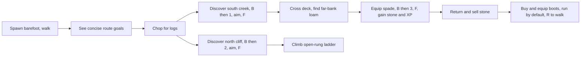
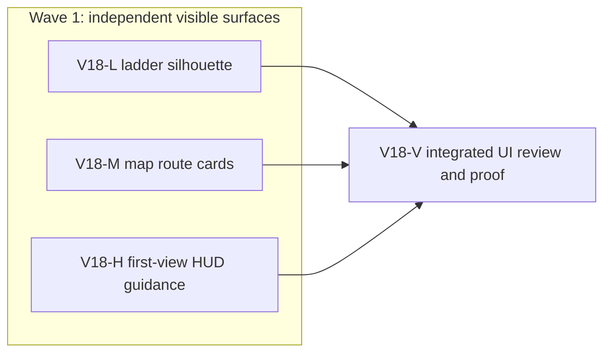

# Ticket Pack: Readable Greenway Traversal

## Understanding

Original ask: the ladder reads as a bridge; bridges and dig sites are hard to find; the player cannot tell how to dig or why; ladders should be quick obstacle-crossing construction; footwear should unlock default running with a walk toggle, while barefoot travel remains walking only.

Aligned problem: v17 already has saved creek bridges, north-cliff ladders, far-bank digging, a boot-gated gait policy, and keyboard Works shortcuts. The playable experience does not expose those mechanics at the point of need, and the ladder silhouette does not clearly communicate a climb. Make the existing Greenway loop legible without expanding the authoritative world or altering saved data.

Goal status: aligned. Success is a fresh v17 player finding the south creek and north cliff, gathering logs, placing a bridge and a visually distinct rung ladder at valid obstacle sites, crossing and climbing, buying and equipping the field spade, digging for stone and Excavation XP, returning to sell, and seeing barefoot walk and booted default run with a working walk toggle. Existing saves must remain valid. A blocked save must not be represented as successful play.

Non-goals: unrestricted Fortnite building anywhere, new world biomes, new items, multiplayer, a new save schema, new engine abstractions, or a PR. This pack implements the first obstacle-loop expression of the requested direction; arbitrary terrain construction remains a later game milestone.

Constraints: one local renderer; protect the in-flight save-controller ownership; preserve hidden-site discovery; no GitHub action; use Bioscopics for any later authorized GitHub action. System translation: not_qualified, this is a game feature/presentation change. Product agent runtime: not_required, no shipped agent execution changes.

## Summary

Make the ladder look and behave like a cliff climbing aid, not a water crossing, and bring bridge, ladder, dig, and boot instructions into the first-view field guide and map. Reuse the current works4 authoritative site, gait, and persistence contracts.

Locked design:

- A bridge is a horizontal creek deck costing 8 logs; a ladder is a steep open-rung climb on a clear discovered north cliff costing 4 logs; digging needs an equipped field spade and free bag slot, lowers dry far-bank loam, grants stone and 30 Excavation XP.
- Barefoot means walk-only. Leather boots enable running by default; R or Walk/Run toggles walking.
- Only discovered work sites get precise positions or markers. Guidance may name broad north/south landmarks before discovery.
- The current v17 save ledger and movement authority remain unchanged in this pack.

Important repo truth: `publicWorldV17GreenwaySites.ts` owns canonical site geometry; `publicWorldV17StarterMovement.ts` owns climb/cross support; `publicWorldGait.ts` already implements the requested footwear rule. `WizardScene.tsx` renders Saved Works. `WizardHud.tsx` and `WizardMap.tsx` hold extensive guidance, but the map guide is collapsed and the HUD guidance is buried in the Works panel. The current save-controller worker owns `PublicV16Controller.tsx` and `PublicV17Controller.tsx`, so these lanes may not edit them.

## Proposed Flow

## Public Interfaces

No serialized interface changes. Current `savedTerrainWorks`, `gait`, `backpack`, and `map` projections remain the source of truth. Only v17 Greenway UI wording and scene presentation change. Existing shortcut contracts B, 1, 2, 3, F, R remain.

## Lane Graph

## Topology Audit

- Productive lanes: L changes only Saved Works ladder mesh and focused geometry/render assertions; M changes only WizardMap navigation copy/layout; H changes only WizardHud concise goal/gait affordance. Each contributes distinct visible behavior.
- Parallel width: 3 after the earlier HUD focus lane releases `WizardHud.tsx`; no file collision with the active save-controller lane. L, M, and H are incomparable and converge at V.
- Evidence novelty: L closes ladder-vs-bridge visual ambiguity; M closes map discoverability; H closes first-view affordance and payoff clarity. V checks integration and fresh v17 play, not duplicate unit tests.
- Surprise trigger: a ladder may be visually correct but untraversable, or a save may block the journey. Escalate to the existing bounded causal repair owner rather than changing authoritative movement or save code from these lanes.
- Conditional review/finisher: reviewer required because three rendered surfaces converge. PR finisher omitted because no PR was requested.
- Dispatch verdict: PASS, conditional on HUD focus lane completion and save-controller file ownership remaining separate.

## Tickets

### Paste now to: V18-L Implementer

Role: implementer only. Read `auto-planner-ticket-pack` and `smallest-viable-diff` completely. Delivery phase: implementation; milestone: current v17 preview is already reachable, final proof pending. Transport: native spawned subagent, inherited model, no fallback. Scope: `games/wizard-realms/engine/src/view/WizardScene.tsx` and focused scene tests only. Change the Saved Works ladder visual so rails and open rungs are visibly steep, anchored to the cliff face, and never have a continuous deck; preserve bridge deck and collision geometry exactly. Reuse `terrainWorkStructureGeometry`, `StarterCliffLadder`, existing materials. Target 2 files, no dependency or new abstraction. Visual proof: required via later single-renderer integrated Grok build; lane-local test must assert structural ladder-versus-bridge distinction. Run focused scene tests, TypeScript, diff check. Return changed files, net lines, reuse/deletion rationale, targeted outputs, candidate merge unit, and limitations. No browser or extra renderer.

### Paste now to: V18-M Implementer

Role: implementer only. Read `auto-planner-ticket-pack` and `smallest-viable-diff` completely. Delivery phase: implementation; milestone: current v17 preview reachable, final proof pending. Transport: native spawned subagent, inherited model, no fallback. Scope: `games/wizard-realms/engine/src/view/WizardMap.tsx` and focused map tests only. Add an immediately visible, compact v17 route key before the map grid: south creek bridge, north cliff ladder, far-bank dig, with broad direction, resource requirement, payoff, status, and actual discovered-site markers/positions only once revealed. Keep the detailed expandable guide, avoid invented coordinates, preserve other versions and map accessibility. Target 2 files, no dependency or new abstraction. Run focused map tests, TypeScript, diff check. Return full smallest-diff receipt. No browser or extra renderer.

### Wait for HUD focus lane, then paste to: V18-H Implementer

Role: implementer only. Read `auto-planner-ticket-pack` and `smallest-viable-diff` completely. Delivery phase: implementation; milestone: current v17 preview reachable, final proof pending. Transport: native spawned subagent, inherited model, no fallback. Scope: `games/wizard-realms/engine/src/view/WizardHud.tsx` and focused HUD tests only. Add one concise, always-visible v17 Greenway field objective above the scrollable Works panel. Use existing projection to point to the next practical action and payoff: logs/bridge, independent ladder obstacle, spade/dig, stone sale, and boots/run. Do not pop up or auto-complete a goal, reveal precise hidden positions, alter Works event emission, or change save/controller code. Keep R and the already correct barefoot/booted gait rule, making its current state legible. Target 2 files, no dependency or new abstraction. Run focused HUD tests, TypeScript, diff check. Return full smallest-diff receipt. No browser or extra renderer.

### Wait for L, M, H, then paste to: V18-V Reviewer

Role: reviewer only, read-only. Read both skills. Inspect integrated v17 UI for visual distinction, hidden-site gating, route instructions, gait clarity, focus and keyboard conflicts, accessibility, and diff minimality. Findings first, severity-ordered, GO/NO-GO with exact file/line. Final user-flow proof is the next hash-frozen v17 build exercised through the already authorized Grok Bot on its own machine, one renderer there. No PR. The primary agent owns test integration, memory monitoring, user handoff, and any bounded repair dispatch.

## Smallest Viable Diff

Behavior delta: make existing mechanics legible and ladder visually distinct. Budget: at most six files across three lanes, under 300 net lines per lane, zero new files except focused tests, zero dependencies, zero authoritative runtime changes. Reuse scan: existing Saved Works mesh/geometry, map guide and projection, HUD Works status and gait. Non-code guidance alone is insufficient because the present first-view UI and mesh cause the confusion. Delete or condense redundant copy when adding upfront cues. Tripwire: any new schema, shared engine change, >5 files in one lane, or >300 net lines requires replanning. Validate focused tests, TypeScript, production build, full suite after integration, and one fresh hash-bound UI journey.

## Assumptions

- The user's Fortnite comparison refers to quick, visible material-driven obstacle construction in the existing Greenway, not unrestricted placement on arbitrary world geometry in this pack.
- The current authorized v17 preview remains available at `http://127.0.0.1:5193/?publicWorld=v17`; automated UI proof uses a separate Grok machine and a frozen build.

## Follow-up: visible build candidates

The source audit found that a valid unbuilt bridge or ladder only enters the v17 view when Works mode has an aim. A player can know that a creek or cliff exists but still see no marked lane to try. This is a presentation and discovery gap, not a reason to relax the checked writer or site resolver.

Add a bounded, seed-canonical suggestion for each obstacle, shown as a distinct unbuilt bridge or ladder marker in the map and scene only after its entire footprint is discovered. The suggested site must be resolved from the current seed, not invented by the UI; it must remain unsaved and may not enable confirmation until the existing Works aim and preview rules succeed. A built route replaces its suggestion. Keep hidden footprints hidden, preserve the current 0.1 m placement freedom and validation, and avoid recomputing a wide site search on every render. Test fresh, partially revealed, fully revealed, and built states for both structures, plus marker visibility at the visual radius edge. This is a separate read-only projection/presentation unit from the save-input scheduler repair.

## Follow-up: keep the route visible while traveling

The frozen-build crossing test succeeded, but the always-open Works panel covered the far end of the deck while Works was off. Collapse the v17 Works panel to a small, keyboard-accessible toggle when inactive. Keep the separate field objective, map route key, B shortcut, and immediate open/close state intact. Expanded mode must still show build and dig guidance, preview, reasons, aim controls, and confirmation. Do not auto-close during a queued checked action or make saved state depend on panel visibility. Verify desktop and narrow viewport composition and that closing Works exposes the route without losing the selected kind or material state.

## Observed bridge-end recovery follow-up

The Grok T155 return trip was rejected near the far deck end. T156 showed the player could turn and move, so this was not a proven permanent trap. A focused numerical reproduction found a narrower, real defect: the deck extends onto dry ground beyond the wet creek, yet movement rejected a lateral bridge-to-ground step on that dry overhang. Permit the transition only when the swept move stays dry, while retaining wet-rail collision and height checks. Update the old test that expected this safe dry entry to fail; move its rejection assertion into the wet creek. Retest the same live return route on a frozen build. Do not snap or teleport the player based on an unverified screenshot pose.
