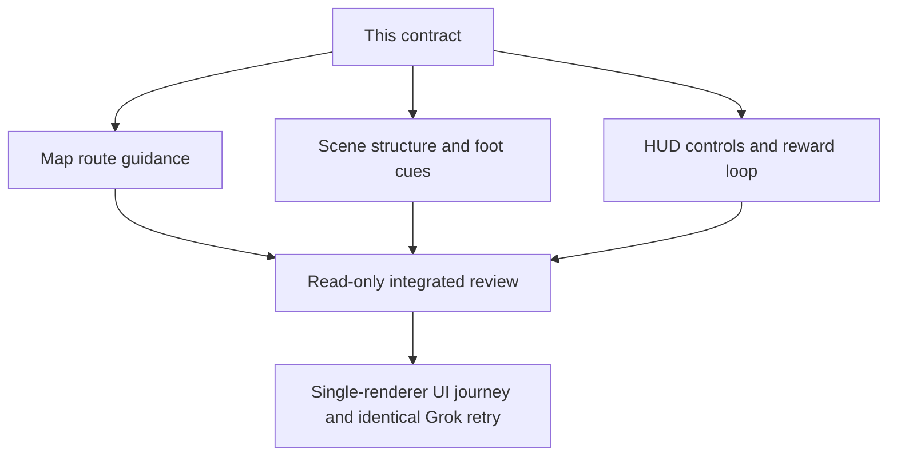

# V22 starter Works navigation and traversal

## Summary

Make the existing Greenway route and digging mechanics understandable in play. The bridge must read as a creek deck, the ladder as a climbable rung structure on the cliff, and the player must be led to a safe dry foot before crossing. Digging needs a visible site, an exact action sequence, and a useful reward loop. Barefoot travel remains walk-only; equipped leather boots unlock default run with a walk toggle.

## Proposed flow

```mermaid
flowchart LR
  A[Explore Greenway] --> B[Reveal creek and cliff sites]
  B --> C[Gather logs and open Works]
  C --> D[Choose Bridge or Ladder and aim at visible support]
  D --> E[Build checked, persistent structure]
  E --> F[Follow dry-foot markers and map guidance]
  F --> G[Cross creek or climb cliff]
  G --> H[Equip field spade and dig dry far-bank loam]
  H --> I[Receive stone and Excavation XP]
  I --> J[Return to Outfitters to sell stone]
  J --> K[Equip boots: run by default, R toggles walk]
```

The existing authoritative writer, support geometry, and movement collision remain the source of truth. Presentation never teleports the player or widens a crossing.

## Public interfaces and invariants

- No saved-state or domain schema changes. Read `WizardViewProjection.player.position`, `savedTerrainWorks`, and the existing site `from`, `to`, `supportPath`, `footprintTileIds`, and rewards.
- Never expose an undiscovered site's position or ghost. Reuse full-footprint visibility gating for scene cues and only show map directions for built or discovered works.
- Keep the Greenway bridge's narrow collision lane. Grok T163 placed the player at least 2 m west of its center, outside the 1.5 m entry assist. More steering would pull the wizard into water.
- The map must expose precise player coordinates and the relevant dry bridge foot or ladder foot so the coarse 4 m tile icon is not mistaken for exact alignment. Guidance should say to stay on the current bank, align at a dry foot, then cross along the rails.
- Preserve B Works, 1 Bridge, 2 Ladder, 3 Dig, F confirm, M map, R gait, and touch equivalents. Barefoot must not run. Boots must run by default; the toggle changes to walking without changing save data.
- Digging requires equipped spade, empty backpack capacity, a revealed dry loam site, and a beside-the-patch stance. Checked completion lowers ground, grants one stone and 30 Excavation XP, and persists. No reward from preview.

## Lane graph and topology audit

A, B, and C own disjoint files and can work in parallel. There is one app renderer for live proof to respect the RAM limit. These are one cohesive local game improvement, not three PRs. No push or PR is authorized by this task. No durable task, external deployment, or production authority is needed.

## Tickets

### V22-A: Map navigation and digging guide

Owner: `WizardMap.tsx` and a focused map test only. Show exact current x/z and built or discovered route feet with a concise safe approach. In the built bridge case, identify the dry foot on the player's bank and then the opposite foot; avoid advice that crosses the creek outside the deck. Show the dig patch and beside-it instruction when revealed. Make the instructions visible without opening a long details disclosure. Keep accessible text and 4 m map symbols unchanged.

Acceptance: an off-lane built-bridge map view states the actual position and the foot coordinates; crossing and digging instructions are actionable. Hidden locations remain hidden. Test the formatting/visibility function without a WebGL renderer.

Smallest viable diff: one view file plus test; reuse projection and existing CSS; no state, route, or geometry changes.

### V22-B: Scene ladder, bridge, and work cues

Owner: `WizardScene.tsx` and its focused test only. Confirm the built ladder presents distinct open rungs and steep cliff attachment, not a bridge deck. Add restrained approach cues at both dry bridge feet and the lower ladder foot, derived from canonical site data and visible only after the full footprint is discovered. Preserve the useful dig-site ring/spade cue and don't put markers on wet water or create colliders. Use existing meshes/materials and a single renderer.

Acceptance: geometry tests distinguish a bridge deck from open ladder rungs; foot cues are tied to the built site and discovery gate, and do not alter collision. Visual check remains required in the integrated single-renderer journey.

Smallest viable diff: scene plus test, no new assets or dependency.

### V22-C: HUD objective, controls, and benefit

Owner: `WizardHud.tsx` and its focused test only. The compact visible objective should make Bridge, Ladder, and Dig available and distinguish their purpose and where to find them. It must explain B/1/2/3/F in context, spade and empty slot for digging, stone and 30 Excavation XP plus sell return, and barefoot walk versus boots default run/R walk toggle. Do not crowd the viewport or repeat the entire map manual. Preserve current Works focus and touch controls.

Acceptance: first-time and resumed states have an actionable next step, while the route/gear summary remains discoverable. Focused tests cover barefoot and booted labels and a built bridge before digging.

Smallest viable diff: HUD plus test, no progression rule change.

### V22-R: Review and integrated proof

Owner: read-only reviewer for the three lanes. Check discovery leakage, saved-state assumptions, cue/support mismatch, HUD blocking input, keyboard/touch parity, and movement safety. Coordinator runs TypeScript, focused tests, build, then one live UI journey on the existing Grok renderer. Reproduce T162 from the same saved position: M shows exact location and dry foot; use the guidance to approach and cross; find and dig the far-bank patch; return and sell. Verify ladder reads as rungs from a useful camera angle, and barefoot/boots gait behavior. Keep a screenshot and console evidence. If the saved state cannot complete the entire loop, report the exact reached milestone and next blocker.

## Assumptions and proof boundary

- A Greenway V17 save with a built south creek bridge and equipped spade/boots is available in Grok's isolated browser. Do not fabricate a different save for the identical retry.
- The first objective is a coherent, playable starter works route. Arbitrary Fortnite-style construction across every obstacle is a later milestone, not implied by these site-checked supports.
- User access to the local preview is a milestone, not proof of the full game. The full RPG goal remains active after this repair.
