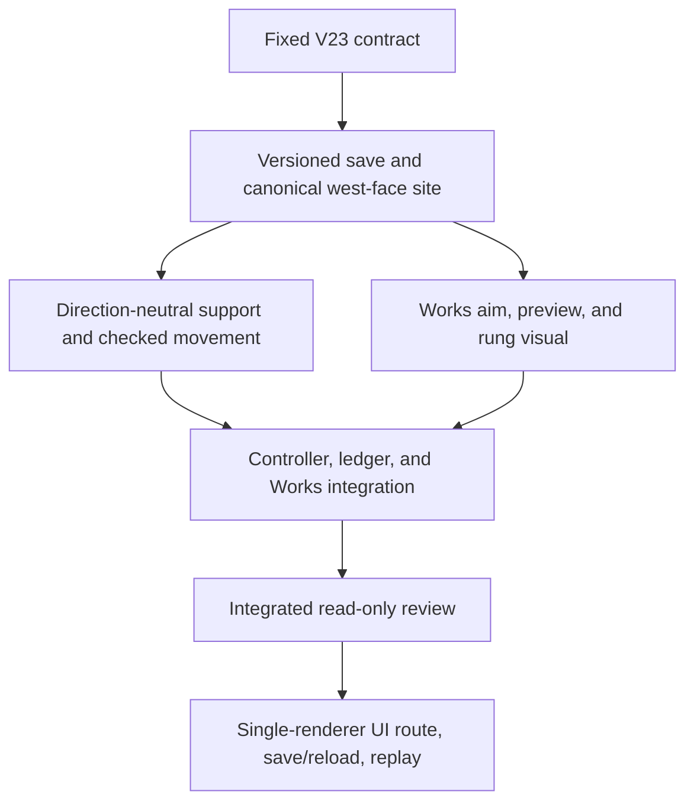

# V23 reusable ladder placement across a second cliff

## Outcome and scope

Turn the starter ladder from a Greenway-only demonstration into a reusable obstacle tool. The proof target is the existing west-facing Mireglass cliff, where a player should be able to aim a four-log ladder at more than one clear point on a discovered face, build it with a checked action, climb and descend on the actual rungs, save, reload, and repeat the route. This is one measured step toward material-driven building, not a claim that every mountain or arbitrary angle is buildable yet.

The existing `greenway-alpha` world provides a distinct target: the canonical grid site `works1:ladder:-103:108:W` rises from approximately (-412, 0.84, 432) to (-416, 2.40, 432). The fen approach, barrier, and climb are already exercised in `terrainWorks.test.ts`. Greenway's current Works ladder only slides along a north-facing cliff, so the second face must use the same principles without copying north-only movement or visual assumptions.

## Player journey

1. Reach Mireglass from the connected Greenway world and discover the west-facing cliff's lower and upper ledges.
2. Gather four logs and open Works. Select Ladder, aim at a clear portion of that face, and see a real rung ghost plus a specific readiness or rejection reason.
3. Confirm within reach of the lower foot. The checked action spends logs once, awards Construction XP once, and records a canonical ID, not client-supplied endpoints.
4. Walk into the lower foot and climb west along the supported face. Descend east by the same ladder. Adjacent bare cliff remains blocked.
5. Save and reload the same world. The structure, collision, inventory, XP, and traveled position must agree with checked replay. Older V17 saves remain loadable and unchanged until migrated under lock.

## Interface and ownership contract

- Keep V17 schema, rules profile, database, and strict validators immutable. Do not teach the V14 embedded terrain-work ledger to accept a new decimetre ID. Introduce a new versioned root/database with an additive regional-work ledger and a full validated V17 source receipt (save revision, nested lineage, state, and Greenway works).
- Use the existing `PUBLIC_V7_LOCK_NAME` for V23 inspect, promotion, frame, resume, and checked work. Within that lock, use `inspectPublicV17UnderLock`, never its public lock-acquiring wrapper. Commit V23 lineage and revision-zero head in **one V23 database transaction**. A valid V23 root is the promotion marker; no cross-database atomicity is claimed. If the target is missing and V17 is valid, offer migration; if both are missing, offer fresh; if V23 is malformed or partial, block rather than falling back. A retry with the same source receipt resumes the existing V23 root. A different receipt or target blocks.
- At every V23 entry and checked write, compare the under-lock V17 head with the V23 receipt. If V17 advanced, disappeared, or diverged after promotion, retain both roots and block automatic writes, rebase, or merging. A new-code V17 writer may voluntarily reject writes while a valid V23 root exists, but an older loaded V17 bundle cannot be fenced, so conflict detection remains required. A failed V23 transaction leaves V17 intact and recoverable.
- The new site ID is an obstacle-keyed, canonical snapped placement token. The pure resolver uses only world seed, obstacle key, and snapped placement coordinate. It recomputes endpoints, support path, footprint, costs, and terrain blockers. Separate current-state validation checks discovery, approach, occupancy against both old and new works, props, reach, inventory, and reward eligibility under lock. Reject unsupported spans, inaccessible feet, and forged IDs.
- For this first west face, use the proposed canonical grammar `works5:ladder:mireglass-slate:W:-103:<q>`, with a signed safe decimal integer `q`, no leading zeros or `-0`, and a 0.1 m tangent lattice (`z=q/10`). The finite valid range is `4306..4334`, subject to full-width terrain checks. In `greenway-alpha`, `q=4306` and `q=4334` must resolve as separate placements, while the adjacent `4305` and `4335` must reject because the guarded width touches a non-cliff row. The normal is west (decreasing X), tangent is increasing Z, lower foot is `(-412, 0.84, q/10)`, upper exit is `(-416, 2.40, q/10)`, and the steep face is between x `-413.675` and `-414.325`. General direction-neutral support uses `(normal, tangent, lower, upper, width)` rather than hardcoded X or Z comparisons.
- Keep `footprintTileIds` for full discovery coverage, but **not** as the sole occupancy authority. The two valid positions share the same four 4 m discovery tiles yet their guarded width strips, z `430.06..431.14` and `432.86..433.94`, do not overlap. The existing fixed 4 m ladder at z `432` is also physically separate. Checked conflict tests use oriented world-space support/corridor intersection against both the old and regional ledgers, with a 0.05 m clearance margin; they must permit the 0.32 m gap to the fixed structure and reject genuinely intersecting ones.
- A direction-neutral ladder face is defined by lower and upper support segment and a width perpendicular to travel. Movement samples progress along the segment rather than assuming decreasing Z. Existing north-facing Greenway behavior must remain byte-for-byte equivalent at its public interface.
- Scene meshes orient from the canonical support path. Rungs are open and steep, not a horizontal deck; approach cues stay on dry reachable ground. No new renderer, asset dependency, or collision authority in the view.
- Works aim follows the obstacle face, not a hardcoded Greenway plane. Preview reveals only fully discovered footprints. Keyboard, touch, and pointer/reticle paths share the same canonical choice and checked confirmation. Confirmation rechecks full-footprint discovery, a grounded lower-foot reach, terrain and prop support, non-overlap, four logs, and not-already-built against the latest head. One checked transition spends logs and awards XP once. Replay verifies the complete inventory, XP, position, and ledger result. Materials and general obstacle discovery come later.
- Preserve all existing Greenway bridge, ladder, dig, gait, map, and checkpoint behavior. Do not move the player across a barrier by shortcut or relax unrelated collision.

## Ticket graph

### V23-A: Persistence and canonical site

Own the new root/lineage/migration and regional site resolver, plus deterministic accounting and replay primitives. Validate exact saved shapes, strict ID ordering/limits, canonical seed-ground re-resolution, world-space occupancy, and XP/inventory accounting. Prove fresh start, V17 migration, stale source rejection, failed write recovery, and replay. Do not edit V17 validators or its database. The output interface for other lanes is a typed resolved site with `from`, `to`, `supportPath`, local normal/tangent, guarded world-space corridor, discovery footprint, cost, benefit, and canonical ID. Test both valid q values and the two adjacent invalid values above against canonical terrain, including the 0.05 m clearance and 0.32 m gap, before B/C begin.

Model routing: `planner_selected`, GPT-6 Astra via native subagent, with repository and test access. Review focus is exact save/replay lineage, under-lock migration, and canonical site geometry. If the live native catalog cannot provide that model, use a capability-equivalent available model without relaxing these checks.

### V23-B: Physical traversal

Consume only the V23-A resolved site and persisted built IDs. Generalize the face-support calculation to a segment-local coordinate system, covering north and west orientations. Prove unsupported west cliff rejection, supported climb and descent, no side-entry or adjacent cliff bypass, and Greenway parity. Do not adjust the save schema or scene mesh in this lane.

### V23-C: Aim and presentation

Consume the resolved site and full-footprint discovery state. The same Works action should allow lateral placement along the west face and show a ghost, lower-foot marker, readiness/rejection, and upright rungs oriented toward the rise. Extend map/HUD guidance only enough to locate and use the new face. Do not change collision or save validation.

### V23-D: Runtime integration

Own the controller, Works preview/action wiring, active-head selection, and save/reload entrypoint that connect A, B, and C. Invoke A's accounting and replay primitives rather than editing A's writer modules in parallel. Keep the old V17 entrypoint available for source inspection; never silently choose a stale V17 head after promotion. Wire keyboard, touch, and pointer aim to one canonical ID. Check the selected V23 head and V17 source under the shared lock before confirmation, then replay and commit the single transition. Run a deterministic journey across promotion, placement, climb, save/reload, and stale-source conflict before visual review.

### V23-R: Review and proof

Review migration under lock, replay determinism, old-save compatibility, hidden-site leakage, direction signs, occupancy, costs and one-time rewards. Force an aborted promotion, a completion response lost after commit, duplicate promotion, stale V17 writes after V23 revision zero and a later revision, malformed V23 target, forged ID, and undiscovered confirmation. Run focused and full tests, TypeScript, production build, and a single-renderer UI journey on an isolated save: discover, aim, build, climb, descend, save/reload, repeat. Keep the user-facing preview available once the minimum safety gate passes; do not open parallel WebGL previews. Report any unreached step exactly.

## Boundaries and delivery

V23-A may proceed as isolated additive groundwork after V22's unit and production-build gate while its single-renderer route proof continues. Hold V23-B, C, and D integration until the V22 live bridge/dig journey passes or an observed V22 defect is repaired. This pack is one cohesive future merge unit. No commit, push, PR, or production deployment is authorized here. Use `ben/` if a new branch is later requested, and use only the Bioscopics GitHub identity for any eventual game-repo action. The full RPG goal remains active after this obstacle slice.
