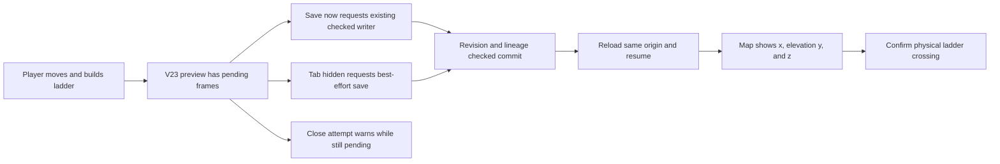
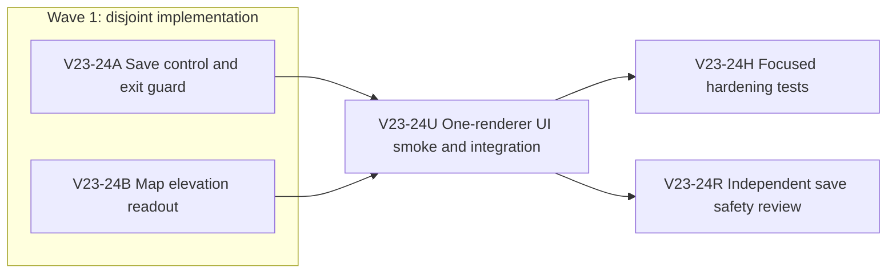

# Ticket Pack: V23 Travel Save And Ladder Proof

## Summary

The full Wizard Realms goal remains a connected, persistent, third-person RPG. This pack closes one first-region reliability gap: a player must be able to checkpoint traveled position deliberately before closing the tab, and the map must expose elevation so a ladder climb and descent can be verified in the real UI. It is not a campaign-completion claim.

Original ask: Build the complete single-player wizard RPG with persistent exploration, route construction, save/resume, and proof of the first expanded region.

Aligned problem statement: V23 records unsaved local frames and automatically checkpoints at 64 frames. The T206 tester moved after a completed save, closed the tab before another checkpoint, and resumed at an older position. The V23 controller currently offers no Save control or close warning. The map reports x/z but not y, leaving physical climb evidence indirect.

Goal status: aligned. Planner handoff: coding auto-planner, this pack. System translation: not_qualified, this is an ordinary game feature. Product agent runtime: not_required, the shipped game does not run a durable model agent.

Locked design:

- The V23 checked writer remains authoritative. Do not write travel to localStorage or bypass revision, lineage, replay, or lock validation.
- Preserve current automatic 64-frame checkpoints and the 128-frame cap. Do not alter V17 or older save schemas.
- A close warning and best-effort background save may reduce loss, but only a completed checked save is presented as durable.
- Keep one game renderer at a time. Preserve the existing dev preview and the tester's same-origin save.

Important repo truth:

- `PublicV23Controller.tsx` already owns `save()`, the checked save task, frame queue, and status overlay; `PublicV23ControllerRuntime.ts` exposes `pendingFrames` and `saveRevision`.
- `WizardMap.tsx` already prints the player's x/z from `projection.player.position`, whose y is available without a contract change.
- The checkout is dirty with unrelated and earlier Wizard changes. No lane may reset, clean, commit, push, or touch GitHub.

Success criteria:

1. A player can use a visible, accessible Save now control when V23 frames are pending; it calls the existing checked writer and visibly distinguishes saving, saved, and blocked outcomes.
2. A close attempt while frames are pending or a checked save is running warns of unsaved progress. Hiding the tab requests a best-effort checked save, without claiming success until the writer confirms it.
3. The map reports y elevation with x/z, enabling visible lower-foot, rung, and upper-foot comparison.
4. In a one-renderer browser journey, move on a built ladder, Save now, reload the same origin, and confirm x/y/z and the built ladder persist. A failed write must remain blocked, never represented as saved.

Non-goals: new save schema, localStorage journal, general performance refactor, new construction types, PR creation, GitHub mutation, full campaign completion.

Open questions: none outcome-determinative. Browser close-dialog presentation varies by platform; the acceptance contract is installing the guard and proving desktop behavior, not promising a mobile dialog.

Implementation risks: a long checked save can overlap buffered input; never discard or silently replay accepted input. A beforeunload handler must not claim asynchronous writes completed. Automated UI validation must not disturb the user-facing preview or start another local renderer.

## Proposed Flow

## Public Interfaces

- Add one V23-only Save now button and save state copy in the existing controller overlay. No shared `WizardViewIntent` or domain schema change.
- Extend the map's existing player-location sentence to include `elevation <y> m` rounded like x/z. The map projection contract stays unchanged.
- Use the browser's standard `beforeunload` guard while frames, queued input, a checked action, or the V23 save task remain unsettled. Attach a `visibilitychange` listener that calls the existing `save()` when hidden and pending.

## Lane Graph

## Topology Audit

- Productive lanes: A owns V23 controller save UX; B owns map elevation. They are incomparable and touch disjoint files. U consumes the combined browser build. H protects the observed behavior. R independently checks save claims and lost-input risk.
- Maximum safe parallel width: 2 implementers, later 2 validation lanes. One renderer is used only by U.
- Serial edges: A+B to U require integrated output; U to H/R requires the observed surviving behavior and revision-bound UI evidence.
- Certainty: A closes deliberate checked-save access, B closes elevation observability; U distinguishes actual persistence from mere UI state; R tests whether the save guard overclaims durability.
- Surprise triggers: missing save after successful UI confirmation, input loss, stale source acceptance, map height not matching position, or warning shown after durable save. Stop and replan if a schema or lower-layer writer change becomes necessary.
- Conditional repair: only a bounded defect owned by A or B may return to that lane under the observed-failure loop. New schema or runtime work requires a new pack.
- Dispatch verdict: PASS. The two productive lanes are independent, narrow, and converge at U.

## Tickets

Paste now to: Implementer A
Ticket: V23-24A
Lane type: Parallel. Delivery phase: implementation. Milestone: pre_surface, then SURFACE_READY at U.
Role lock: Your role is "implementer" ONLY. Read `auto-planner-ticket-pack` and `smallest-viable-diff` completely before action. Follow `/Volumes/git/weave-agents/AGENTS.md` prose preferences and preserve the dirty checkout. Do not spawn workers.
Transport: native_spawned_subagent; model: inherited; Cursor runtime: not_applicable; existing task routing: not_authorized; user-authorized Codex task coordination: not_authorized; no-interruption: not_applicable; task receipt: not_applicable; fallback: none. First contact: this ticket in native spawn. Follow-up: same child session. Agent spec: narrow V23 save UX implementer. Runtime choice: existing checked writer is understood; no specialist model or external agent is needed.
Branch/worktree: `ben/wizard-playable-v2`, `/private/tmp/pa-wizard-playable-v2`. No branch change or commit.
Own only `games/wizard-realms/engine/src/PublicV23Controller.tsx`. Do not edit tests before U or touch writer/schema modules, map, or shared contracts.
Required behavior: expose a V23-only Save now button when `pendingFrames > 0`; disable during save/block, show honest saving/saved/blocked notice from existing result; attach a beforeunload guard while pending or saving; on visibility hidden, request `save()` best effort only if pending and not already saving. Preserve input queue behavior and existing automatic checkpoints. No new dependency.
Smallest viable diff: target one file, under 45 net new lines, zero new files/dependencies. Reuse local `save()`, status, notice, and V23 CSS. Prompt/config cannot solve deterministic browser-exit behavior. Delete/simplify any duplicated save-state copy added by this lane. Tripwire: any shared contract/schema or >5 files requires planner reapproval.
Shortest user flow: move, Save now, wait for saved notice, reload, resume. First-feedback evidence: build compiles and button is present; U owns rendered proof. Test writing: prohibited until U. Visual proof: required at U. Review blocker: false saved state or input loss. Validation: `npx tsc --noEmit` in the engine; no broad suite or renderer. Surface availability: keep current 5193 preview up; U uses isolated tester machine. Environment repair authority: none; stop after first external failure plus one documented retry. Optional-feedback wait: never.
Return: exact diff/files, net lines, reuse/deletion/tripwire receipt, command output, no out-of-scope touch, child ID, and revision-bound readiness. No PR.

Paste now to: Implementer B
Ticket: V23-24B
Lane type: Parallel. Delivery phase: implementation. Milestone: pre_surface, then SURFACE_READY at U.
Role lock: Your role is "implementer" ONLY. Read `auto-planner-ticket-pack` and `smallest-viable-diff` completely before action. Preserve the dirty checkout. Do not spawn workers.
Transport: native_spawned_subagent; model: inherited; Cursor runtime: not_applicable; existing task routing: not_authorized; user-authorized Codex task coordination: not_authorized; no-interruption: not_applicable; task receipt: not_applicable; fallback: none. First contact: this ticket in native spawn. Follow-up: same child session. Agent spec: map projection implementer. Runtime choice: exact one-line map surface and available y data favor inherited native worker.
Branch/worktree: `ben/wizard-playable-v2`, `/private/tmp/pa-wizard-playable-v2`. No branch change or commit.
Own only `games/wizard-realms/engine/src/view/WizardMap.tsx`. Do not edit controller, contracts, tests before U, or terrain/collision.
Required behavior: include the existing player position y as `elevation <value> m` in the map's x/z location sentence, using the same one-decimal formatter. Keep the existing map shape and discovery behavior.
Smallest viable diff: one file, under 5 net new lines, zero new files/dependencies. Reuse `projection.player.position` and `at()`. A prompt/config change cannot expose a missing coordinate. No obsolete code should remain. Tripwire: any new contract or >5 files requires planner reapproval.
Shortest user flow: open map at lower foot, rungs, and upper ledge; read x/y/z. First-feedback evidence: map renders y; U owns screenshot. Test writing: prohibited until U. Visual proof: required at U. Review blocker: incorrect or hidden y. Validation: `npx tsc --noEmit` in the engine. Surface availability: keep 5193, test remotely. Environment repair authority: none. Optional-feedback wait: never.
Return: exact diff/files, net lines, reuse/deletion/tripwire receipt, command output, child ID, no out-of-scope touch, and revision-bound readiness. No PR.

Wait for A and B, then run: V23-24U
Lane type: Dependent integration and early-smoke UI evidence. Do not mutate code unless a narrow observed product failure routes to its owner. Use the already-authorized Wizard Realms Grok tester on its separate machine with one renderer, same-origin saved world, and a verified build hash. Prove a real Save now, reload, x/y/z equality, and ladder persistence. Record screenshot paths, console/trace status, and the first blocker. Keep local preview available and close tester tab afterward. No tests before this gate.

Wait for U, then paste to: Hardening H
Ticket: V23-24H. Role: implementer ONLY. Own only `PublicV23ControllerInput.test.tsx` and `view/WizardMap.test.ts` after the integrated UI journey advances. Add focused assertions for Save now/guard, pending versus saved versus blocked, and elevation text, then run those focused Vitest files, TypeScript, build, and diff check. No runtime or writer edits. Transport: native_spawned_subagent, inherited model, no fallback. Return full smallest-diff and validation receipt.

Wait for U, then paste to: Reviewer R
Ticket: V23-24R. Role: reviewer ONLY. Read-only review of the integrated A+B diff, targeting false durability claims, queued input behavior across save/map/close, listener cleanup, and map y source. Report severity findings, Smallest Viable Diff GO/NO-GO, and residual proof gaps. Transport: native_spawned_subagent, inherited model, no fallback. Do not edit files or run a renderer.

No PR finisher: no PR or GitHub action was requested for this continuation. Direct orchestrator integrates accepted receipts and moves to the next full-game pack.

## Assumptions

- The current checked V23 writer and database lineage remain the only durability authority.
- The tester's save on its separate machine is test data, but must still be preserved, not reset.
- A browser may not complete an asynchronous save at page close; the UI must not claim otherwise.

## Current receipt (2026-10-09)

- A and B landed in the shared dirty checkout. The first review found that the saved notice disappeared within the next 50 ms frame and that the exit guard missed checked actions and queued input. A repaired both in its owned controller file; the independent read-only reviewer then returned GO for those code-level concerns.
- H passed 38 focused controller tests, 13 map tests, TypeScript, and the production build. These prove the controls and guards at their test boundary, not a ladder crossing.
- U completed a one-renderer local UI smoke on `http://127.0.0.1:5193/?publicWorld=v23`: create V23, walk from x 0.0, z 0.0, elevation 1.0 m to x 0.0, z -1.0, elevation 1.0 m; use Save now; close the sole game tab; reopen the same origin; observe validated V23 save #29; resume and read the same x/y/z in the map. No browser errors affected the journey. Both map states were visually captured in the browser tool, and the tab was closed afterward. System free-memory percentage returned to 47% after closing.
- U then completed success criterion 4 in one additional local game tab at a time. From the saved x 0.0, z -1.0 state, the player equipped the axe, chopped a Greenway oak twice to obtain four logs, moved to x 1.2, z -3.4, selected the ready North cliff ladder at x 1.1, z -4 in Works, and confirmed a checked build that spent four logs and granted 60 XP. Facing north between the rails, W moved the player from x 1.2, z -4.2, elevation 1.3 m through x 1.2, z -5.8, elevation 2.5 m to x 1.2, z -8.2, elevation 2.9 m. Save now showed `Saving progress…`, then a checked saved notice. After closing the only renderer and reopening the same origin, validated save #67 resumed at x 1.2, z -8.2, elevation 2.9 m with one built route and the same ladder coordinates. S descended to x 1.2, z -5.2, elevation 1.3 m; Save now completed again. A second close/reopen yielded validated save #71 with that lower pose and the ladder still built. The final browser console had no errors and two nonblocking Three.js warnings (duplicate import and deprecated Clock). The upper-ledge, map, and final resumed-lower-foot views were captured inline in the browser tool. Every local test tab was closed afterward. This closes the V23 save-and-ladder pack, not the full Wizard Realms goal.

## Follow-on first-region probe, incomplete

- A later one-renderer attempt resumed validated V23 save #113 with the built north ladder, learned Wayfinder Glow, owned field spade, and 102 coins. Equipping the axe and completing four checked oak chops produced eight visible logs and advanced the field objective from `chop 8 more logs` to `B, 1, aim at a discovered dry crossing, F`. This is a UI observation of gathering, not bridge or dig completion.
- The map showed the discovered bridge's dry feet at x 0.0, z 4.0 and x 0.0, z 12.0 m. It also showed one revealed far-bank dry-loam patch at x 4.0, z 12.0 m with spade, capacity, beside-the-patch, and Works instructions. The player moved from x 5.6, z 1.6 to x 3.3, z 5.1 on the near bank. The browser tab then disappeared during a further movement wait, before bridge construction. Do not infer the cause or claim a saved final position; resume and inspect the validated head before retrying.
- The browser reported no remaining game tabs afterward. System free-memory percentage was 38%. No second renderer was opened. Focused renderer-free tests passed 36/36 across V17 Greenway work, starter movement, V14 actions, and V23 controller runtime. These do not replace the missing UI bridge, dig, return-trade, and save/resume proof.

## Follow-on bridge and dig UI receipt, partial

- A fresh one-tab attempt resumed validated V23 save #134 with the eight logs preserved. From x 1.4, z 5.9 on the north creek bank, Works selected the fully discovered `works4:bridge:greenway-creek:0` at x 0, z 4 with a Ready preview. UI confirmation returned `Build saved: works4:bridge:greenway-creek:0. 8 logs spent, 80 XP.` The map then reported two saved bridge-or-ladder structures.
- The map's dry-bank instruction led the player to x 0.1, z 3.0, inside the bridge lane. Walking south moved the character through x 0.4, z 4.9 and x 0.5, z 8.4 on the deck to x 0.5, z 11.3 on the far bank. The map changed from north/shop-bank advice to south/far-bank advice and displayed revealed dry-loam choices at x 4, z 12 and x 0, z 16. This is direct UI evidence of the supported crossing, not yet a reload proof.
- Equipping the spade at x 0.5, z 11.3 was rejected `unavailable_here`; after walking fully clear of the bridge to x 0.6, z 13.2, the same equip action succeeded. Works Dig selected the x 0, z 16 bank patch 2.85 m away and reported Ready, including the one-stone and 30-XP outcome. Two browser-control click attempts timed out **before command dispatch**. No `Dig saved` message or stone was observed. Browser error/warning logs were empty. The sole preview tab was closed, and system free-memory percentage rose to 51%.
- On retry, first inspect the validated saved head for the bridge, far-bank position, and spade. Then use the already-visible Ready dig from a dry stance, verify the stone and lowered tile, return across the same bridge, sell at Outfitters, save, close, and reload. Do not count the unexecuted confirm click as a gameplay rejection or infer that the final traveled position was saved.

## Greenway full-loop UI closure

- The next one-tab retry resumed validated V23 save #172 at x 0.6, z 13.2 m with the bridge, built north ladder, equipped field spade, and zero dug cells preserved. Works Dig selected the x 0, z 16 bank patch as Ready. Pressing F produced `Dig saved: works3:dig:0:4. 1 stone gained, 30 XP.` The backpack visibly gained one Stone, Excavation advanced to Lv2, and the map displayed a lowered-ground marker.
- The player returned over the same deck from the south/far bank via x 0.0, z 10.1 and x 0.4, z 5.9 to the north/shop bank at x 0.6, z 3.0. At Greenway Outfitters, the visible `Sell all 1 Stone for 1 gold` action committed: coins changed from 102 to 103, the Stone disappeared from the backpack, and the UI reported `store item sold`.
- Save now completed at the shop-side pose x -3.3, z -1.6 m. After closing the sole tab and reopening the same origin, the entry validated V23 save #191. Resuming showed 103 coins, no carried stone, Wayfinder Glow learned, Excavation Lv2, field spade still equipped, x -3.3, z -1.6 m, and the map's saved local works count of two bridge-or-ladder structures plus one dug cell. The UI displayed `Greenway works complete`. Screenshots of the completed-loop map before and after reload were captured inline by the browser tool. No game tab remained afterward; system free-memory percentage was 55%.
- This closes the Greenway mechanics loop at the real UI boundary. It does **not** close the broader expanded-region gate: Mireglass's distinctive traversal, second route, seal-cache dig, herb return, trade, save/resume, and independent playtest remain to be proven.

## Mireglass entry probe and integration finding

- A source audit of the current V23 path found that streamed territory delegates to `PublicV14WorldView`, which exposes no Mireglass marker, resources, store, ring, or seal-cache action and marks ordinary actions unavailable. V23 can traverse streamed terrain and use saved terrain Works, including its west-facing Slate ladder, but cannot yet complete the Mireglass expedition through this public entrypoint. The separate older Mireglass route is not proof of V23 parity.
- One temporary V23 browser tab resumed validated save #192 at x -3.3, z -1.6 m with 103 coins. At Greenway Outfitters, buying Leather boots changed coins to 78 and added the boots; equipping them showed `Run now in leather boots` and the boots in the Feet slot. Both were checked actions that displayed purchase/equip receipts. A subsequent westward turn had pending travel. Browser-control commands for a further map close and then `Save now` timed out before dispatch, so no marker visit or final deliberate save is claimed.
- The sole tab was closed, with no in-app game tabs remaining. Live system free-memory percentage was 58% before the renderer, 44% during it, and 47% immediately after closure. No other app or browser window was closed. Before any new V23 UI journey, resume the checked save and verify the boots and coins; do not infer that the unsaved bearing change survived.
