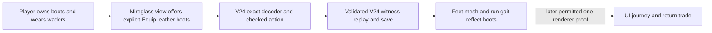
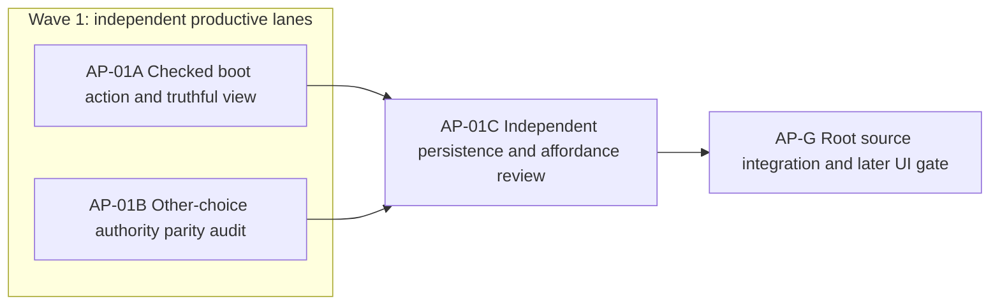

# Ticket Pack: V24 Mireglass action parity

## Summary

The [aligned understanding](V24_ACTION_PARITY_UNDERSTANDING.md) identifies a concrete Mireglass gear dead end: the view lists leather boots but V24 cannot equip them. Enable this existing owned gear action through checked authority and replay, while independently auditing all other V24 choice/view seams for the same failure class. This advances, but does not complete, the full Wizard Realms goal.

Goal status: aligned by the active full-game goal. System translation: `not_qualified`. Product agent runtime: `not_required`. Pack state: `ready_to_dispatch`. Expected PR units: one possible action-parity unit; no PR is requested.

Locked design:

- Keep V23/V24 database names, root schemas, source receipts, replay, shared lock, strict transaction and CAS, old witness behavior, current save data, movement, and simulation cadence unchanged.
- Only explicit gear intent can equip boots. Generic E must never buy, sell, equip, or cast. Rejection is identity-preserving.
- Existing `allowV11LeatherBoots` in `applyMireglassExpeditionAction` is the only underlying rule switch; do not duplicate gear logic.
- One renderer total. The earlier browser tab crashed and its browser-control protocol forbids inspecting it through an alternate surface. Do source work only until a permitted/manual reload makes real UI evidence available. Do not call HTTP 200 a browser pass.
- No commit, push, PR, GitHub account use, dependency, or unrelated process change.

Important repo truth:

- `MireglassEquippableItemId` already includes `leather_boots`; `applyMireglassExpeditionAction` permits them only when its final `allowV11LeatherBoots` argument is true.
- Both `projectPublicV24Mireglass` and `applyPublicV24MireglassAction` call that rule without the opt-in. The V24 exact request decoder separately excludes boots. `PublicV24MireglassView.test.ts` currently pins the disabled choice.
- V24 remains a validated V23-source successor. The current public V23 route is reachable on port 5193, but current browser gameplay proof is not available.

## Proposed Flow

## Public Interfaces

No URL, save shape, schema string, or required API changes. The existing V24 witness `{kind:'mireglass-action/v1', action:{type:'equip_item', itemId:'leather_boots'}}` becomes an accepted exact request when boots are owned, not worn, and the player has a grounded streamed pose. `checkedEquipmentChoices` marks that exact option actionable. Existing equip rejection reasons remain the source of disabled copy.

## Lane Graph

## Topology Audit

- Productive-lane inventory: A changes one bounded gear behavior across authority and its existing view. B produces a bounded independent evidence matrix for every other V24 action category and the grounded-pose guard, without changing live files.
- Maximum parallel width: two. `AP-01A || AP-01B`: B excludes boots from its verdict and needs no A output; A owns only the boots behavior. B's read-only source access cannot conflict with A's writes. Both receipts converge at C.
- Broad-lane split: A is one gear contract with one checked action path and one view; B is one mismatch audit. Neither owns general Mireglass gameplay, travel, or save optimization.
- Certainty: A's deterministic action/view/replay tests close the source boot semantics only. B uses reasoning closure over the displayed choice constructors, exact decoder, and checked pose/authority to identify mismatches tests may miss. Stop at a complete action-category matrix. Surprise trigger: a new false-actionable choice or a V24 old-root decode failure requires a new repair decision.
- C supplies independent findings-first review for old-save replay safety and view/authority parity. D compares current test and reviewer receipts, keeps the preview available, and retains the browser gate as `unproven` until allowed.
- Serial edges: A and B to C consume their distinct diff/evidence receipts; C to D consumes its GO/NO-GO and residual risks. No conditional repair ticket is preauthorized; a newly found mismatch returns to Planner mode.
- Reviewer required because V24 checked witness acceptance and view behavior cross persistence/UI boundaries. PR finisher omitted because no PR or GitHub action was requested. Dispatch verdict: `PASS`.

## Tickets

### Paste now to: Implementer AP-01A

Ticket: AP-01A. Lane type: parallel. Delivery phase: `pr_hardening`, because a V24 route and earlier smoke already exist. Delivery milestone: `pre_surface` for this revision, not a new browser-ready claim. Shortest flow: own boots, wear waders, select Equip leather boots, observe saved feet item and replay. First feedback: focused source test output and exact diff, not a screenshot. Test-writing policy: `pr_hardening_required`. Visual proof: required for the rendered equipment choice, but blocked by the current crashed-browser protocol until a permitted one-renderer reload; report it `unproven`. Review BLOCK_NOW: false actionable choice, invalid witness acceptance, old root loss, or altered generic E. Existing port 5193 stays available. Validation environment: existing local Vite and source tests; no environment repair authority, stop after a confirmed external failure plus one documented retry. Optional-feedback wait: never.

Role: `implementer` ONLY under `auto-planner-ticket-pack`, `smallest-viable-diff`, and `test-from-ui` applicability rules. Transport: `native_spawned_subagent`, model `inherited`, Cursor runtime `not_applicable`; existing durable-task routing `not_authorized`. Reuse completed native V24 source worker with recent matching save/action context if still safe, otherwise use a fresh ephemeral child. Shared checkout custody is safe only for these owned files. No interruption. Fallback transport: `none`. Do not start a browser or a second renderer. Branch/worktree: `ben/wizard-playable-v2` at `/private/tmp/pa-wizard-playable-v2`.

Change only:

- `games/wizard-realms/engine/src/domain/publicWorldV24MireglassAction.ts`
- `games/wizard-realms/engine/src/PublicV24MireglassView.ts`
- `games/wizard-realms/engine/src/domain/publicWorldV24MireglassAction.test.ts`
- `games/wizard-realms/engine/src/PublicV24MireglassView.test.ts`
- `games/wizard-realms/engine/src/domain/publicWorldV24Snapshot.test.ts` only if the existing action test cannot directly assert witness replay and old-root decode.

Accept an exact `equip_item/leather_boots` V24 request, pass the existing opt-in true in the checked adapter and view's prospective rule call, and keep all other request/pose/gear behavior unchanged. In tests, prove owned boots after waders are actionable, commit into `feet`, are rejected when already worn/unowned/airborne, and do not advance tick or RNG. Prove an old V24 root still decodes and a new exact boot witness replays. Update the currently disabled view test rather than adding a duplicate. Do not edit `mireglassExpedition.ts` or a save decoder's shape contract. Preserve generic E exclusions.

Acceptance commands from `games/wizard-realms/engine`: `npx vitest run src/domain/publicWorldV24MireglassAction.test.ts src/PublicV24MireglassView.test.ts src/domain/publicWorldV24Snapshot.test.ts --maxWorkers=1`; `npx tsc -b --pretty false`; `git diff --check`. Browser final proof remains blocked and must be reported, not silently replaced.

Return: exact changed files/net lines, reuse scan, removed/simplified code, key diff, old-root/replay/pose/explicit-action evidence, command outputs, tripwires, candidate one-unit diff, no out-of-scope touches, native child/session ID and continued-session status, no fallback, source-only proof limit, and revision-bound server URL. No GitHub action.

### Paste now to: Implementer AP-01B

Ticket: AP-01B. Lane type: parallel. Delivery phase: `pr_hardening`. Delivery milestone: `pre_surface`. Shortest flow: for each non-boots Mireglass choice that the view labels actionable, check whether its exact request and current state pass the checked V24 adapter. First feedback: a category matrix with exact file/line evidence and an actionable mismatch list. Test-writing policy: no repository tests in this read-only lane. Visual proof: not applicable, no rendered edit and no browser access. Review BLOCK_NOW: any displayed actionable choice that the checked authority rejects under the same pose/progress, or a valid checked choice hidden without a deliberate rule.

Role: `implementer` ONLY, evidence/artifact lane under `auto-planner-ticket-pack` and `smallest-viable-diff`. Transport: `native_spawned_subagent`, model `inherited`, Cursor runtime `not_applicable`; existing durable-task routing `not_authorized`. Reuse completed native V24 projection worker with recent matching view context if still safe, otherwise use a fresh ephemeral child. Read-only custody, no interruption, fallback `none`. Branch/worktree as A; no live file edits, browser, build, server, or GitHub actions.

Audit only `PublicV24MireglassView.ts`, `PublicV23Controller.tsx` choice dispatch, `publicWorldV24MireglassAction.ts`, `mireglassExpedition.ts`, and their current focused tests. Exclude leather boots from the verdict because A owns it. Enumerate study, ring discovery, chop, stump, forage, cache dig, Glow, buy, sell, axe/spade/waders equip, plus airborne pose. For each, list view gate, exact decoder gate, checked result gate, generic versus explicit routing, and whether the displayed actionable state can be falsely positive or negative. Stop after a decision-sufficient matrix; report `NO-GO` with the smallest observed owner if any mismatch exists. Do not propose schema or scope changes on your own.

Acceptance: source/fixture inspection only, no command required beyond targeted source reads. Return matrix, concrete mismatches or none, file/line evidence, uncertainty, no-files-changed receipt, native child/session ID, no-browser/no-GitHub confirmation, and candidate follow-on repair owner if needed.

### Wait for AP-01A and AP-01B, then paste to: Reviewer AP-01C

Role: `reviewer` ONLY under `auto-planner-ticket-pack` and `smallest-viable-diff`, read-only. Transport: `native_spawned_subagent`, model `inherited`, Cursor runtime `not_applicable`; durable-task routing `not_authorized`, no interruption, fallback `none`. Reuse completed native V24 persistence reviewer with recent matching context if still safe. Review the integrated changed files and both lane receipts, no edits, browser, renderer, server, or GitHub. Delivery phase: `pr_hardening`, milestone: `pre_surface`; final UI proof remains open.

Required findings-first review: (1) exact boot request and rejection safety, including old root decode and replay; (2) UI actionable/checked outcome parity and generic E exclusion; (3) B's other-choice matrix for omitted false promises; (4) SVD, reuse, deletion, tripwires. Return severity-ordered findings with file/line, explicit GO/NO-GO on each, coverage gaps, and a source-only verdict. A new mismatch is not automatically in A's scope: return the precise next owner to root. The reviewer must not call source tests browser proof.

### Wait for AP-01C, then: AP-G root integration and UI gate

Compare receipts to this pack, rerun focused tests only if integration invalidates A's test output, then run `npx tsc -b --pretty false` and `npm run build` if source GO. Confirm port 5193 remains reachable without creating another renderer. Real UI final proof requires one permitted visible journey with screenshot, inputs, console/network, and saved replay. The current crash-page protocol forbids using another browser surface as a workaround, so keep this gate `unproven` until a permitted/manual reload; neither HTTP 200 nor source tests may close it. If B/C finds an additional mismatch, return to Planner mode with a new bounded repair pack.

## Smallest Viable Diff

Behavior delta: owned boots can be explicitly re-equipped in V24 Mireglass with truthful affordance, checked replay, and no effect on other actions. Expected diff: 4 files, possibly 5 for replay test, under 90 net lines, zero new code files/dependencies. Reuse scan: `allowV11LeatherBoots`, existing exact V24 decoder, view `add`, current disabled-boots test, V24 snapshot replay test. Prompt/config/contract cannot authorize a checked equipment action while decoder and rule reject it. Delete/simplify the old disabled-boots assertion and any redundant local condition instead of adding a second gear path. Forbidden: V23/older code, save shape/DB, controller, renderer, package files. Validation: the focused commands above, independent source review, and later one-renderer UI gate. Tripwire: more than 5 files, more than 300 net lines, new abstraction/dependency, changed root schema/source behavior, or another actionable mismatch requires Planner re-evaluation.

## Assumptions

- The user-facing local server at `http://localhost:5193/?publicWorld=v24` remains available, but its current runtime behavior is not proven by a HEAD request.
- The worktree is heavily dirty and all pre-existing changes belong to the user. No lane may reset, clean, stage, commit, or push them.
- A finished source repair is progress toward the full-game objective, not completion of first-region UI proof, browser stability, or the campaign.
