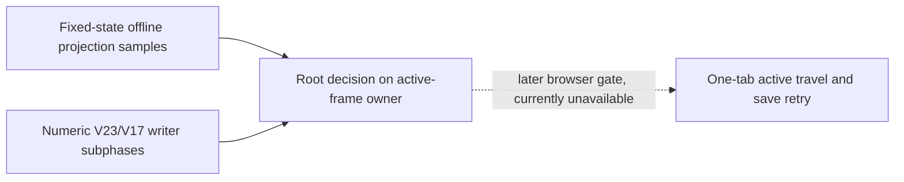
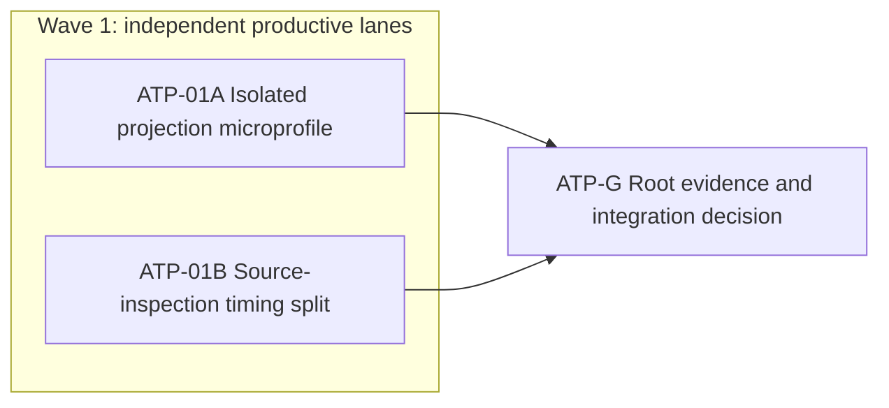

# Ticket Pack: V24 active-travel performance decision

## Summary

Original ask: finish Wizard Realms as a connected, playable single-player RPG. The
immediate user-facing constraint is that early play should be intuitive and smooth,
not a choppy or crashing preview. The public V24 save succeeded in prior one-tab
tests, but its 50 ms frame budget was oversubscribed, and the latest fresh-start
browser tab crashed. The idle-clock repair now passes source tests; it is not
proof that active travel or the crash is fixed. This pack identifies the next
bounded performance owner without guessing or weakening save safety.

Input spec: `GAME_DESIGN.md` requires a complete game and target-hardware
performance; `V24_MIREGLASS_INTEGRATION_PACK.md` records 43.9 to 50.8 ms browser
projection medians and a 534 to 626 ms combined V23/V17 source inspection.

Aligned problem: determine whether base projection or the Mireglass overlay is
the likely active-frame hot path, and make the checked-save source inspection
separable into V23 read, V17 inspection, and receipt comparison timings. These
are decisions toward the same full-game goal, not a narrower terminal state.

Goal status: aligned by the active goal. System translation: not_qualified.
Product agent runtime: not_required. No new game agent/model runtime is shipped.

Locked design:

- Keep the user-facing Vite server at port 5193 available. No worker opens a
  game renderer; the sole browser tab crashed and browser-control diagnostics
  for that crash are disallowed. Do not use another browser surface to bypass it.
- Do not change 50 ms simulation cadence, save schemas, V23/V17 live source
  validation, witness replay, CAS, or world behavior.
- Diagnostics contain only numeric durations. No seed, player state, save bytes,
  identifiers, URLs, or personal data in trace records.
- No GitHub action, commit, PR, dependency, or unrelated app process change.

Important repo truth: `PublicV23Controller.tsx` already emits opt-in
`baseProjectionMs` and `mireglassProjectionMs`, but no accepted browser sample
exists for those fields. `publicWorldV24Flow.ts` emits only one combined
`v23-v17-source-inspection` writer phase. `inspectPublicV23UnderLock` calls
`store.readChecked()` and then `inspectPublicV17UnderLock`, so those two owners
can be measured without altering authority. The V24 flow tests already assert
the exact phase list and fail-closed source drift.

Success criteria: one reproducible source-only projection microprofile with
separate V23 base and V24 overlay samples on fixed Greenway and Mireglass
fixtures, plus a source-safe new timing trace with focused tests. Neither alone
proves browser speed or crash recovery. The later one-tab browser gate remains
pending a permitted/manual reload.

Open question: the precise cause of the browser crash remains unknown. No
source-only result may be called a browser crash fix.

## Proposed Flow

## Public Interfaces

The existing optional V24 writer timing callback may report
`v23-checked-read`, `v17-source-inspection`, and
`source-receipt-compare` durations in addition to existing phases. The
existing `v23-v17-source-inspection` total remains. No required callback,
gameplay action, save field, or URL changes.

## Lane Graph

## Topology Audit

- Productive lanes: A creates a bounded empirical projection receipt in an
  isolated copy; B changes only the numeric writer trace and focused test.
- Maximum parallel width: 2. A has no live source ownership and does not
  consume B. B owns V23/V24 flow and its test, not projection.
- Fan-in: ATP-G compares source-only samples and timing shape to the prior
  browser baseline and chooses a later bounded repair or further measurement.
- Certainty: A tests the live branches base projection versus Mireglass overlay
  with a fixed-state discriminating probe; stop after 30 warm samples per
  fixture or if the fixture cannot model the real view. B closes whether the
  current combined writer span can be split without authority changes; stop
  when focused tests and TypeScript pass. Any phase callback changing write
  outcome is a surprise and NO-GO.
- Reviewer omitted: B changes only opt-in numeric callback data, with an exact
  trace-shape test; root checks its diff and invariant. PR finisher omitted:
  no PR was requested.
- Serial edges A to C and B to C consume their distinct receipts. Dispatch
  verdict: PASS. No artificial dependency joins the two lanes.

## Tickets

### Paste now to: Implementer ATP-01A

Role: implementer only under `auto-planner-ticket-pack` and
`smallest-viable-diff`. Transport: native_spawned_subagent, inherited model,
Cursor runtime not_applicable. Existing durable-task routing not_authorized;
reuse the completed native projection worker with recent matching context,
without interruption. Fallback transport: none. Branch: existing
`ben/wizard-playable-v2`; worktree: isolated engine copy, never live source.
Delivery phase: pr_hardening; milestone: pre_surface. Shortest flow: profile a
fixed Greenway view and a known Mireglass view through the same pure projection
calls used by `PublicV23Controller`. First-feedback evidence: numeric table,
not a browser screenshot. Visual proof: not_applicable, no rendered change.

Create only a temporary harness in an isolated copy. Reuse fixture construction
from `PublicV24MireglassView.test.ts` and the actual projection functions.
Measure 30 warmed calls each for V23 base and V24 overlay on a Greenway root and
a Mireglass marker or outpost position, with the same state objects reused
within a series. Report median, p95, and max in milliseconds, plus how many
visible and map tiles the fixture represents. A one-tile mock is not adequate
to explain the browser's 961-cell window; report that limitation explicitly or
use a real active window. Do not edit live source, change production caches,
run a browser, or leave a benchmark file in the game repository. If a faithful
active-window fixture is infeasible, return `UNRESOLVED` with the precise
missing seam instead of substituting a weaker speed claim.

Smallest viable diff: zero live files, zero live lines, no dependencies.
Prompt/config alternative: not applicable to deterministic projection cost.
Deletion target: remove temporary harness after recording the receipt. Tripwire:
any live source edit or second renderer stops this lane. Acceptance: fixed-state
30-sample table and exact command/runtime record; no gameplay assertion.
Receipt: isolated path, fixture construction, method, raw/summary samples,
limitations, decision, no live files touched, continued-session and transport.

### Paste now to: Implementer ATP-01B

Role: implementer only under `auto-planner-ticket-pack` and
`smallest-viable-diff`. Transport: native_spawned_subagent, inherited model,
Cursor runtime not_applicable. Existing durable-task routing not_authorized;
reuse the completed native source-inspection worker with recent matching
context, without interruption. Fallback transport: none. Branch/worktree:
`ben/wizard-playable-v2` at `/private/tmp/pa-wizard-playable-v2`.
Delivery phase: pr_hardening; milestone: SURFACE_READY is already on port 5193,
but no browser claim follows from this trace edit. Shortest flow: call the real
V24 checked writer with a trace callback and observe numeric subphases. First
feedback: focused test output and trace sample. Visual proof: not_applicable.

Change only `engine/src/domain/publicWorldV23Flow.ts`,
`engine/src/domain/publicWorldV24Flow.ts`, and
`engine/src/domain/publicWorldV24Flow.test.ts`. Add an optional, fail-safe
numeric phase callback to the existing V23 under-lock inspection. Measure its
checked V23 read and full V17 inspection separately. In V24, pass the optional
callback to V23, measure the final V24 source-receipt comparison separately,
and keep the original combined total. Emit new phases only when the existing
V24 `onPhase` is supplied. A callback throwing must not alter commit result.
Do not instrument V17 internals, alter the order or frequency of source reads,
skip validation, change root caching, or change non-V24 callers. Update the
existing exact-phase test and its finite/nonnegative numeric assertion; retain
source-drift and callback-throw regression behavior.

Smallest viable diff: 3 files, under 60 net lines, zero new files/dependencies.
Reuse scan: `inspectPublicV23UnderLock`, V24 `report`, current exact phase test.
Prompt/config alternative: impossible to split an unmeasured call without
timing its actual stages. Deletion target: none, the existing total is retained
for comparability. Tripwire: a fourth production file or gameplay/persistence
change returns to planner. Acceptance from `games/wizard-realms/engine`:
`npx vitest run src/domain/publicWorldV24Flow.test.ts` and
`npx tsc -b --pretty false`. Receipt: exact files/net lines, timing phase
example, unchanged root semantics proof, tests, diff rationale, no browser,
no GitHub action, transport/session proof.

### Wait for A and B, then: ATP-G root decision

Compare both receipts against the known browser observations without claiming
cross-environment equivalence. Review B's diff for timer callback isolation,
phase ordering, and no altered read/validation path. Run the targeted V24 flow
test only if integration changes invalidate B's result. Do not open another
browser surface to inspect the crashed tab. If manual reload later permits one
renderer, retry the exact V24 active-travel/save entrypoint and record the
opt-in numeric phases, frame behavior, errors, and memory before a repair.

## Smallest Viable Diff

Behavior delta: only opt-in diagnostic visibility, no game behavior change.
Expected live diff: 3 files, under 60 net lines, no new file or dependency.
Forbidden: state/snapshot/schema, movement, input, renderer, terrain, old save
bytes, caches, cadence, package files. Reuse: existing V24 timing callback and
flow test. Prompt/config cannot split actual runtime stages. Validation:
focused flow test, TypeScript, source review, later one-tab gate when allowed.
Tripwire: any gameplay edit or scope growth requires replan.

## Assumptions

- The Vite server on 5193 remains the user entrypoint; its HTTP 200 does not
  prove the crashed browser page works.
- The current heavily dirty checkout is user work. Neither lane resets,
  stages, commits, or cleans it.

## Wave 1 receipts and root decision

ATP-01A used an isolated engine copy and a fixed canonical active window,
then removed its temporary harness. Ten warm calls preceded 30 timed calls
per stage and fixture. The Greenway fixture had 256 active, visible, and map
tiles; its V23 base projection was 5.369 ms median and 5.839 ms p95, while
the V24 overlay was a no-op. The Mireglass fixture had 2,304 active and known
tiles, 961 visible terrain cells, and 1,089 map tiles. Its base projection was
1.933 ms median and 2.279 ms p95; its V24 overlay was 0.228 ms median and
0.262 ms p95. A second 30-sample run gave similar medians. This isolates the
larger pure-call cost in the V23 base projection, but its Node times do not
explain the earlier 43.9 to 50.8 ms browser projection. That browser-specific
gap remains unresolved. No live files or browser state changed in this lane.

ATP-01B changed only the V23 flow, V24 flow, and V24 flow test. Its optional
trace now reports V23 checked read, complete V17 inspection, and final source
receipt comparison before the unchanged combined total. Throwing timing
callbacks do not change a successful commit. The worker's focused V24 tests
(4), plain V23 tests (20), and TypeScript passed. Root re-ran the two suites
against the integrated live source: 24 tests passed. Source review found the
same V23-then-V17 read order under the V24 world lock, with unchanged live
validation, receipt comparison, witness replay, candidate preflight, and CAS.

ATP-G decision: accept the diagnostic change, but do not optimize the base
projection or source inspector from these samples alone. The Vite entrypoint
still returns HTTP 200 and system-wide memory was 76% free after source
validation. Neither fact proves browser recovery. The prior browser tab
crashed, and browser-control policy disallows using another surface to work
around that crash. A permitted manual reload and one-renderer trace are the
next discriminating browser gate; until then active-play responsiveness and
crash recovery remain unproven. This pack is diagnostic progress toward the
full-game goal, not completion of the first region or the game.
